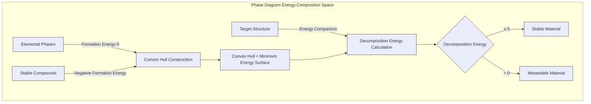
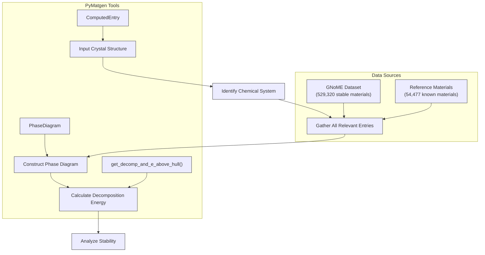
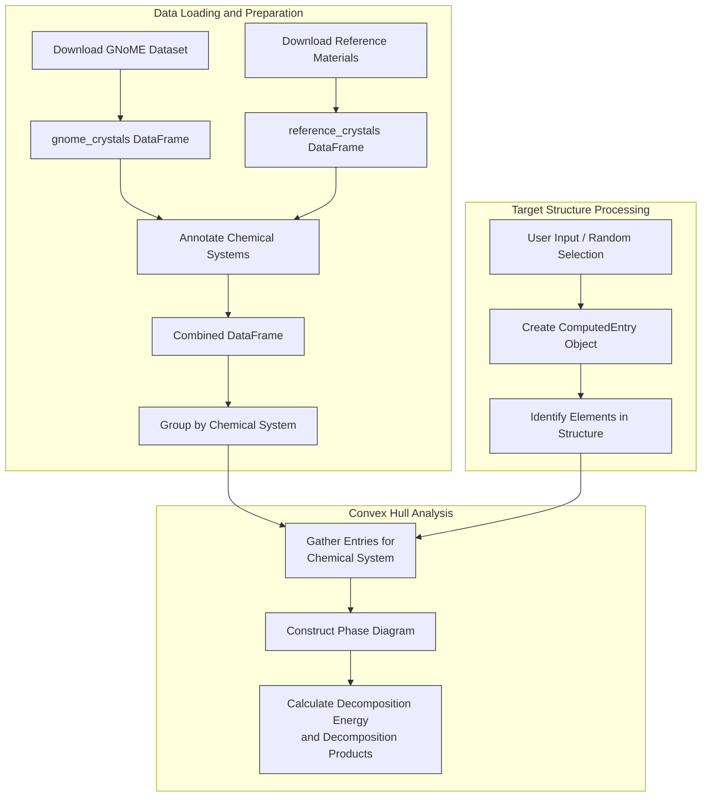
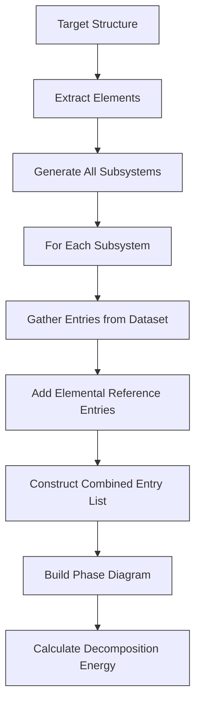

<!-- source: DeepWiki mcp.deepwiki.com · repo google-deepmind/materials_discovery · page 4.2 Computing Decomposition Energies · fetched 2026-10-26 -->

# Computing Decomposition Energies

<details>
<summary>Relevant source files</summary>

The following files were used as context for generating this wiki page:

- [notebooks/Compute_Decomposition_Energies.ipynb](notebooks/Compute_Decomposition_Energies.ipynb)

</details>


## Overview

This document explains how to calculate decomposition energies for crystal structures using the GNoME (Graph Networks for Materials Exploration) dataset. Decomposition energy is a crucial metric in materials science that quantifies the thermodynamic stability of a material relative to competing phases. It represents the energy difference between a structure and the most stable combination of other structures that have the same overall composition.

The `Compute_Decomposition_Energies.ipynb` notebook provides a streamlined way to determine whether a new material is stable or metastable by comparing it to the extensive GNoME database of stable materials.

Sources: [notebooks/Compute_Decomposition_Energies.ipynb:20-24]()

## Understanding Decomposition Energies

### Theoretical Background

In materials science, stability is often assessed by constructing a convex hull of formation energies across composition space. The convex hull represents the lowest energy states available to a system at different compositions. Materials that lie on the hull are considered thermodynamically stable, while those above it are metastable or unstable.

**Decomposition Energy** (also called "energy above hull" or "e_hull") is defined as the energy difference between a material and the convex hull at that composition. Mathematically:

- E_decomp = E_material - E_hull
- Negative or zero values indicate stable materials
- Positive values indicate metastable materials that may decompose into more stable phases

**Convex Hull Construction Visualization**



Sources: [notebooks/Compute_Decomposition_Energies.ipynb:1598-1615]()

## Decomposition Energy Calculation Workflow

The process of calculating decomposition energies involves several key steps:



Sources: [notebooks/Compute_Decomposition_Energies.ipynb:600-615](), [notebooks/Compute_Decomposition_Energies.ipynb:1547-1591]()

## Implementation Components

The implementation uses several Python libraries and data structures:

### Key Libraries and Classes

| Component | Purpose |
|-----------|---------|
| pandas | Data manipulation and preprocessing |
| pymatgen | Materials analysis and calculations |
| ComputedEntry | Representation of material with composition and energy |
| PhaseDiagram | Construction and analysis of phase diagrams |

### Data Preparation Process



Sources: [notebooks/Compute_Decomposition_Energies.ipynb:164-196](), [notebooks/Compute_Decomposition_Energies.ipynb:1433-1464]()

## Using the Notebook

### Option 1: Analyzing a Random Structure from GNoME

If no custom structure is provided, the notebook will randomly select a structure from the GNoME dataset and compute its decomposition energy:

1. The structure is selected using `gnome_crystals.sample()`
2. A ComputedEntry object is created with the composition and energy
3. The chemical system is identified
4. The convex hull is constructed
5. Decomposition energy is calculated

Sources: [notebooks/Compute_Decomposition_Energies.ipynb:1493-1512]()

### Option 2: Analyzing a Custom Structure

To analyze a custom structure:

1. Provide a chemical composition (e.g., "Li2O", "Fe2O3", etc.)
2. Specify the corrected energy value (in eV)
3. The notebook will create a ComputedEntry object
4. Identify the chemical system
5. Calculate the decomposition energy against the GNoME dataset

Sources: [notebooks/Compute_Decomposition_Energies.ipynb:1739-1758]()

## Chemical System Analysis

A critical part of the decomposition energy calculation is identifying the correct chemical system and all relevant entries:



The `gather_convex_hull` function performs these steps by:

1. Identifying all possible subsystems (combinations of elements)
2. Finding entries for each subsystem in the dataset
3. Creating ComputedEntry objects for each entry
4. Adding reference entries for pure elements
5. Returning a complete list for phase diagram construction

Sources: [notebooks/Compute_Decomposition_Energies.ipynb:1547-1576]()

## Interpreting Results

The notebook outputs two key pieces of information:

1. **Decomposition Energy**: The energy difference between the material and the convex hull
   - Negative or zero values: The material is thermodynamically stable
   - Positive values: The material is metastable and may decompose

2. **Decomposition Products**: The stable materials that would form if the metastable material decomposed
   - For stable materials, this will show the material itself
   - For metastable materials, this shows the mixture of stable materials that would form

### Stability Thresholds

The GNoME dataset uses a threshold of 1e-3 eV/atom to determine stability:

| Decomposition Energy (eV/atom) | Interpretation |
|-------------------------------|----------------|
| ≤ 0 | Thermodynamically stable |
| 0 < E < 0.001 | Effectively stable (numerical precision) |
| 0.001 ≤ E < 0.025 | Slightly metastable, may be synthesizable |
| 0.025 ≤ E < 0.1 | Moderately metastable, challenging to synthesize |
| ≥ 0.1 | Highly metastable, unlikely to be synthesizable |

Sources: [notebooks/Compute_Decomposition_Energies.ipynb:1673-1691]()

## Technical Implementation Details

### Data Structure 

The calculation relies on two primary datasets:

1. **GNoME Dataset** (`stable_materials_summary.csv`): Contains ~529,320 stable materials identified by GNoME
2. **Reference Dataset** (`external_materials_summary.csv`): Contains ~54,477 materials from other databases like Materials Project or OQMD

These are processed into pandas DataFrames with annotations for chemical systems:

```python
# Annotation of chemical systems
chemical_systems = []
for i, e in enumerate(crystals['Elements']):
  # replace single quotes with double quotes 
  chemsys = json.loads(e.replace("'", '"'))
  # provide chemical system in sorted order
  chemical_systems.append(tuple(sorted(chemsys)))
```

Sources: [notebooks/Compute_Decomposition_Energies.ipynb:1433-1443]()

### Convex Hull Construction

The phase diagram and convex hull are constructed using pymatgen's `PhaseDiagram` class, which:

1. Takes a list of `ComputedEntry` objects
2. Constructs a convex hull in composition-energy space
3. Provides methods to analyze the stability of materials

The `get_decomp_and_e_above_hull` method is then used to:

1. Calculate the decomposition energy of a target structure
2. Identify the decomposition products if the material is metastable

Sources: [notebooks/Compute_Decomposition_Energies.ipynb:1607-1608](), [notebooks/Compute_Decomposition_Energies.ipynb:1662-1662]()

## Conclusion

The `Compute_Decomposition_Energies.ipynb` notebook provides a powerful tool for evaluating the thermodynamic stability of materials against the comprehensive GNoME dataset. By calculating decomposition energies, researchers can:

1. Determine if a newly predicted or synthesized material is thermodynamically stable
2. Identify potential decomposition products for metastable materials
3. Screen computational predictions before experimental synthesis
4. Compare stability across different computational methods

This tool integrates seamlessly with the broader GNoME framework for materials discovery and characterization, complementing other analysis notebooks in the repository.

---

