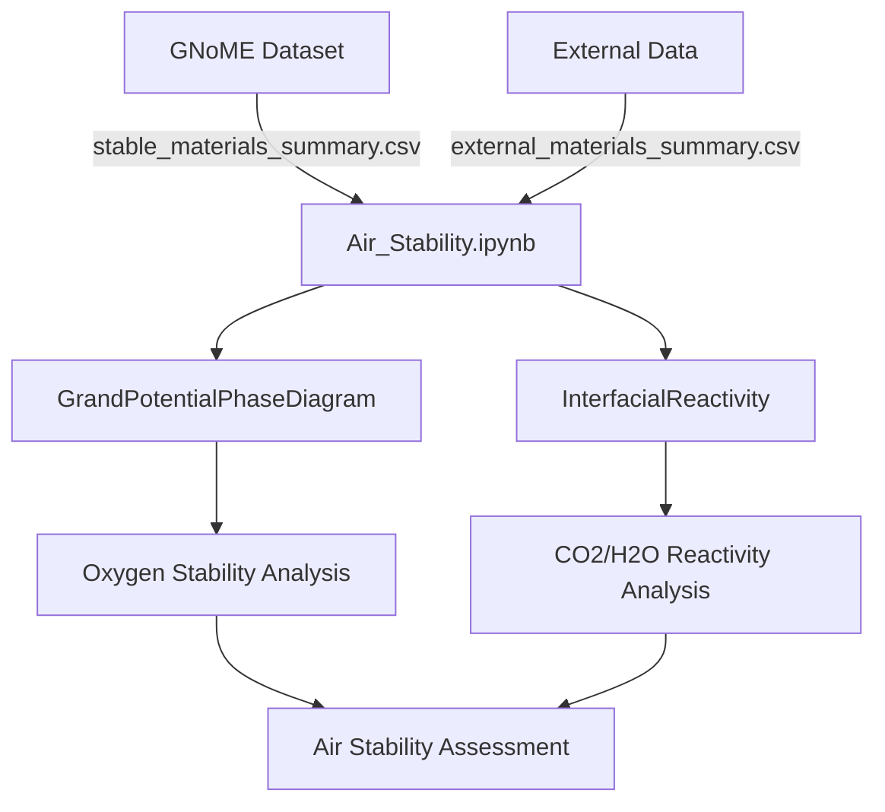
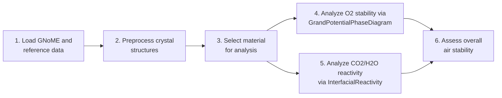
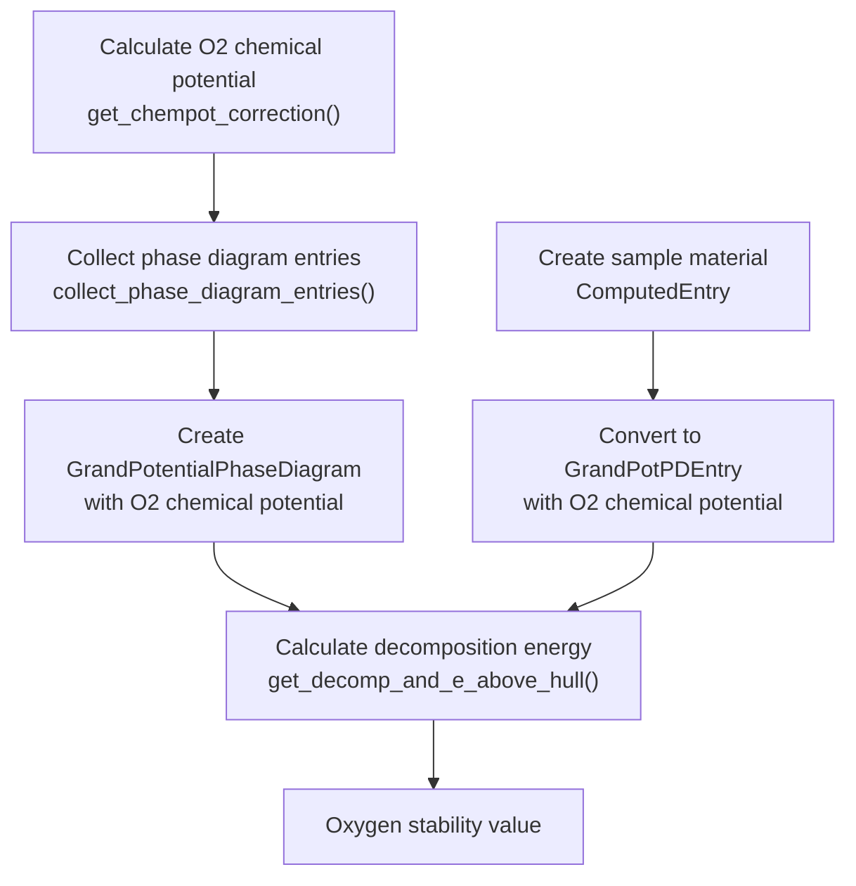
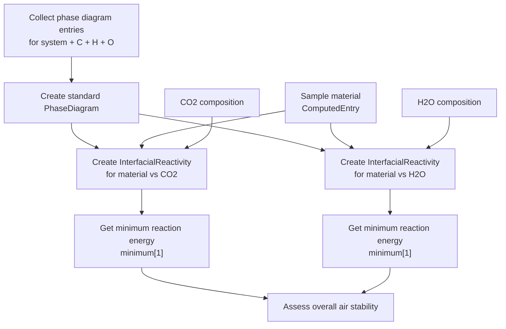
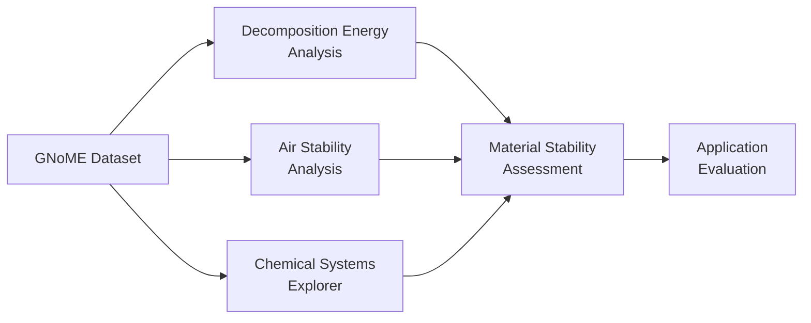

<!-- source: DeepWiki mcp.deepwiki.com · repo google-deepmind/materials_discovery · page 4.3 Air Stability Analysis · fetched 2026-10-26 -->

# Air Stability Analysis

<details>
<summary>Relevant source files</summary>

The following files were used as context for generating this wiki page:

- [notebooks/Air_Stability.ipynb](notebooks/Air_Stability.ipynb)

</details>


## Purpose and Overview

This document describes the Air Stability Analysis component of the Materials Discovery framework. While the GNoME dataset provides thermodynamic stability information for crystal structures at zero temperature, this analysis extends that evaluation to compute material stability in atmospheric conditions by examining reactivity with oxygen, carbon dioxide, and water vapor - the primary reactive components of air.

For information on the basic thermodynamic stability and decomposition energies, see [Computing Decomposition Energies](#4.2).

Sources: [notebooks/Air_Stability.ipynb:17-25]()

## System Overview

The Air Stability Analysis workflow is implemented in the `Air_Stability.ipynb` notebook, which leverages Pymatgen's phase diagram and interfacial reactivity tools to assess material stability in air.



Sources: [notebooks/Air_Stability.ipynb:1-24]()

## Analysis Workflow

The air stability analysis follows a sequential process:



Sources: [notebooks/Air_Stability.ipynb:74-127](), [notebooks/Air_Stability.ipynb:378-392]()

## Implementation Details

### Data Preparation

The analysis starts with loading the GNoME dataset and reference materials, followed by preprocessing to extract chemical system information:

```python
# Dataset loading
gnome_crystals = pd.read_csv('stable_materials_summary.csv', index_col=0)
reference_crystals = pd.read_csv('external_materials_summary.csv')

# Preprocess crystal structures
gnome_crystals = annotate_chemical_system(gnome_crystals)
reference_crystals = annotate_chemical_system(reference_crystals)

# Combine datasets and prepare for phase diagram analysis
all_crystals = pd.concat([gnome_crystals, reference_crystals], ignore_index=True)
required_columns = ['Composition', 'NSites', 'Corrected Energy', 'Formation Energy Per Atom', 'Chemical System']
minimal_entries = all_crystals[required_columns]
grouped_entries = minimal_entries.groupby('Chemical System')
```

The `annotate_chemical_system` function extracts and sorts elements from each material's composition:

```python
def annotate_chemical_system(crystals: pd.DataFrame) -> pd.DataFrame:
  chemical_systems = []
  for i, e in enumerate(crystals['Elements']):
    try:
      # replace single quotes with double quotes to avoid having to use python eval
      chemsys = json.loads(e.replace("'", '"'))
      chemical_systems.append(tuple(sorted(chemsys)))
    except:
      print(e)
  crystals['Chemical System'] = chemical_systems
  return crystals
```

Sources: [notebooks/Air_Stability.ipynb:128-139](), [notebooks/Air_Stability.ipynb:348-359](), [notebooks/Air_Stability.ipynb:370-392]()

### Oxygen Stability Analysis

The stability against oxygen is calculated using Pymatgen's `GrandPotentialPhaseDiagram`, which treats oxygen as an external reservoir with a fixed chemical potential:



The implementation includes these key steps:

1. Calculate oxygen chemical potential based on temperature and pressure:

```python
element = 'O'
temperature = 300  # Kelvin
pressure = 21200   # Pa, standard atmospheric pressure
chempot_oxygen = InterfacialReactivity.get_chempot_correction(
    element, temperature, pressure)
u_o = -4.95 + chempot_oxygen
```

2. Collect phase diagram entries for the material system plus oxygen:

```python
oxygen_chemsys = chemsys + ('O',)
chempots = {mg.core.Element('O'): u_o}
gnome_grand_diagram_entries = collect_phase_diagram_entries(
    oxygen_chemsys, grouped_entries, all_crystals)
```

3. Create the grand potential phase diagram and compute decomposition energy:

```python
gnome_grand_diagram = phase_diagram.GrandPotentialPhaseDiagram(
    gnome_grand_diagram_entries,
    chempots=chempots)

decomposition, decomposition_energy = gnome_grand_diagram.get_decomp_and_e_above_hull(sample_grand_entry)
```

Sources: [notebooks/Air_Stability.ipynb:698-837]()

### CO2 and H2O Reactivity Analysis

The reactivity with CO2 and H2O is evaluated using Pymatgen's `InterfacialReactivity` class:



The implementation involves:

1. Collecting phase diagram entries for the expanded chemical system:

```python
gnome_phase_diagram_entries = collect_phase_diagram_entries(
    chemsys + ('H', 'C', 'O'),
    grouped_entries,
    all_crystals
)
gnome_phase_diagram = phase_diagram.PhaseDiagram(gnome_phase_diagram_entries)
```

2. Computing CO2 reactivity:

```python
carbon_dioxide = mg.core.Composition('CO2')
gnome_co2_rxns = interface_reactions.InterfacialReactivity(
    sample_entry.composition,
    carbon_dioxide,
    gnome_phase_diagram,
    use_hull_energy=True,
)
co2_stability = gnome_co2_rxns.minimum[1]
```

3. Computing H2O reactivity:

```python
water = mg.core.Composition('H2O')
gnome_h2o_rxns = interface_reactions.InterfacialReactivity(
    sample_entry.composition,
    water,
    gnome_phase_diagram,
    use_hull_energy=True,
)
h2o_stability = gnome_h2o_rxns.minimum[1]
```

Sources: [notebooks/Air_Stability.ipynb:859-948]()

## Key Functions and Utilities

### Phase Diagram Entry Collection

The `collect_phase_diagram_entries` function gathers all required entries for phase diagram construction:

```python
def collect_phase_diagram_entries(
    chemsys: Tuple[str, ...],
    grouped_entries: pd.core.groupby.generic.DataFrameGroupBy,
    minimal_entries: pd.DataFrame
) -> List[ComputedEntry]:
  phase_diagram_entries = []
  for length in range(len(chemsys) + 1):
    for subsystem in itertools.combinations(chemsys, length):
      subsystem_key = tuple(sorted(subsystem))
      subsystem_entries = grouped_entries.groups.get(subsystem_key, [])
      if len(subsystem_entries):
        phase_diagram_entries.append(minimal_entries.iloc[subsystem_entries])
  phase_diagram_entries = pd.concat(phase_diagram_entries)

  mg_entries = []
  for _, row in phase_diagram_entries.iterrows():
    composition = row['Composition']
    formation_energy = row['Corrected Energy']
    entry = ComputedEntry(composition, formation_energy)
    mg_entries.append(entry)

  return mg_entries
```

This function:
1. Iterates through all possible subsystems of the given chemical system
2. Collects material entries for each subsystem
3. Converts them to Pymatgen's `ComputedEntry` objects for phase diagram analysis

Sources: [notebooks/Air_Stability.ipynb:748-770]()

## Interpreting Results

### Oxygen Stability

The decomposition energy with respect to oxygen provides key information about a material's stability in an oxygen environment:

```
Decomposition energy with oxygen: 1.5718342511757761
```

- **Higher positive values**: Material is unstable in oxygen (prone to oxidation)
- **Near-zero values**: Material is stable against oxidation

Sources: [notebooks/Air_Stability.ipynb:824-854]()

### CO2 and H2O Reactivity

The minimum reaction energy values from interfacial reactivity analysis indicate stability with respect to CO2 and H2O:

```
co2_stability: 0.0
h2o_stability: 0.0
```

- **Zero values**: Material is stable against the gas
- **Negative values**: Material may react with the gas

Sources: [notebooks/Air_Stability.ipynb:886-916](), [notebooks/Air_Stability.ipynb:920-948]()

## Integration with Materials Discovery Framework

The Air Stability Analysis complements other tools in the Materials Discovery framework:



Sources: [notebooks/Air_Stability.ipynb:17-25]()

## Example Use Case

To analyze a material's stability in air:

1. Select a material from the GNoME dataset
   ```python
   binaries = gnome_crystals[gnome_crystals['Chemical System'].map(len) == 2]
   sample = binaries.sample()
   ```

2. Calculate oxygen stability
   ```python
   decomposition, decomposition_energy = gnome_grand_diagram.get_decomp_and_e_above_hull(sample_grand_entry)
   ```

3. Calculate CO2 and H2O reactivity
   ```python
   co2_stability = gnome_co2_rxns.minimum[1]
   h2o_stability = gnome_h2o_rxns.minimum[1]
   ```

4. Assess overall air stability by examining all three values

A comprehensive air stability analysis helps determine whether theoretically stable materials would remain stable under practical atmospheric conditions, which is crucial for materials selection in real-world applications.

Sources: [notebooks/Air_Stability.ipynb:397-431](), [notebooks/Air_Stability.ipynb:824-948]()

---

