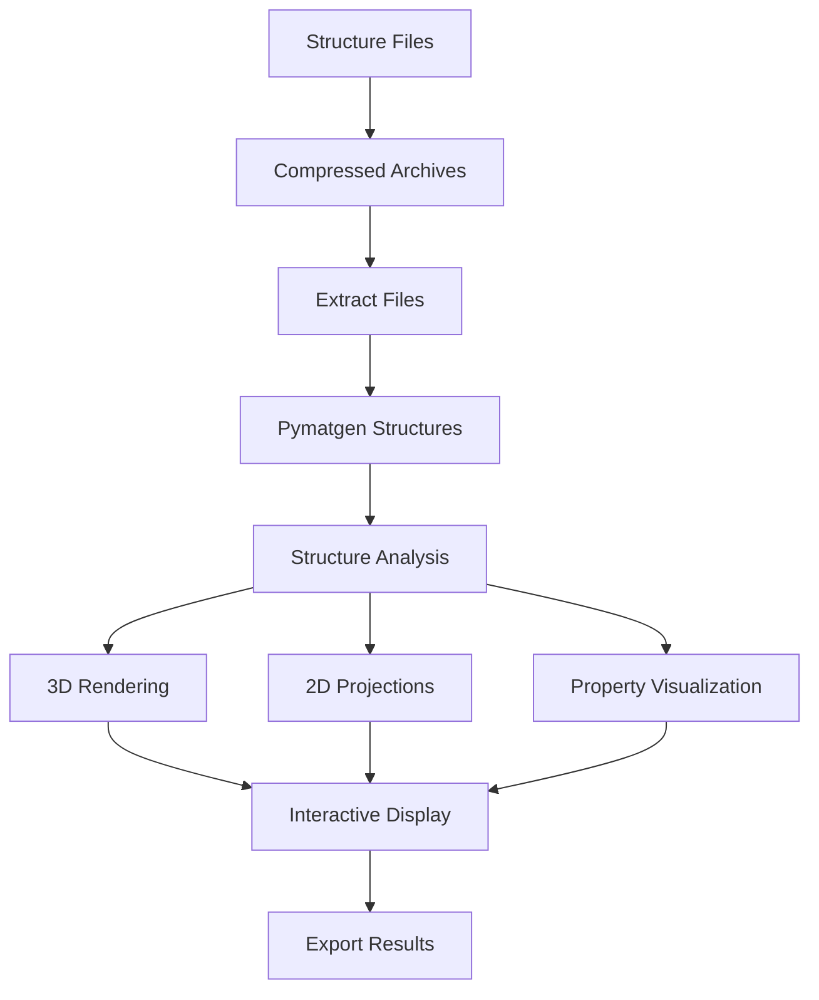
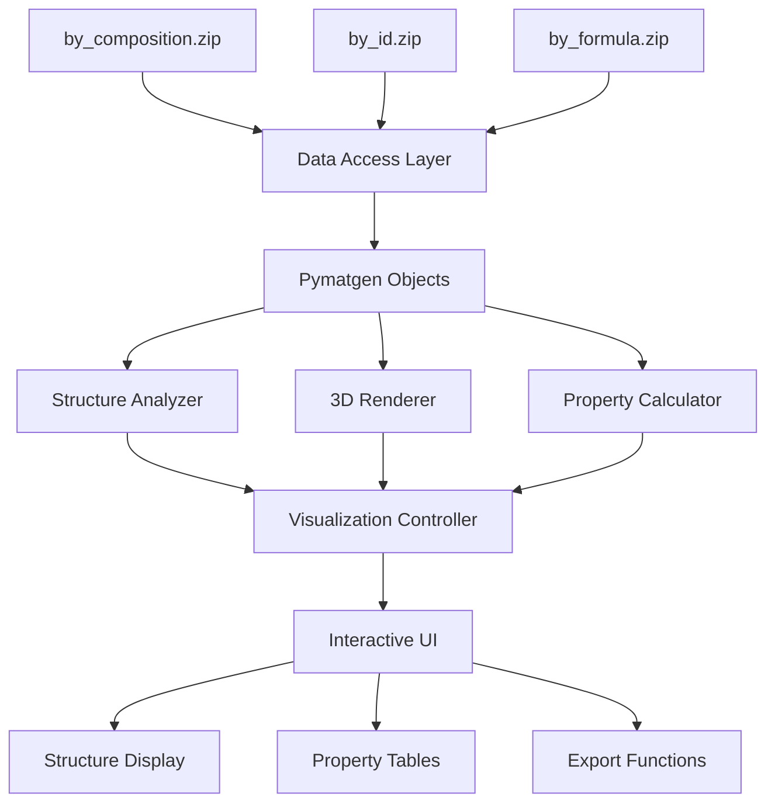
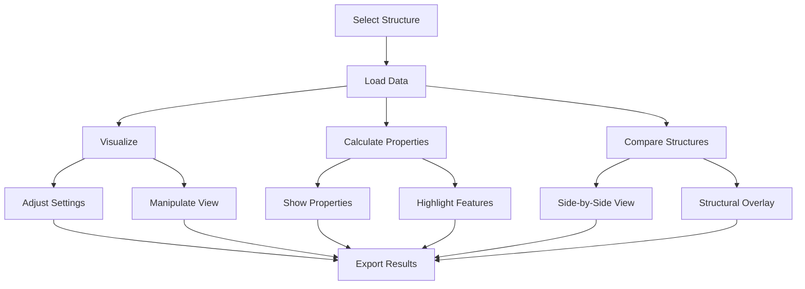

<!-- source: DeepWiki mcp.deepwiki.com · repo google-deepmind/materials_discovery · page 4.4 Visualizing Structures · fetched 2026-10-26 -->

# Visualizing Structures

Relevant source files

The following files were used as context for generating this wiki page:

- [notebooks/Visualize_GNoME_Structures.ipynb](notebooks/Visualize_GNoME_Structures.ipynb)

This document provides a technical guide for visualizing crystal structures from the GNoME dataset. It covers how to use the visualization tools in the repository to render, analyze, and explore the 3D crystal structures of materials discovered by GNoME. For information about analyzing stability properties of these structures, see [Computing Decomposition Energies](#4.2) and [Air Stability Analysis](#4.3).

## Structure Data Organization

The GNoME dataset stores crystal structures in standard CIF (Crystallographic Information File) format, organized in three compressed archives:

- `by_composition.zip` - Structures organized by chemical composition
- `by_id.zip` - Structures organized by unique material identifiers
- `by_reduced_formula.zip` - Structures organized by reduced chemical formula

These files are downloaded as part of the dataset acquisition process described in [Downloading the Dataset](#2.1).

Sources: Based on system diagrams, particularly "Data Download System Components" diagram

## Visualization Workflow

### Structure Visualization Process

The visualization workflow follows these steps:

1. **Extract structure files** from one of the compressed archives based on your search criteria
2. **Load structures** using Pymatgen to convert CIF files into computational structure objects
3. **Analyze structure properties** including symmetry, bonding, and geometric features
4. **Render structures** in 3D using interactive visualization tools
5. **Interact with structures** through rotation, zooming, and property highlighting
6. **Export visualizations** for publications or further analysis

Sources: Based on "Analysis Notebooks and Dataset Interactions" diagram, particularly the connection between "StructureZip" and "VisualizeStructures"

## Using the Visualization Notebook

The primary tool for structure visualization is the `Visualize_GNoME_Structures.ipynb` notebook, which provides an interactive interface for exploring crystal structures.

### Visualization System Components

The notebook integrates several components:

1. **Data Access Layer**: Handles retrieval of structure files from compressed archives
2. **Pymatgen Structure Objects**: Core representation of crystal structures using Pymatgen
3. **Structure Analyzer**: Performs symmetry analysis and geometric calculations
4. **3D Renderer**: Creates interactive visualizations of crystal structures
5. **Property Calculator**: Computes structural properties and derived metrics
6. **Interactive UI**: Provides user controls for visualization settings and analysis options

Sources: Based on "Analysis Notebooks and Dataset Interactions" diagram, particularly the connection to "Structure Visualization Tools"

## Common Visualization Tasks

### Structure Visualization Workflow

### Loading Structures

The notebook supports multiple ways to load structures:

1. **By composition**: Search for structures with specific elements (e.g., "Li-Fe-O")
2. **By material ID**: Load a specific structure using its unique identifier
3. **By formula**: Load structures with a particular chemical formula

Example table of loading methods:

| Method | Example | Use Case |
|--------|---------|----------|
| Composition | "Li-Fe-O" | Explore all structures in a chemical system |
| Material ID | "mp-19017" | Access a specific known structure |
| Formula | "LiFePO4" | Find structures with specific stoichiometry |

### Visualization Options

The visualization system likely supports these common rendering styles:

| Style | Description | Best For |
|-------|-------------|----------|
| Ball and stick | Atoms as spheres, bonds as sticks | General structure visualization |
| Polyhedral | Coordination polyhedra | Visualizing coordination environments |
| Space-filling | Atoms as spheres with van der Waals radii | Analyzing void spaces and packing |
| Wire frame | Simple line representation | Performance with large structures |

### Structure Analysis Tools

The notebook provides tools for analyzing structural properties:

1. **Symmetry analysis**: Identify space group, point group, and symmetry operations
2. **Bond analysis**: Calculate bond lengths, angles, and coordination numbers
3. **Polyhedra identification**: Recognize and visualize coordination polyhedra
4. **Void analysis**: Locate and characterize void spaces in the structure

Sources: Based on system diagrams, particularly "Analysis Notebooks and Dataset Interactions" diagram

## Integration with Other GNoME Tools

The structure visualization tools can be used alongside other GNoME analysis capabilities:

- **Chemical Systems Explorer**: Visualize structures identified in stability regions
- **Decomposition Energy Calculator**: Examine structures with specific stability metrics
- **Air Stability Analyzer**: Visualize materials with desired stability in air
- **a2c Explorer**: Compare amorphous and crystalline structures

Sources: Based on "High-Level System Overview" diagram showing relationships between analysis tools

## Technical Implementation

The structure visualization system likely leverages these key technologies:

- **Pymatgen**: For structure representation, manipulation, and analysis
- **3D visualization libraries**: For interactive structure rendering (likely NGLView, Plotly, or similar)
- **Jupyter widgets**: For interactive controls and visualization settings
- **Symmetry analysis tools**: For identifying space groups and symmetry operations

Sources: Based on "Data Flow Architecture" diagram, particularly the "Structure Processing (Pymatgen)" component

## Advanced Visualization Techniques

For advanced users, the visualization system may support:

1. **Supercell creation**: Expand structures along crystallographic directions
2. **Surface generation**: Create and visualize crystal surfaces and slabs
3. **Defect introduction**: Insert vacancies, substitutions, or interstitials
4. **Structural interpolation**: Visualize transitions between different structures
5. **Custom coloring schemes**: Color atoms based on properties or custom rules

Sources: Based on general functionality present in crystal structure visualization systems used with Pymatgen

---

