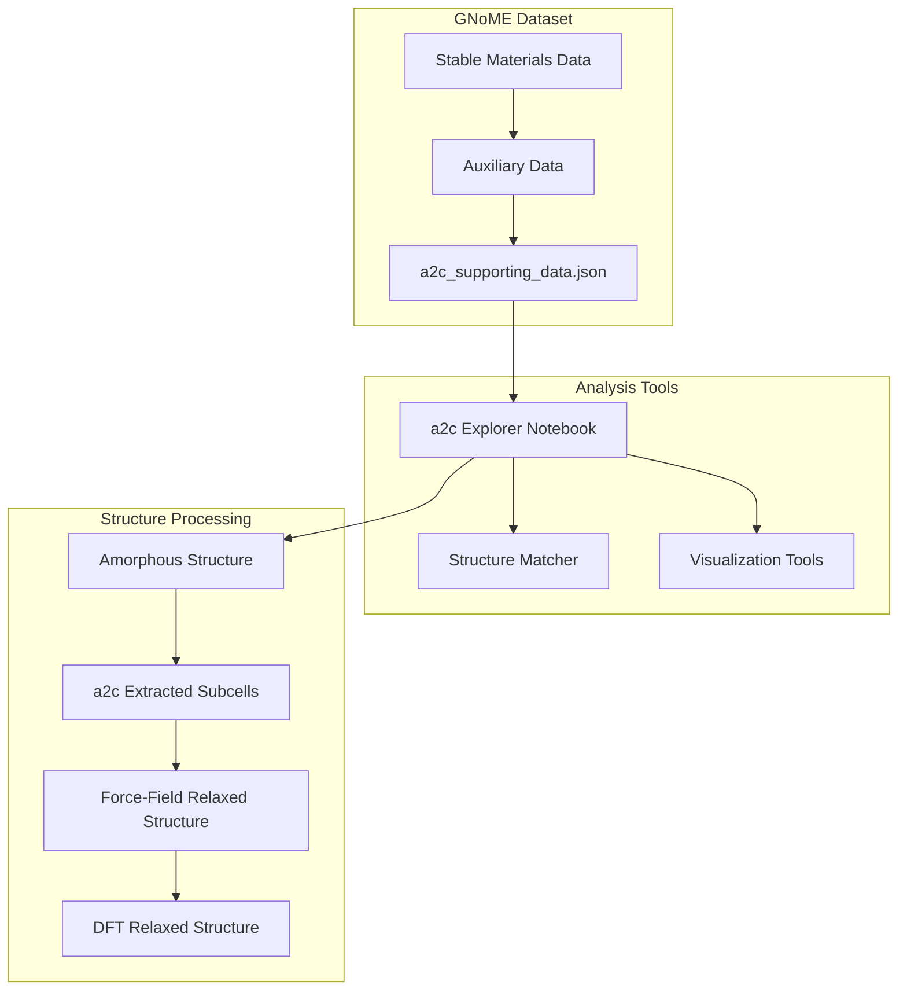
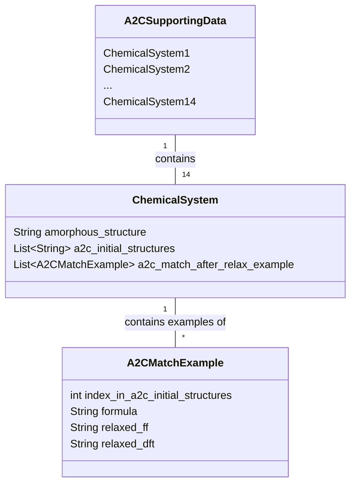

<!-- source: DeepWiki mcp.deepwiki.com · repo google-deepmind/materials_discovery · page 4.5 a2c Explorer · fetched 2026-10-26 -->

# a2c Explorer

<details>
<summary>Relevant source files</summary>

The following files were used as context for generating this wiki page:

- [notebooks/a2c_Explorer.ipynb](notebooks/a2c_Explorer.ipynb)

</details>


## Purpose and Scope

The a2c Explorer is a specialized tool for analyzing amorphous-to-crystalline (a2c) structure prediction data within the GNoME (Graph Networks for Materials Exploration) framework. This documentation covers the a2c Explorer Jupyter notebook, which enables users to examine and validate results from the a2c crystal structure prediction pipeline that was introduced in the a2c preprint accompanying the GNoME research.

This tool allows materials scientists to explore how initially amorphous structures can transform into crystalline structures through computational methods, providing insights into crystallization pathways and validating the effectiveness of the structure prediction algorithms.

Sources: [notebooks/a2c_Explorer.ipynb:8-19]()

## System Overview

The a2c Explorer fits into the broader GNoME ecosystem as part of the analysis and visualization toolset. It provides a specific workflow for examining the amorphous-to-crystalline transformation process.

### a2c Explorer in the GNoME Ecosystem



Sources: [notebooks/a2c_Explorer.ipynb:8-19](), [notebooks/a2c_Explorer.ipynb:63-79]()

## Data Structure

The a2c Explorer works with the `a2c_supporting_data.json` file, which contains comprehensive data about various material systems and their transformation from amorphous to crystalline structures. Each entry in this file represents a different chemical system (such as Al₂O₃, SiO₂, etc.) and contains:

1. **Amorphous structures**: Initial disordered atomic arrangements
2. **a2c initial structures**: Subcells extracted from the amorphous phase using a2c methodology
3. **a2c match examples**: Examples of specific subcells that successfully transformed into the target crystalline phase
4. **Force-field relaxed structures**: Intermediate structures after relaxation with force fields
5. **DFT relaxed structures**: Final structures after density functional theory relaxation

### Data Schema



Sources: [notebooks/a2c_Explorer.ipynb:90-91](), [notebooks/a2c_Explorer.ipynb:146-163]()

## Workflow and Functionality

The a2c Explorer implements a specific workflow for examining the transformation of amorphous structures to crystalline ones. This section outlines the key steps and functionality provided by the notebook.

### Data Acquisition and Processing

1. **Data Download**: The notebook downloads the `a2c_supporting_data.json` file from Google Cloud Storage
2. **Data Organization**: The `get_saved_poscars_zip` function extracts and organizes the structural data into a folder structure for easy analysis
3. **Structure Extraction**: For each chemical system, the notebook allows access to:
   - Original amorphous structure
   - Extracted subcells
   - Force-field relaxed structures
   - DFT relaxed structures

```mermaid
flowchart LR
    CloudStorage["Google Cloud Storage"] -->|"wget"| LocalJSON["a2c_supporting_data.json"]
    LocalJSON -->|"json.load()"| ParsedData["Parsed Data Dictionary"]
    ParsedData -->|"get_saved_poscars_zip()"| OrganizedFiles["Organized Structure Files"]
    OrganizedFiles -->|"Structure.from_str()"| PymatgenObjects["Pymatgen Structure Objects"]
    PymatgenObjects -->|"StructureMatcher"| StructureAnalysis["Structure Analysis"]
```



Sources: [notebooks/a2c_Explorer.ipynb:62-79](), [notebooks/a2c_Explorer.ipynb:111-128](), [notebooks/a2c_Explorer.ipynb:139-140]()

### Structure Analysis

The notebook demonstrates how to analyze different structures through the crystallization process:

1. **Structure Loading**: Load VASP-format structures into Pymatgen Structure objects
2. **Structure Comparison**: Using Pymatgen's StructureMatcher to compare:
   - Force-field relaxed structures with experimental structures
   - DFT relaxed structures with experimental structures
3. **Transformation Validation**: Confirming whether the a2c approach successfully predicts the correct crystal structure

This analysis helps validate that the force-field or DFT relaxation of the extracted subcells can indeed lead to the expected crystalline structures, confirming the effectiveness of the a2c approach.

Sources: [notebooks/a2c_Explorer.ipynb:254-255](), [notebooks/a2c_Explorer.ipynb:345-379]()

## Example Usage

The following table shows a summary of some chemical systems available in the a2c supporting data:

| Chemical System | Amorphous Structure | Subcells | Crystallization Product |
|-----------------|---------------------|----------|------------------------|
| Al₂O₃           | 80 atoms           | Multiple | Theta Alumina          |
| SiO₂            | 72 atoms           | Multiple | Alpha Quartz           |
| TiO₂            | 72 atoms           | Multiple | Rutile                 |
| ZnO             | 64 atoms           | Multiple | Wurtzite               |

To examine a specific system like Al₂O₃, the notebook allows:
1. Accessing the amorphous structure
2. Finding which subcell (by index) successfully transformed
3. Comparing the relaxed structure to the known experimental structure

```python
# Example code flow (simplified from notebook)
import json
from pymatgen.core import Structure
from pymatgen.analysis.structure_matcher import StructureMatcher

# Load data
with open("a2c_supporting_data.json", "r") as f:
  a2c_data = json.load(f)

# Get the Al2O3 data
al2o3_data = a2c_data['Al2O3']

# Get the subcell that successfully transformed
idx = al2o3_data['a2c_match_after_relax_example'][0]['index_in_a2c_initial_structures']
initial_subcell = al2o3_data['a2c_initial_structures'][idx]

# Get the relaxed structures
ff_relaxed = Structure.from_str(al2o3_data['a2c_match_after_relax_example'][0]['relaxed_ff'], fmt='poscar')
dft_relaxed = Structure.from_str(al2o3_data['a2c_match_after_relax_example'][0]['relaxed_dft'], fmt='poscar')

# Compare to experimental structure
sm = StructureMatcher()
matches_ff = sm.fit(ff_relaxed, experimental_structure)
matches_dft = sm.fit(dft_relaxed, experimental_structure)
```

Sources: [notebooks/a2c_Explorer.ipynb:90-91](), [notebooks/a2c_Explorer.ipynb:232-235](), [notebooks/a2c_Explorer.ipynb:254-255](), [notebooks/a2c_Explorer.ipynb:367-379]()

## Technical Requirements

To use the a2c Explorer notebook, you'll need:

1. **Python libraries**:
   - pymatgen (for structure manipulation and analysis)
   - json (for parsing the data file)

2. **Data Access**:
   - Internet connection to download the data file from Google Cloud Storage
   - Approximately 5-10 MB of disk space for the supporting data

Sources: [notebooks/a2c_Explorer.ipynb:29-30](), [notebooks/a2c_Explorer.ipynb:40-44]()

## Relationship to Other Components

The a2c Explorer is part of the broader GNoME analysis and visualization toolkit. While other components in the GNoME ecosystem focus on different aspects of materials exploration, the a2c Explorer specifically targets the amorphous-to-crystalline transformation process.

Related components in the GNoME ecosystem include:
- [Exploring Chemical Systems](#4.1) - For analyzing compositional spaces
- [Computing Decomposition Energies](#4.2) - For calculating material stability
- [Visualizing Structures](#4.4) - For general structure visualization capabilities

Sources: [notebooks/a2c_Explorer.ipynb:8-19]()

## Conclusion

The a2c Explorer provides a valuable tool for materials scientists interested in crystal structure prediction, specifically focusing on the transformation from amorphous to crystalline states. By allowing researchers to examine successful transformations across various chemical systems, it helps validate the a2c approach and provides insights into crystallization pathways.

The notebook demonstrates how initially disordered structures can be processed to extract subcells that, when relaxed using computational methods, transform into known crystal structures. This capability is crucial for discovering new materials and understanding structure-property relationships in materials science.

---

