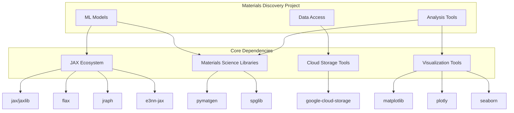
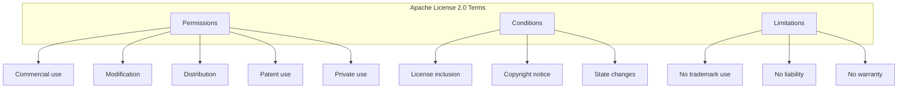
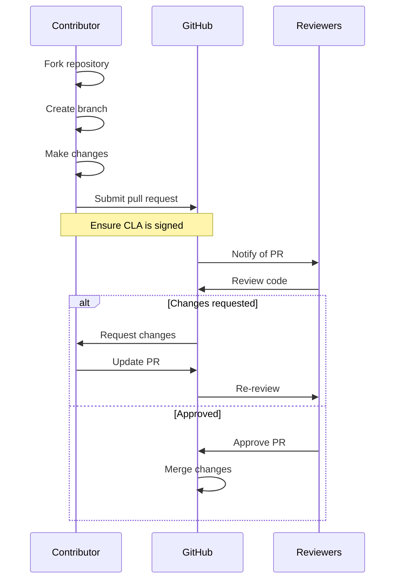
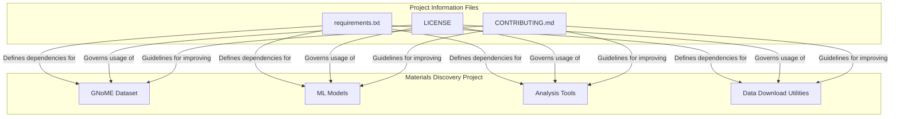

<!-- source: DeepWiki mcp.deepwiki.com · repo google-deepmind/materials_discovery · page 5 Project Information · fetched 2026-10-26 -->

# Project Information

<details>
<summary>Relevant source files</summary>

The following files were used as context for generating this wiki page:

- [CONTRIBUTING.md](CONTRIBUTING.md)
- [LICENSE](LICENSE)
- [requirements.txt](requirements.txt)

</details>


This document provides comprehensive information about the technical aspects, licensing, and contribution guidelines for the materials_discovery project. It covers system requirements, dependencies, licensing terms, and how to contribute to the project. For information about the GNoME dataset structure, see [GNoME Dataset](#2), and for details about machine learning models, see [Machine Learning Models](#3).

## System Requirements and Dependencies

The materials_discovery project requires several Python libraries and tools to function properly. All dependencies are listed in the requirements.txt file.

### Core Dependencies

The project relies on the following key libraries:

| Category | Key Dependencies | Purpose |
|----------|-----------------|---------|
| Machine Learning | jax, flax, jraph, e3nn-jax, optax | Neural network frameworks and graph network libraries |
| Scientific Computing | numpy, scipy, pandas | Data processing and numerical operations |
| Materials Science | pymatgen, spglib | Crystallography tools and materials analysis |
| Visualization | matplotlib, plotly, seaborn | Data visualization for analysis notebooks |
| Cloud Storage | google-cloud-storage | Dataset access and management |
| Utilities | tqdm, fsspec | Progress tracking and file system operations |

Sources: [requirements.txt:1-85]()

### Dependency Structure

The diagram below illustrates the major dependency categories and their relationships in the project:



Sources: [requirements.txt:1-85]()

## Licensing Information

### Apache License 2.0

The materials_discovery project is licensed under the Apache License 2.0, a permissive open-source license that allows significant freedom while maintaining appropriate protections.



### Key License Requirements

When using or distributing the materials_discovery project:

1. Include a copy of the Apache License 2.0 with any distribution
2. Retain all copyright, patent, and attribution notices
3. Document any significant modifications you make
4. Do not use the names or trademarks of contributors for endorsement

Sources: [LICENSE:1-202]()

## Contributing to the Project

Contributions to the materials_discovery project are welcome. The project follows standard open-source contribution practices with some specific requirements.

### Contribution Workflow



### Contributor License Agreement (CLA)

All contributions require a Contributor License Agreement (CLA):

1. Visit https://cla.developers.google.com/
2. Sign in with your GitHub account
3. Accept the CLA terms

You generally only need to submit a CLA once, even if you contribute to multiple Google open-source projects.

### Code Review Process

All submissions, including those from project members, require review through GitHub pull requests. This ensures code quality and consistency across the project.

### Community Guidelines

This project follows [Google's Open Source Community Guidelines](https://opensource.google/conduct/), which promote an inclusive and respectful community.

Sources: [CONTRIBUTING.md:1-25]()

## Project Integration with GNoME

The materials_discovery project is an implementation of Graph Networks for Materials Exploration (GNoME), focused on discovering stable inorganic materials through machine learning methods.



Sources: [requirements.txt:1-85](), [LICENSE:1-202](), [CONTRIBUTING.md:1-25]()

## Technical Setup

### Environment Setup

To set up a working environment for the materials_discovery project:

1. Clone the repository:
   ```bash
   git clone https://github.com/google-deepmind/materials_discovery.git
   cd materials_discovery
   ```

2. Create and activate a virtual environment:
   ```bash
   python -m venv venv
   source venv/bin/activate  # On Windows: venv\Scripts\activate
   ```

3. Install dependencies:
   ```bash
   pip install -r requirements.txt
   ```

### Hardware Recommendations

The machine learning models, particularly the graph neural networks, can benefit from GPU acceleration:

- CUDA-compatible GPU (NVIDIA) is recommended for model training
- At least 8GB GPU memory for running inference
- 16GB+ GPU memory for full-scale training

For running the analysis notebooks only, a standard CPU configuration may be sufficient.

Sources: [requirements.txt:1-85]()