# Page: GNoME: Graph Networks for Materials Exploration

# GNoME: Graph Networks for Materials Exploration

<details>
<summary>Relevant source files</summary>

The following files were used as context for generating this wiki page:

- [DATASET.md](DATASET.md)
- [README.md](README.md)
- [model/gnome.py](model/gnome.py)

</details>


## Purpose and Scope

This document provides a high-level overview of the Graph Networks for Materials Exploration (GNoME) project, its core components, and how they interact to enable materials discovery at scale. GNoME is a system that utilizes graph neural networks to explore and predict stable inorganic crystal materials, resulting in the discovery of over 381,000 novel stable materials (expanded to more than 520,000 materials as of August 2024).

For detailed information about the GNoME dataset structure and access methods, see [GNoME Dataset](#2). For specifics on the machine learning models, see [Machine Learning Models](#3).

Sources: [README.md:11-28](), [DATASET.md:8-14]()

## System Architecture Overview

The GNoME system consists of three main components working together to enable materials discovery:

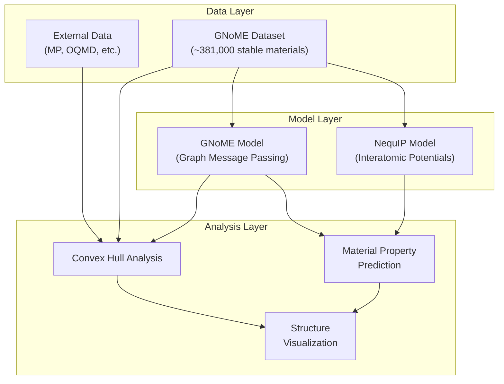

The system architecture consists of three main layers:
1. **Data Layer**: Contains the GNoME dataset with ~381,000 stable materials and external reference data
2. **Model Layer**: Houses the graph neural network models used for property prediction
3. **Analysis Layer**: Provides tools for analyzing stability, properties, and visualizing structures

Sources: [README.md:29-62](), [DATASET.md:8-28]()

## GNoME Dataset

The GNoME dataset is a comprehensive collection of novel crystal structures that update the convex hull of known stable materials. Key components include:

- **Stable Materials Summary**: Contains compositions, energies, and material properties
- **Structure Files**: Crystal structures in CIF format organized by composition, ID, and formula
- **r²SCAN Validation**: Additional high-precision DFT calculations for validation
- **External Data**: Reference data from Materials Project (MP) and Open Quantum Materials Database (OQMD)

The dataset is organized in a Google Cloud Storage bucket with a structure that facilitates access and analysis:

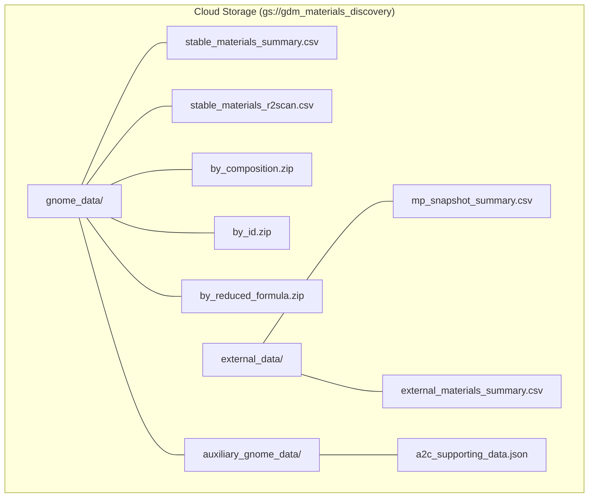

The dataset can be downloaded using provided utility scripts in the repository. For detailed information on the dataset structure and download instructions, see the [GNoME Dataset](#2) page.

Sources: [DATASET.md:8-40](), [DATASET.md:70-94]()

## Machine Learning Models

GNoME utilizes two main machine learning models for materials discovery and property prediction:

### GNoME Model

The primary model used for materials discovery is a graph neural network that processes crystal structures to predict energies and stability. The model represents crystal structures as graphs, where:
- Nodes represent atoms
- Edges represent interatomic connections
- Node features include element properties
- Edge features include spatial information

The model architecture is implemented in the `model/gnome.py` file and uses message passing to predict materials properties.

### NequIP Model

In addition to the GNoME model, the system also implements the NequIP architecture (Batzner et al., 2022) for interatomic potentials. This model:
- Utilizes equivariant neural networks
- Preserves rotational and translational symmetries
- Is used to model atomic dynamics

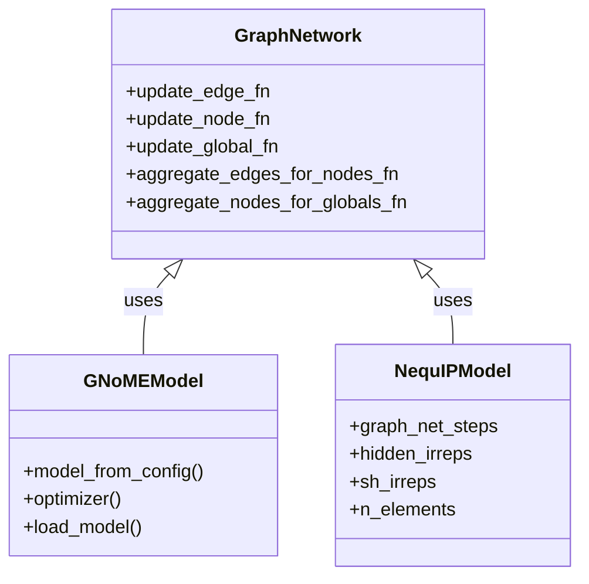

The models are configurable via a configuration dictionary (`ConfigDict`) that allows customization of model architecture, training parameters, and optimization strategies.

Sources: [model/gnome.py:15-165](), [README.md:65-76]()

## Materials Discovery Workflow

The GNoME system follows a comprehensive workflow for materials discovery, from data processing to novel material identification:

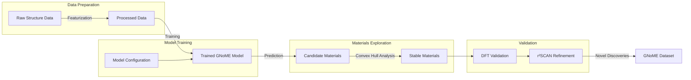

The workflow consists of four main stages:
1. **Data Preparation**: Raw crystal structures are processed and featurized for model input
2. **Model Training**: The GNoME model is trained on known materials
3. **Materials Exploration**: The model predicts properties of candidate materials, and stability is assessed
4. **Validation**: Promising candidates are validated with DFT and refined with r²SCAN calculations

Sources: [README.md:11-28](), [DATASET.md:141-159]()

## Model Implementation Details

### Model Configuration and Loading

The GNoME framework provides utilities for configuring, initializing, and loading models. These functions are defined in `model/gnome.py`:

```mermaid
flowchart TD
    subgraph "Model Configuration"
        Config["ConfigDict"]
        ModelFactory["model_from_config()"]
        Config --> ModelFactory
        ModelFactory --> |"Creates"| ModelInstance["Model Instance"]
    end
    
    subgraph "Model Optimization"
        OptConfig["Optimizer Configuration"]
        OptimizerFactory["optimizer()"]
        OptConfig --> OptimizerFactory
        OptimizerFactory --> |"Creates"| OptState["Optimizer State"]
    end
    
    subgraph "Model Loading"
        Directory["Model Directory"]
        LoadModel["load_model()"]
        Directory --> LoadModel
        LoadModel --> |"Returns"| ModelTriple["Config, Model, Params"]
    end
```

Key functions include:
- `model_from_config()`: Creates a model instance from a configuration dictionary
- `optimizer()`: Configures the optimizer based on learning rate schedule, regularization, etc.
- `load_model()`: Loads a saved model from a directory

The implementation supports various learning rate schedules and optimization strategies, including constant learning rate, linear decay, cosine decay, and learning rate reduction on plateau.

Sources: [model/gnome.py:48-165]()

## Key Metrics and Results

The GNoME project has achieved significant results in materials discovery:

| Metric | Value | Description |
|--------|-------|-------------|
| Discovered Materials | >381,000 | Novel stable materials discovered (as of initial release) |
| Expanded Dataset | >520,000 | Materials within 1 meV/atom from the convex hull (as of August 2024) |
| Model Accuracy | 21 meV/atom | State-of-the-art energy prediction accuracy |
| Validation | r²SCAN | Higher-precision DFT functional used for validation |

These results represent a significant advancement in computational materials discovery, expanding the known stable materials space by orders of magnitude.

Sources: [README.md:11-24](), [README.md:65-70]()

## Integration with Analysis Tools

The GNoME system integrates with various analysis tools for exploring and visualizing the discovered materials:

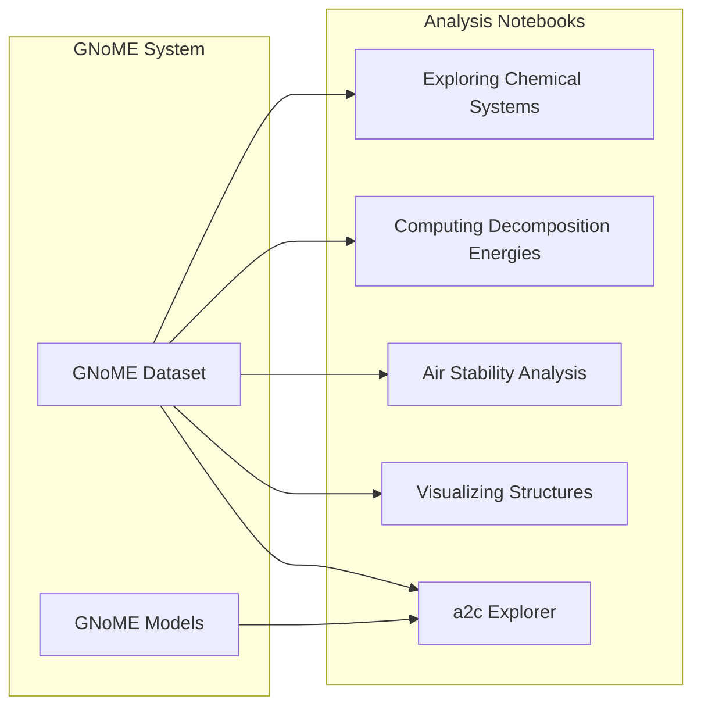

These analysis tools, provided as Jupyter notebooks, enable researchers to:
- Explore specific chemical systems
- Calculate decomposition energies to assess stability
- Analyze stability in air
- Visualize crystal structures
- Examine amorphous-to-crystalline transformations

For detailed information on these analysis tools, see the [Analysis Tools](#4) page.

Sources: [README.md:78-82]()

## Conclusion

The GNoME project represents a significant advancement in materials discovery, using graph neural networks to identify hundreds of thousands of novel stable materials. The system combines state-of-the-art machine learning models with comprehensive materials data and analysis tools to enable exploration of the materials space at an unprecedented scale.

The project is still evolving, with planned expansions including reference structures, search paths, model training examples, and additional material properties such as electronic band structures.

Sources: [README.md:94-98]()

---

# Page: GNoME Dataset

# GNoME Dataset

<details>
<summary>Relevant source files</summary>

The following files were used as context for generating this wiki page:

- [DATASET.md](DATASET.md)

</details>


## Purpose and Scope

This page provides a comprehensive overview of the Graph Networks for Materials Exploration (GNoME) dataset, a collection of approximately 381,000 novel stable material structures. The document covers the dataset's organization, available properties, access methods, and significance for materials discovery research. For information about downloading the dataset, see [Downloading the Dataset](#2.1).

Sources: [DATASET.md:10-13]()

## Dataset Overview

The GNoME dataset represents a significant advancement in computational materials discovery, providing ~381,000 novel crystal structures that update the convex hull of known stable materials. These structures were discovered using the GNoME machine learning approach and have been validated through density functional theory (DFT) calculations.

The dataset serves as a foundational resource for:
- Evaluating material stability
- Exploring new chemical systems
- Benchmarking computational materials discovery methods
- Identifying candidates for various applications

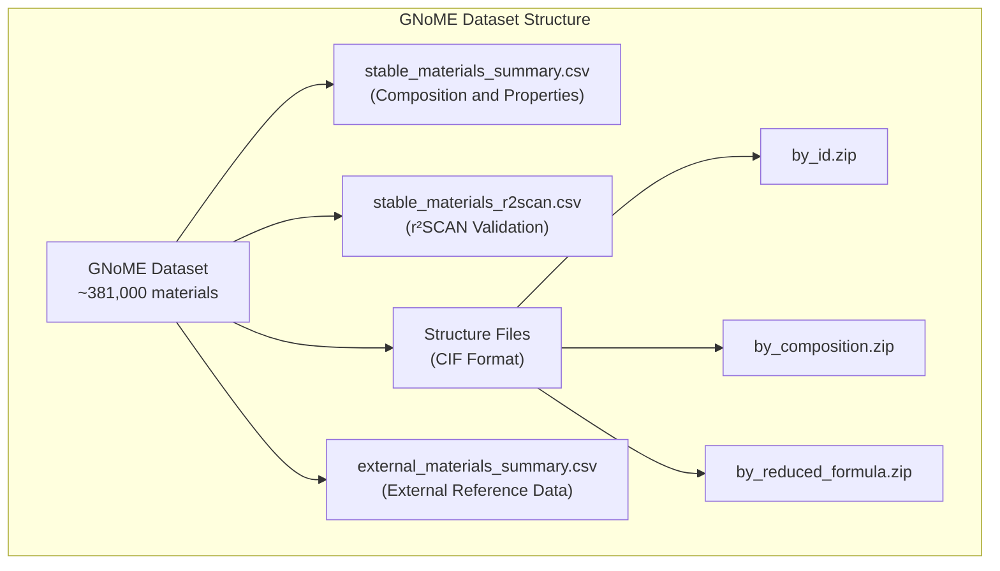

Sources: [DATASET.md:10-28]()

## Dataset Organization

The dataset is stored in a Google Cloud Storage bucket (`gs://gdm_materials_discovery`) with the following file structure:

```
gdm_materials_discovery
└───gnome_data
│   │   stable_materials_summary.csv
│   │   stable_materials_r2scan.csv
│   │   by_composition.zip
│   │   by_id.zip
│   │   by_reduced_formula.zip
│   └───auxiliary_gnome_data
|       |   a2c_supporting_data.json
└───external_data
|   |   mp_snapshot_summary.csv
|   |   external_materials_summary.csv
```

### Core Dataset Files

| File | Description |
|------|-------------|
| `stable_materials_summary.csv` | Main data file containing compositions, energies, and other properties for all novel materials |
| `stable_materials_r2scan.csv` | Validation calculations performed using the r²SCAN functional |
| `by_id.zip` | Crystal structures in CIF format organized by unique material ID |
| `by_composition.zip` | Crystal structures organized by composition |
| `by_reduced_formula.zip` | Crystal structures organized by reduced chemical formula |
| `external_materials_summary.csv` | Compositions and convex hull entries from external datasets (MP, OQMD, WBM) with matching elemental compositions |

Sources: [DATASET.md:15-28](), [DATASET.md:72-89]()

## Material Properties

The `stable_materials_summary.csv` file provides comprehensive information about each material in the dataset. The following properties are included:

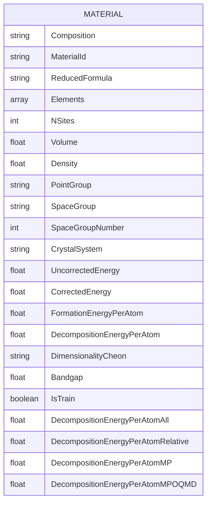

### Key Property Descriptions

| Property | Description |
|----------|-------------|
| Composition | Alphabetically-ordered chemical composition |
| MaterialId | Unique identifier for the material |
| Reduced Formula | Reduced chemical formula |
| Elements | Chemical system (constituent elements) |
| NSites | Number of atoms in the unit cell |
| Volume | Unit cell volume in ų |
| Density | Density in ų/atom |
| Point Group, Space Group, Space Group Number | Crystallographic symmetry information |
| Uncorrected Energy | Raw DFT energy |
| Corrected Energy | Energy adjusted by MP2020 corrections |
| Formation Energy Per Atom | Energy normalized and corrected by reference elements |
| Decomposition Energy Per Atom | Energy relative to the Materials Project convex hull |
| Dimensionality Cheon | Material dimensionality predicted by Cheon et al. 2017 method |
| Bandgap | Calculated electronic bandgap (when available) |
| Is Train | Boolean indicating if the material was in the training set for ML models |

Sources: [DATASET.md:102-138]()

## Convex Hull and Stability Analysis

The dataset provides comprehensive information for constructing and analyzing the convex hull of stable materials, which is essential for determining thermodynamic stability.

### Stability Metrics

The dataset includes multiple decomposition energy metrics that represent different reference stability hulls:

- **Decomposition Energy Per Atom All**: Distance to convex hull of all entries
- **Decomposition Energy Per Atom Relative**: Distance to convex hull of all entries except the current material
- **Decomposition Energy Per Atom MP**: Distance to convex hull of Materials Project entries
- **Decomposition Energy Per Atom MP OQMD**: Distance to convex hull of Materials Project + Open Quantum Materials Database entries

A stability threshold of 5e-5 eV was used to determine whether a material is on the convex hull.

### Energy Corrections

To ensure compatibility between different DFT calculations, energy corrections are applied to entries from the Materials Project that contain Ga, Ge, Li, Mg, or Na, for which the pseudopotentials differ. The corrections per atom are:

```
Ga: -0.0028805
Ge: 0.10417085
Li: -0.00301278
Mg: 0.0924014
Na: -0.00447437
```

Formation energies are calculated with respect to a fixed set of elemental references from the Materials Project, provided in `elemental_references.json`.

Sources: [DATASET.md:70-99](), [DATASET.md:162-168]()

## Crystal Structures

Each material in the dataset is associated with a crystal structure file in CIF format (Crystallographic Information File), which is the standard format in materials science. The structures are provided in three compressed archives:

1. `by_id.zip`: Structures organized by unique material identifier
2. `by_reduced_formula.zip`: Structures organized by reduced chemical formula
3. `by_composition.zip`: Structures organized by composition

These different organization schemes allow for easy lookup of structures based on different criteria.

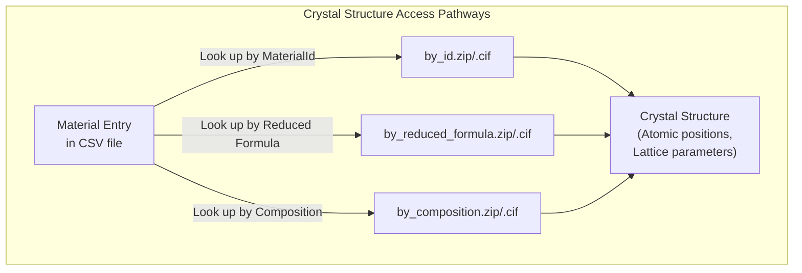

Sources: [DATASET.md:145-151]()

## Validation with r²SCAN

Beyond the standard GGA-PBE calculations, a subset of the dataset has been validated using the more accurate r²SCAN functional. The `stable_materials_r2scan.csv` file provides these validation calculations.

It's important to note that stability metrics change with the choice of functional, so not all materials that are stable at the PBE level remain stable according to r²SCAN calculations.

Sources: [DATASET.md:153-159]()

## Dataset Integration with Materials Discovery Pipeline

The GNoME dataset serves as both input and output in the materials discovery pipeline, forming a critical component in the end-to-end workflow.

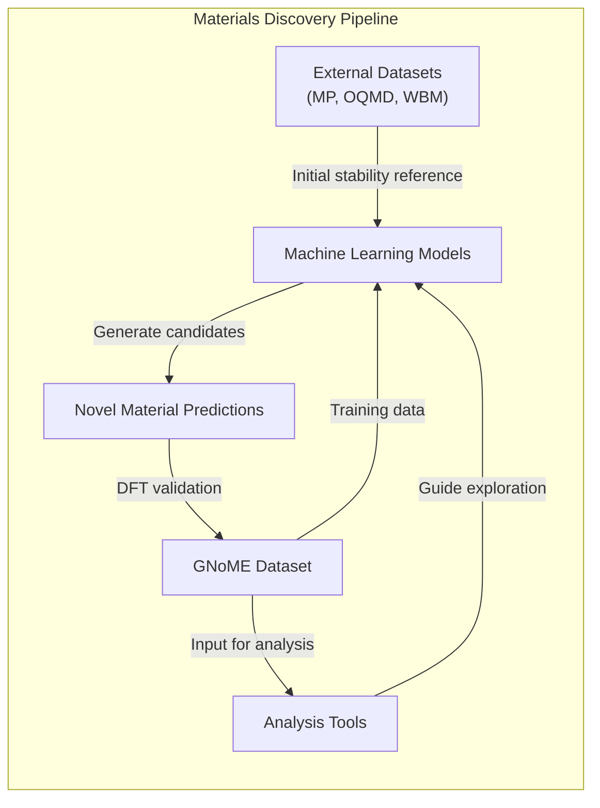

Sources: [DATASET.md:10-13]()

## Versioning and Updates

The GNoME dataset is periodically updated with improvements and corrections. Major version updates include:

| Date | Changes |
|------|---------|
| 11/29/2023 | Initial dataset release |
| 12/1/2023 | Re-introduced paper filters to remove un-physical energies; added 2 missing columns ('Dimensionality Cheon' and 'Is Train') |
| 8/21/2024 | Adjusted threshold to 1meV/atom off the hull (significantly increasing the number of released crystals); updated to use "require_bound" version of MP corrections; re-relaxed structures where VASP did not update lattice coordinates; provided convex hull entries from recomputations of MP/OQMD; fixed file naming in by_id.zip |
| 11/21/2024 | Ensured consistency in formation energies; provided elemental references and pseudopotential corrections used in the GNoME paper |

Sources: [DATASET.md:171-184]()

## Limitations and Caveats

When working with the GNoME dataset, the following caveats should be kept in mind:

1. A stability threshold of 5e-5 eV is used due to numerical precision and errors inherent in computational simulations.
2. The materials update the convex hull of a snapshotted version of Materials Project and similar databases, so stability may change as more crystals are discovered by the scientific community.
3. Additional data not part of the core GNoME effort (such as bandgaps) are provided as-is at PBE-level and may be updated over time.
4. Electronic property characterization is ongoing, and more accurate calculations may update or correct these values in the future.

Sources: [DATASET.md:162-193]()

---

# Page: Downloading the Dataset

# Downloading the Dataset

<details>
<summary>Relevant source files</summary>

The following files were used as context for generating this wiki page:

- [scripts/download_data_cloud.py](scripts/download_data_cloud.py)
- [scripts/download_data_wget.py](scripts/download_data_wget.py)

</details>


This page provides detailed instructions for accessing and downloading the GNoME (Graph Networks for Materials Exploration) dataset using the utility scripts provided in the repository. The GNoME dataset contains 381,000 stable materials and their properties, which can be used for materials discovery and analysis. For information about the dataset's structure and contents, see [GNoME Dataset](#2).

## Dataset Overview

The GNoME dataset is hosted on Google Cloud Storage in the `gdm_materials_discovery` bucket. The repository provides two different methods for downloading the dataset:

1. Using Google Cloud Storage API (recommended for Google Cloud Platform users)
2. Using wget for public HTTP access (recommended for general users)

Both methods download the same set of files:

| File | Description |
|------|-------------|
| `LICENSE` | License information for the dataset |
| `stable_materials_summary.csv` | Summary of stable materials and their properties |
| `stable_materials_r2scan.csv` | r²SCAN validation data for stable materials |
| `by_composition.zip` | Crystal structures organized by composition (CIF format) |
| `by_id.zip` | Crystal structures organized by unique identifiers (CIF format) |
| `by_reduced_formula.zip` | Crystal structures organized by reduced formula (CIF format) |

Sources: [scripts/download_data_cloud.py:30-37](), [scripts/download_data_wget.py:28-37]()

## Data Download Process

The following diagram illustrates the overall process of downloading the GNoME dataset:

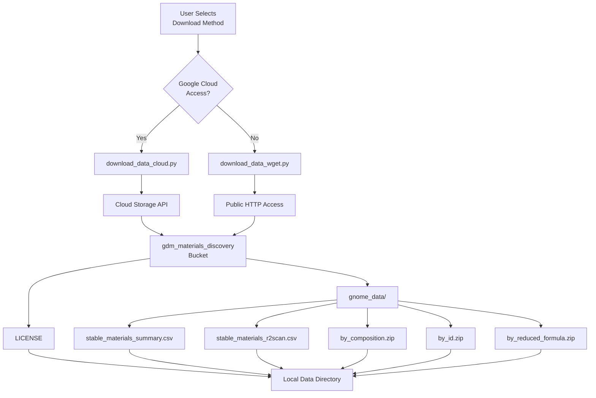

Sources: [scripts/download_data_cloud.py](), [scripts/download_data_wget.py]()

## Method 1: Download Using Google Cloud Storage API

This method requires the Google Cloud SDK and appropriate authentication to access the Google Cloud Storage bucket.

### Prerequisites
- Python 3.7 or newer
- Google Cloud SDK installed and configured
- `google-cloud-storage` Python package installed

### Usage

1. Clone the materials_discovery repository:
   ```bash
   git clone https://github.com/google-deepmind/materials_discovery.git
   cd materials_discovery
   ```

2. Run the download script with an optional data directory (defaults to "data"):
   ```bash
   python scripts/download_data_cloud.py --data_dir=/path/to/store/data
   ```

The script creates the specified directory (if it doesn't exist), establishes a connection to the Google Cloud Storage bucket, and downloads all the dataset files.

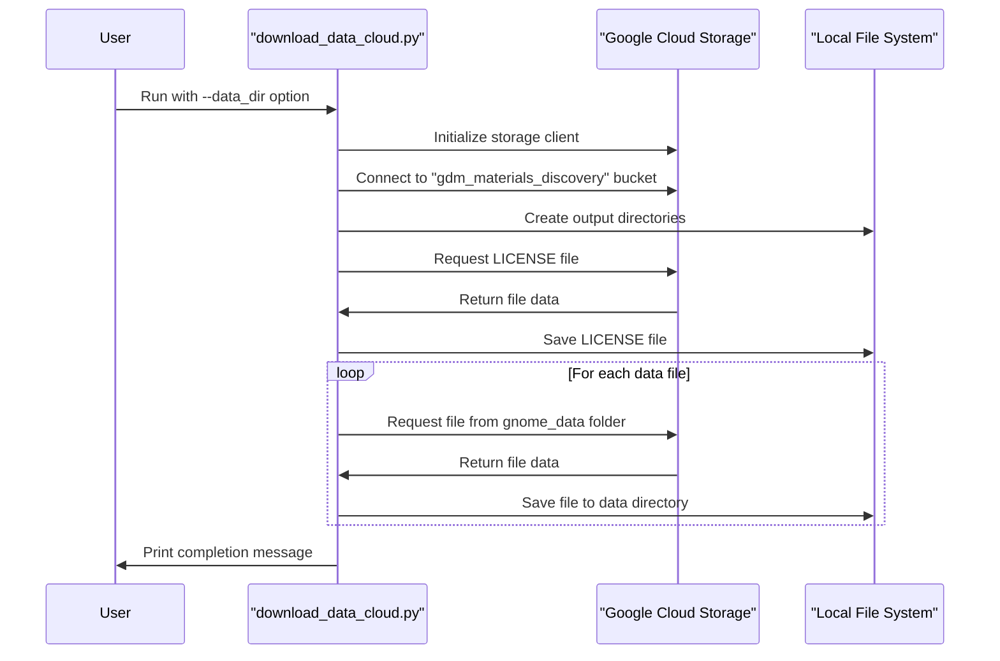

Sources: [scripts/download_data_cloud.py:49-68]()

## Method 2: Download Using wget

This method uses the `wget` command-line utility to download the dataset from public HTTP links. This is recommended for users who don't have Google Cloud Platform access.

### Prerequisites
- Python 3.7 or newer
- `wget` utility installed on your system

### Usage

1. Clone the materials_discovery repository:
   ```bash
   git clone https://github.com/google-deepmind/materials_discovery.git
   cd materials_discovery
   ```

2. Run the download script with an optional data directory (defaults to "data"):
   ```bash
   python scripts/download_data_wget.py --data_dir=/path/to/store/data
   ```

The script creates the specified directory (if it doesn't exist), constructs the public URLs for each file, and uses `wget` to download them.

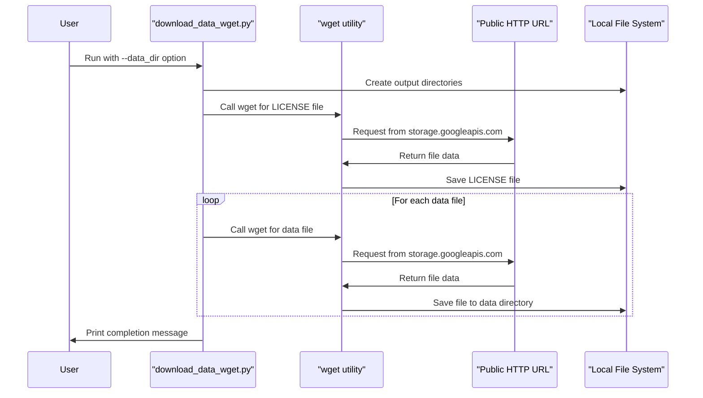

Sources: [scripts/download_data_wget.py:45-65]()

## Downloaded File Structure

After running either download script, you'll have the following file structure in your specified data directory:

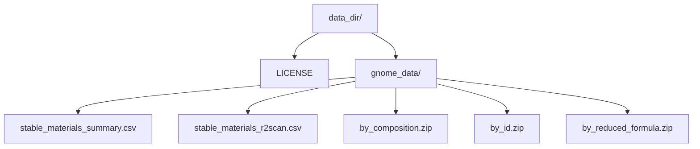

The total download size is approximately:
- CSV files: ~150 MB
- ZIP files with structures: ~3 GB

Sources: [scripts/download_data_cloud.py:57-66](), [scripts/download_data_wget.py:49-63]()

## Verifying the Download

You can verify that all files have been downloaded correctly by checking their existence and sizes:

```bash
ls -la data/LICENSE
ls -la data/gnome_data/
```

When the download is complete, you'll see a message:
```
Done downloading data to directory: [your_data_dir]
```

Sources: [scripts/download_data_cloud.py:68](), [scripts/download_data_wget.py:65]()

## Next Steps

After downloading the dataset, you can:

1. Extract the structure ZIP files if you need to access the individual crystal structures
2. Load the CSV files using pandas for data analysis
3. Use the provided analysis notebooks to explore the dataset (see [Analysis Tools](#4))

For specific guidance on analyzing the dataset, refer to the [Exploring Chemical Systems](#4.1) page.

---

# Page: Machine Learning Models

# Machine Learning Models

<details>
<summary>Relevant source files</summary>

The following files were used as context for generating this wiki page:

- [README.md](README.md)
- [model/crystal.py](model/crystal.py)
- [model/gnn.py](model/gnn.py)
- [model/gnome.py](model/gnome.py)
- [model/nequip.py](model/nequip.py)

</details>


This page documents the machine learning architecture used in the Materials Discovery project for material property prediction and structure exploration. The repository contains implementations of specialized deep learning models, with a focus on graph-based representations of crystal structures to enable accurate prediction of material stability and properties.

For detailed instructions on using these models with the GNoME dataset, see [GNoME Dataset](#2). For more information about specific model implementations, refer to corresponding model-specific pages: [GNoME Model](#3.1), [NequIP Model](#3.2), and [Crystal Energy Model](#3.3).

## Model Architecture Overview

The codebase implements two primary model families:

1. **GNoME (Graph Networks for Materials Exploration)**: Message-passing neural networks optimized for materials discovery, achieving state-of-the-art accuracy of 21 meV/atom in formation energy prediction
   
2. **NequIP**: Equivariant interatomic potential models based on the architecture by Batzner et al. (2022), used for learning dynamics from large datasets

Both model families utilize graph representations of materials, where atoms serve as nodes and their connections as edges, enabling the models to understand and predict material properties based on structural relationships.

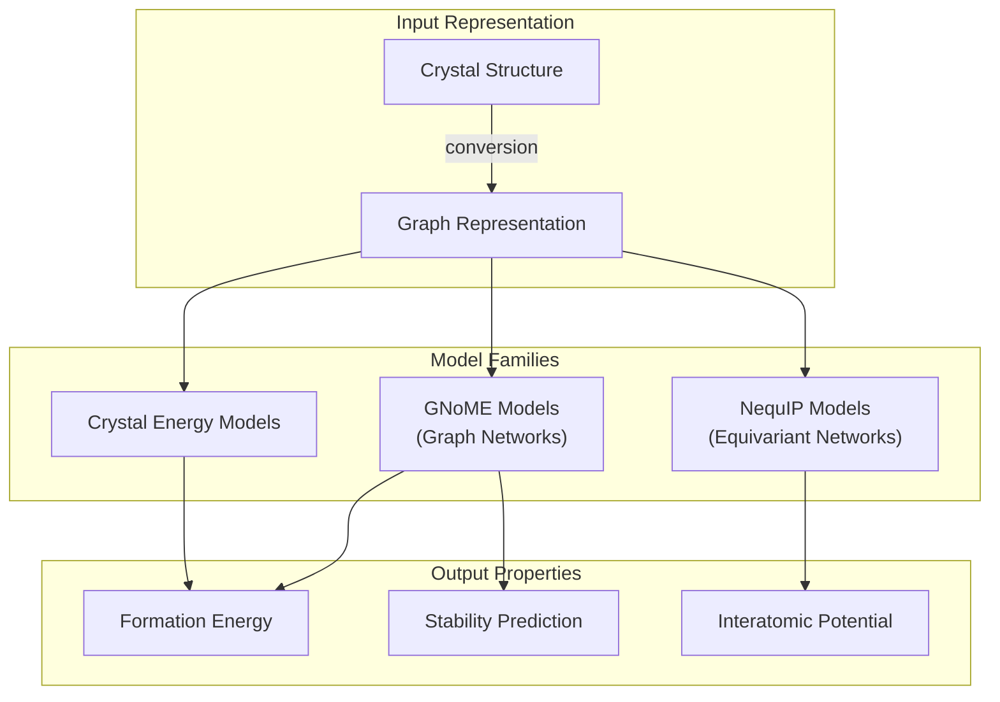

Sources: [README.md:64-77](), [model/gnome.py:48-53]()

## Model Components Hierarchy

The models in the codebase share common architectural principles but vary in their implementation details. Here's a hierarchical view of the model components:

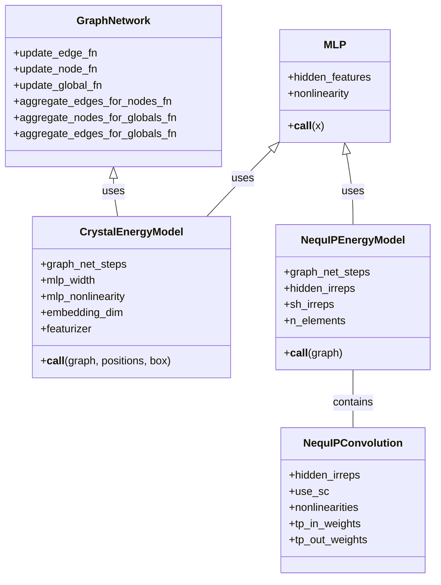

Sources: [model/gnome.py:45-53](), [model/nequip.py:306-334](), [model/crystal.py:204-294](), [model/gnn.py:45-183]()

## Model Creation and Configuration

Models are created through a common interface that uses configuration dictionaries to specify model hyperparameters.

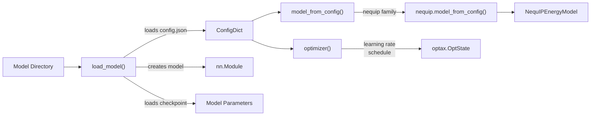

Sources: [model/gnome.py:48-53](), [model/gnome.py:95-123](), [model/gnome.py:126-165]()

### Creating Models from Configuration

The `model_from_config` function serves as the primary entry point for creating model instances:

```python
def model_from_config(cfg: ConfigDict) -> nn.Module:
  model_family = cfg.get('model_family', 'nequip')
  if model_family == 'nequip':
    return nequip.model_from_config(cfg)
  else:
    raise ValueError(f'Unrecognized model family: {model_family}')
```

Currently, the implementation only supports the `nequip` model family, though the repository documents both GNoME and NequIP models.

Sources: [model/gnome.py:48-53]()

### Configuring Optimizers

The `optimizer` function configures optimization algorithms based on the training configuration:

```python
def optimizer(cfg: ConfigDict) -> optax.OptState:
  # Configuration logic for learning rate schedules
  # Supports constant, linear_decay, cosine_decay, warmup_cosine_decay, scale_on_plateau
  # Returns appropriate optax optimizer
```

Sources: [model/gnome.py:95-123]()

### Loading Saved Models

The `load_model` function provides functionality to load saved models from a directory:

```python
def load_model(directory: str) -> Tuple[ConfigDict, nn.Module, PyTree]:
  # Loads config.json from directory
  # Creates model from config
  # Loads parameters from checkpoint
  # Returns config, model, and parameters
```

Sources: [model/gnome.py:126-165]()

## NequIP Model

The NequIP model implements the architecture described by Batzner et al. for equivariant interatomic potentials. It processes crystal structures represented as graphs and maintains invariance to rotations and translations in 3D space.

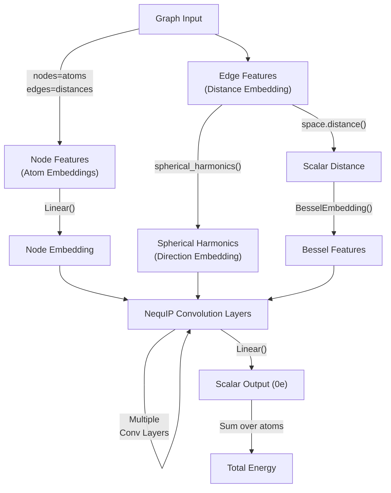

Key components of the NequIP model:

1. **NequIPEnergyModel**: Main model class that orchestrates the entire network
2. **NequIPConvolution**: Core convolution operation that performs equivariant message passing
3. **Linear and MLP layers**: Transform features while preserving equivariance

Sources: [model/nequip.py:306-334](), [model/nequip.py:77-303]()

## Crystal Energy Model

The Crystal Energy Model is specifically designed for crystal energy prediction, using a graph neural network with specialized features for crystalline materials.

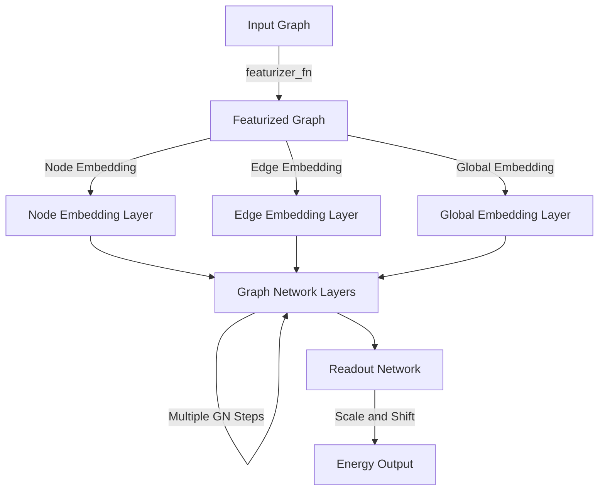

Key components of the Crystal Energy Model:

1. **Featurizer**: Converts raw crystal structure to graph features
2. **Graph Network Steps**: Series of message passing layers that update node, edge, and global features
3. **Readout Network**: Converts graph features to energy prediction

Sources: [model/crystal.py:204-294](), [model/crystal.py:302-333]()

## Graph Neural Network

The fundamental building block for both model families is the graph neural network implementation in `gnn.py`. This implementation follows the architecture described in the DeepMind paper ["Relational inductive biases, deep learning, and graph networks"](https://arxiv.org/abs/1806.01261).

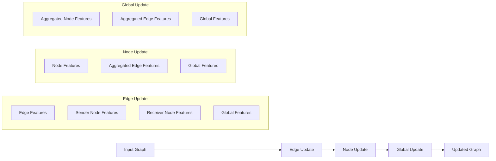

The `GraphNetwork` function generates a callable that applies this transformation to input graphs, with customizable update and aggregation functions.

Sources: [model/gnn.py:45-183]()

## Model Training Process

The codebase supports different learning rate schedules and optimization strategies for model training:

```mermaid
flowchart TD
    ConfigDict["ConfigDict"] --> |"optimizer()"| Optimizer["Optimizer Configuration"]
    
    Optimizer --> LRSchedule["Learning Rate Schedule"]
    
    LRSchedule --> |"constant"| ConstantLR["Constant LR"]
    LRSchedule --> |"linear_decay"| LinearDecay["Linear Decay"]
    LRSchedule --> |"cosine_decay"| CosineDecay["Cosine Decay"]
    LRSchedule --> |"warmup_cosine_decay"| WarmupCosine["Warmup + Cosine Decay"]
    LRSchedule --> |"scale_on_plateau"| Plateau["Scale on Plateau"]
    
    ConstantLR & LinearDecay & CosineDecay & WarmupCosine & Plateau --> OptaxOptimizer["optax Optimizer"]
    OptaxOptimizer --> |"Optional L2 regularization"| FinalOptimizer["Final Optimizer"]
```

The `scale_lr_on_plateau` gradient transformation provides functionality to reduce the learning rate when the loss plateaus, which can help models escape local minima during training.

Sources: [model/gnome.py:64-92](), [model/gnome.py:95-123]()

## Summary

The machine learning models in this repository represent state-of-the-art approaches for materials discovery and property prediction. By leveraging graph neural networks with specialized architectures for 3D crystal structures, these models can accurately predict formation energies and stability of novel materials.

The model architecture is modular, with common interfaces for model creation, optimization, and loading. This enables easy experimentation with different model configurations and training strategies.

Sources: [model/gnome.py](), [model/nequip.py](), [model/crystal.py](), [model/gnn.py]()

---

# Page: GNoME Model

# GNoME Model

<details>
<summary>Relevant source files</summary>

The following files were used as context for generating this wiki page:

- [README.md](README.md)
- [model/gnome.py](model/gnome.py)

</details>


This document provides a comprehensive overview of the GNoME (Graph Networks for Materials Exploration) model, its architecture, configuration, and usage within the materials discovery pipeline. The GNoME model is the primary machine learning component used to identify 381,000 novel stable materials as described in the research paper.

For information about NequIP, which is used for interatomic potentials, see [NequIP Model](#3.2). For information about the Crystal Energy Model, see [Crystal Energy Model](#3.3).

## 1. Model Overview

The GNoME model is a specialized graph neural network designed for predicting material stability and properties from crystal structures. It represents crystal structures as graphs where atoms are nodes and bonds or interactions are edges, then applies message passing operations to predict formation energies and stability metrics.

```mermaid
flowchart TD
    subgraph "GNoME Model in Materials Discovery Pipeline"
        RawData["Crystal Structure Data"] --> GraphRepresentation["Graph Representation"]
        GraphRepresentation --> GNoMEModel["GNoME Model Processing"]
        GNoMEModel --> EnergyPrediction["Energy Prediction"]
        GNoMEModel --> StabilityPrediction["Stability Prediction"]
        EnergyPrediction & StabilityPrediction --> MaterialDiscovery["Novel Material Discovery"]
    end
```

Sources: [model/gnome.py:48-53](), [README.md:67-71]()

## 2. Model Architecture

The GNoME model is built on the concept of graph neural networks, specifically optimized for materials science applications. The `model_from_config` function in the codebase is responsible for constructing the appropriate model architecture based on the provided configuration.

```mermaid
classDiagram
    class ModelFactory {
        +model_from_config(cfg)
    }
    
    class NequIPModel {
        +graph_net_steps
        +hidden_irreps
        +sh_irreps
        +n_elements
    }
    
    class GraphsTuple {
        +nodes
        +edges
        +senders
        +receivers
        +globals
        +n_node
        +n_edge
    }
    
    ModelFactory --> NequIPModel : creates
    NequIPModel --> GraphsTuple : processes
```

The current implementation defaults to the NequIP architecture when creating a model:

```python
def model_from_config(cfg: ConfigDict) -> nn.Module:
  model_family = cfg.get('model_family', 'nequip')
  if model_family == 'nequip':
    return nequip.model_from_config(cfg)
  else:
    raise ValueError(f'Unrecognized model family: {model_family}')
```

The model input is structured as a `GraphsTuple`, which contains:
- `nodes`: Features for each atom (shape: [nodes, features])
- `edges`: Spatial vectors between connected atoms (shape: [edges, 3])
- `senders`/`receivers`: Indices defining the graph connectivity
- `globals`: Global features for each graph
- `n_node`/`n_edge`: Number of nodes and edges per graph

Sources: [model/gnome.py:36-53](), [model/gnome.py:135-143]()

## 3. Model Training and Optimization

The model provides a flexible optimization strategy through the `optimizer` function, which creates an appropriate optimizer based on the configuration parameters.

```mermaid
flowchart TD
    subgraph "GNoME Model Training Process"
        Config["Configuration Parameters"] --> Schedule["Learning Rate Schedule Selection"]
        Schedule --> Optimizer["Optimizer Creation"]
        Optimizer --> Training["Training Loop"]
        Training --> Evaluation["Model Evaluation"]
        Evaluation --> |"If performance plateaus"| LRScaling["Learning Rate Scaling"]
        LRScaling --> Training
    end
```

The GNoME model supports various learning rate schedules:

| Schedule Type | Description |
|---------------|-------------|
| `constant` | Fixed learning rate throughout training |
| `linear_decay` | Linear decrease from initial to zero |
| `cosine_decay` | Cosine-shaped decay schedule |
| `warmup_cosine_decay` | Initial warmup period followed by cosine decay |
| `scale_on_plateau` | Reduces learning rate when performance plateaus |

The optimization is handled by either Adam or AdamW optimizers, with optional L2 regularization for weight decay:

```python
if not hasattr(cfg, 'l2_regularization') or cfg.l2_regularization == 0.0:
  return optax.adam(schedule)

return optax.adamw(schedule, weight_decay=cfg.l2_regularization)
```

Sources: [model/gnome.py:95-123](), [model/gnome.py:64-92]()

## 4. Learning Rate Adaptation

The GNoME model implements a `scale_lr_on_plateau` optimizer transformation that can automatically reduce the learning rate when training progress stalls. This is particularly useful for fine-tuning and achieving optimal convergence.

```mermaid
flowchart LR
    subgraph "Learning Rate Adaptation"
        InitLR["Initial Learning Rate"] --> Monitoring["Monitor Loss Value"]
        Monitoring --> Decision{"Improved in N steps?"}
        Decision --> |"Yes"| Continue["Continue Training"]
        Decision --> |"No"| ReduceLR["Reduce Learning Rate"]
        ReduceLR --> Continue
    end
```

The implementation uses a `ScaleLROnPlateau` named tuple to track the optimization state:

```python
class ScaleLROnPlateau(NamedTuple):
  step_size: jnp.ndarray
  minimum_loss: jnp.ndarray
  steps_without_reduction: jnp.ndarray
  max_steps_without_reduction: jnp.ndarray
  reduction_factor: jnp.ndarray
```

When the model performance plateaus (doesn't improve for a specified number of steps), the learning rate is automatically scaled down by the reduction factor to enable more precise optimization.

Sources: [model/gnome.py:64-92]()

## 5. Model Loading and Initialization

The GNoME model provides utilities for loading pre-trained models from checkpoints. The `load_model` function handles the complete process of:
1. Loading the model configuration
2. Initializing the model architecture
3. Loading the trained parameters from checkpoints

```mermaid
flowchart TD
    subgraph "Model Loading Process"
        LoadConfig["Load Configuration"] --> InitModel["Initialize Model"]
        InitModel --> CreateDummyGraph["Create Dummy Graph"]
        CreateDummyGraph --> InitParams["Initialize Parameters Structure"]
        InitParams --> LoadCheckpoint["Load Checkpoint Data"]
        LoadCheckpoint --> ReturnComponents["Return Config, Model, Parameters"]
    end
```

The function initializes an abstract model structure using a dummy graph to determine the parameter shapes, then loads the actual parameter values from the checkpoint:

```python
def load_model(directory: str) -> Tuple[ConfigDict, nn.Module, PyTree]:
  # Load configuration
  with open(os.path.join(directory, 'config.json'), 'r') as f:
    c = json.loads(json.loads(f.read()))
    c = ConfigDict(c)

  # Initialize model and optimizer
  model = model_from_config(c)
  opt_init, _ = optimizer(c)

  # Create dummy graph for shape initialization
  graph = GraphsTuple(
      ShapedArray((1, NUM_ELEMENTS), f32),  # Nodes
      ShapedArray((1, 3), f32),  # dR 
      ShapedArray((1,), i32),  # senders
      ShapedArray((1,), i32),  # receivers
      ShapedArray((1, 1), f32),  # globals
      ShapedArray((1,), i32),  # n_node
      ShapedArray((1,), i32),  # n_edge
  )
  
  # Get abstract parameter structure
  abstract_params, abstract_state = eval_shape(init_opt_and_model, graph)
  
  # Load checkpoint data
  ckpt_data = (0, abstract_params, abstract_state)
  checkpoint = os.path.join(directory, checkpoints[0])
  with open(checkpoint, 'rb') as f:
    ckpt = serialization.from_bytes(ckpt_data, f.read())
    
  params = tree_map(lambda x: x.astype(f32), ckpt[1])
  return c, model, params
```

This function enables researchers to easily load trained models for inference on new crystal structures.

Sources: [model/gnome.py:126-165]()

## 6. Integration with Materials Discovery Pipeline

The GNoME model serves as a critical component in the materials discovery pipeline, bridging the gap between crystal structure representation and stability prediction.

```mermaid
flowchart LR
    subgraph "GNoME in Materials Discovery Pipeline"
        Dataset["GNoME Dataset"] -->|"Crystal Structures"| GraphConstruction["Graph Construction"]
        GraphConstruction -->|"GraphsTuple"| GNoMEModel["GNoME Model"]
        GNoMEModel -->|"Energy Predictions"| StabilityAnalysis["Stability Analysis"]
        StabilityAnalysis -->|"Decomposition Energy"| ConvexHull["Convex Hull Construction"]
        ConvexHull --> NovelMaterials["Novel Stable Materials"]
    end
```

The model takes crystal structures from the dataset, processes them as graph representations using the `GraphsTuple` structure, and makes energy predictions that feed into stability analysis and convex hull construction for materials discovery.

Sources: [model/gnome.py:36-53](), [README.md:67-71]()

## 7. Technical Implementation Details

The GNoME model is implemented using several key libraries:

| Library | Purpose |
|---------|---------|
| JAX | Accelerated numerical computing |
| Flax | Neural network library built on JAX |
| jraph | Graph neural network library for JAX |
| e3nn_jax | Equivariant neural networks for 3D data |
| optax | Gradient processing and optimization |

The model uses 32-bit floating point (`f32`) precision for parameters and computations, and provides specialized utilities for handling equivariant operations that respect the symmetries inherent in crystal structures.

A few important constants and type definitions used in the implementation:

```python
f32 = jnp.float32
i32 = jnp.int32
GraphsTuple = jraph.GraphsTuple
IrrepsArray = e3nn.IrrepsArray
NUM_ELEMENTS = 94  # Maximum atomic number considered
```

Sources: [model/gnome.py:15-47]()

This technical foundation enables the GNoME model to efficiently process crystal structures and make accurate predictions about their stability and properties, facilitating the discovery of novel materials at scale.

---

# Page: NequIP Model

# NequIP Model

<details>
<summary>Relevant source files</summary>

The following files were used as context for generating this wiki page:

- [README.md](README.md)
- [model/nequip.py](model/nequip.py)

</details>


## Purpose and Scope

This document describes the NequIP (Neural Equivariant Interatomic Potentials) model implementation in the Materials Discovery GNoME project. The NequIP model is designed to predict interatomic potentials and energies of crystal structures with high accuracy while respecting physical symmetries. This page covers the model architecture, components, and configuration options as implemented in JAX. For information about the broader GNoME model architecture, see [GNoME Model](#3.1).

Sources: [model/nequip.py:1-5](), [README.md:72-76]()

## Model Overview

NequIP is an equivariant graph neural network designed for atomic systems, originally described by Batzner et al. in their 2022 paper. The implementation in this repository uses JAX and e3nn_jax to create a model that respects the symmetries of 3D space (translations, rotations) while predicting energies of crystal structures.

The model processes atomic structures as graphs where:
- Atoms are represented as nodes
- Interatomic interactions are represented as edges
- Node and edge features transform according to specific symmetry rules (irreducible representations)

```mermaid
flowchart TD
    subgraph "NequIP Model Architecture"
        Input["Crystal Structure Graph"] --> Embed["Node and Edge Embedding"]
        Embed --> Conv["NequIP Convolution Layers"]
        Conv --> Output["Energy Prediction"]
        
        subgraph "Graph Representation"
            Nodes["Atoms as Nodes"]
            Edges["Interatomic Bonds as Edges"]
            ShEmbed["Spherical Harmonics Edge Features"]
        end
        
        subgraph "Key Features"
            Equivariance["E(3) Equivariance"]
            TensorProducts["Tensor Product Operations"]
            RadialFunctions["Radial Basis Functions"]
        end
    end
```

Sources: [model/nequip.py:306-334](), [model/nequip.py:427-433]()

## Model Components

The NequIP implementation consists of two main classes and several supporting functions:

### NequIPEnergyModel

This is the main model class that constructs the complete neural network architecture for energy prediction.

```mermaid
classDiagram
    class NequIPEnergyModel {
        +graph_net_steps: int
        +use_sc: bool
        +nonlinearities: Dict
        +n_elements: int
        +hidden_irreps: str
        +sh_irreps: str
        +num_basis: int
        +r_max: float
        +__call__(graph) Energy
    }
    
    class NequIPConvolution {
        +hidden_irreps: Irreps
        +use_sc: bool
        +nonlinearities: Dict
        +radial_net_nonlinearity: str
        +__call__(node_features, node_attributes, edge_sh, edge_src, edge_dst, edge_embedded) IrrepsArray
    }
    
    class Linear {
        +irreps_out: Irreps
        +__call__(x) IrrepsArray
    }
    
    class BesselEmbedding {
        +count: int
        +inner_cutoff: float
        +outer_cutoff: float
        +__call__(rs) Array
    }
    
    NequIPEnergyModel --> NequIPConvolution : uses
    NequIPEnergyModel --> Linear : uses
    NequIPEnergyModel --> BesselEmbedding : uses
    NequIPConvolution --> Linear : uses
```

The `NequIPEnergyModel` takes a graph representation of a crystal structure and processes it through the following steps:
1. Creates node embeddings based on atom types
2. Computes spherical harmonic embeddings of edge vectors
3. Processes the graph through multiple convolutional layers
4. Outputs per-atom energies, which are then summed to get the total energy

Key parameters include:
- `graph_net_steps`: Number of convolutional layers
- `hidden_irreps`: Feature dimensions and transformation properties
- `sh_irreps`: Spherical harmonic irreps used for edge embedding
- `r_max`: Cutoff radius for interatomic interactions

Sources: [model/nequip.py:306-423]()

### NequIPConvolution

The `NequIPConvolution` class implements the message-passing operation for the NequIP model, combining node features with spherical harmonic embeddings of edge vectors.

Key operations include:
1. Linear transformation of node features
2. Tensor product between edge spherical harmonics and node features
3. Weighting by a radial network that processes interatomic distances
4. Aggregation of edge features to target nodes
5. Self-connection (residual connection) and gating operations

The convolution respects equivariance by using tensor products between features with well-defined transformation properties.

Sources: [model/nequip.py:77-303]()

## Technical Details

### Irreducible Representations (Irreps)

The model uses irreducible representations from group theory to encode how features transform under rotations. These are specified using strings like `"128x0e + 64x1e + 4x2e"`, where:
- `0e` represents scalar features (invariant to rotations)
- `1e` represents vector features (transform as vectors under rotation)
- `2e` represents L=2 features (transform like quadrupoles)
- The coefficients (128, 64, 4) indicate the multiplicity of each irrep

Default hidden irreps in the model are `"128x0e + 64x1e + 4x2e"`, providing a mix of scalar, vector, and higher-order features.

Sources: [model/nequip.py:39-43](), [model/nequip.py:464]()

### Tensor Products and Spherical Harmonics

The model uses tensor products to combine features in a way that preserves equivariance. Key components include:

1. **Spherical Harmonics**: Used to embed edge vectors in a rotationally equivariant representation
   ```python
   edge_sh = e3nn.spherical_harmonics(self.sh_irreps, dR, normalize=True)
   ```

2. **Functional Tensor Product**: Combines node features with spherical harmonics
   ```python
   tp = FunctionalTensorProduct(
       irreps_in1=edge_features.irreps,
       irreps_in2=edge_sh.irreps,
       irreps_out=irreps_after_tp,
       instructions=sorted_instructions,
   )
   ```

The tensor product operations follow specific "instructions" that determine how different irreps are combined.

Sources: [model/nequip.py:229-234](), [model/nequip.py:372]()

### Radial Functions

The model uses Bessel functions to create a basis for representing interatomic distances in a smooth, differentiable way.

```python
embedded_dr_edge = nn_util.BesselEmbedding(
    count=self.num_basis, inner_cutoff=r_max - 0.5, outer_cutoff=r_max
)(scalar_dr_edge)
```

These radial embeddings are used to weight the tensor product operations through a small MLP that maps distances to tensor product weights.

Sources: [model/nequip.py:374-376](), [model/nequip.py:248-253]()

## Configuration Options

The NequIP model provides several configuration options through the `default_config()` function:

| Parameter | Default Value | Description |
|-----------|---------------|-------------|
| `graph_net_steps` | 5 | Number of convolutional layers |
| `nonlinearities` | `{'e': 'raw_swish', 'o': 'tanh'}` | Activation functions for even/odd irreps |
| `use_sc` | `True` | Whether to use self-connections (residual connections) |
| `n_elements` | 94 | Number of chemical elements in the periodic table to support |
| `hidden_irreps` | `'128x0e + 64x1e + 4x2e'` | Feature dimensions and symmetry properties |
| `sh_irreps` | `'1x0e + 1x1e + 1x2e'` | Spherical harmonic irreps for edge embeddings |
| `num_basis` | 8 | Number of Bessel basis functions |
| `r_max` | 5.0 | Cutoff radius in Angstroms |
| `n_neighbors` | 10.0 | Average number of neighbors per atom (for normalization) |

These parameters can be adjusted to balance model expressivity, computational efficiency, and physical accuracy.

Sources: [model/nequip.py:457-480]()

## Integration with GNoME Framework

The NequIP model is integrated into the GNoME framework using the `model_from_config` function, which creates a model instance from a configuration dictionary:

```mermaid
flowchart LR
    Config["Configuration Dictionary"] --> ModelFromConfig["model_from_config()"]
    ModelFromConfig --> NequIPInstance["NequIPEnergyModel Instance"]
    NequIPInstance --> GNoMEFramework["GNoME Materials Discovery Framework"]
```

The model provides energy predictions that can be used for various materials discovery tasks, including:
1. Structure optimization
2. Energy prediction for crystal structure candidates
3. Force calculations for molecular dynamics

Sources: [model/nequip.py:426-454](), [README.md:72-76]()

## Performance Considerations

The NequIP model balances accuracy and computational efficiency through several design choices:

1. **Configurable Depth**: The number of convolutional layers can be adjusted based on the complexity of the material system
2. **Feature Dimensions**: The hidden_irreps parameter controls model capacity
3. **Cutoff Radius**: The r_max parameter determines the extent of interatomic interactions considered
4. **Normalization**: Division by average neighbor count helps stabilize training

For larger systems, computational requirements grow with the number of atoms and their connectivity.

Sources: [model/nequip.py:274-276](), [model/nequip.py:473-474]()

---

# Page: Crystal Energy Model

# Crystal Energy Model

<details>
<summary>Relevant source files</summary>

The following files were used as context for generating this wiki page:

- [model/crystal.py](model/crystal.py)
- [model/gnn.py](model/gnn.py)

</details>


## Purpose and Scope

The Crystal Energy Model is a graph neural network designed to predict the energy of crystal structures within the materials discovery pipeline. It serves as a key component in the GNoME (Graph Networks for Materials Exploration) framework by providing accurate energy predictions that are essential for identifying stable materials. For information about the broader GNoME model architecture, see [GNoME Model](#3.1).

This document explains the architecture, implementation, and integration of the Crystal Energy Model, focusing on how it transforms crystal structure information into accurate energy predictions.

Sources: [model/crystal.py:204-293]()

## Model Architecture Overview

The Crystal Energy Model processes crystal structures represented as graphs, where atoms are nodes and bonds/interactions are edges. The model uses message passing through a graph neural network to capture complex interactions within the crystal structure and predict its energy.

```mermaid
flowchart TD
    subgraph "CrystalEnergyModel Architecture"
        A["Input: Crystal Graph, Positions, Box"] --> B["Featurization"]
        B --> C["Graph Embedding"]
        C --> D["Graph Network Steps"]
        D --> E["Readout Function"]
        E --> F["Output: Crystal Energy"]
    end
```

Sources: [model/crystal.py:204-293]()

### Graph Representation and Featurization

The model begins by converting crystal structure information into a graph-based representation:

- **Nodes**: Atoms in the crystal
- **Edges**: Interactions between atoms
- **Global attributes**: Properties of the entire crystal

The featurization process transforms atomic positions into feature vectors that capture distance relationships between atoms using Gaussian basis functions.

```mermaid
flowchart LR
    subgraph "Graph Featurization"
        A["Crystal Structure<br>(Positions, Unit Cell)"] --> B["Position Differences"]
        B --> C["Distance Calculation"]
        C --> D["Gaussian Features<br>(r_0 = linspace(0.05, 4, 30))"]
        D --> E["Featurized Graph"]
    end
```

Sources: [model/crystal.py:139-183](), [model/crystal.py:186-202]()

## Implementation Details

The Crystal Energy Model is implemented as a Flax module in [model/crystal.py]() and uses the graph network definitions from [model/gnn.py]().

### Key Components

#### 1. MLP (Multi-Layer Perceptron)

The model uses MLPs to transform node, edge, and global features. The MLP implementation supports various activation functions including ReLU, Swish, and a customized BetaSwish.

```mermaid
classDiagram
    class MLP {
        +features: Tuple[int,...]
        +nonlinearity: str
        +use_bias: bool
        +scalar_mlp_std: Optional[float]
        +__call__(x)
    }

    class BetaSwish {
        +__call__(x)
    }

    MLP --> BetaSwish : uses when nonlinearity="swish"
```

Sources: [model/crystal.py:96-117](), [model/crystal.py:58-64]()

#### 2. Graph Network

The Crystal Energy Model uses the `GraphNetwork` defined in [model/gnn.py]() to perform message passing between nodes, edges, and global features of the graph.

```mermaid
flowchart TD
    subgraph "GraphNetwork Message Passing"
        A["Input Graph"] --> B["Edge Update"]
        B --> C["Node Update"]
        C --> D["Global Update"]
        D --> E["Updated Graph"]
    end
```

Sources: [model/gnn.py:45-183]()

#### 3. Forward Pass Logic

The model processes a crystal graph through the following steps:

1. Apply featurization to the input graph, atom positions, and box dimensions
2. Embed the graph features into a latent space
3. Apply multiple graph network steps to update node, edge, and global features
4. Apply a readout function to produce the final energy prediction
5. Scale and shift the output to match the expected energy range

Sources: [model/crystal.py:226-293]()

### Configuration Parameters

The CrystalEnergyModel class accepts multiple configuration parameters:

| Parameter | Type | Description |
|-----------|------|-------------|
| graph_net_steps | int | Number of message passing steps in the graph network |
| mlp_width | Tuple[int] | Widths of MLP hidden layers |
| mlp_nonlinearity | str or Dict[str, str] | Activation function(s) for MLPs |
| embedding_dim | int | Dimension of the embedding space |
| featurizer | str | Type of featurization to use |
| shift | float | Constant shift applied to output (default: -1.6526496) |
| scale | float | Scaling factor for output (default: 1.0) |
| feature_band_limit | Optional[int] | Limit on feature bands |
| residual | Optional[str] | Type of residual connections |

Sources: [model/crystal.py:204-224](), [model/crystal.py:302-333]()

## Aggregation Functions

The model supports different types of aggregation functions for collecting information from nodes and edges:

```mermaid
flowchart LR
    subgraph "Aggregation Functions"
        A["segment_sum"] --> D["Used for default aggregation"]
        B["segment_mean"] --> E["Used for averaging features"]
        C["coordination-normalized"] --> F["Normalized by coordination numbers"]
    end
```

The model uses these aggregation functions to gather information from edges to nodes, nodes to globals, and edges to globals. The aggregation functions are defined in a dictionary called `AGGREGATION`:

Sources: [model/crystal.py:41-55]()

## Integration with GNoME

The Crystal Energy Model is instantiated by the `crystal_energy_model` function which configures the model according to the provided configuration dictionary. This function creates a model instance with appropriate aggregation functions and normalization settings.

```mermaid
flowchart TD
    subgraph "Model Integration"
        A["Configuration Dictionary"] --> B["crystal_energy_model()"]
        B --> C["CrystalEnergyModel Instance"]
        C --> D["GNoME Framework"]
    end
```

Sources: [model/crystal.py:302-333]()

## Gaussian Feature Generation

A key aspect of the model is how it generates features from interatomic distances using Gaussian basis functions. The `gaussian_edge_features` function implements this by transforming distance vectors into feature vectors:

```
feature_i = exp(-((dr - r_0_i)²) / 0.5²)
```

Where:
- `dr` is the interatomic distance
- `r_0_i` is a reference distance from a predefined set
- The standard deviation is fixed at 0.5 Å

The standard implementation uses 30 Gaussian basis functions with centers linearly spaced from 0.05 to 4 Å.

Sources: [model/crystal.py:186-202]()

## Practical Usage

The Crystal Energy Model can be used in two modes:
1. **Compositional mode**: When `positions` is `None`, the model operates only on composition information
2. **Structural mode**: When provided with atomic positions and unit cell information, the model performs full structural energy prediction

This makes the model versatile for different stages of materials discovery, from initial composition screening to detailed structural analysis.

Sources: [model/crystal.py:226-227](), [model/crystal.py:244-246]()

---

# Page: Model Utilities

# Model Utilities

<details>
<summary>Relevant source files</summary>

The following files were used as context for generating this wiki page:

- [model/e3nn_layer.py](model/e3nn_layer.py)
- [model/util.py](model/util.py)

</details>


## Overview

This page documents the utility functions and classes that support the machine learning models in the materials discovery pipeline. These utilities provide fundamental building blocks for constructing and operating the neural network architectures used in the [GNoME Model](#3.1), [NequIP Model](#3.2), and [Crystal Energy Model](#3.3).

The model utilities include neural network primitives, activation functions, feature encoding methods, and specialized components for equivariant neural networks that respect physical symmetries in materials representation.

Sources: [model/util.py:15-16]()

## Neural Network Primitives

### Nonlinearity Functions

The model framework offers a variety of activation functions (nonlinearities) that can be selected by name. These include standard functions like ReLU, sigmoid, and tanh, as well as more specialized functions like Swish and a parametric variant called BetaSwish.

```mermaid
graph TD
    subgraph "Nonlinearity Functions"
        none["none (identity)"]
        relu["relu"]
        swish["swish (parameterized)"]
        raw_swish["raw_swish (non-parameterized)"]
        tanh["tanh"]
        sigmoid["sigmoid"]
        silu["silu"]
    end
    
    get_nonlinearity["get_nonlinearity_by_name()"] --> |"name parameter"| NONLINEARITY
    NONLINEARITY --> none
    NONLINEARITY --> relu
    NONLINEARITY --> swish
    NONLINEARITY --> raw_swish
    NONLINEARITY --> tanh
    NONLINEARITY --> sigmoid
    NONLINEARITY --> silu
```

BetaSwish is a learnable activation function that introduces a trainable parameter β for each feature dimension:

```mermaid
graph LR
    input["Input x"] --> beta["multiply by β parameter"]
    beta --> sigmoid["sigmoid(β*x)"]
    sigmoid --> mult["multiply"]
    input --> mult
    mult --> output["Output: x*sigmoid(β*x)"]
```

Sources: [model/util.py:42-71]()

### Multilayer Perceptron (MLP)

The `MLP` class implements a configurable multilayer perceptron with customizable layer widths, activation functions, and initialization options.

```mermaid
flowchart TD
    input["Input tensor"] --> 
    dense1["Dense layer 1\nfeatures[0] neurons"] -->
    nonlin1["Nonlinearity φ"] -->
    dense2["Dense layer 2\nfeatures[1] neurons"] -->
    nonlin2["Nonlinearity φ"] -->
    denseN["Dense layer N\nfeatures[-1] neurons"] -->
    output["Output tensor"]
    
    config["MLP Configuration:
    - features: tuple of layer widths
    - nonlinearity: activation function
    - use_bias: whether to use bias terms
    - scalar_mlp_std: initialization scale"]
```

The `mlp` function provides a convenient wrapper that handles concatenated inputs for use with graph data structures.

Sources: [model/util.py:74-111]()

## Graph Featurizers

Featurizers transform raw atomic data into graph representations suitable for neural network processing. The `neighbor_list_featurizer` function creates a featurizer that:

1. Takes atoms, positions, and neighbor list information
2. Converts this data into a graph representation (jraph.GraphsTuple)
3. Computes displacement vectors between connected atoms
4. Returns the graph with displacement vectors as edge features

```mermaid
sequenceDiagram
    participant A as "Input Data"
    participant B as "neighbor_list_featurizer"
    participant C as "Featurized Graph"
    
    A->>B: atoms, positions, neighbor_list
    Note over B: 1. Convert to graph structure
    Note over B: 2. Compute displacement vectors
    Note over B: 3. Apply masks for valid neighbors
    B->>C: Graph with displacement vectors as edge features
```

Sources: [model/util.py:114-132]()

## Distance Encodings with Bessel Functions

The `BesselEmbedding` module encodes interatomic distances using a set of radial basis functions based on spherical Bessel functions. This encoding is crucial for models like NequIP and SchNet that need to represent distance information in a way that respects rotational symmetry.

```mermaid
flowchart LR
    r["Interatomic distance r"] --> cutoff["Apply cutoff function"]
    cutoff --> bessel["Compute Bessel functions:\n2/r_c * sin(n*π*r/r_c)/r"]
    bessel --> output["Distance embedding vector"]
    
    params["Parameters:
    - count: number of basis functions
    - inner_cutoff: short-range cutoff
    - outer_cutoff: long-range cutoff"]
```

The implementation includes handling for numerical stability when distances approach zero and smooth cutoff functions to ensure continuous representations.

Sources: [model/util.py:137-168]()

## Equivariant Neural Network Layers

The model utilities include specialized neural network layers that maintain equivariance to rotations and translations, which is crucial for accurately representing 3D structures of materials.

```mermaid
classDiagram
    class FullyConnectedTensorProductE3nn {
        +irreps_out: Irreps
        +irreps_in1: Optional[Irreps]
        +irreps_in2: Optional[Irreps]
        +__call__(x1, x2)
    }
    
    class Linear {
        +irreps_out: Irreps
        +irreps_in: Optional[Irreps]
        +__call__(x)
    }
    
    class IrrepsArray {
        +irreps: Irreps
        +data: Array
    }
    
    IrrepsArray <-- FullyConnectedTensorProductE3nn: operates on
    IrrepsArray <-- Linear: operates on
```

These layers handle data represented as `IrrepsArray` objects that combine numerical values with their transformation properties under 3D rotations. This allows the neural networks to respect physical symmetries inherent in molecular and crystal structures.

Sources: [model/e3nn_layer.py:222-323]()

## Data Scaling and Normalization

The utilities provide functions for normalizing model inputs and outputs using dataset-specific shift and scale parameters. The `get_shift_and_scale` function retrieves appropriate normalization constants based on the configuration or dataset identifier.

```mermaid
flowchart TD
    config["Configuration"] --> check{"Has explicit\nshift and scale?"}
    check -->|Yes| explicit["Return cfg.shift, cfg.scale"]
    check -->|No| dataset{"Has train_dataset\nspecified?"}
    dataset -->|Yes| lookup["Look up in DATASET_SHIFT_SCALE"]
    dataset -->|No| error["Raise ValueError"]
```

A dictionary `DATASET_SHIFT_SCALE` contains predefined normalization parameters for known datasets, such as the "harder_silicon" dataset.

Sources: [model/util.py:171-181]()

## Integration with Model Components

The utility functions and classes described above are used throughout the model components in the materials discovery pipeline. The following diagram illustrates how these utilities integrate with the main model components:

```mermaid
graph TD
    subgraph "Model Utilities"
        MLP["MLP"]
        Nonlin["NONLINEARITY"]
        Feat["neighbor_list_featurizer"]
        Bessel["BesselEmbedding"]
        E3nn["Equivariant Layers"]
        Scale["get_shift_and_scale"]
    end
    
    subgraph "Model Components"
        GNoME["GNoME Model"]
        NequIP["NequIP Model"]
        CEM["Crystal Energy Model"]
    end
    
    MLP --> GNoME
    MLP --> NequIP
    MLP --> CEM
    
    Nonlin --> MLP
    
    Feat --> GNoME
    Feat --> NequIP
    
    Bessel --> NequIP
    
    E3nn --> NequIP
    
    Scale --> GNoME
    Scale --> NequIP
    Scale --> CEM
```

These utilities form the foundational building blocks that enable the construction of sophisticated machine learning models for materials discovery, ensuring consistent implementation, physical relevance, and computational efficiency.

---

# Page: Analysis Tools

# Analysis Tools

<details>
<summary>Relevant source files</summary>

The following files were used as context for generating this wiki page:

- [notebooks/Air_Stability.ipynb](notebooks/Air_Stability.ipynb)
- [notebooks/Compute_Decomposition_Energies.ipynb](notebooks/Compute_Decomposition_Energies.ipynb)
- [notebooks/Exploring_Chemical_Systems.ipynb](notebooks/Exploring_Chemical_Systems.ipynb)
- [notebooks/Visualize_GNoME_Structures.ipynb](notebooks/Visualize_GNoME_Structures.ipynb)
- [notebooks/a2c_Explorer.ipynb](notebooks/a2c_Explorer.ipynb)

</details>


The GNoME (Graph Networks for Materials Exploration) project provides a set of Jupyter notebooks for analyzing and exploring the materials dataset. These notebooks enable researchers to investigate chemical systems, calculate stability metrics, visualize crystal structures, and explore amorphous-to-crystalline transformations.

## Overview of Analysis Tools

The analysis tools consist of five Jupyter notebooks, each designed for a specific analytical task:

```mermaid
flowchart TD
    classDef notebook fill:#f9f9f9,stroke:#333,stroke-width:1px

    Dataset["GNoME Dataset<br>(381,000+ stable materials)"] --> N1
    Dataset --> N2
    Dataset --> N3
    Dataset --> N4
    Dataset --> N5

    N1["Exploring_Chemical_Systems.ipynb<br>Chemical system exploration & phase diagrams"] :::notebook
    N2["Compute_Decomposition_Energies.ipynb<br>Stability analysis via decomposition energy"] :::notebook
    N3["Air_Stability.ipynb<br>Reactivity analysis in air environment"] :::notebook
    N4["Visualize_GNoME_Structures.ipynb<br>3D visualization of crystal structures"] :::notebook
    N5["a2c_Explorer.ipynb<br>Amorphous to crystalline transformation"] :::notebook
```

Sources: 
- `notebooks/Exploring_Chemical_Systems.ipynb`
- `notebooks/Compute_Decomposition_Energies.ipynb`
- `notebooks/Air_Stability.ipynb`
- `notebooks/Visualize_GNoME_Structures.ipynb`
- `notebooks/a2c_Explorer.ipynb`

## Common Data Processing Pattern

All analysis notebooks follow a similar pattern for accessing and processing the GNoME dataset:

```mermaid
sequenceDiagram
    participant N as "Notebook"
    participant GCS as "Google Cloud Storage"
    participant DF as "DataFrame Processing"
    participant PT as "Pymatgen Tools"
    
    N ->> GCS: Download dataset via wget
    Note over N,GCS: Cloud bucket: gdm_materials_discovery
    GCS -->> N: Returns CSV and structure files
    N ->> DF: Load with pandas
    DF -->> N: Returns processed DataFrame
    N ->> PT: Create Pymatgen objects
    PT -->> N: Returns analysis-ready structures
```

Sources:
- `notebooks/Exploring_Chemical_Systems.ipynb:79-189`
- `notebooks/Compute_Decomposition_Energies.ipynb:79-195`
- `notebooks/Air_Stability.ipynb:79-114`

Each notebook contains a common pattern for accessing data:

```python
PUBLIC_LINK = "https://storage.googleapis.com/"
BUCKET_NAME = "gdm_materials_discovery"
FOLDER_NAME = "gnome_data"
FILES = ("stable_materials_summary.csv", ...)

# Download data
def download_from_link(link: str, output_dir: str):
    os.system(f"wget {link} -P {output_dir}")

# Load data
gnome_crystals = pd.read_csv('stable_materials_summary.csv', index_col=0)
```

## Exploring Chemical Systems

The `Exploring_Chemical_Systems.ipynb` notebook enables researchers to explore phase diagrams of specific chemical systems and compare GNoME entries with those from Materials Project.

### Key Features

1. Chemical system selection and filtering
2. Phase diagram generation using Pymatgen
3. Comparison with Materials Project data
4. Visualization of convex hulls

```mermaid
graph TD
    classDef dataStore fill:#f9f9f9,stroke:#333,stroke-width:1px
    classDef process fill:#f9f9f9,stroke:#333,stroke-width:1px
    classDef output fill:#f9f9f9,stroke:#333,stroke-width:1px

    GNoME["GNoME Crystals<br>DataFrame"] :::dataStore
    MP["Materials Project<br>DataFrame"] :::dataStore
    
    GNoME --> ProcessGNoME["annotate_chemical_system()<br>Group by chemical elements"] :::process
    MP --> ProcessMP["annotate_chemical_system()<br>Group by chemical elements"] :::process
    
    ProcessGNoME --> SelectSystem["Select chemical system<br>(e.g., Na-Zn-P)"] :::process
    ProcessMP --> SelectSystem
    
    SelectSystem --> PDEntries["collect_phase_diagram_entries()<br>Convert to Pymatgen entries"] :::process
    PDEntries --> PhaseDiagram["Generate PhaseDiagram<br>objects"] :::process
    
    PhaseDiagram --> PlotGNoME["Plot GNoME<br>Phase Diagram"] :::output
    PhaseDiagram --> PlotMP["Plot Materials Project<br>Phase Diagram"] :::output
    PhaseDiagram --> PlotJoint["Plot Joint<br>Phase Diagram"] :::output
```

Sources:
- `notebooks/Exploring_Chemical_Systems.ipynb:125-403`

### Example Usage

The notebook allows users to explore phase diagrams for specific chemical systems:

```python
# Select a chemical system
chemsys = 'Na-Zn-P'  # Specify elements separated by dashes

# Generate and plot phase diagram
gnome_phase_diagram_entries = collect_phase_diagram_entries(chemsys, grouped_entries, all_crystals)
gnome_phase_diagram = phase_diagram.PhaseDiagram(gnome_phase_diagram_entries)
gnome_pd_plot = phase_diagram.PDPlotter(gnome_phase_diagram)
gnome_pd_plot.get_plot()
```

## Computing Decomposition Energies

The `Compute_Decomposition_Energies.ipynb` notebook allows researchers to calculate decomposition energies of new structures relative to the GNoME dataset, determining if new materials are stable or how far they are from the convex hull.

### Key Components

1. Loading and processing GNoME dataset
2. Creating phase diagrams using Pymatgen
3. Computing decomposition energies for new structures
4. Evaluating stability of proposed materials

```mermaid
graph TD
    classDef dataComponent fill:#f9f9f9,stroke:#333,stroke-width:1px
    classDef processComponent fill:#f9f9f9,stroke:#333,stroke-width:1px
    classDef outputComponent fill:#f9f9f9,stroke:#333,stroke-width:1px

    GNoME["GNoME Dataset<br>stable_materials_summary.csv"] :::dataComponent
    External["External Dataset<br>external_materials_summary.csv"] :::dataComponent
    
    GNoME --> Process["Process Crystal Data<br>with pandas"] :::processComponent
    External --> Process
    
    Process --> Entries["Create Pymatgen<br>ComputedEntry objects"] :::processComponent
    
    Entries --> PD["Construct Phase Diagram<br>with pymatgen"] :::processComponent
    
    PD --> Hull["Generate Convex Hull"] :::processComponent
    
    NewStructure["New Material<br>Structure"] :::dataComponent --> ComputeEnergy["Calculate Energy<br>with same method"] :::processComponent
    
    ComputeEnergy --> DecompEnergy["Compute Decomposition<br>Energy Against Hull"] :::outputComponent
    Hull --> DecompEnergy
    
    DecompEnergy --> Stable{"Is Energy < 0?"}
    
    Stable -->|"Yes"| StableOutput["Material is Stable<br>Relative to Known Phases"] :::outputComponent
    Stable -->|"No"| UnstableOutput["Material is Unstable<br>Will Decompose to Hull Phases"] :::outputComponent
```

Sources:
- `notebooks/Compute_Decomposition_Energies.ipynb:196-261`

### Decomposition Energy Interpretation

| Decomposition Energy | Interpretation |
|----------------------|----------------|
| E < 0 | Structure is stable relative to the convex hull |
| E = 0 | Structure is on the convex hull (marginally stable) |
| E > 0 | Structure is unstable and will decompose to hull phases |

## Air Stability Analysis

The `Air_Stability.ipynb` notebook extends the zero-temperature stability analysis to account for reactivity with oxygen, water, and other components in air environments.

### Key Features

1. Grand potential phase diagram construction
2. Chemical potential adjustments for gas-phase species
3. Stability analysis under different environmental conditions
4. Reactivity predictions with air components

```mermaid
graph TD
    classDef dataComponent fill:#f9f9f9,stroke:#333,stroke-width:1px
    classDef processComponent fill:#f9f9f9,stroke:#333,stroke-width:1px
    classDef outputComponent fill:#f9f9f9,stroke:#333,stroke-width:1px

    GNoME["GNoME Dataset"] :::dataComponent
    EnvCond["Environmental Conditions<br>(T, P, pH, etc.)"] :::dataComponent
    
    GNoME --> ProcessData["Process Crystal Data<br>Create ComputedEntry objects"] :::processComponent
    EnvCond --> CalcPotential["Calculate Chemical Potentials<br>for O, H, etc."] :::processComponent
    
    ProcessData --> GrandPD["Create GrandPotentialPhaseDiagram<br>with pymatgen"] :::processComponent
    CalcPotential --> GrandPD
    
    GrandPD --> StabilityCalc["Calculate Pourbaix-like<br>Stability Regions"] :::processComponent
    
    StabilityCalc --> StabilityMap["Generate Stability Map<br>across conditions"] :::outputComponent
    
    StabilityCalc --> InterfaceAnalysis["InterfacialReactivity<br>Analysis"] :::processComponent
    
    InterfaceAnalysis --> ReactionProducts["Identify Likely<br>Reaction Products"] :::outputComponent
```

Sources:
- `notebooks/Air_Stability.ipynb:115-124`

The notebook leverages Pymatgen's `GrandPotentialPhaseDiagram` and `InterfacialReactivity` classes to model the impact of atmospheric components on material stability:

```python
# Create grand potential phase diagram with adjusted O2 chemical potential
entries = [...]  # ComputedEntry objects from GNoME dataset
chempots = {Element('O'): mu_o2}  # Chemical potential for oxygen
gpd = GrandPotentialPhaseDiagram(entries, chempots)

# Analyze stability
analyzer = PDAnalyzer(gpd)
decomp_e = analyzer.get_decomposition_energy(entry)
```

## Visualizing Crystal Structures

The `Visualize_GNoME_Structures.ipynb` notebook provides tools for exploring and visualizing the 3D structures of materials in the GNoME dataset.

### Key Features

1. Interactive 3D visualization of crystal structures
2. Element filtering and custom coloring
3. Multiple visualization backends (NGLView, ASE)
4. Crystal structure property examination

```mermaid
graph TD
    classDef dataComponent fill:#f9f9f9,stroke:#333,stroke-width:1px
    classDef processComponent fill:#f9f9f9,stroke:#333,stroke-width:1px
    classDef outputComponent fill:#f9f9f9,stroke:#333,stroke-width:1px

    GNoME["GNoME Dataset<br>stable_materials_summary.csv"] :::dataComponent
    ZipFile["CIF Structure Files<br>by_reduced_formula.zip"] :::dataComponent
    
    GNoME --> SelectMaterial["Select Material<br>by composition/properties"] :::processComponent
    
    SelectMaterial --> GetCIF["Extract CIF file<br>from zip archive"] :::processComponent
    ZipFile --> GetCIF
    
    GetCIF --> PymatgenStruct["Create Pymatgen<br>Structure object"] :::processComponent
    GetCIF --> ASEStruct["Create ASE<br>Atoms object"] :::processComponent
    
    PymatgenStruct --> NGLView["NGLView Visualization<br>Interactive 3D model"] :::outputComponent
    ASEStruct --> ASEVis["ASE Visualization<br>Alternative viewer"] :::outputComponent
    
    NGLView --> UIControls["UI Controls:<br>- Element filtering<br>- Color schemes<br>- Size adjustments"] :::outputComponent
```

Sources:
- `notebooks/Visualize_GNoME_Structures.ipynb:1456-1830`

### Visualization Options

The notebook supports multiple visualization backends with different capabilities:

| Visualization Method | Features | Best For |
|----------------------|----------|----------|
| NGLView | Interactive 3D, element filtering, custom colors | Detailed structure inspection |
| ASE | Simple visualization, publication-ready images | Quick overview, static images |
| Pymatgen plotters | 2D projections, bond analysis | Analyzing bonding patterns |

## Amorphous to Crystalline Explorer

The `a2c_Explorer.ipynb` notebook allows researchers to explore the amorphous-to-crystalline (a2c) structure prediction pipeline, examining the progression from generated amorphous structures to crystalline materials.

### Key Features

1. Exploration of a2c supporting data
2. Visualization of amorphous precursors and crystalline outcomes
3. Comparison between force field and DFT relaxations
4. Structure matching analysis

```mermaid
graph TD
    classDef dataComponent fill:#f9f9f9,stroke:#333,stroke-width:1px
    classDef processComponent fill:#f9f9f9,stroke:#333,stroke-width:1px
    classDef outputComponent fill:#f9f9f9,stroke:#333,stroke-width:1px

    a2cData["a2c_supporting_data.json"] :::dataComponent --> LoadData["Load and parse<br>JSON data"] :::processComponent
    
    LoadData --> ExtractStructures["Extract structure data<br>for specific campaign"] :::processComponent
    
    ExtractStructures --> Amorphous["Amorphous Structure<br>Starting point"] :::outputComponent
    ExtractStructures --> Subcells["Extracted Subcells<br>from amorphous phase"] :::outputComponent
    ExtractStructures --> FFRelaxed["Force-Field Relaxed<br>Final structure"] :::outputComponent
    ExtractStructures --> DFTRelaxed["DFT Relaxed<br>Final structure"] :::outputComponent
    
    Amorphous -- "Cut into subcells" --> Subcells
    Subcells -- "FF relaxation" --> FFRelaxed
    FFRelaxed -- "DFT validation" --> DFTRelaxed
    
    FFRelaxed --> StructureMatch["StructureMatcher<br>comparison with experiment"] :::processComponent
    DFTRelaxed --> StructureMatch
    
    StructureMatch --> MatchResults["Matching results<br>Analysis of transformation"] :::outputComponent
```

Sources:
- `notebooks/a2c_Explorer.ipynb:9-18`
- `notebooks/a2c_Explorer.ipynb:99-129`

The notebook provides functions to save structures for further analysis and visualizes the transformation pathway from amorphous to crystal:

```python
def get_saved_poscars_zip(merged_data, base_dir='a2c_supporting_data'):
    os.mkdir(base_dir)
    for k, data_dump in merged_data.items():
        path = os.path.join(base_dir, k)
        os.mkdir(path)
        
        # Save amorphous structure
        with open(os.path.join(path, 'a.vasp'), 'w') as f:
            f.write(data_dump['amorphous_structure'])
            
        # Save relaxed structures
        for a2c_match in data_dump['a2c_match_after_relax_example']:
            with open(os.path.join(path, 'a2c_match_{}_FF.vasp'.format(
                    a2c_match['index_in_a2c_initial_structures'])), 'w') as f:
                f.write(a2c_match['relaxed_ff'])
```

## Notebook Dependencies and Requirements

The analysis notebooks rely on several external Python libraries for data processing, analysis, and visualization:

```mermaid
graph TD
    classDef notebookComponent fill:#f9f9f9,stroke:#333,stroke-width:1px
    classDef libraryComponent fill:#f9f9f9,stroke:#333,stroke-width:1px

    Notebooks["GNoME Analysis<br>Notebooks"] :::notebookComponent
    
    Notebooks --> Pymatgen["pymatgen<br>Materials analysis toolkit"]:::libraryComponent
    Notebooks --> Pandas["pandas<br>Data processing"]:::libraryComponent
    Notebooks --> ASE["ASE<br>Atomic Simulation Environment"]:::libraryComponent
    Notebooks --> NGLView["nglview<br>3D visualization"]:::libraryComponent
    Notebooks --> Matplotlib["matplotlib<br>2D plotting"]:::libraryComponent
    
    Pymatgen --> PymatgenCore["Core structure handling<br>Element properties"]:::libraryComponent
    Pymatgen --> PymatgenAnalysis["Analysis modules<br>Phase diagrams, stability"]:::libraryComponent
    Pymatgen --> PymatgenIO["File I/O<br>CIF, POSCAR formats"]:::libraryComponent
    
    PymatgenAnalysis --> PhaseDiagram["PhaseDiagram<br>Convex hull construction"]:::libraryComponent
    PymatgenAnalysis --> PDPlotter["PDPlotter<br>Phase diagram visualization"]:::libraryComponent
    PymatgenAnalysis --> GrandPotential["GrandPotentialPhaseDiagram<br>Open system analysis"]:::libraryComponent
```

Sources:
- `notebooks/Exploring_Chemical_Systems.ipynb:40-62`
- `notebooks/Compute_Decomposition_Energies.ipynb:40-62`
- `notebooks/Air_Stability.ipynb:40-63`
- `notebooks/Visualize_GNoME_Structures.ipynb:1475-1612`

### Core Library Dependencies

| Library | Purpose | Used In |
|---------|---------|---------|
| pymatgen | Crystal structure manipulation, phase diagram analysis | All notebooks |
| pandas | Data processing and manipulation | All notebooks |
| matplotlib | 2D plotting and visualization | Chemical Systems, Decomposition |
| nglview | 3D interactive visualization | Structure Visualization |
| ASE | Alternative structure handling | Structure Visualization |
| zipfile | Handling compressed structure files | Structure Visualization |

## Integration with the GNoME Ecosystem

The analysis tools integrate with the broader GNoME ecosystem, consuming data produced by the machine learning models and providing insights into material properties:

```mermaid
graph TD
    classDef dataComponent fill:#f9f9f9,stroke:#333,stroke-width:1px
    classDef modelComponent fill:#f9f9f9,stroke:#333,stroke-width:1px
    classDef analysisComponent fill:#f9f9f9,stroke:#333,stroke-width:1px

    GNoMEData["GNoME Dataset<br>381,000+ materials"] :::dataComponent
    
    GNoMEData --> GNoMEModel["GNoME Model<br>Graph network model"] :::modelComponent
    GNoMEData --> NequIPModel["NequIP Model<br>Interatomic potentials"] :::modelComponent
    GNoMEData --> AnalysisTools["Analysis Tools<br>Jupyter notebooks"] :::analysisComponent
    
    GNoMEModel --> NewPredictions["New material<br>predictions"] :::dataComponent
    NequIPModel --> RelaxedStructures["Relaxed<br>structures"] :::dataComponent
    
    NewPredictions --> AnalysisTools
    RelaxedStructures --> AnalysisTools
    
    AnalysisTools --> ChemicalSystems["Chemical Systems<br>Explorer"] :::analysisComponent
    AnalysisTools --> DecompEnergy["Decomposition Energy<br>Calculator"] :::analysisComponent
    AnalysisTools --> AirStability["Air Stability<br>Analyzer"] :::analysisComponent
    AnalysisTools --> StructureViz["Structure<br>Visualizer"] :::analysisComponent
    AnalysisTools --> A2CExplorer["a2c Explorer<br>Amorphous to Crystal"] :::analysisComponent
    
    ChemicalSystems --> MaterialInsights["Material insights<br>and discoveries"] :::dataComponent
    DecompEnergy --> MaterialInsights
    AirStability --> MaterialInsights
    StructureViz --> MaterialInsights
    A2CExplorer --> MaterialInsights
```

Sources:
- All notebooks collectively

The analysis tools serve as the final stage in the GNoME workflow, enabling researchers to extract insights from the dataset and make informed decisions about which materials warrant experimental investigation.

---

# Page: Exploring Chemical Systems

# Exploring Chemical Systems

<details>
<summary>Relevant source files</summary>

The following files were used as context for generating this wiki page:

- [notebooks/Exploring_Chemical_Systems.ipynb](notebooks/Exploring_Chemical_Systems.ipynb)

</details>


## Purpose and Scope

This document describes the Chemical Systems Explorer component of the GNoME (Graph Networks for Materials Exploration) materials discovery framework. The Explorer allows researchers to analyze and visualize phase diagrams for various chemical systems, enabling comparison between stable materials discovered by GNoME and existing entries from the Materials Project database. 

For information about calculating specific decomposition energies, see [Computing Decomposition Energies](#4.2). For analyzing stability in air, see [Air Stability Analysis](#4.3).

Sources: [notebooks/Exploring_Chemical_Systems.ipynb:19-23](/)

## System Overview

The Chemical Systems Explorer provides tools to explore the thermodynamic stability landscape of materials across different compositional spaces. It processes crystal structure data from the GNoME dataset and external sources, allows selection of specific chemical systems, and generates phase diagrams using pymatgen's analysis capabilities.

```mermaid
flowchart TD
    subgraph "Data Sources"
        gnomeData["stable_materials_summary.csv"]
        extData["external_materials_summary.csv"]
        mpData["mp_snapshot_summary.csv"]
    end
    
    subgraph "Processing Pipeline"
        download["Download Datasets"]
        preprocess["Preprocess Data\nannotate_chemical_system()"]
        select["Select Chemical System"]
        collect["Gather Entries\ncollect_phase_diagram_entries()"]
        generate["Generate Phase Diagrams\nPhaseDiagram()"]
        visualize["Visualize Results\nPDPlotter.get_plot()"]
    end
    
    gnomeData --> download
    extData --> download
    mpData --> download
    
    download --> preprocess
    preprocess --> select
    select --> collect
    collect --> generate
    generate --> visualize
```

**Diagram: Chemical Systems Explorer Workflow**

Sources: [notebooks/Exploring_Chemical_Systems.ipynb:52-62](/)

## Data Sources

The Explorer utilizes three primary data sources:

| Data File | Description | Purpose |
|-----------|-------------|---------|
| `stable_materials_summary.csv` | Computationally stable materials discovered by GNoME | Main dataset of crystal structures |
| `external_materials_summary.csv` | Additional reference materials | Comparison dataset |
| `mp_snapshot_summary.csv` | Snapshot of Materials Project stable entries | Reference for established materials |

These files are downloaded from Google Cloud Storage at the beginning of the workflow.

Sources: [notebooks/Exploring_Chemical_Systems.ipynb:82-107](/)

## Key Components and Workflow

### 1. Data Preprocessing

The Explorer first annotates each material with its chemical system (the set of elements present):

```mermaid
classDiagram
    class annotate_chemical_system {
        +process(DataFrame) DataFrame
        -extract elements from data
        -sort elements
        -create chemical system tuple
        -add as new column
    }
    
    class DataFrame {
        +Composition
        +Elements
        +Formation Energy Per Atom
        +Corrected Energy
        +NSites
        +Chemical System
    }
    
    DataFrame --> annotate_chemical_system : input
    annotate_chemical_system --> DataFrame : output
```

**Diagram: Data Preprocessing Flow**

Sources: [notebooks/Exploring_Chemical_Systems.ipynb:165-172](/)

### 2. Chemical System Selection

Users can specify a chemical system to explore (e.g., "Na-Zn-P") or the system can select a random chemical system from the dataset. The selection is converted into a tuple of element symbols.

Sources: [notebooks/Exploring_Chemical_Systems.ipynb:234-248](/)

### 3. Entry Collection

The `collect_phase_diagram_entries` function gathers all relevant entries for a selected chemical system, including all subsystems, and converts them to pymatgen's `ComputedEntry` format for phase diagram calculation:

```mermaid
flowchart TD
    chemSys["Chemical System\n(e.g., Na-Zn-P)"] --> subsystems["Generate Subsystems\n(Na, Zn, P, Na-Zn, Na-P, Zn-P)"]
    subsystems --> filter["Filter DataFrame\nby Chemical System"]
    filter --> convert["Convert to ComputedEntry\nObjects"]
    convert --> entries["List[ComputedEntry]"]
    
    subgraph "collect_phase_diagram_entries"
        subsystems
        filter
        convert
    end
```

**Diagram: Entry Collection Process**

Sources: [notebooks/Exploring_Chemical_Systems.ipynb:268-290](/)

### 4. Phase Diagram Generation

The Explorer uses pymatgen's `PhaseDiagram` class to generate three thermodynamic phase diagrams:

1. GNoME entries only
2. Materials Project entries only 
3. Joint entries (combined GNoME and Materials Project)

Sources: [notebooks/Exploring_Chemical_Systems.ipynb:323-324](/)

### 5. Visualization

Phase diagrams are visualized using pymatgen's `PDPlotter` class, which creates interactive plots showing:

- Stable compositions (vertices on the convex hull)
- Unstable compositions (points above the hull)
- Tie lines connecting stable phases
- Hull facets representing stability regions

Sources: [notebooks/Exploring_Chemical_Systems.ipynb:344-345](/)

## Example Usage

Below is an example of how to use the Chemical Systems Explorer to visualize the Na-Zn-P chemical system:

```python
# Specify chemical system
chemsys = 'Na-Zn-P'
chemsys = tuple(re.split('\W+', chemsys))

# Gather entries and generate phase diagram
gnome_phase_diagram_entries = collect_phase_diagram_entries(chemsys, grouped_entries, all_crystals)
gnome_phase_diagram = phase_diagram.PhaseDiagram(gnome_phase_diagram_entries)

# Visualize phase diagram
gnome_pd_plot = phase_diagram.PDPlotter(gnome_phase_diagram)
gnome_pd_plot.get_plot()
```

Sources: [notebooks/Exploring_Chemical_Systems.ipynb:417-424](/)

## Data Flow Architecture

The following diagram illustrates the complete data flow in the Chemical Systems Explorer:

```mermaid
flowchart LR
    subgraph "Data Sources"
        gnomeDF["gnome_crystals\nDataFrame"]
        refDF["reference_crystals\nDataFrame"]
        mpDF["mp_crystals\nDataFrame"]
    end
    
    subgraph "Data Processing"
        annotate["annotate_chemical_system()"]
        concat["pd.concat()"]
        group["groupby('Chemical System')"]
    end
    
    subgraph "Phase Diagram Generation"
        collect["collect_phase_diagram_entries()"]
        pdConstructor["PhaseDiagram()"]
        plotter["PDPlotter()"]
        display["get_plot()"]
    end
    
    gnomeDF --> annotate
    refDF --> annotate
    mpDF --> annotate
    
    annotate --> concat
    concat --> group
    group --> collect
    
    collect --> pdConstructor
    pdConstructor --> plotter
    plotter --> display
```

**Diagram: Complete Data Flow in Chemical Systems Explorer**

Sources: [notebooks/Exploring_Chemical_Systems.ipynb:180-218](/)

## Practical Applications

The Chemical Systems Explorer has several important applications in materials discovery:

1. **Identifying stable compositions**: Visualizing convex hulls helps identify thermodynamically stable compositions in a chemical system

2. **Comparing datasets**: The side-by-side comparison between GNoME and Materials Project data allows researchers to identify novel materials not present in existing databases

3. **Discovery targeting**: By exploring specific chemical systems of interest, researchers can focus computational and experimental efforts on promising regions of compositional space

4. **Thermodynamic analysis**: The phase diagrams provide insights into competitive phases and thermodynamic stability regions

Sources: [notebooks/Exploring_Chemical_Systems.ipynb:379-398](/)

---

# Page: Computing Decomposition Energies

# Computing Decomposition Energies

<details>
<summary>Relevant source files</summary>

The following files were used as context for generating this wiki page:

- [notebooks/Compute_Decomposition_Energies.ipynb](notebooks/Compute_Decomposition_Energies.ipynb)

</details>


## Overview

This document explains how to calculate decomposition energies for crystal structures using the GNoME (Graph Networks for Materials Exploration) dataset. Decomposition energy is a crucial metric in materials science that quantifies the thermodynamic stability of a material relative to competing phases. It represents the energy difference between a structure and the most stable combination of other structures that have the same overall composition.

The `Compute_Decomposition_Energies.ipynb` notebook provides a streamlined way to determine whether a new material is stable or metastable by comparing it to the extensive GNoME database of stable materials.

Sources: [notebooks/Compute_Decomposition_Energies.ipynb:20-24]()

## Understanding Decomposition Energies

### Theoretical Background

In materials science, stability is often assessed by constructing a convex hull of formation energies across composition space. The convex hull represents the lowest energy states available to a system at different compositions. Materials that lie on the hull are considered thermodynamically stable, while those above it are metastable or unstable.

**Decomposition Energy** (also called "energy above hull" or "e_hull") is defined as the energy difference between a material and the convex hull at that composition. Mathematically:

- E_decomp = E_material - E_hull
- Negative or zero values indicate stable materials
- Positive values indicate metastable materials that may decompose into more stable phases

**Convex Hull Construction Visualization**

```mermaid
flowchart TD
    subgraph "Phase Diagram Energy-Composition Space"
        A["Elemental Phases"] --> |"Formation Energy 0"| B["Convex Hull Construction"]
        C["Stable Compounds"] --> |"Negative Formation Energy"| B
        B --> D["Convex Hull = Minimum Energy Surface"]
        E["Target Structure"] --> |"Energy Comparison"| F["Decomposition Energy Calculation"]
        D --> F
        F --> G{"Decomposition Energy"}
        G --> |"≤ 0"| H["Stable Material"]
        G --> |"> 0"| I["Metastable Material"]
    end

    classDef default stroke:#333,stroke-width:1px;
```

Sources: [notebooks/Compute_Decomposition_Energies.ipynb:1598-1615]()

## Decomposition Energy Calculation Workflow

The process of calculating decomposition energies involves several key steps:

```mermaid
flowchart TD
    A["Input Crystal Structure"] --> B["Identify Chemical System"]
    B --> C["Gather All Relevant Entries"]
    C --> D["Construct Phase Diagram"]
    D --> E["Calculate Decomposition Energy"]
    E --> F["Analyze Stability"]
    
    subgraph "Data Sources"
        G["GNoME Dataset\n(529,320 stable materials)"] --> C
        H["Reference Materials\n(54,477 known materials)"] --> C
    end
    
    subgraph "PyMatgen Tools"
        I["ComputedEntry"] --> A
        J["PhaseDiagram"] --> D
        K["get_decomp_and_e_above_hull()"] --> E
    end

    classDef default stroke:#333,stroke-width:1px;
```

Sources: [notebooks/Compute_Decomposition_Energies.ipynb:600-615](), [notebooks/Compute_Decomposition_Energies.ipynb:1547-1591]()

## Implementation Components

The implementation uses several Python libraries and data structures:

### Key Libraries and Classes

| Component | Purpose |
|-----------|---------|
| pandas | Data manipulation and preprocessing |
| pymatgen | Materials analysis and calculations |
| ComputedEntry | Representation of material with composition and energy |
| PhaseDiagram | Construction and analysis of phase diagrams |

### Data Preparation Process

```mermaid
graph TD
    subgraph "Data Loading and Preparation"
        A["Download GNoME Dataset"] --> B["gnome_crystals DataFrame"]
        C["Download Reference Materials"] --> D["reference_crystals DataFrame"]
        B --> E["Annotate Chemical Systems"]
        D --> E
        E --> F["Combined DataFrame"]
        F --> G["Group by Chemical System"]
    end
    
    subgraph "Target Structure Processing"
        H["User Input / Random Selection"] --> I["Create ComputedEntry Object"]
        I --> J["Identify Elements in Structure"]
    end
    
    subgraph "Convex Hull Analysis"
        G --> K["Gather Entries for\nChemical System"]
        J --> K
        K --> L["Construct Phase Diagram"]
        L --> M["Calculate Decomposition Energy\nand Decomposition Products"]
    end

    classDef default stroke:#333,stroke-width:1px;
```

Sources: [notebooks/Compute_Decomposition_Energies.ipynb:164-196](), [notebooks/Compute_Decomposition_Energies.ipynb:1433-1464]()

## Using the Notebook

### Option 1: Analyzing a Random Structure from GNoME

If no custom structure is provided, the notebook will randomly select a structure from the GNoME dataset and compute its decomposition energy:

1. The structure is selected using `gnome_crystals.sample()`
2. A ComputedEntry object is created with the composition and energy
3. The chemical system is identified
4. The convex hull is constructed
5. Decomposition energy is calculated

Sources: [notebooks/Compute_Decomposition_Energies.ipynb:1493-1512]()

### Option 2: Analyzing a Custom Structure

To analyze a custom structure:

1. Provide a chemical composition (e.g., "Li2O", "Fe2O3", etc.)
2. Specify the corrected energy value (in eV)
3. The notebook will create a ComputedEntry object
4. Identify the chemical system
5. Calculate the decomposition energy against the GNoME dataset

Sources: [notebooks/Compute_Decomposition_Energies.ipynb:1739-1758]()

## Chemical System Analysis

A critical part of the decomposition energy calculation is identifying the correct chemical system and all relevant entries:

```mermaid
flowchart TD
    A["Target Structure"] --> B["Extract Elements"]
    B --> C["Generate All Subsystems"]
    C --> D["For Each Subsystem"]
    D --> E["Gather Entries from Dataset"]
    E --> F["Add Elemental Reference Entries"]
    F --> G["Construct Combined Entry List"]
    G --> H["Build Phase Diagram"]
    H --> I["Calculate Decomposition Energy"]

    classDef default stroke:#333,stroke-width:1px;
```

The `gather_convex_hull` function performs these steps by:

1. Identifying all possible subsystems (combinations of elements)
2. Finding entries for each subsystem in the dataset
3. Creating ComputedEntry objects for each entry
4. Adding reference entries for pure elements
5. Returning a complete list for phase diagram construction

Sources: [notebooks/Compute_Decomposition_Energies.ipynb:1547-1576]()

## Interpreting Results

The notebook outputs two key pieces of information:

1. **Decomposition Energy**: The energy difference between the material and the convex hull
   - Negative or zero values: The material is thermodynamically stable
   - Positive values: The material is metastable and may decompose

2. **Decomposition Products**: The stable materials that would form if the metastable material decomposed
   - For stable materials, this will show the material itself
   - For metastable materials, this shows the mixture of stable materials that would form

### Stability Thresholds

The GNoME dataset uses a threshold of 1e-3 eV/atom to determine stability:

| Decomposition Energy (eV/atom) | Interpretation |
|-------------------------------|----------------|
| ≤ 0 | Thermodynamically stable |
| 0 < E < 0.001 | Effectively stable (numerical precision) |
| 0.001 ≤ E < 0.025 | Slightly metastable, may be synthesizable |
| 0.025 ≤ E < 0.1 | Moderately metastable, challenging to synthesize |
| ≥ 0.1 | Highly metastable, unlikely to be synthesizable |

Sources: [notebooks/Compute_Decomposition_Energies.ipynb:1673-1691]()

## Technical Implementation Details

### Data Structure 

The calculation relies on two primary datasets:

1. **GNoME Dataset** (`stable_materials_summary.csv`): Contains ~529,320 stable materials identified by GNoME
2. **Reference Dataset** (`external_materials_summary.csv`): Contains ~54,477 materials from other databases like Materials Project or OQMD

These are processed into pandas DataFrames with annotations for chemical systems:

```python
# Annotation of chemical systems
chemical_systems = []
for i, e in enumerate(crystals['Elements']):
  # replace single quotes with double quotes 
  chemsys = json.loads(e.replace("'", '"'))
  # provide chemical system in sorted order
  chemical_systems.append(tuple(sorted(chemsys)))
```

Sources: [notebooks/Compute_Decomposition_Energies.ipynb:1433-1443]()

### Convex Hull Construction

The phase diagram and convex hull are constructed using pymatgen's `PhaseDiagram` class, which:

1. Takes a list of `ComputedEntry` objects
2. Constructs a convex hull in composition-energy space
3. Provides methods to analyze the stability of materials

The `get_decomp_and_e_above_hull` method is then used to:

1. Calculate the decomposition energy of a target structure
2. Identify the decomposition products if the material is metastable

Sources: [notebooks/Compute_Decomposition_Energies.ipynb:1607-1608](), [notebooks/Compute_Decomposition_Energies.ipynb:1662-1662]()

## Conclusion

The `Compute_Decomposition_Energies.ipynb` notebook provides a powerful tool for evaluating the thermodynamic stability of materials against the comprehensive GNoME dataset. By calculating decomposition energies, researchers can:

1. Determine if a newly predicted or synthesized material is thermodynamically stable
2. Identify potential decomposition products for metastable materials
3. Screen computational predictions before experimental synthesis
4. Compare stability across different computational methods

This tool integrates seamlessly with the broader GNoME framework for materials discovery and characterization, complementing other analysis notebooks in the repository.

---

# Page: Air Stability Analysis

# Air Stability Analysis

<details>
<summary>Relevant source files</summary>

The following files were used as context for generating this wiki page:

- [notebooks/Air_Stability.ipynb](notebooks/Air_Stability.ipynb)

</details>


## Purpose and Overview

This document describes the Air Stability Analysis component of the Materials Discovery framework. While the GNoME dataset provides thermodynamic stability information for crystal structures at zero temperature, this analysis extends that evaluation to compute material stability in atmospheric conditions by examining reactivity with oxygen, carbon dioxide, and water vapor - the primary reactive components of air.

For information on the basic thermodynamic stability and decomposition energies, see [Computing Decomposition Energies](#4.2).

Sources: [notebooks/Air_Stability.ipynb:17-25]()

## System Overview

The Air Stability Analysis workflow is implemented in the `Air_Stability.ipynb` notebook, which leverages Pymatgen's phase diagram and interfacial reactivity tools to assess material stability in air.

```mermaid
flowchart TD
    GNOMEData["GNoME Dataset"] --> |"stable_materials_summary.csv"| AirStability["Air_Stability.ipynb"]
    ExternalData["External Data"] --> |"external_materials_summary.csv"| AirStability
    
    AirStability --> PymatgenGrand["GrandPotentialPhaseDiagram"]
    AirStability --> PymatgenInterface["InterfacialReactivity"]
    
    PymatgenGrand --> OxygenStability["Oxygen Stability Analysis"]
    PymatgenInterface --> GasReactivity["CO2/H2O Reactivity Analysis"]
    
    OxygenStability --> StabilityMetrics["Air Stability Assessment"]
    GasReactivity --> StabilityMetrics
```

Sources: [notebooks/Air_Stability.ipynb:1-24]()

## Analysis Workflow

The air stability analysis follows a sequential process:

```mermaid
flowchart LR
    DataLoad["1. Load GNoME and\nreference data"] --> DataProcess["2. Preprocess crystal\nstructures"]
    DataProcess --> MaterialSelect["3. Select material\nfor analysis"]
    MaterialSelect --> OxygenAnalysis["4. Analyze O2 stability via\nGrandPotentialPhaseDiagram"]
    MaterialSelect --> GasAnalysis["5. Analyze CO2/H2O reactivity\nvia InterfacialReactivity"]
    OxygenAnalysis --> StabilityAssessment["6. Assess overall\nair stability"]
    GasAnalysis --> StabilityAssessment
```

Sources: [notebooks/Air_Stability.ipynb:74-127](), [notebooks/Air_Stability.ipynb:378-392]()

## Implementation Details

### Data Preparation

The analysis starts with loading the GNoME dataset and reference materials, followed by preprocessing to extract chemical system information:

```python
# Dataset loading
gnome_crystals = pd.read_csv('stable_materials_summary.csv', index_col=0)
reference_crystals = pd.read_csv('external_materials_summary.csv')

# Preprocess crystal structures
gnome_crystals = annotate_chemical_system(gnome_crystals)
reference_crystals = annotate_chemical_system(reference_crystals)

# Combine datasets and prepare for phase diagram analysis
all_crystals = pd.concat([gnome_crystals, reference_crystals], ignore_index=True)
required_columns = ['Composition', 'NSites', 'Corrected Energy', 'Formation Energy Per Atom', 'Chemical System']
minimal_entries = all_crystals[required_columns]
grouped_entries = minimal_entries.groupby('Chemical System')
```

The `annotate_chemical_system` function extracts and sorts elements from each material's composition:

```python
def annotate_chemical_system(crystals: pd.DataFrame) -> pd.DataFrame:
  chemical_systems = []
  for i, e in enumerate(crystals['Elements']):
    try:
      # replace single quotes with double quotes to avoid having to use python eval
      chemsys = json.loads(e.replace("'", '"'))
      chemical_systems.append(tuple(sorted(chemsys)))
    except:
      print(e)
  crystals['Chemical System'] = chemical_systems
  return crystals
```

Sources: [notebooks/Air_Stability.ipynb:128-139](), [notebooks/Air_Stability.ipynb:348-359](), [notebooks/Air_Stability.ipynb:370-392]()

### Oxygen Stability Analysis

The stability against oxygen is calculated using Pymatgen's `GrandPotentialPhaseDiagram`, which treats oxygen as an external reservoir with a fixed chemical potential:

```mermaid
flowchart TD
    ChemPot["Calculate O2 chemical potential\nget_chempot_correction()"] --> CollectEntries["Collect phase diagram entries\ncollect_phase_diagram_entries()"]
    
    CollectEntries --> CreateGPD["Create GrandPotentialPhaseDiagram\nwith O2 chemical potential"]
    
    SampleMaterial["Create sample material\nComputedEntry"] --> ConvertEntry["Convert to GrandPotPDEntry\nwith O2 chemical potential"]
    
    CreateGPD --> CalculateDecomp["Calculate decomposition energy\nget_decomp_and_e_above_hull()"]
    ConvertEntry --> CalculateDecomp
    
    CalculateDecomp --> StabilityValue["Oxygen stability value"]
```

The implementation includes these key steps:

1. Calculate oxygen chemical potential based on temperature and pressure:

```python
element = 'O'
temperature = 300  # Kelvin
pressure = 21200   # Pa, standard atmospheric pressure
chempot_oxygen = InterfacialReactivity.get_chempot_correction(
    element, temperature, pressure)
u_o = -4.95 + chempot_oxygen
```

2. Collect phase diagram entries for the material system plus oxygen:

```python
oxygen_chemsys = chemsys + ('O',)
chempots = {mg.core.Element('O'): u_o}
gnome_grand_diagram_entries = collect_phase_diagram_entries(
    oxygen_chemsys, grouped_entries, all_crystals)
```

3. Create the grand potential phase diagram and compute decomposition energy:

```python
gnome_grand_diagram = phase_diagram.GrandPotentialPhaseDiagram(
    gnome_grand_diagram_entries,
    chempots=chempots)

decomposition, decomposition_energy = gnome_grand_diagram.get_decomp_and_e_above_hull(sample_grand_entry)
```

Sources: [notebooks/Air_Stability.ipynb:698-837]()

### CO2 and H2O Reactivity Analysis

The reactivity with CO2 and H2O is evaluated using Pymatgen's `InterfacialReactivity` class:

```mermaid
flowchart TD
    PDEntries["Collect phase diagram entries\nfor system + C + H + O"] --> CreatePD["Create standard PhaseDiagram"]
    
    CreatePD --> CO2React["Create InterfacialReactivity\nfor material vs CO2"]
    CreatePD --> H2OReact["Create InterfacialReactivity\nfor material vs H2O"]
    
    SampleEntry["Sample material\nComputedEntry"] --> CO2React
    CO2Comp["CO2 composition"] --> CO2React
    
    SampleEntry --> H2OReact
    H2OComp["H2O composition"] --> H2OReact
    
    CO2React --> CO2Min["Get minimum reaction energy\nminimum[1]"]
    H2OReact --> H2OMin["Get minimum reaction energy\nminimum[1]"]
    
    CO2Min --> StabilityAssess["Assess overall air stability"]
    H2OMin --> StabilityAssess
```

The implementation involves:

1. Collecting phase diagram entries for the expanded chemical system:

```python
gnome_phase_diagram_entries = collect_phase_diagram_entries(
    chemsys + ('H', 'C', 'O'),
    grouped_entries,
    all_crystals
)
gnome_phase_diagram = phase_diagram.PhaseDiagram(gnome_phase_diagram_entries)
```

2. Computing CO2 reactivity:

```python
carbon_dioxide = mg.core.Composition('CO2')
gnome_co2_rxns = interface_reactions.InterfacialReactivity(
    sample_entry.composition,
    carbon_dioxide,
    gnome_phase_diagram,
    use_hull_energy=True,
)
co2_stability = gnome_co2_rxns.minimum[1]
```

3. Computing H2O reactivity:

```python
water = mg.core.Composition('H2O')
gnome_h2o_rxns = interface_reactions.InterfacialReactivity(
    sample_entry.composition,
    water,
    gnome_phase_diagram,
    use_hull_energy=True,
)
h2o_stability = gnome_h2o_rxns.minimum[1]
```

Sources: [notebooks/Air_Stability.ipynb:859-948]()

## Key Functions and Utilities

### Phase Diagram Entry Collection

The `collect_phase_diagram_entries` function gathers all required entries for phase diagram construction:

```python
def collect_phase_diagram_entries(
    chemsys: Tuple[str, ...],
    grouped_entries: pd.core.groupby.generic.DataFrameGroupBy,
    minimal_entries: pd.DataFrame
) -> List[ComputedEntry]:
  phase_diagram_entries = []
  for length in range(len(chemsys) + 1):
    for subsystem in itertools.combinations(chemsys, length):
      subsystem_key = tuple(sorted(subsystem))
      subsystem_entries = grouped_entries.groups.get(subsystem_key, [])
      if len(subsystem_entries):
        phase_diagram_entries.append(minimal_entries.iloc[subsystem_entries])
  phase_diagram_entries = pd.concat(phase_diagram_entries)

  mg_entries = []
  for _, row in phase_diagram_entries.iterrows():
    composition = row['Composition']
    formation_energy = row['Corrected Energy']
    entry = ComputedEntry(composition, formation_energy)
    mg_entries.append(entry)

  return mg_entries
```

This function:
1. Iterates through all possible subsystems of the given chemical system
2. Collects material entries for each subsystem
3. Converts them to Pymatgen's `ComputedEntry` objects for phase diagram analysis

Sources: [notebooks/Air_Stability.ipynb:748-770]()

## Interpreting Results

### Oxygen Stability

The decomposition energy with respect to oxygen provides key information about a material's stability in an oxygen environment:

```
Decomposition energy with oxygen: 1.5718342511757761
```

- **Higher positive values**: Material is unstable in oxygen (prone to oxidation)
- **Near-zero values**: Material is stable against oxidation

Sources: [notebooks/Air_Stability.ipynb:824-854]()

### CO2 and H2O Reactivity

The minimum reaction energy values from interfacial reactivity analysis indicate stability with respect to CO2 and H2O:

```
co2_stability: 0.0
h2o_stability: 0.0
```

- **Zero values**: Material is stable against the gas
- **Negative values**: Material may react with the gas

Sources: [notebooks/Air_Stability.ipynb:886-916](), [notebooks/Air_Stability.ipynb:920-948]()

## Integration with Materials Discovery Framework

The Air Stability Analysis complements other tools in the Materials Discovery framework:

```mermaid
flowchart LR
    GNoMEDataset["GNoME Dataset"] --> DecompEnergy["Decomposition Energy\nAnalysis"]
    GNoMEDataset --> AirStability["Air Stability\nAnalysis"]
    GNoMEDataset --> ChemSys["Chemical Systems\nExplorer"]
    
    DecompEnergy --> MaterialStability["Material Stability\nAssessment"]
    AirStability --> MaterialStability
    ChemSys --> MaterialStability
    
    MaterialStability --> ApplicationEval["Application\nEvaluation"]
```

Sources: [notebooks/Air_Stability.ipynb:17-25]()

## Example Use Case

To analyze a material's stability in air:

1. Select a material from the GNoME dataset
   ```python
   binaries = gnome_crystals[gnome_crystals['Chemical System'].map(len) == 2]
   sample = binaries.sample()
   ```

2. Calculate oxygen stability
   ```python
   decomposition, decomposition_energy = gnome_grand_diagram.get_decomp_and_e_above_hull(sample_grand_entry)
   ```

3. Calculate CO2 and H2O reactivity
   ```python
   co2_stability = gnome_co2_rxns.minimum[1]
   h2o_stability = gnome_h2o_rxns.minimum[1]
   ```

4. Assess overall air stability by examining all three values

A comprehensive air stability analysis helps determine whether theoretically stable materials would remain stable under practical atmospheric conditions, which is crucial for materials selection in real-world applications.

Sources: [notebooks/Air_Stability.ipynb:397-431](), [notebooks/Air_Stability.ipynb:824-948]()

---

# Page: Visualizing Structures

# Visualizing Structures

<details>
<summary>Relevant source files</summary>

The following files were used as context for generating this wiki page:

- [notebooks/Visualize_GNoME_Structures.ipynb](notebooks/Visualize_GNoME_Structures.ipynb)

</details>


This document provides a technical guide for visualizing crystal structures from the GNoME dataset. It covers how to use the visualization tools in the repository to render, analyze, and explore the 3D crystal structures of materials discovered by GNoME. For information about analyzing stability properties of these structures, see [Computing Decomposition Energies](#4.2) and [Air Stability Analysis](#4.3).

## Structure Data Organization

The GNoME dataset stores crystal structures in standard CIF (Crystallographic Information File) format, organized in three compressed archives:

- `by_composition.zip` - Structures organized by chemical composition
- `by_id.zip` - Structures organized by unique material identifiers
- `by_reduced_formula.zip` - Structures organized by reduced chemical formula

These files are downloaded as part of the dataset acquisition process described in [Downloading the Dataset](#2.1).

Sources: Based on system diagrams, particularly "Data Download System Components" diagram

## Visualization Workflow

### Structure Visualization Process

```mermaid
graph TD
    StructureFiles["Structure Files"] --> CompressedArchives["Compressed Archives"]
    CompressedArchives --> ExtractFiles["Extract Files"]
    ExtractFiles --> PymatgenStructures["Pymatgen Structures"]
    PymatgenStructures --> StructureAnalysis["Structure Analysis"]
    StructureAnalysis --> Rendering3D["3D Rendering"]
    StructureAnalysis --> Projections2D["2D Projections"]
    StructureAnalysis --> PropertyViz["Property Visualization"]
    Rendering3D --> InteractiveDisplay["Interactive Display"]
    Projections2D --> InteractiveDisplay
    PropertyViz --> InteractiveDisplay
    InteractiveDisplay --> ExportResults["Export Results"]
```

The visualization workflow follows these steps:

1. **Extract structure files** from one of the compressed archives based on your search criteria
2. **Load structures** using Pymatgen to convert CIF files into computational structure objects
3. **Analyze structure properties** including symmetry, bonding, and geometric features
4. **Render structures** in 3D using interactive visualization tools
5. **Interact with structures** through rotation, zooming, and property highlighting
6. **Export visualizations** for publications or further analysis

Sources: Based on "Analysis Notebooks and Dataset Interactions" diagram, particularly the connection between "StructureZip" and "VisualizeStructures"

## Using the Visualization Notebook

The primary tool for structure visualization is the `Visualize_GNoME_Structures.ipynb` notebook, which provides an interactive interface for exploring crystal structures.

### Visualization System Components

```mermaid
graph TD
    CompZip["by_composition.zip"] --> DataAccess["Data Access Layer"]
    IdZip["by_id.zip"] --> DataAccess
    FormulaZip["by_formula.zip"] --> DataAccess
    DataAccess --> PymatgenObj["Pymatgen Objects"]
    PymatgenObj --> Analyzer["Structure Analyzer"]
    PymatgenObj --> Renderer["3D Renderer"]
    PymatgenObj --> Calculator["Property Calculator"]
    Analyzer --> Controller["Visualization Controller"]
    Renderer --> Controller
    Calculator --> Controller
    Controller --> UI["Interactive UI"]
    UI --> Display["Structure Display"]
    UI --> Tables["Property Tables"]
    UI --> Export["Export Functions"]
```

The notebook integrates several components:

1. **Data Access Layer**: Handles retrieval of structure files from compressed archives
2. **Pymatgen Structure Objects**: Core representation of crystal structures using Pymatgen
3. **Structure Analyzer**: Performs symmetry analysis and geometric calculations
4. **3D Renderer**: Creates interactive visualizations of crystal structures
5. **Property Calculator**: Computes structural properties and derived metrics
6. **Interactive UI**: Provides user controls for visualization settings and analysis options

Sources: Based on "Analysis Notebooks and Dataset Interactions" diagram, particularly the connection to "Structure Visualization Tools"

## Common Visualization Tasks

### Structure Visualization Workflow

```mermaid
graph TD
    SelectStruct["Select Structure"] --> LoadData["Load Data"]
    LoadData --> Visualize["Visualize"]
    LoadData --> Calculate["Calculate Properties"]
    LoadData --> Compare["Compare Structures"]
    Visualize --> AdjustSettings["Adjust Settings"]
    Visualize --> ManipulateView["Manipulate View"]
    Calculate --> ShowProps["Show Properties"]
    Calculate --> Highlight["Highlight Features"]
    Compare --> SideBySide["Side-by-Side View"]
    Compare --> Overlay["Structural Overlay"]
    AdjustSettings --> ExportResults["Export Results"]
    ManipulateView --> ExportResults
    ShowProps --> ExportResults
    Highlight --> ExportResults
    SideBySide --> ExportResults
    Overlay --> ExportResults
```

### Loading Structures

The notebook supports multiple ways to load structures:

1. **By composition**: Search for structures with specific elements (e.g., "Li-Fe-O")
2. **By material ID**: Load a specific structure using its unique identifier
3. **By formula**: Load structures with a particular chemical formula

Example table of loading methods:

| Method | Example | Use Case |
|--------|---------|----------|
| Composition | "Li-Fe-O" | Explore all structures in a chemical system |
| Material ID | "mp-19017" | Access a specific known structure |
| Formula | "LiFePO4" | Find structures with specific stoichiometry |

### Visualization Options

The visualization system likely supports these common rendering styles:

| Style | Description | Best For |
|-------|-------------|----------|
| Ball and stick | Atoms as spheres, bonds as sticks | General structure visualization |
| Polyhedral | Coordination polyhedra | Visualizing coordination environments |
| Space-filling | Atoms as spheres with van der Waals radii | Analyzing void spaces and packing |
| Wire frame | Simple line representation | Performance with large structures |

### Structure Analysis Tools

The notebook provides tools for analyzing structural properties:

1. **Symmetry analysis**: Identify space group, point group, and symmetry operations
2. **Bond analysis**: Calculate bond lengths, angles, and coordination numbers
3. **Polyhedra identification**: Recognize and visualize coordination polyhedra
4. **Void analysis**: Locate and characterize void spaces in the structure

Sources: Based on system diagrams, particularly "Analysis Notebooks and Dataset Interactions" diagram

## Integration with Other GNoME Tools

The structure visualization tools can be used alongside other GNoME analysis capabilities:

- **Chemical Systems Explorer**: Visualize structures identified in stability regions
- **Decomposition Energy Calculator**: Examine structures with specific stability metrics
- **Air Stability Analyzer**: Visualize materials with desired stability in air
- **a2c Explorer**: Compare amorphous and crystalline structures

Sources: Based on "High-Level System Overview" diagram showing relationships between analysis tools

## Technical Implementation

The structure visualization system likely leverages these key technologies:

- **Pymatgen**: For structure representation, manipulation, and analysis
- **3D visualization libraries**: For interactive structure rendering (likely NGLView, Plotly, or similar)
- **Jupyter widgets**: For interactive controls and visualization settings
- **Symmetry analysis tools**: For identifying space groups and symmetry operations

Sources: Based on "Data Flow Architecture" diagram, particularly the "Structure Processing (Pymatgen)" component

## Advanced Visualization Techniques

For advanced users, the visualization system may support:

1. **Supercell creation**: Expand structures along crystallographic directions
2. **Surface generation**: Create and visualize crystal surfaces and slabs
3. **Defect introduction**: Insert vacancies, substitutions, or interstitials
4. **Structural interpolation**: Visualize transitions between different structures
5. **Custom coloring schemes**: Color atoms based on properties or custom rules

Sources: Based on general functionality present in crystal structure visualization systems used with Pymatgen

---

# Page: a2c Explorer

# a2c Explorer

<details>
<summary>Relevant source files</summary>

The following files were used as context for generating this wiki page:

- [notebooks/a2c_Explorer.ipynb](notebooks/a2c_Explorer.ipynb)

</details>


## Purpose and Scope

The a2c Explorer is a specialized tool for analyzing amorphous-to-crystalline (a2c) structure prediction data within the GNoME (Graph Networks for Materials Exploration) framework. This documentation covers the a2c Explorer Jupyter notebook, which enables users to examine and validate results from the a2c crystal structure prediction pipeline that was introduced in the a2c preprint accompanying the GNoME research.

This tool allows materials scientists to explore how initially amorphous structures can transform into crystalline structures through computational methods, providing insights into crystallization pathways and validating the effectiveness of the structure prediction algorithms.

Sources: [notebooks/a2c_Explorer.ipynb:8-19]()

## System Overview

The a2c Explorer fits into the broader GNoME ecosystem as part of the analysis and visualization toolset. It provides a specific workflow for examining the amorphous-to-crystalline transformation process.

### a2c Explorer in the GNoME Ecosystem

```mermaid
flowchart TD
    subgraph "GNoME Dataset"
        GNOMEData["Stable Materials Data"]
        AuxiliaryData["Auxiliary Data"]
        A2CData["a2c_supporting_data.json"]
    end

    subgraph "Analysis Tools"
        A2CExplorer["a2c Explorer Notebook"]
        StructureMatcher["Structure Matcher"]
        VisualizationTools["Visualization Tools"]
    end

    subgraph "Structure Processing"
        AmorphousStructure["Amorphous Structure"]
        A2CSubcells["a2c Extracted Subcells"]
        FFRelaxed["Force-Field Relaxed Structure"]
        DFTRelaxed["DFT Relaxed Structure"]
    end

    GNOMEData --> AuxiliaryData
    AuxiliaryData --> A2CData
    A2CData --> A2CExplorer
    A2CExplorer --> StructureMatcher
    A2CExplorer --> VisualizationTools
    
    A2CExplorer --> AmorphousStructure
    AmorphousStructure --> A2CSubcells
    A2CSubcells --> FFRelaxed
    FFRelaxed --> DFTRelaxed
```

Sources: [notebooks/a2c_Explorer.ipynb:8-19](), [notebooks/a2c_Explorer.ipynb:63-79]()

## Data Structure

The a2c Explorer works with the `a2c_supporting_data.json` file, which contains comprehensive data about various material systems and their transformation from amorphous to crystalline structures. Each entry in this file represents a different chemical system (such as Al₂O₃, SiO₂, etc.) and contains:

1. **Amorphous structures**: Initial disordered atomic arrangements
2. **a2c initial structures**: Subcells extracted from the amorphous phase using a2c methodology
3. **a2c match examples**: Examples of specific subcells that successfully transformed into the target crystalline phase
4. **Force-field relaxed structures**: Intermediate structures after relaxation with force fields
5. **DFT relaxed structures**: Final structures after density functional theory relaxation

### Data Schema

```mermaid
classDiagram
    class A2CSupportingData {
        ChemicalSystem1
        ChemicalSystem2
        ...
        ChemicalSystem14
    }
    
    class ChemicalSystem {
        String amorphous_structure
        List~String~ a2c_initial_structures
        List~A2CMatchExample~ a2c_match_after_relax_example
    }
    
    class A2CMatchExample {
        int index_in_a2c_initial_structures
        String formula
        String relaxed_ff
        String relaxed_dft
    }
    
    A2CSupportingData "1" -- "14" ChemicalSystem: contains
    ChemicalSystem "1" -- "*" A2CMatchExample: contains examples of
```

Sources: [notebooks/a2c_Explorer.ipynb:90-91](), [notebooks/a2c_Explorer.ipynb:146-163]()

## Workflow and Functionality

The a2c Explorer implements a specific workflow for examining the transformation of amorphous structures to crystalline ones. This section outlines the key steps and functionality provided by the notebook.

### Data Acquisition and Processing

1. **Data Download**: The notebook downloads the `a2c_supporting_data.json` file from Google Cloud Storage
2. **Data Organization**: The `get_saved_poscars_zip` function extracts and organizes the structural data into a folder structure for easy analysis
3. **Structure Extraction**: For each chemical system, the notebook allows access to:
   - Original amorphous structure
   - Extracted subcells
   - Force-field relaxed structures
   - DFT relaxed structures

```mermaid
flowchart LR
    CloudStorage["Google Cloud Storage"] -->|"wget"| LocalJSON["a2c_supporting_data.json"]
    LocalJSON -->|"json.load()"| ParsedData["Parsed Data Dictionary"]
    ParsedData -->|"get_saved_poscars_zip()"| OrganizedFiles["Organized Structure Files"]
    OrganizedFiles -->|"Structure.from_str()"| PymatgenObjects["Pymatgen Structure Objects"]
    PymatgenObjects -->|"StructureMatcher"| StructureAnalysis["Structure Analysis"]
```

Sources: [notebooks/a2c_Explorer.ipynb:62-79](), [notebooks/a2c_Explorer.ipynb:111-128](), [notebooks/a2c_Explorer.ipynb:139-140]()

### Structure Analysis

The notebook demonstrates how to analyze different structures through the crystallization process:

1. **Structure Loading**: Load VASP-format structures into Pymatgen Structure objects
2. **Structure Comparison**: Using Pymatgen's StructureMatcher to compare:
   - Force-field relaxed structures with experimental structures
   - DFT relaxed structures with experimental structures
3. **Transformation Validation**: Confirming whether the a2c approach successfully predicts the correct crystal structure

This analysis helps validate that the force-field or DFT relaxation of the extracted subcells can indeed lead to the expected crystalline structures, confirming the effectiveness of the a2c approach.

Sources: [notebooks/a2c_Explorer.ipynb:254-255](), [notebooks/a2c_Explorer.ipynb:345-379]()

## Example Usage

The following table shows a summary of some chemical systems available in the a2c supporting data:

| Chemical System | Amorphous Structure | Subcells | Crystallization Product |
|-----------------|---------------------|----------|------------------------|
| Al₂O₃           | 80 atoms           | Multiple | Theta Alumina          |
| SiO₂            | 72 atoms           | Multiple | Alpha Quartz           |
| TiO₂            | 72 atoms           | Multiple | Rutile                 |
| ZnO             | 64 atoms           | Multiple | Wurtzite               |

To examine a specific system like Al₂O₃, the notebook allows:
1. Accessing the amorphous structure
2. Finding which subcell (by index) successfully transformed
3. Comparing the relaxed structure to the known experimental structure

```python
# Example code flow (simplified from notebook)
import json
from pymatgen.core import Structure
from pymatgen.analysis.structure_matcher import StructureMatcher

# Load data
with open("a2c_supporting_data.json", "r") as f:
  a2c_data = json.load(f)

# Get the Al2O3 data
al2o3_data = a2c_data['Al2O3']

# Get the subcell that successfully transformed
idx = al2o3_data['a2c_match_after_relax_example'][0]['index_in_a2c_initial_structures']
initial_subcell = al2o3_data['a2c_initial_structures'][idx]

# Get the relaxed structures
ff_relaxed = Structure.from_str(al2o3_data['a2c_match_after_relax_example'][0]['relaxed_ff'], fmt='poscar')
dft_relaxed = Structure.from_str(al2o3_data['a2c_match_after_relax_example'][0]['relaxed_dft'], fmt='poscar')

# Compare to experimental structure
sm = StructureMatcher()
matches_ff = sm.fit(ff_relaxed, experimental_structure)
matches_dft = sm.fit(dft_relaxed, experimental_structure)
```

Sources: [notebooks/a2c_Explorer.ipynb:90-91](), [notebooks/a2c_Explorer.ipynb:232-235](), [notebooks/a2c_Explorer.ipynb:254-255](), [notebooks/a2c_Explorer.ipynb:367-379]()

## Technical Requirements

To use the a2c Explorer notebook, you'll need:

1. **Python libraries**:
   - pymatgen (for structure manipulation and analysis)
   - json (for parsing the data file)

2. **Data Access**:
   - Internet connection to download the data file from Google Cloud Storage
   - Approximately 5-10 MB of disk space for the supporting data

Sources: [notebooks/a2c_Explorer.ipynb:29-30](), [notebooks/a2c_Explorer.ipynb:40-44]()

## Relationship to Other Components

The a2c Explorer is part of the broader GNoME analysis and visualization toolkit. While other components in the GNoME ecosystem focus on different aspects of materials exploration, the a2c Explorer specifically targets the amorphous-to-crystalline transformation process.

Related components in the GNoME ecosystem include:
- [Exploring Chemical Systems](#4.1) - For analyzing compositional spaces
- [Computing Decomposition Energies](#4.2) - For calculating material stability
- [Visualizing Structures](#4.4) - For general structure visualization capabilities

Sources: [notebooks/a2c_Explorer.ipynb:8-19]()

## Conclusion

The a2c Explorer provides a valuable tool for materials scientists interested in crystal structure prediction, specifically focusing on the transformation from amorphous to crystalline states. By allowing researchers to examine successful transformations across various chemical systems, it helps validate the a2c approach and provides insights into crystallization pathways.

The notebook demonstrates how initially disordered structures can be processed to extract subcells that, when relaxed using computational methods, transform into known crystal structures. This capability is crucial for discovering new materials and understanding structure-property relationships in materials science.

---

# Page: Project Information

# Project Information

<details>
<summary>Relevant source files</summary>

The following files were used as context for generating this wiki page:

- [CONTRIBUTING.md](CONTRIBUTING.md)
- [LICENSE](LICENSE)
- [requirements.txt](requirements.txt)

</details>


This document provides comprehensive information about the technical aspects, licensing, and contribution guidelines for the materials_discovery project. It covers system requirements, dependencies, licensing terms, and how to contribute to the project. For information about the GNoME dataset structure, see [GNoME Dataset](#2), and for details about machine learning models, see [Machine Learning Models](#3).

## System Requirements and Dependencies

The materials_discovery project requires several Python libraries and tools to function properly. All dependencies are listed in the requirements.txt file.

### Core Dependencies

The project relies on the following key libraries:

| Category | Key Dependencies | Purpose |
|----------|-----------------|---------|
| Machine Learning | jax, flax, jraph, e3nn-jax, optax | Neural network frameworks and graph network libraries |
| Scientific Computing | numpy, scipy, pandas | Data processing and numerical operations |
| Materials Science | pymatgen, spglib | Crystallography tools and materials analysis |
| Visualization | matplotlib, plotly, seaborn | Data visualization for analysis notebooks |
| Cloud Storage | google-cloud-storage | Dataset access and management |
| Utilities | tqdm, fsspec | Progress tracking and file system operations |

Sources: [requirements.txt:1-85]()

### Dependency Structure

The diagram below illustrates the major dependency categories and their relationships in the project:

```mermaid
graph TD
    subgraph "Materials Discovery Project"
        Models["ML Models"]
        Data["Data Access"]
        Analysis["Analysis Tools"]
    end
    
    subgraph "Core Dependencies"
        ML["JAX Ecosystem"]
        MatSci["Materials Science Libraries"]
        Viz["Visualization Tools"]
        Cloud["Cloud Storage Tools"]
    end
    
    Models --> ML
    Models --> MatSci
    Data --> Cloud
    Analysis --> MatSci
    Analysis --> Viz
    
    ML --> JAX["jax/jaxlib"]
    ML --> Flax["flax"]
    ML --> Jraph["jraph"]
    ML --> E3NN["e3nn-jax"]
    
    MatSci --> Pymatgen["pymatgen"]
    MatSci --> Spglib["spglib"]
    
    Viz --> Matplotlib["matplotlib"]
    Viz --> Plotly["plotly"]
    Viz --> Seaborn["seaborn"]
    
    Cloud --> GCS["google-cloud-storage"]
```

Sources: [requirements.txt:1-85]()

## Licensing Information

### Apache License 2.0

The materials_discovery project is licensed under the Apache License 2.0, a permissive open-source license that allows significant freedom while maintaining appropriate protections.

```mermaid
flowchart TD
    subgraph "Apache License 2.0 Terms"
        direction TB
        Permissions["Permissions"]
        Conditions["Conditions"]
        Limitations["Limitations"]
    end
    
    Permissions --> Use["Commercial use"]
    Permissions --> Modify["Modification"]
    Permissions --> Distribute["Distribution"]
    Permissions --> Patent["Patent use"]
    Permissions --> Private["Private use"]
    
    Conditions --> License["License inclusion"]
    Conditions --> Copyright["Copyright notice"]
    Conditions --> Changes["State changes"]
    
    Limitations --> Trademark["No trademark use"]
    Limitations --> Liability["No liability"]
    Limitations --> Warranty["No warranty"]
```

### Key License Requirements

When using or distributing the materials_discovery project:

1. Include a copy of the Apache License 2.0 with any distribution
2. Retain all copyright, patent, and attribution notices
3. Document any significant modifications you make
4. Do not use the names or trademarks of contributors for endorsement

Sources: [LICENSE:1-202]()

## Contributing to the Project

Contributions to the materials_discovery project are welcome. The project follows standard open-source contribution practices with some specific requirements.

### Contribution Workflow

```mermaid
sequenceDiagram
    participant Contributor
    participant GitHub
    participant Reviewers
    
    Contributor->>Contributor: Fork repository
    Contributor->>Contributor: Create branch
    Contributor->>Contributor: Make changes
    Contributor->>GitHub: Submit pull request
    Note over Contributor,GitHub: Ensure CLA is signed
    GitHub->>Reviewers: Notify of PR
    Reviewers->>GitHub: Review code
    alt Changes requested
        GitHub->>Contributor: Request changes
        Contributor->>GitHub: Update PR
        GitHub->>Reviewers: Re-review
    else Approved
        Reviewers->>GitHub: Approve PR
        GitHub->>GitHub: Merge changes
    end
```

### Contributor License Agreement (CLA)

All contributions require a Contributor License Agreement (CLA):

1. Visit https://cla.developers.google.com/
2. Sign in with your GitHub account
3. Accept the CLA terms

You generally only need to submit a CLA once, even if you contribute to multiple Google open-source projects.

### Code Review Process

All submissions, including those from project members, require review through GitHub pull requests. This ensures code quality and consistency across the project.

### Community Guidelines

This project follows [Google's Open Source Community Guidelines](https://opensource.google/conduct/), which promote an inclusive and respectful community.

Sources: [CONTRIBUTING.md:1-25]()

## Project Integration with GNoME

The materials_discovery project is an implementation of Graph Networks for Materials Exploration (GNoME), focused on discovering stable inorganic materials through machine learning methods.

```mermaid
graph TD
    subgraph "Materials Discovery Project"
        Dataset["GNoME Dataset"]
        MLModels["ML Models"]
        AnalysisTools["Analysis Tools"]
        DataDownload["Data Download Utilities"]
    end
    
    subgraph "Project Information Files"
        Requirements["requirements.txt"]
        License["LICENSE"]
        Contributing["CONTRIBUTING.md"]
    end
    
    Requirements -->|"Defines dependencies for"| Dataset
    Requirements -->|"Defines dependencies for"| MLModels
    Requirements -->|"Defines dependencies for"| AnalysisTools
    Requirements -->|"Defines dependencies for"| DataDownload
    
    License -->|"Governs usage of"| Dataset
    License -->|"Governs usage of"| MLModels
    License -->|"Governs usage of"| AnalysisTools
    License -->|"Governs usage of"| DataDownload
    
    Contributing -->|"Guidelines for improving"| Dataset
    Contributing -->|"Guidelines for improving"| MLModels
    Contributing -->|"Guidelines for improving"| AnalysisTools
    Contributing -->|"Guidelines for improving"| DataDownload
```

Sources: [requirements.txt:1-85](), [LICENSE:1-202](), [CONTRIBUTING.md:1-25]()

## Technical Setup

### Environment Setup

To set up a working environment for the materials_discovery project:

1. Clone the repository:
   ```bash
   git clone https://github.com/google-deepmind/materials_discovery.git
   cd materials_discovery
   ```

2. Create and activate a virtual environment:
   ```bash
   python -m venv venv
   source venv/bin/activate  # On Windows: venv\Scripts\activate
   ```

3. Install dependencies:
   ```bash
   pip install -r requirements.txt
   ```

### Hardware Recommendations

The machine learning models, particularly the graph neural networks, can benefit from GPU acceleration:

- CUDA-compatible GPU (NVIDIA) is recommended for model training
- At least 8GB GPU memory for running inference
- 16GB+ GPU memory for full-scale training

For running the analysis notebooks only, a standard CPU configuration may be sufficient.

Sources: [requirements.txt:1-85]()