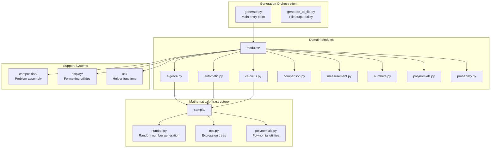
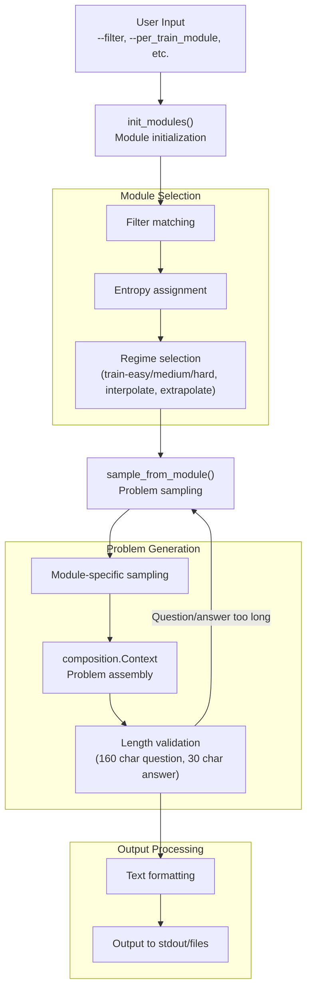

<!-- source: DeepWiki mcp.deepwiki.com · repo google-deepmind/mathematics_dataset · page 1 Overview · fetched 2026-10-26 -->

# Overview

<details>
<summary>Relevant source files</summary>

The following files were used as context for generating this wiki page:

- [README.md](README.md)

</details>


This document introduces the mathematics dataset generation system, which creates school-level mathematical question-answer pairs designed to test AI model reasoning abilities. The system generates problems across multiple mathematical domains with configurable difficulty levels and supports curriculum-based training through structured data splits.

For information about specific mathematical domains, see [Mathematical Domain Modules](#4). For configuration and advanced usage, see [Configuration and Settings](#6).

## Purpose and Capabilities

The mathematics dataset generation system produces large-scale training and evaluation datasets for mathematical reasoning tasks. The system generates question-answer pairs that cover fundamental mathematical concepts typically taught at school level, including algebra, arithmetic, calculus, and probability.

Key capabilities include:
- **Multi-domain coverage**: Eight mathematical subject areas from basic arithmetic to calculus
- **Curriculum learning support**: Three difficulty levels (easy, medium, hard) plus interpolation/extrapolation test sets
- **Configurable complexity**: Entropy-based difficulty control with length constraints
- **Scalable generation**: Designed to produce millions of question-answer pairs per domain
- **Multiple output formats**: Command-line interface, file output, and pre-generated cloud datasets

The system enforces strict formatting constraints with questions limited to 160 characters and answers to 30 characters to ensure consistency across the dataset.

Sources: [README.md:1-56]()

## System Architecture

The mathematics dataset generation system follows a modular architecture with clear separation between domain logic, mathematical infrastructure, and output formatting.

### High-Level Component Organization



The system uses a three-tier architecture:
- **Orchestration layer**: `generate.py` coordinates module selection, sampling, and output
- **Domain layer**: Subject-specific modules implement problem generation logic
- **Infrastructure layer**: Shared utilities for mathematical operations and formatting

Sources: [README.md:77-91]()

### Problem Generation Pipeline



The pipeline implements a rejection sampling approach where problems exceeding length limits are discarded and regeneration is attempted.

Sources: [README.md:83-84]()

## Mathematical Domains

The system covers eight primary mathematical domains, each implemented as a separate module with domain-specific problem generation logic:

| Domain | Module | Problem Types |
|--------|---------|---------------|
| **Algebra** | `modules/algebra.py` | Linear equations, polynomial roots, sequences |
| **Arithmetic** | `modules/arithmetic.py` | Basic operations, mixed expressions, surds |
| **Calculus** | `modules/calculus.py` | Differentiation problems |
| **Comparison** | `modules/comparison.py` | Sorting, closest numbers, pairwise comparisons |
| **Measurement** | `modules/measurement.py` | Unit conversion, time calculations |
| **Numbers** | `modules/numbers.py` | Base conversion, GCD/LCM, primality, place value |
| **Polynomials** | `modules/polynomials.py` | Addition, simplification, composition, evaluation |
| **Probability** | `modules/probability.py` | Sampling without replacement |

Each domain module implements standardized interfaces for problem generation while maintaining domain-specific mathematical logic and constraints.

Sources: [README.md:45-55]()

## Training Curriculum Structure

The system supports curriculum learning through a structured difficulty progression:

```mermaid
graph TB
    entropy_fn["entropy_fn<br/>Difficulty controller"]
    train_split["train_split parameter"]
    
    subgraph "Training Regimes"
        train_easy["train-easy<br/>Lower 1/3 entropy range"]
        train_medium["train-medium<br/>Middle 1/3 entropy range"] 
        train_hard["train-hard<br/>Upper 1/3 entropy range"]
        train_uniform["train<br/>Uniform difficulty"]
    end
    
    subgraph "Evaluation Regimes"
        interpolate["interpolate<br/>Within training range"]
        extrapolate["extrapolate<br/>Beyond training range"]
    end
    
    subgraph "Output Organization"
        regime_dirs["Regime directories<br/>train-easy/, train-medium/, train-hard/"]
        module_files["Module files<br/>algebra.txt, arithmetic.txt, etc."]
    end
    
    entropy_fn --> train_split
    train_split -->|"split=True"| train_easy
    train_split -->|"split=True"| train_medium
    train_split -->|"split=True"| train_hard
    train_split -->|"split=False"| train_uniform
    
    entropy_fn --> interpolate
    entropy_fn --> extrapolate
    
    train_easy --> regime_dirs
    train_medium --> regime_dirs
    train_hard --> regime_dirs
    
    regime_dirs --> module_files
```

The curriculum structure enables progressive training where models can be trained on easier problems first, then gradually exposed to more complex problems. The interpolation and extrapolation test sets evaluate generalization within and beyond the training difficulty range.

Sources: [README.md:37-44]()

## Data Access and Usage

The system provides multiple access methods for generated mathematical problems:

### Pre-generated Datasets
Pre-generated datasets containing 2 million question-answer pairs per module are available on Google Cloud Storage. These datasets follow the curriculum structure with separate directories for each training regime and mathematical domain.

### Command Line Generation
Interactive problem generation using the `generate` script:
```bash
python -m mathematics_dataset.generate --filter=linear_1d
```

### Programmatic Access
The system can be installed via PyPI and used programmatically for custom dataset generation needs.

The `generate_to_file.py` utility provides an example implementation for batch file generation that can be adapted for specific training workflows.

Sources: [README.md:33-36](), [README.md:59-91]()

---

