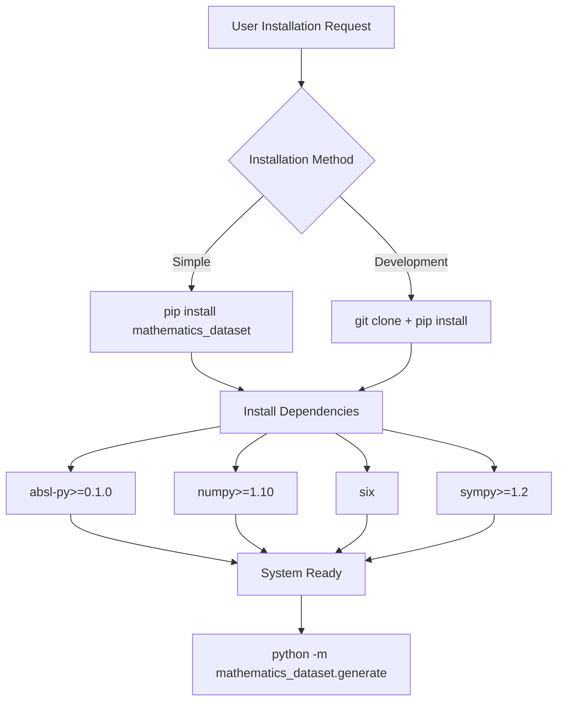
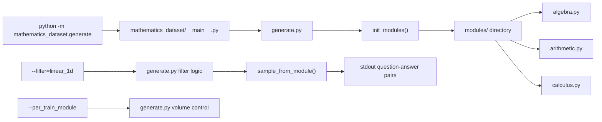
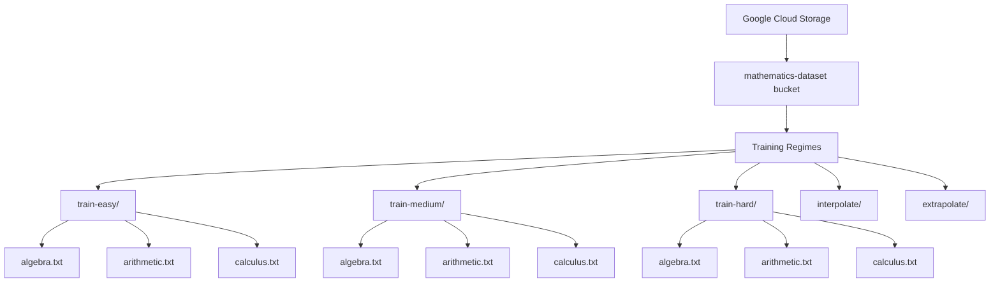

<!-- source: DeepWiki mcp.deepwiki.com · repo google-deepmind/mathematics_dataset · page 2 Getting Started · fetched 2026-10-26 -->

# Getting Started

<details>
<summary>Relevant source files</summary>

The following files were used as context for generating this wiki page:

- [README.md](README.md)
- [setup.py](setup.py)

</details>


This page guides you through installing the mathematics dataset generation system and running your first mathematical problem generations. The system generates school-level mathematical question-answer pairs across multiple domains for testing AI model reasoning abilities.

For detailed information about the mathematical domains and problem types available, see [Mathematical Domain Modules](#4). For advanced configuration options, see [Configuration and Settings](#6).

## Installation

The mathematics dataset system can be installed through two methods: PyPI package installation or direct GitHub installation.

### PyPI Installation

The simplest installation method uses pip to install the packaged version:

```bash
pip install mathematics_dataset
```

This installs the system as a Python module with all required dependencies specified in [setup.py:46-51]().

### GitHub Installation  

For development or the latest version, clone and install directly from the repository:

```bash
git clone https://github.com/deepmind/mathematics_dataset
pip install --upgrade mathematics_dataset/
```

### System Requirements

The system requires the following Python packages as defined in [setup.py:46-51]():

| Package | Version | Purpose |
|---------|---------|---------|
| `absl-py` | >=0.1.0 | Command-line flag parsing |
| `numpy` | >=1.10 | Numerical operations |
| `six` | (latest) | Python 2/3 compatibility |
| `sympy` | >=1.2 | Symbolic mathematics |

**Installation Flow**


Sources: [README.md:59-75](), [setup.py:46-51]()

## Quick Start Examples

Once installed, you can immediately start generating mathematical problems using the command-line interface.

### Basic Problem Generation

Generate problems by running the main `generate` module:

```bash
python -m mathematics_dataset.generate --filter=linear_1d
```

This command will output question-answer pairs for linear equations in one variable to stdout, such as:

```
Question: Solve -42*r + 27*c = -1167 and 130*r + 4*c = 372 for r.
Answer: 4
```

### Domain-Specific Generation

Filter problems by mathematical domain using the `--filter` flag:

```bash
# Generate arithmetic problems
python -m mathematics_dataset.generate --filter=arithmetic

# Generate calculus problems  
python -m mathematics_dataset.generate --filter=calculus

# Generate probability problems
python -m mathematics_dataset.generate --filter=probability
```

### Generation Workflow

**Command-Line to Code Mapping**


Sources: [README.md:79-91]()

## Pre-Generated Datasets

For immediate use without generation, pre-built datasets are available containing millions of question-answer pairs.

### Accessing Pre-Generated Data

The complete dataset is hosted on Google Cloud Storage and can be accessed at:

**Dataset Location**: [Google Cloud Storage - mathematics-dataset](https://console.cloud.google.com/storage/browser/mathematics-dataset)

### Dataset Structure

The pre-generated dataset (Version 1.0) contains:

| Characteristic | Value |
|----------------|--------|
| **Questions per module** | 2 million |
| **Question length limit** | 160 characters |
| **Answer length limit** | 30 characters |
| **Training split** | train-easy, train-medium, train-hard |
| **Test sets** | interpolate, extrapolate |

### Mathematical Domains Available

The dataset covers eight mathematical domains as defined in [README.md:46-55]():

| Domain | Description |
|--------|-------------|
| **algebra** | Linear equations, polynomial roots, sequences |
| **arithmetic** | Pairwise operations, mixed expressions, surds |
| **calculus** | Differentiation |
| **comparison** | Closest numbers, pairwise comparisons, sorting |
| **measurement** | Conversion, working with time |
| **numbers** | Base conversion, remainders, divisors, primality |
| **polynomials** | Addition, simplification, composition, evaluation |
| **probability** | Sampling without replacement |

**Dataset Organization**


Sources: [README.md:33-55]()

## File Output Generation

For saving generated problems to files, the system includes an example script demonstrating file-based output.

### Using generate_to_file.py

The included [generate_to_file.py]() script shows how to write generated problems to text files:

```bash
python generate_to_file.py
```

This script can be adapted for specific generation and training needs, providing a template for:
- Custom file organization
- Batch generation 
- Output formatting control

### File Format

Generated files contain alternating lines of questions and answers:

```
Question: Calculate -841880142.544 + 411127.
Answer: -841469015.544
Question: Let x(g) = 9*g + 1. Let q(c) = 2*c + 1...
Answer: 54*a - 30
```

Sources: [README.md:89-91]()

## Next Steps

After completing the installation and basic usage:

1. **Explore Mathematical Domains**: See [Mathematical Domain Modules](#4) for detailed information about each subject area
2. **Advanced Configuration**: Learn about difficulty levels, filtering, and output control in [Configuration and Settings](#6)  
3. **System Architecture**: Understand the underlying generation pipeline in [Core Architecture](#3)
4. **Development Tools**: For custom implementations, see [Development Tools](#7)

The system is now ready to generate mathematical problems for your specific use case, whether for model training, evaluation, or research purposes.

---

