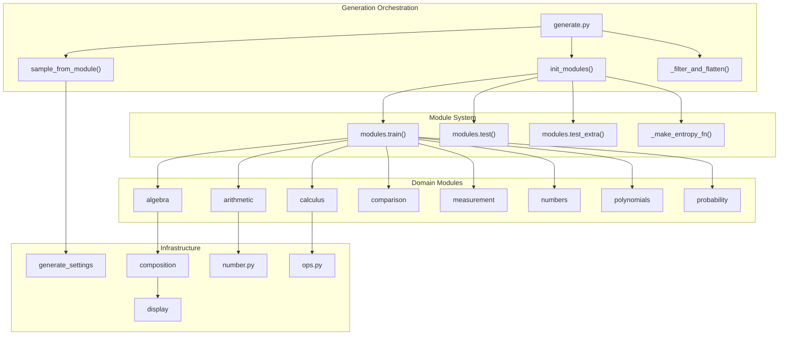
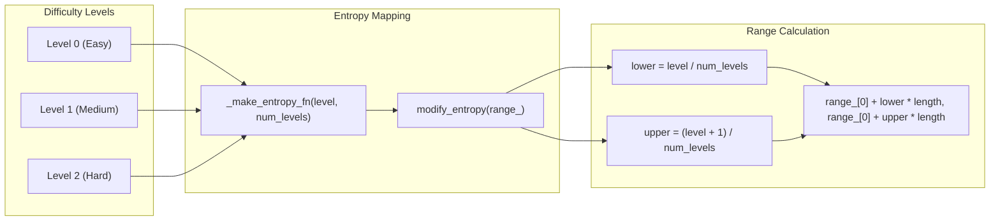
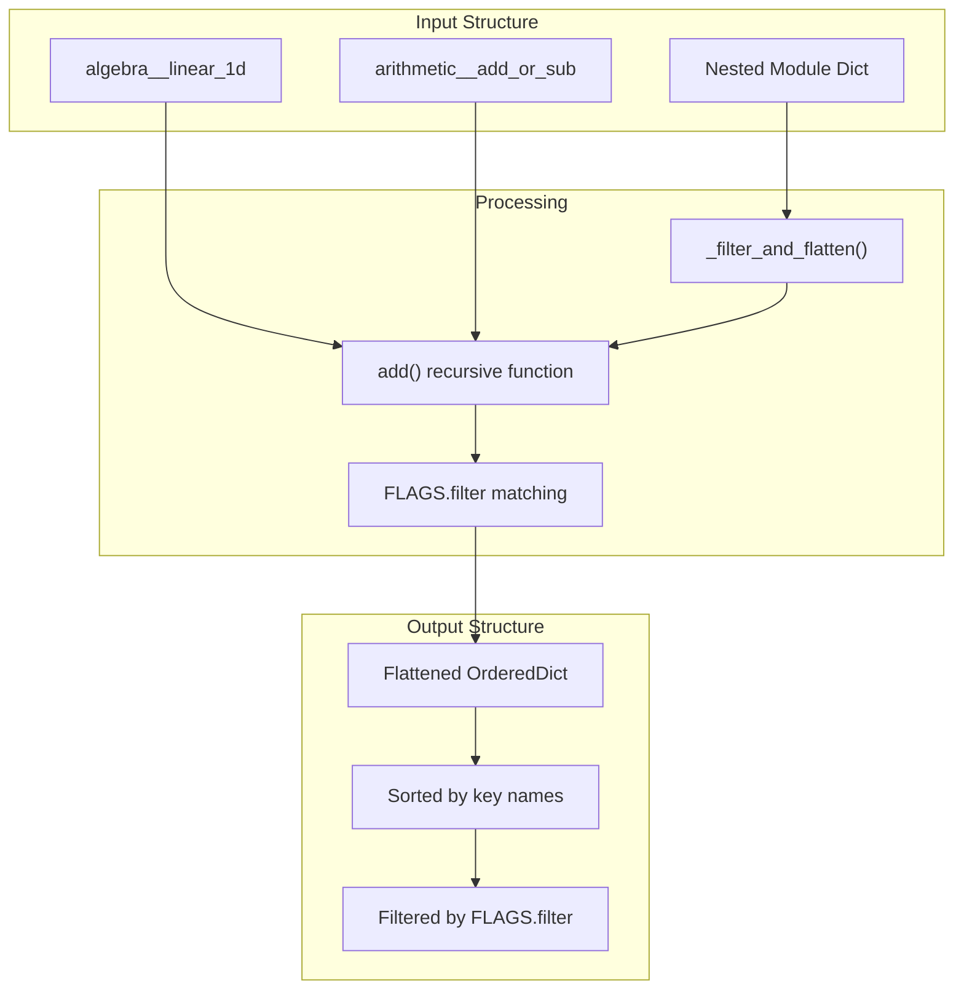
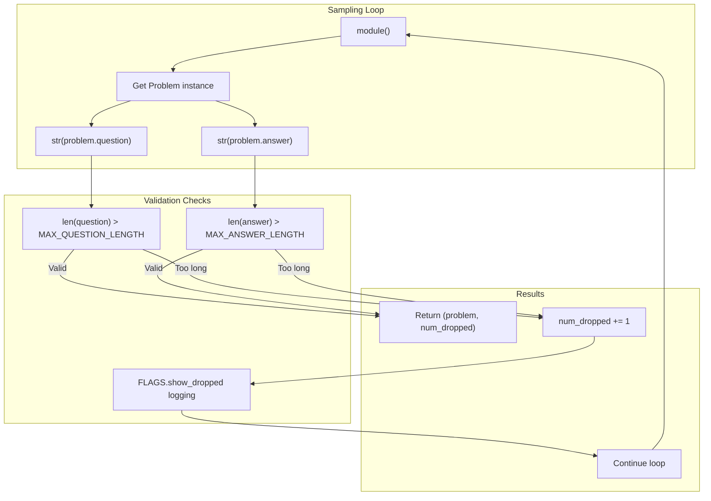

<!-- source: DeepWiki mcp.deepwiki.com · repo google-deepmind/mathematics_dataset · page 3 Core Architecture · fetched 2026-10-26 -->

# Core Architecture

Relevant source files

The following files were used as context for generating this wiki page:

- [mathematics_dataset/generate.py](mathematics_dataset/generate.py)

This document explains the fundamental systems that power the mathematical problem generation in the mathematics dataset. It covers the high-level architecture, the orchestration mechanisms, and how the various components interact to generate mathematical question-answer pairs.

For detailed information about specific aspects: the generation pipeline flow is covered in [Question Generation Pipeline](#3.1), mathematical building blocks in [Mathematical Infrastructure](#3.2), problem assembly in [Composition and Display System](#3.3), and individual problem structure in [Problem Structure and Templates](#3.4).

## System Overview

The mathematics dataset generation system is built around a modular architecture that separates concerns between problem orchestration, mathematical domain logic, and infrastructure utilities. The system generates problems across multiple difficulty levels and mathematical domains through a pipeline that can be configured for different training and testing regimes.

### High-Level Architecture

Sources: [mathematics_dataset/generate.py:1-173]()

## Generation Orchestration

The primary orchestration layer is implemented in `generate.py`, which manages the entire question generation process through several key functions:

### Module Initialization

The `init_modules()` function sets up the problem generation modules for different training regimes:

| Regime | Description | Entropy Function |
|--------|-------------|------------------|
| `train-easy` | Lower 1/3 difficulty range | `_make_entropy_fn(0, 3)` |
| `train-medium` | Middle 1/3 difficulty range | `_make_entropy_fn(1, 3)` |
| `train-hard` | Upper 1/3 difficulty range | `_make_entropy_fn(2, 3)` |
| `interpolate` | Test within training range | `modules.test()` |
| `extrapolate` | Test beyond training range | `modules.test_extra()` |

The system maintains global state in `filtered_modules` and `counts` dictionaries to track available modules and generation quotas.

Sources: [mathematics_dataset/generate.py:92-117]()

### Entropy-Based Difficulty Control

The `_make_entropy_fn()` creates difficulty control functions that map entropy ranges to specific difficulty levels. Each level gets an equal subdivision of the total entropy range.

Sources: [mathematics_dataset/generate.py:46-65]()

## Module System Architecture

The module system provides a hierarchical structure for organizing mathematical domains and problem types. The system uses a nested dictionary structure that gets flattened and filtered during initialization.

### Module Filtering and Organization

The `_filter_and_flatten()` function processes the hierarchical module structure:

This flattening process creates fully qualified module names using double underscores as separators (e.g., `algebra__linear_1d__solve`), enabling precise filtering and deterministic ordering across multiple machines.

Sources: [mathematics_dataset/generate.py:68-89]()

## Problem Sampling and Validation

The `sample_from_module()` function implements the core sampling logic with built-in validation:

The sampling process continues until a valid problem is generated, tracking dropped samples for monitoring purposes. Length constraints are defined in `generate_settings.MAX_QUESTION_LENGTH` and `generate_settings.MAX_ANSWER_LENGTH`.

Sources: [mathematics_dataset/generate.py:119-145]()

## Configuration and Control Flow

The system accepts several command-line flags that control generation behavior:

| Flag | Purpose | Default |
|------|---------|---------|
| `--filter` | Restrict to matching module names | `''` (empty) |
| `--per_train_module` | Examples per training module | `10` |
| `--per_test_module` | Examples per testing module | `10` |
| `--show_dropped` | Print dropped questions for debugging | `False` |

The main execution flow processes all filtered modules across all regimes, generating the specified number of problems per module while tracking and reporting dropped samples.

Sources: [mathematics_dataset/generate.py:34-39](), [mathematics_dataset/generate.py:148-172]()

---

