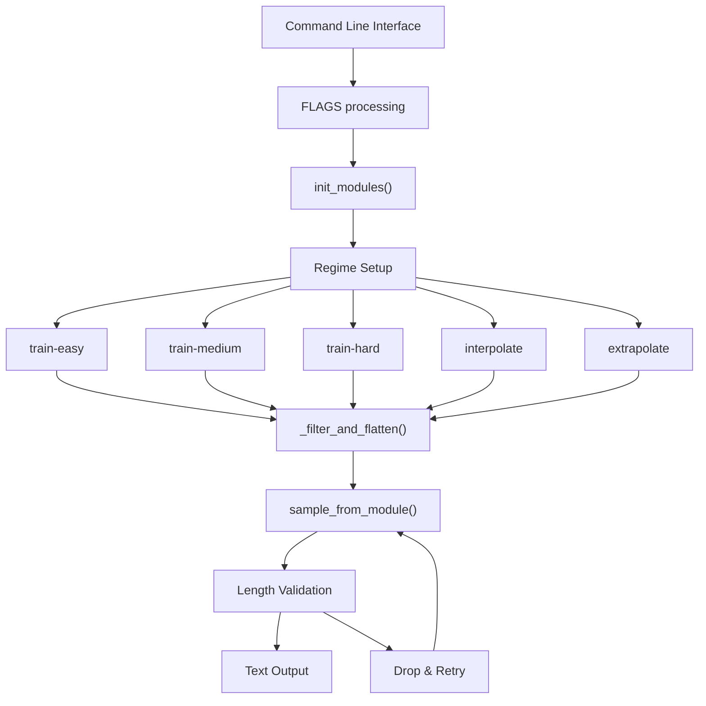
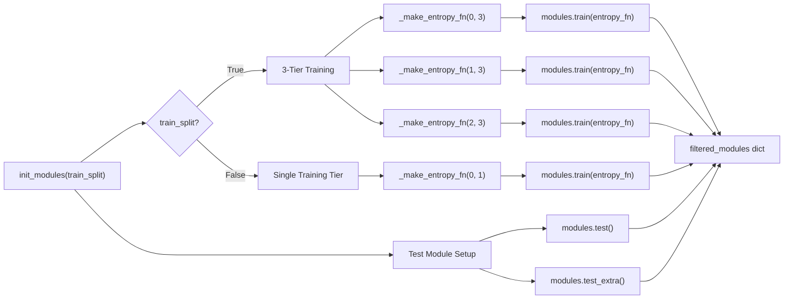
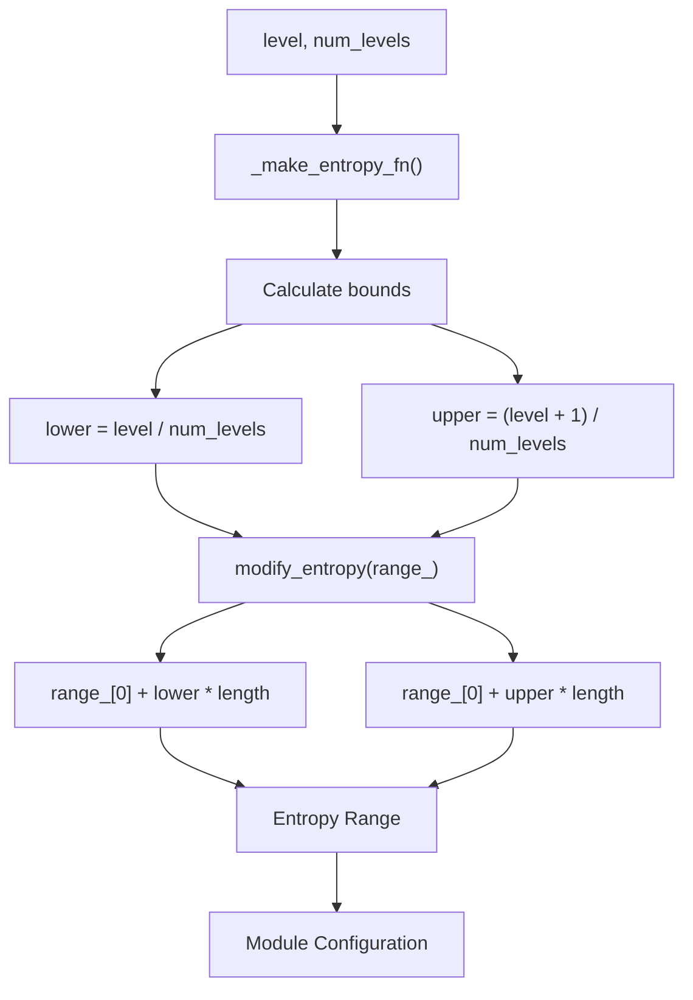
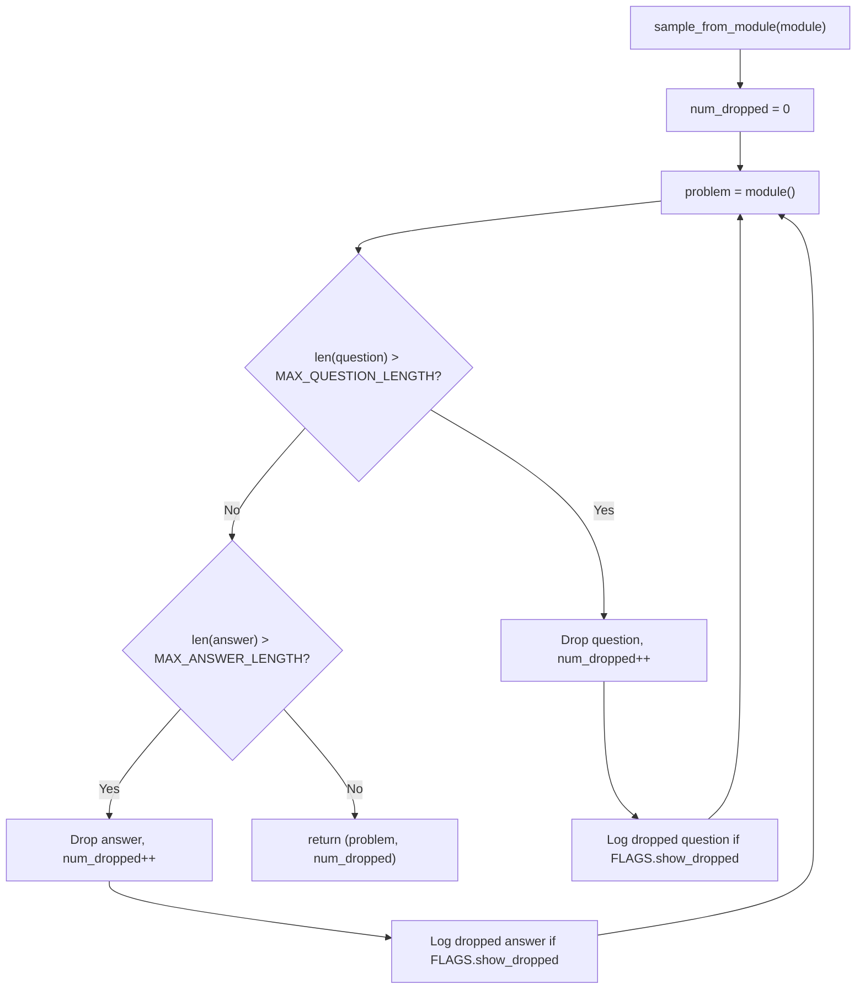
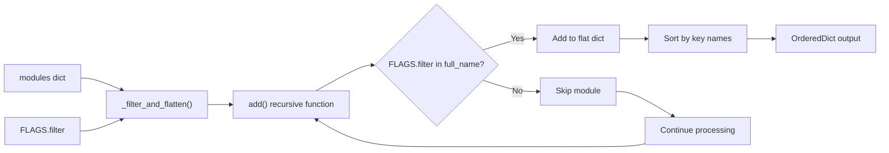
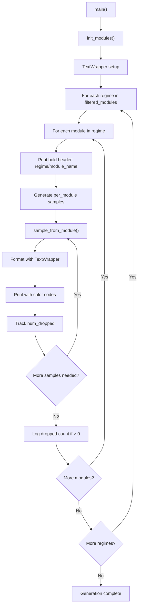

<!-- source: DeepWiki mcp.deepwiki.com · repo google-deepmind/mathematics_dataset · page 3.1 Question Generation Pipeline · fetched 2026-10-26 -->

# Question Generation Pipeline

Relevant source files

The following files were used as context for generating this wiki page:

- [mathematics_dataset/generate.py](mathematics_dataset/generate.py)
- [mathematics_dataset/generate_test.py](mathematics_dataset/generate_test.py)

This document describes the core orchestration system that coordinates mathematical problem generation across different domains and difficulty levels. The pipeline manages module initialization, difficulty control, problem sampling, and output formatting to produce question-answer pairs for training and testing AI models.

For information about the specific mathematical building blocks used in problem generation, see [Mathematical Infrastructure](#3.2). For details about individual domain modules, see [Mathematical Domain Modules](#4).

## Pipeline Overview

The question generation pipeline operates as the central coordination layer that orchestrates the entire problem generation process. It manages the flow from user configuration through module selection, difficulty assignment, problem sampling, and final output formatting.

### Core Pipeline Flow

Sources: [mathematics_dataset/generate.py:148-169]()

## Module Initialization System

The `init_modules` function serves as the central setup mechanism that configures all mathematical domains according to the specified training regime and difficulty parameters.

### Initialization Process

The initialization system creates a global `filtered_modules` dictionary that maps regime names to their corresponding module collections. Each regime is populated with modules from the `mathematics_dataset.modules.modules` package, configured with appropriate entropy functions for difficulty control.

| Regime | Entropy Function | Purpose |
|--------|------------------|---------|
| `train-easy` | `_make_entropy_fn(0, 3)` | Lower 1/3 difficulty range |
| `train-medium` | `_make_entropy_fn(1, 3)` | Middle 1/3 difficulty range |
| `train-hard` | `_make_entropy_fn(2, 3)` | Upper 1/3 difficulty range |
| `interpolate` | N/A | Testing within training range |
| `extrapolate` | N/A | Testing beyond training range |

Sources: [mathematics_dataset/generate.py:92-117]()

## Difficulty Control and Entropy Functions

The pipeline implements sophisticated difficulty control through entropy functions that map problem complexity to specific ranges within each regime's difficulty spectrum.

### Entropy Function Mechanism

The entropy function system enables precise control over problem difficulty by subdividing the full complexity range into specific segments. For example, with `level=1` and `num_levels=3`, the function maps an input range `[x, x + y]` to the middle third `[x + y/3, x + 2y/3]`.

Sources: [mathematics_dataset/generate.py:46-65]()

## Problem Sampling and Validation

The `sample_from_module` function implements the core problem generation loop with built-in quality control through length validation and retry mechanisms.

### Sampling Process

The sampling system ensures output quality by enforcing maximum length constraints defined in `generate_settings`. Problems exceeding these limits are automatically discarded and regenerated, with optional logging of dropped examples for debugging purposes.

| Validation Check | Constraint | Action on Violation |
|------------------|------------|-------------------|
| Question Length | `MAX_QUESTION_LENGTH` | Drop and regenerate |
| Answer Length | `MAX_ANSWER_LENGTH` | Drop and regenerate |

Sources: [mathematics_dataset/generate.py:119-145]()

## Module Filtering and Organization

The pipeline includes a sophisticated filtering system that processes the hierarchical module structure into a flat, deterministic ordering suitable for distributed generation.

### Filtering Architecture

The filtering process transforms the nested module hierarchy into a flat `OrderedDict` where:
- Keys represent full module paths (e.g., `algebra__linear_1d`)
- Values are callable functions that generate problems
- Ordering is deterministic across different machines
- Only modules matching the filter string are included

Sources: [mathematics_dataset/generate.py:68-89]()

## Output Generation and Formatting

The main execution loop coordinates the generation process across all filtered modules and regimes, with formatted terminal output and progress tracking.

### Output Pipeline

The output system provides:
- **Colored terminal output** with bold headers for regime/module identification
- **Text wrapping** at 80 characters with proper indentation
- **Progress tracking** through dropped sample counts
- **Structured formatting** with questions in normal text and answers in green

Sources: [mathematics_dataset/generate.py:148-169]()

## Configuration Parameters

The pipeline exposes several command-line flags for controlling generation behavior:

| Flag | Type | Default | Purpose |
|------|------|---------|---------|
| `--filter` | string | '' | Restrict to matching module names |
| `--per_train_module` | integer | 10 | Number of examples per training module |
| `--per_test_module` | integer | 10 | Number of examples per testing module |
| `--show_dropped` | boolean | False | Whether to print dropped questions |

The count distribution for split training regimes automatically divides `per_train_module` by 3 across the easy/medium/hard tiers, ensuring balanced representation across difficulty levels.

Sources: [mathematics_dataset/generate.py:36-39](), [mathematics_dataset/generate.py:108-113]()

---

