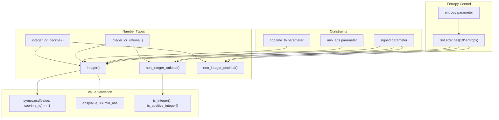
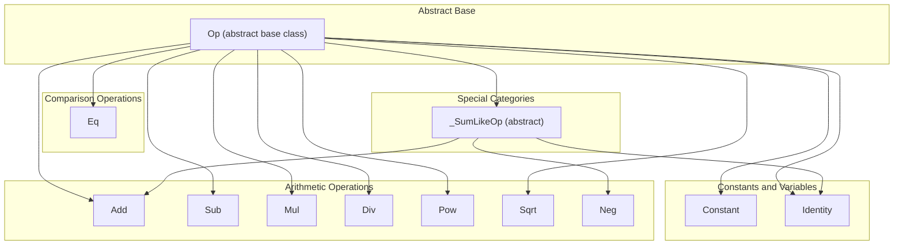
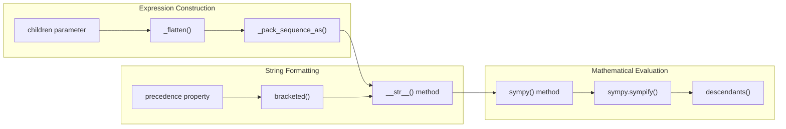
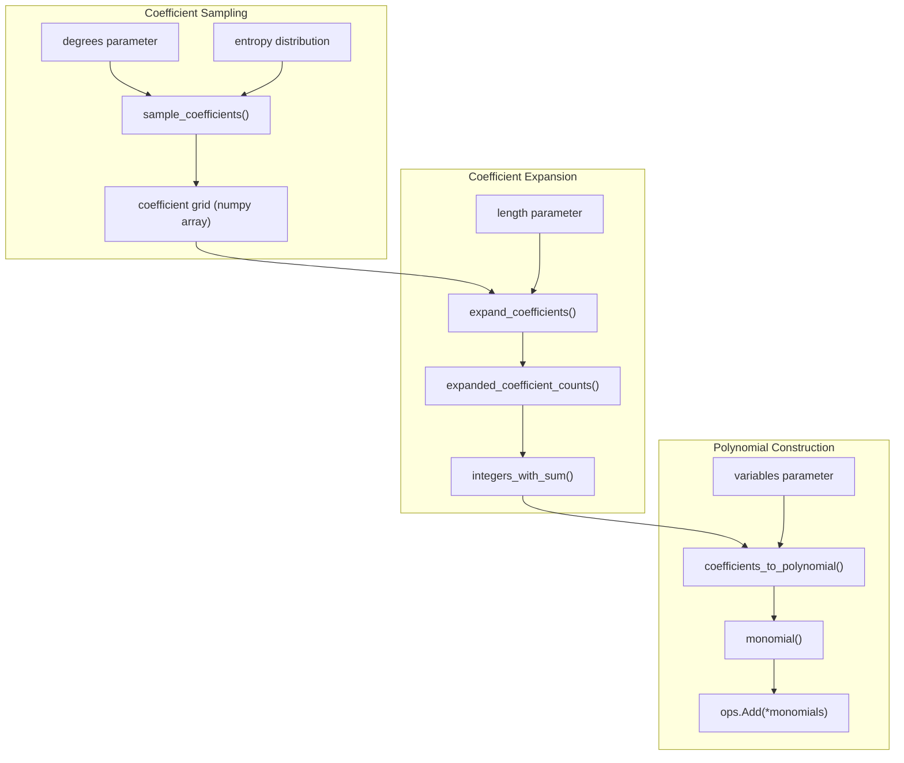
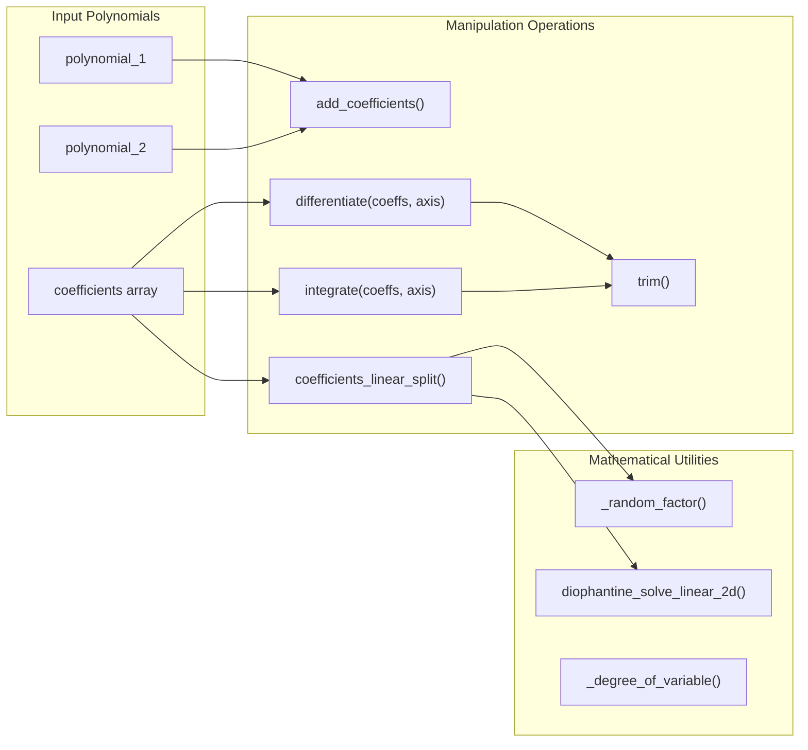

<!-- source: DeepWiki mcp.deepwiki.com · repo google-deepmind/mathematics_dataset · page 3.2 Mathematical Infrastructure · fetched 2026-10-26 -->

# Mathematical Infrastructure

Relevant source files

The following files were used as context for generating this wiki page:

- [mathematics_dataset/sample/number.py](mathematics_dataset/sample/number.py)
- [mathematics_dataset/sample/ops.py](mathematics_dataset/sample/ops.py)
- [mathematics_dataset/sample/polynomials.py](mathematics_dataset/sample/polynomials.py)

This document explains the core mathematical building blocks that power the mathematics dataset generation system. The mathematical infrastructure provides three fundamental capabilities: controlled random number generation, expression tree construction, and polynomial manipulation. These components work together to create the mathematical content that appears in generated problems.

For information about how these mathematical components are assembled into complete problems, see [Composition and Display System](#3.3). For details on domain-specific problem generation that uses this infrastructure, see [Mathematical Domain Modules](#4).

## Number Generation System

The number generation system provides entropy-controlled random sampling of integers, rationals, and decimals. This system ensures that generated numbers have appropriate complexity for the target difficulty level while satisfying mathematical constraints.

### Core Number Generation Functions

The `number.py` module implements the primary number generation interface through several key functions:

| Function | Purpose | Parameters |
|----------|---------|------------|
| `integer()` | Generate random integers | entropy, signed, min_abs, coprime_to |
| `non_integer_rational()` | Generate rational numbers | entropy, signed |
| `integer_or_rational()` | Generate integers or rationals | entropy, signed, min_abs |
| `non_integer_decimal()` | Generate decimal numbers | entropy, signed |
| `integer_or_decimal()` | Generate integers or decimals | entropy, signed |

### Entropy-Based Sampling

The system uses entropy as a measure of complexity, where higher entropy values produce numbers from larger ranges. The entropy calculation follows logarithmic scaling:

- For integers: sample from range approximately `[-10^entropy/2, 10^entropy/2]` when signed
- For rationals: entropy is split between numerator and denominator
- For decimals: entropy determines both the base value and decimal precision

Sources: [mathematics_dataset/sample/number.py:40-78](), [mathematics_dataset/sample/number.py:80-95](), [mathematics_dataset/sample/number.py:97-124]()

## Expression Tree System

The expression tree system provides a framework for building mathematical expressions that can be displayed exactly as constructed, without automatic simplification. This is implemented through the `ops.py` module using an object-oriented hierarchy of operation classes.

### Operation Class Hierarchy

### Expression Tree Construction and Evaluation

Each operation class implements three key methods:

- `__str__()`: Returns formatted string representation with appropriate bracketing
- `sympy()`: Converts to SymPy object for mathematical evaluation
- `precedence`: Returns operator precedence for bracket insertion logic

The precedence hierarchy controls when brackets are inserted:

| Precedence Level | Operations | Value |
|------------------|------------|-------|
| Equality | `Eq` | 0 |
| Constants | `Constant` | 1 |
| Power | `Pow`, `Sqrt` | 2, 3 |
| Multiplication | `Mul`, `Div` | 4 |
| Addition | `Add`, `Sub`, `Neg` | 5 |

Sources: [mathematics_dataset/sample/ops.py:114-174](), [mathematics_dataset/sample/ops.py:175-221](), [mathematics_dataset/sample/ops.py:300-326]()

## Polynomial Generation System

The polynomial generation system creates polynomials with controlled complexity and specific mathematical properties. This system supports both univariate and multivariate polynomials with configurable coefficient distributions.

### Coefficient Generation Pipeline

### Main Polynomial Generation Functions

| Function | Purpose | Key Parameters |
|----------|---------|----------------|
| `sample()` | Generate basic polynomials | variables, degrees, entropy, length |
| `sample_with_brackets()` | Generate polynomials with parentheses | variables, degrees, entropy, length |
| `sample_with_small_evaluation()` | Generate bounded-evaluation polynomials | variable, degree, max_abs_input, entropy |
| `sample_messy_power()` | Generate complex power expressions | variable, entropy |

### Advanced Polynomial Operations

The system provides sophisticated polynomial manipulation capabilities:

- **Coefficient splitting**: `coefficients_linear_split()` decomposes polynomials into linear combinations
- **Differentiation**: `differentiate()` computes derivatives of coefficient arrays
- **Integration**: `integrate()` computes antiderivatives of coefficient arrays
- **Trimming**: `trim()` removes unnecessary zero coefficients

Sources: [mathematics_dataset/sample/polynomials.py:172-225](), [mathematics_dataset/sample/polynomials.py:270-300](), [mathematics_dataset/sample/polynomials.py:462-489]()

## System Integration

The three mathematical infrastructure components work together through well-defined interfaces:

1. **Number generation** provides the raw numerical content for coefficients and constants
2. **Expression trees** structure the mathematical relationships and handle display formatting  
3. **Polynomial generation** combines both systems to create complex algebraic expressions

The integration follows this pattern:
- Polynomial functions call `number.integer()` and related functions to generate coefficients
- Coefficient arrays are converted to expression trees using `ops.Add()`, `ops.Mul()`, and `ops.Pow()`
- Expression trees provide both string representation and SymPy evaluation capabilities

Sources: [mathematics_dataset/sample/polynomials.py:276-295](), [mathematics_dataset/sample/polynomials.py:136-170](), [mathematics_dataset/sample/ops.py:442-452]()

---

