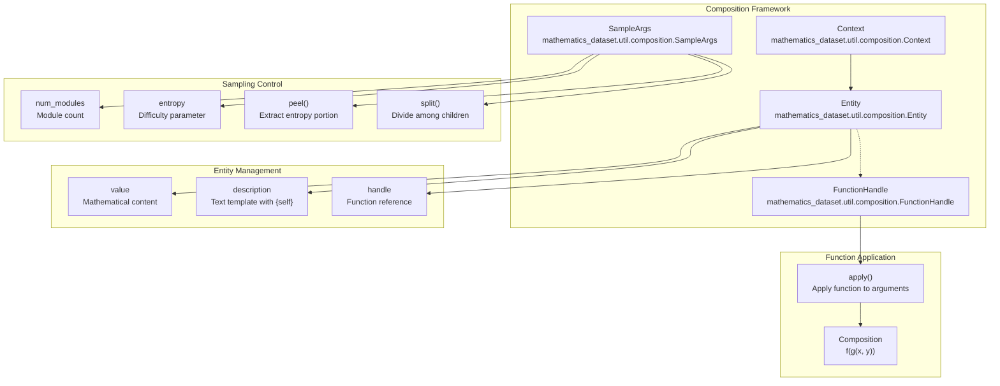
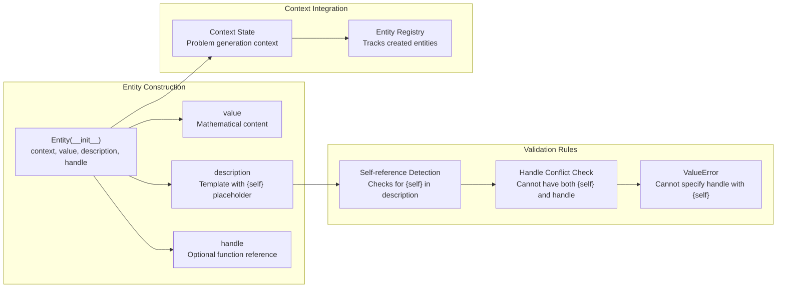
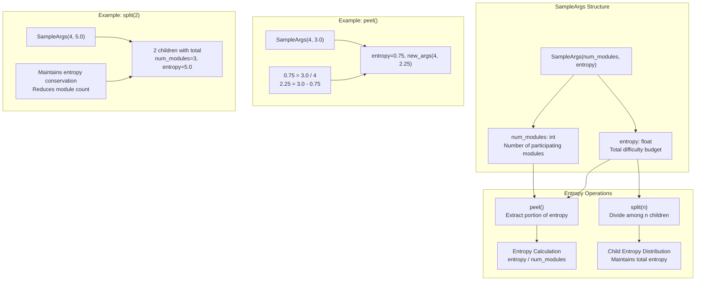
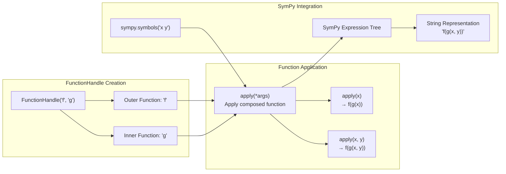
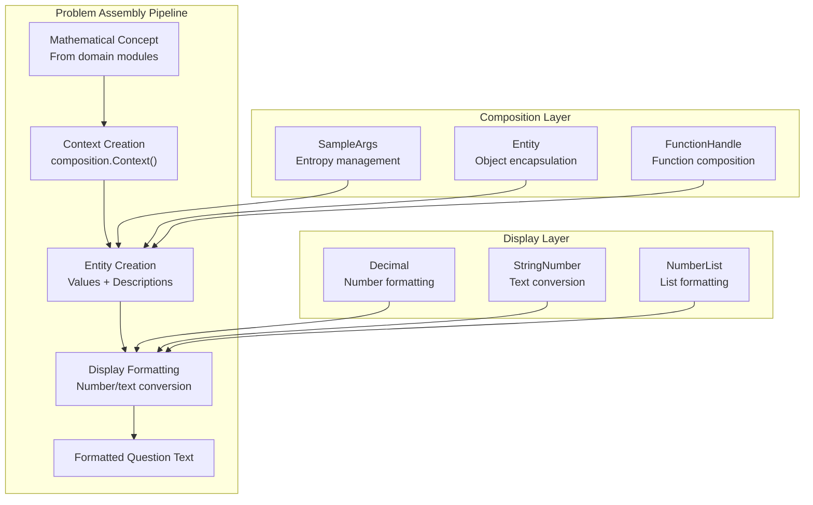

<!-- source: DeepWiki mcp.deepwiki.com · repo google-deepmind/mathematics_dataset · page 3.3 Composition and Display System · fetched 2026-10-26 -->

# Composition and Display System

Relevant source files

The following files were used as context for generating this wiki page:

- [mathematics_dataset/util/composition_test.py](mathematics_dataset/util/composition_test.py)
- [mathematics_dataset/util/display_test.py](mathematics_dataset/util/display_test.py)

## Purpose and Scope

The Composition and Display System provides the foundational framework for assembling mathematical problems and formatting their output in the mathematics dataset generation system. This system consists of two main components:

1. **Composition Framework** - Manages the context, entities, and function handles used to construct complex mathematical problems from simpler components
2. **Display System** - Handles formatting and presentation of mathematical content, including numbers, expressions, and specialized mathematical notation

For information about the mathematical building blocks that feed into this system, see [Mathematical Infrastructure](#3.2). For details about how problems are structured using these composition tools, see [Problem Structure and Templates](#3.4).

## Composition Framework Architecture

The composition framework provides the scaffolding for building complex mathematical problems by managing context, entities, and relationships between mathematical components.

**Core Composition Classes**

| Class | Purpose | Key Methods |
|-------|---------|-------------|
| `Context` | Manages problem generation context | Context initialization and state |
| `Entity` | Represents mathematical objects with descriptions | Value storage and template handling |
| `FunctionHandle` | Manages function composition | `apply()` for function application |
| `SampleArgs` | Controls entropy distribution | `peel()`, `split()` for entropy management |

Sources: [mathematics_dataset/util/composition_test.py:27-62]()

## Display System Architecture

The display system provides specialized formatting classes for different types of mathematical content, ensuring consistent and readable output across all problem types.

```mermaid
graph TB
    subgraph "Number Display Classes"
        Decimal["Decimal<br/>mathematics_dataset.util.display.Decimal"]
        Percentage["Percentage<br/>mathematics_dataset.util.display.Percentage"]
        NonSimpleRational["NonSimpleRational<br/>mathematics_dataset.util.display.NonSimpleRational"]
        NumberInBase["NumberInBase<br/>mathematics_dataset.util.display.NumberInBase"]
    end
    
    subgraph "Text Conversion Classes"
        StringNumber["StringNumber<br/>mathematics_dataset.util.display.StringNumber"]
        StringOrdinal["StringOrdinal<br/>mathematics_dataset.util.display.StringOrdinal"]
        NumberList["NumberList<br/>mathematics_dataset.util.display.NumberList"]
    end
    
    subgraph "Operations"
        DecimalOps["Arithmetic Operations<br/>+, -, *, round()"]
        TextConversion["Number to Words<br/>integer_to_words()"]
        BaseConversion["Base Representation<br/>Binary, Hex, etc."]
        ListFormatting["Comma-separated Lists<br/>2, 3, 1"]
    end
    
    subgraph "SymPy Integration"
        SympyCompat["sympy.sympify()<br/>Conversion compatibility"]
        RationalSupport["sympy.Rational<br/>Exact fraction handling"]
    end
    
    Decimal --> DecimalOps
    Decimal --> SympyCompat
    
    StringNumber --> TextConversion
    StringNumber --> RationalSupport
    
    NumberInBase --> BaseConversion
    NumberList --> ListFormatting
    
    Percentage --> DecimalOps
    NonSimpleRational --> RationalSupport
    StringOrdinal --> TextConversion
```

**Display Class Capabilities**

| Class | Input Types | Output Examples | Special Features |
|-------|-------------|-----------------|------------------|
| `Decimal` | Rational, Integer | `1.23`, `0.000000001` | Avoids scientific notation, arithmetic operations |
| `Percentage` | Rational, Float | `67%`, `6.7%` | Automatic percentage conversion |
| `StringNumber` | Integer, Rational | `fifteen-million...`, `two thirds` | Full word conversion |
| `NumberInBase` | Integer | `10` (binary), `a` (hex) | Arbitrary base support |
| `NumberList` | List of numbers | `2, 3, 1` | Comma-separated formatting |

Sources: [mathematics_dataset/util/display_test.py:27-204]()

## Entity and Context Management

The composition system uses entities to encapsulate mathematical objects along with their textual descriptions, enabling flexible problem construction.

The `Entity` class enforces a key constraint: entities cannot simultaneously use `{self}` placeholders in their descriptions and specify external function handles, preventing ambiguous reference resolution.

Sources: [mathematics_dataset/util/composition_test.py:54-62]()

## Entropy Management and Sampling

The `SampleArgs` class manages difficulty distribution across problem components through entropy allocation and splitting mechanisms.

The entropy system ensures that problem difficulty is distributed proportionally across all participating modules while maintaining precise control over the total complexity budget.

Sources: [mathematics_dataset/util/composition_test.py:39-52]()

## Function Handle System

Function handles enable composition of mathematical functions, allowing complex expressions to be built from simpler components through function application.

Function handles integrate seamlessly with SymPy's symbolic mathematics system, enabling the creation of complex mathematical expressions that can be manipulated algebraically.

Sources: [mathematics_dataset/util/composition_test.py:27-35]()

## Integration with Problem Generation

The composition and display systems work together to transform mathematical concepts into human-readable problems through a coordinated process.

This integrated approach ensures that mathematical content maintains its precision through the composition layer while being presented in formats suitable for natural language understanding.

Sources: [mathematics_dataset/util/composition_test.py:15-66](), [mathematics_dataset/util/display_test.py:15-208]()

---

