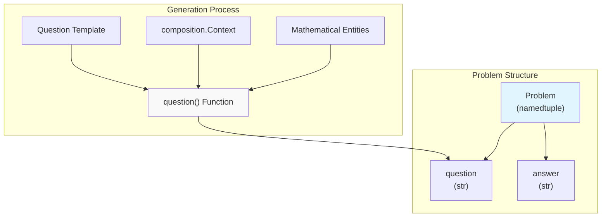
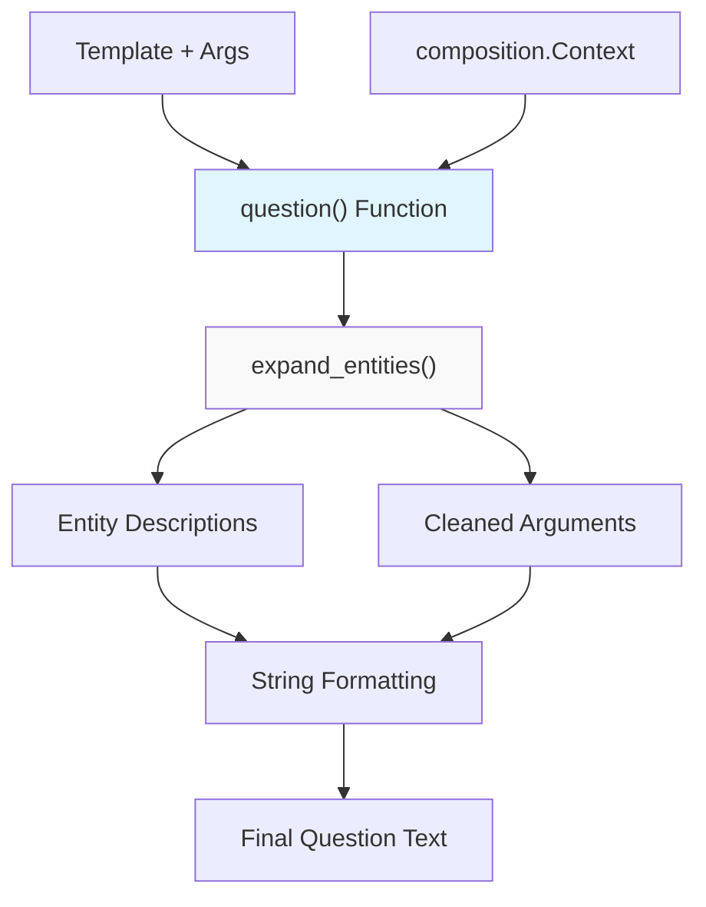
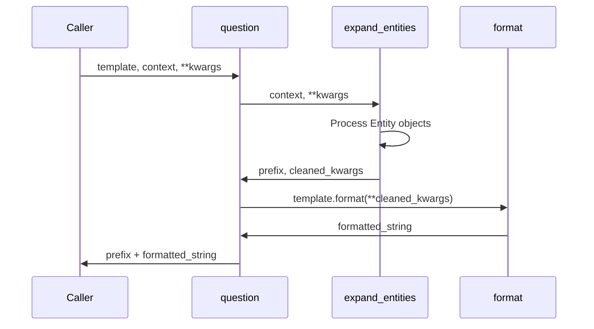
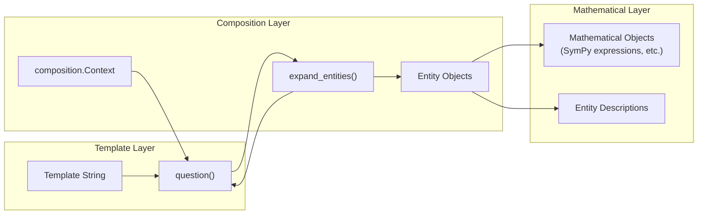

<!-- source: DeepWiki mcp.deepwiki.com · repo google-deepmind/mathematics_dataset · page 3.4 Problem Structure and Templates · fetched 2026-10-26 -->

# Problem Structure and Templates

<details>
<summary>Relevant source files</summary>

The following files were used as context for generating this wiki page:

- [mathematics_dataset/example.py](mathematics_dataset/example.py)

</details>


This document explains the fundamental structure of mathematical problems in the dataset and the template system used to generate question text. It covers the `Problem` data structure, the question template formatting system, and how mathematical entities are incorporated into natural language questions.

For information about the broader composition framework that supports templates, see [Composition and Display System](#3.3). For details on domain-specific problem generation implementations, see [Mathematical Domain Modules](#4).

## Problem Data Structure

Every generated mathematical problem follows a consistent structure defined by the `Problem` namedtuple. This simple but fundamental data structure serves as the container for all question-answer pairs in the system.



**Problem Structure Components**
The `Problem` namedtuple contains exactly two fields:

| Field | Type | Description |
|-------|------|-------------|
| `question` | `str` | The natural language question text |
| `answer` | `str` | The expected answer as a string |

Sources: [mathematics_dataset/example.py:57]()

## Question Template System

The core of the template system is the `question` function, which transforms mathematical templates into natural language questions. This function bridges the gap between mathematical entities and human-readable text.



**Template Function Signature**
```python
question(context, template, **kwargs)
```

**Parameters:**
- `context`: Instance of `composition.Context` for entity management
- `template`: String template with format placeholders (e.g., "What is {} plus {p}?")
- `**kwargs`: Named arguments mapping placeholders to mathematical values

Sources: [mathematics_dataset/example.py:26-54]()

## Template Processing Pipeline

The question generation follows a specific processing pipeline that handles mathematical entities and formatting:



**Processing Steps:**

1. **Entity Expansion**: The `composition.expand_entities` function processes any `Entity` objects in the arguments
2. **Prefix Generation**: Entity descriptions are collected into a prefix string
3. **Argument Cleaning**: Entity objects are replaced with their string representations
4. **Template Formatting**: Standard Python string formatting is applied
5. **Final Assembly**: Prefix and formatted template are combined

Sources: [mathematics_dataset/example.py:49-54]()

## Template Usage Patterns

Mathematical problems use several common template patterns to generate questions:

**Basic Value Substitution**
```python
question(context, 'What is {} plus {p} over {q}?', 2, p=3, q=4)
# Result: "What is 2 plus 3 over 4?"
```

**Named Parameter Templates**
```python
question(context, 'Calculate the value of {exp}.', exp=sympy.Add(2, 3, evaluate=False))
# Result: "Calculate the value of 2 + 3."
```

**Entity-Based Templates**
When arguments contain `Entity` objects, their descriptions are automatically prefixed:
```python
# If 'x' is an Entity representing a variable
question(context, 'Solve for {var} in {equation}.', var=x, equation=equation_expr)
# Result: "Let x be a real number. Solve for x in 2*x + 3 = 7."
```

Sources: [mathematics_dataset/example.py:29-44]()

## Integration with Composition System

The template system is tightly integrated with the composition framework, which manages mathematical entities and their descriptions:



**Key Integration Points:**
- **Context Management**: The `composition.Context` tracks all entities used in a problem
- **Entity Expansion**: Mathematical objects wrapped as entities get automatic descriptions
- **Description Prefixing**: Entity descriptions are prepended to questions when needed
- **Argument Processing**: Entity objects are converted to appropriate string representations

Sources: [mathematics_dataset/example.py:49-51]()

## Template System Benefits

The template system provides several key advantages for mathematical problem generation:

**Separation of Concerns**
- Mathematical logic is separated from natural language presentation
- Templates can be reused across different mathematical contexts
- Entity descriptions are handled automatically

**Consistency**
- All problems follow the same formatting pipeline
- Entity descriptions follow consistent patterns
- Mathematical notation is standardized

**Flexibility**
- Templates support both positional and named arguments
- Complex mathematical expressions are handled transparently
- New entity types can be added without changing template code

**Maintainability**
- Question text can be modified without changing mathematical logic
- Template changes affect all problems using that template
- Entity description logic is centralized

Sources: [mathematics_dataset/example.py:26-54]()

---

