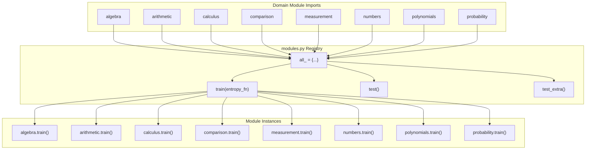
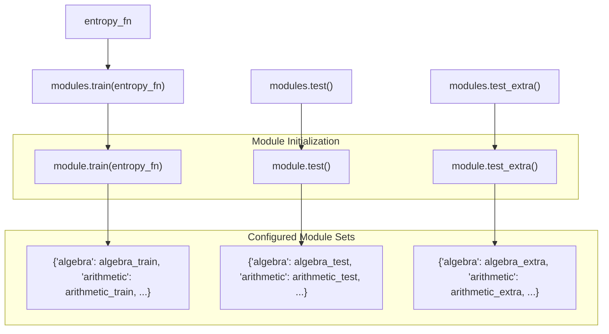
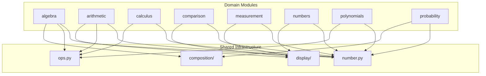

<!-- source: DeepWiki mcp.deepwiki.com · repo google-deepmind/mathematics_dataset · page 4 Mathematical Domain Modules · fetched 2026-10-26 -->

# Mathematical Domain Modules

Relevant source files

The following files were used as context for generating this wiki page:

- [mathematics_dataset/modules/modules.py](mathematics_dataset/modules/modules.py)

## Purpose and Scope

This document covers the mathematical domain modules that form the core of the problem generation system. These modules implement domain-specific logic for generating questions across eight mathematical subject areas: algebra, arithmetic, calculus, comparison, measurement, numbers, polynomials, and probability. Each module provides structured problem generators that can be configured for different difficulty levels and training/testing regimes.

For detailed documentation of individual modules, see [Algebra Module](#4.1), [Arithmetic Module](#4.2), [Calculus Module](#4.3), and [Other Mathematical Modules](#4.4). For information about the underlying mathematical infrastructure used by these modules, see [Mathematical Infrastructure](#3.2).

## Module Organization and Registry

The mathematical domain modules are organized through a centralized registry system implemented in [mathematics_dataset/modules/modules.py](). This registry provides a unified interface for accessing and initializing all mathematical domains.

### Module Registry Structure

The `all_` dictionary [mathematics_dataset/modules/modules.py:32-41]() serves as the master registry, mapping module names to their corresponding module objects. This centralized approach ensures consistent access patterns across the system.

**Sources:** [mathematics_dataset/modules/modules.py:21-41]()

### Module Interface Functions

The registry provides three key functions that return dictionaries of configured modules:

| Function | Purpose | Configuration |
|----------|---------|---------------|
| `train(entropy_fn)` | Training modules | Configured with entropy function for difficulty control |
| `test()` | Standard testing modules | Default testing configuration |
| `test_extra()` | Extrapolation testing modules | Extended difficulty range for testing |

Each function iterates through the `all_` dictionary and calls the corresponding method on each domain module [mathematics_dataset/modules/modules.py:44-58]().

**Sources:** [mathematics_dataset/modules/modules.py:44-58]()

## Training and Testing Regimes

Mathematical domain modules support different operational regimes that control problem difficulty and sampling behavior. The regime system enables curriculum learning by providing graduated difficulty levels.

### Regime Configuration Flow

### Regime Types

**Training Regime (`train`)**
- Accepts an `entropy_fn` parameter for difficulty control
- Enables curriculum learning through entropy-based problem selection
- Used for generating training datasets with controlled difficulty progression

**Testing Regime (`test`)**
- Uses default difficulty settings appropriate for evaluation
- Provides consistent baseline for model assessment
- No entropy function parameterization

**Extrapolation Testing Regime (`test_extra`)**
- Generates problems beyond the typical training difficulty range
- Tests model generalization to unseen problem complexities
- Used for measuring extrapolation capabilities

**Sources:** [mathematics_dataset/modules/modules.py:44-58]()

## Domain Overview

The system includes eight mathematical domains, each implementing specialized problem generation logic for their respective subject areas. Each domain module follows a consistent interface pattern, providing `train()`, `test()`, and `test_extra()` methods.

### Domain Module Mapping

| Domain | Module Name | Primary Focus Areas |
|--------|-------------|-------------------|
| `algebra` | Linear equations, polynomial roots, sequences |
| `arithmetic` | Basic operations, mixed expressions, surds |
| `calculus` | Differentiation problems |
| `comparison` | Sorting and ordering operations |
| `measurement` | Unit conversions, time calculations |
| `numbers` | Number theory (GCD, LCM, primality, bases) |
| `polynomials` | Polynomial manipulation and evaluation |
| `probability` | Sampling without replacement |

### Module Dependencies

Each domain module leverages the shared mathematical infrastructure while implementing domain-specific problem generation logic. The modules are designed to be self-contained, allowing for independent development and testing of individual mathematical areas.

**Sources:** [mathematics_dataset/modules/modules.py:21-28](), [mathematics_dataset/modules/modules.py:32-41]()

---

