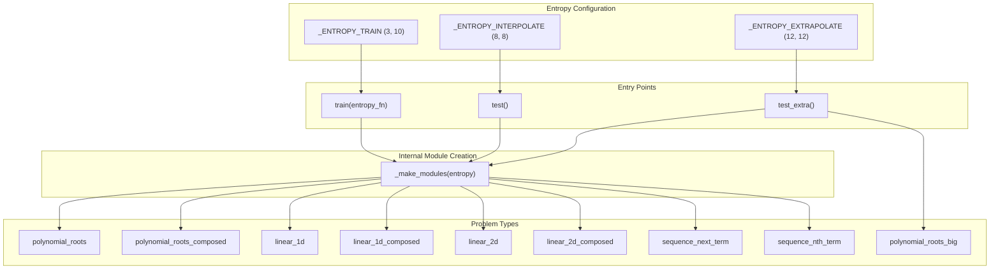
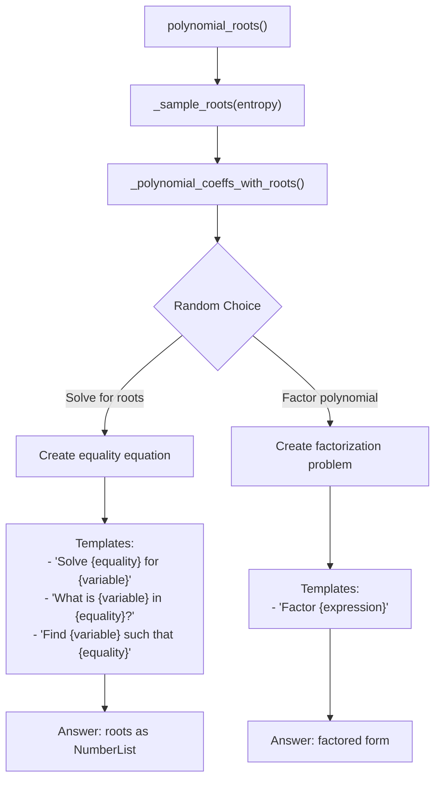
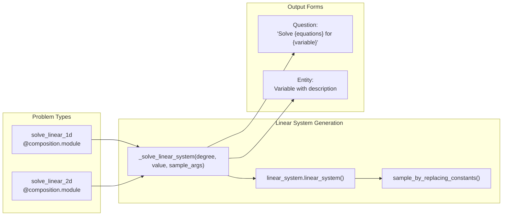
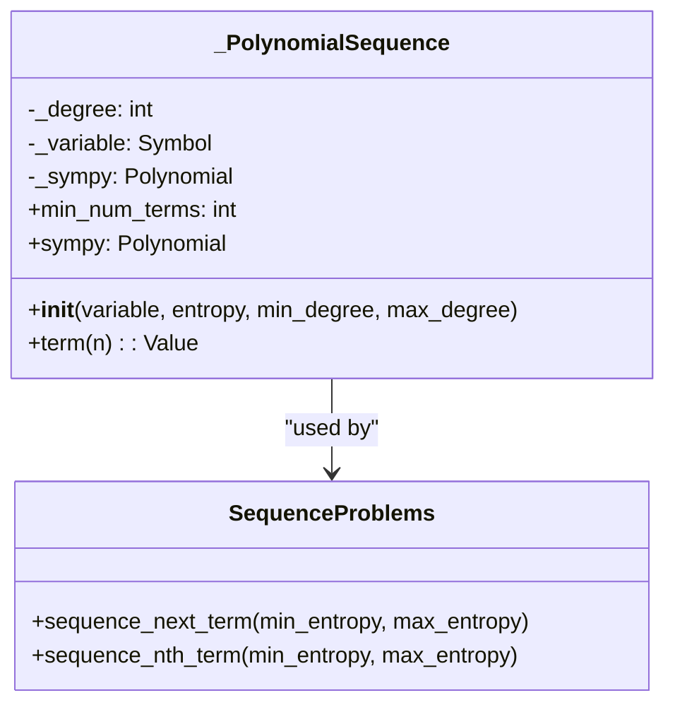
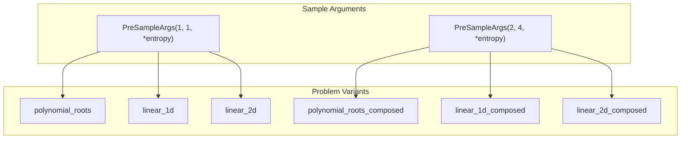
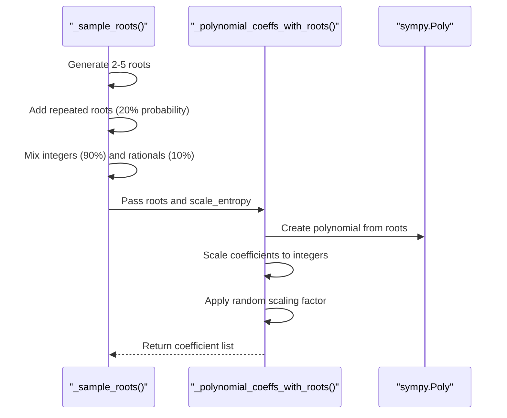

<!-- source: DeepWiki mcp.deepwiki.com · repo google-deepmind/mathematics_dataset · page 4.1 Algebra Module · fetched 2026-10-26 -->

# Algebra Module

Relevant source files

The following files were used as context for generating this wiki page:

- [mathematics_dataset/modules/algebra.py](mathematics_dataset/modules/algebra.py)
- [mathematics_dataset/modules/algebra_test.py](mathematics_dataset/modules/algebra_test.py)

## Purpose and Scope

The Algebra Module generates mathematical problems related to algebraic concepts including polynomial equation solving, linear system solving, and sequence analysis. This module produces questions like "Solve 2*x**2 - 18 = 0" and "What is the next term in the sequence 1, 4, 9?". 

For arithmetic operations and basic mathematical expressions, see [Arithmetic Module](#4.2). For polynomial manipulation utilities used across modules, see [Other Mathematical Modules](#4.4).

## Module Structure and Entry Points

The algebra module follows the standard mathematics dataset module pattern with three main entry points that return dictionaries of problem generators.

**Sources:** [mathematics_dataset/modules/algebra.py:49-92]()

## Problem Generation Categories

The algebra module generates four main categories of problems, each with varying complexity levels.

| Problem Category | Function Names | Description |
|------------------|----------------|-------------|
| Polynomial Roots | `polynomial_roots`, `polynomial_roots_composed`, `polynomial_roots_big` | Solve polynomial equations or factor polynomials |
| Linear Systems 1D | `linear_1d`, `linear_1d_composed` | Solve single-variable linear equations |
| Linear Systems 2D | `linear_2d`, `linear_2d_composed` | Solve two-variable linear systems |
| Sequences | `sequence_next_term`, `sequence_nth_term` | Analyze polynomial-based sequences |

### Polynomial Root Problems

The `polynomial_roots` function generates two types of problems: solving for roots or factoring polynomials.

The root generation process uses controlled randomness with repeated roots:

- **Root Count**: 2-5 roots per polynomial
- **Repeated Roots**: Binomial distribution with probability `_POLY_PROBABILITY_REPEATED_ROOT = 0.2`
- **Root Types**: Mostly integers with 10% rational numbers to avoid large coefficients

**Sources:** [mathematics_dataset/modules/algebra.py:94-221]()

### Linear System Problems

Linear equation solving is handled by the `_solve_linear_system` function, which supports both 1D and 2D systems.

The linear system generator ensures non-trivial problems by requiring constants that can be replaced by handles from other modules when used in composed problems.

**Sources:** [mathematics_dataset/modules/algebra.py:223-293]()

### Sequence Problems

Sequence problems use the `_PolynomialSequence` class to generate polynomial-based sequences with predictable patterns.

**Sequence Generation Process**:
1. Random polynomial degree (1-3)
2. Generate polynomial using `polynomials.sample_with_small_evaluation`
3. Calculate required number of terms (`degree + 2`)
4. Generate sequence samples and format as `NumberList`

**Templates**:
- Next term: "What is next in {sequence}?", "What comes next: {sequence}?"
- Nth term: "What is the {variable}'th term of {sequence}?"

**Sources:** [mathematics_dataset/modules/algebra.py:295-379]()

## Difficulty Control and Entropy Configuration

The algebra module uses three entropy configurations to control problem difficulty:

| Configuration | Range | Usage |
|---------------|-------|-------|
| `_ENTROPY_TRAIN` | (3, 10) | Training problems with variable difficulty |
| `_ENTROPY_INTERPOLATE` | (8, 8) | Standard test problems |
| `_ENTROPY_EXTRAPOLATE` | (12, 12) | Harder extrapolation test problems |

### Composition Support

Problems are available in both pure and composed versions:
- **Pure**: Single module problems (1 entity, 1 sample)
- **Composed**: Multi-module problems (2-4 entities, 2-4 samples)

**Sources:** [mathematics_dataset/modules/algebra.py:37-72]()

## Key Implementation Functions

### Root Sampling and Polynomial Construction

The polynomial generation process carefully balances complexity and solvability:

### Linear System Integration

Linear problems integrate with the broader composition system through the `@composition.module` decorator, allowing them to be used as entities in other problems.

**Sources:** [mathematics_dataset/modules/algebra.py:127-158](), [mathematics_dataset/modules/algebra.py:285-292]()

---

