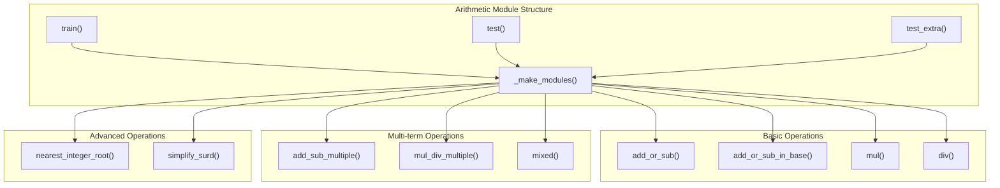
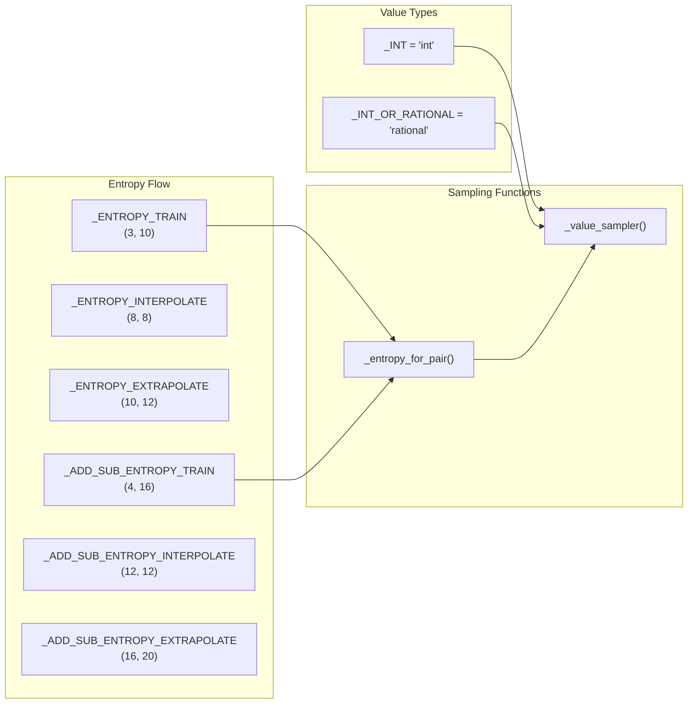
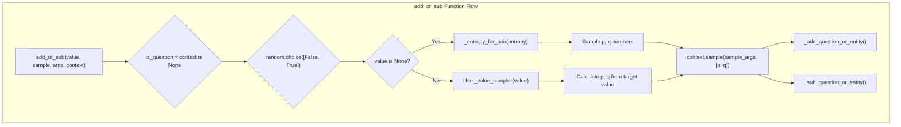
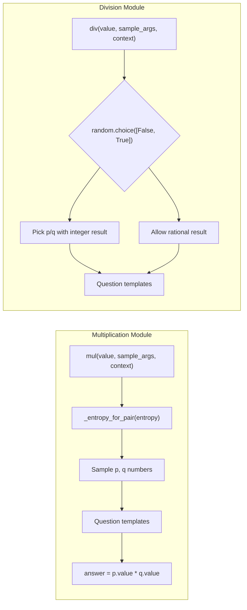
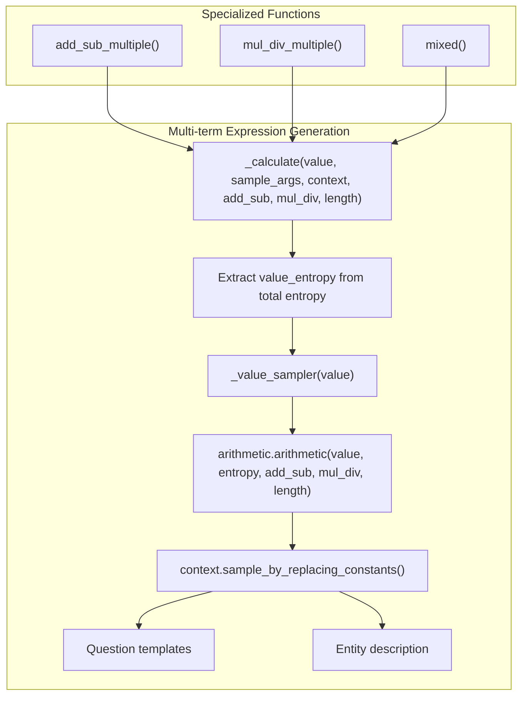
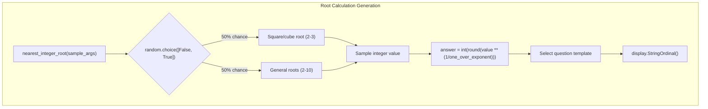
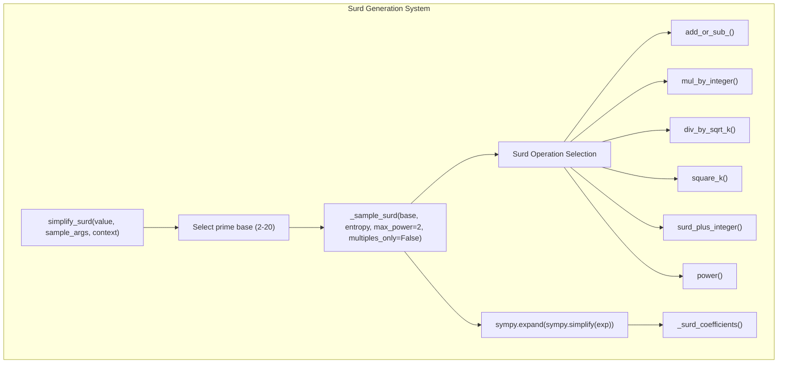
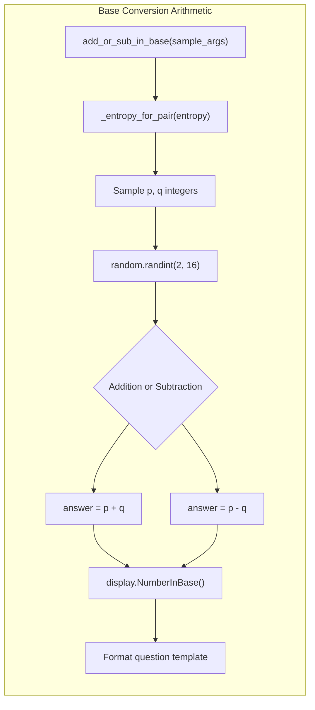
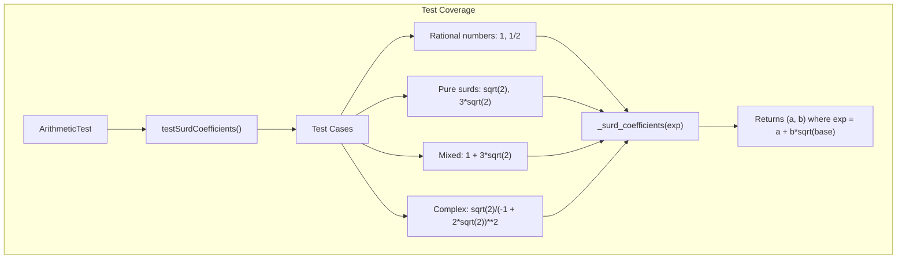

<!-- source: DeepWiki mcp.deepwiki.com · repo google-deepmind/mathematics_dataset · page 4.2 Arithmetic Module · fetched 2026-10-26 -->

# Arithmetic Module

Relevant source files

The following files were used as context for generating this wiki page:

- [mathematics_dataset/modules/arithmetic.py](mathematics_dataset/modules/arithmetic.py)
- [mathematics_dataset/modules/arithmetic_test.py](mathematics_dataset/modules/arithmetic_test.py)

The Arithmetic Module generates mathematical problems involving basic arithmetic operations including addition, subtraction, multiplication, division, and related computations. This module produces questions ranging from simple two-number operations to complex multi-term expressions, root calculations, and surd simplifications. Problems are generated with configurable difficulty levels using entropy-based sampling.

For algebraic problem generation involving polynomial equations and sequences, see [Algebra Module](#4.1). For advanced arithmetic expression generation utilities, see [Arithmetic Expression Generation](#5.1).

## Module Structure and Problem Types

The arithmetic module organizes problem generation into distinct categories based on operation types and complexity levels. Each category supports configurable entropy parameters to control problem difficulty.

Sources: [mathematics_dataset/modules/arithmetic.py:50-78]()

## Entropy Configuration and Difficulty Levels

The module uses entropy parameters to control problem complexity across different training and testing regimes. Higher entropy values generate more complex problems with larger numbers and longer expressions.

| Regime | Entropy Range | Add/Sub Entropy Range | Purpose |
|--------|---------------|----------------------|---------|
| Training | (3, 10) | (4, 16) | General training problems |
| Interpolation | (8, 8) | (12, 12) | Testing within training range |
| Extrapolation | (10, 12) | (16, 20) | Testing beyond training range |

Sources: [mathematics_dataset/modules/arithmetic.py:35-47](), [mathematics_dataset/modules/arithmetic.py:197-200](), [mathematics_dataset/modules/arithmetic.py:124-133]()

## Basic Arithmetic Operations

### Addition and Subtraction

The `add_or_sub` function generates problems involving two-number addition or subtraction with multiple question templates and answer formats.

Question templates for addition include:
- `{p} + {q}`
- `Work out {p} + {q}.`
- `Add {p} and {q}.`
- `What is {p} plus {q}?`

Question templates for subtraction include:
- `{p} - {q}`
- `What is {p} minus {q}?`
- `Subtract {q} from {p}.`
- `What is the difference between {p} and {q}?`

Sources: [mathematics_dataset/modules/arithmetic.py:203-237](), [mathematics_dataset/modules/arithmetic.py:136-194]()

### Multiplication and Division

The `mul` and `div` functions generate multiplication and division problems with varied question formats and answer types.

Multiplication templates include:
- `{p}` + `ops.MUL_SYMBOL` + `{q}`
- `Multiply {p} and {q}.`
- `What is the product of {p} and {q}?`

Division templates include:
- `Divide {p} by {q}.`
- `{p} divided by {q}`
- `What is {p} divided by {q}?`

Sources: [mathematics_dataset/modules/arithmetic.py:264-300](), [mathematics_dataset/modules/arithmetic.py:302-340]()

## Multi-term Arithmetic Expressions

### Expression Generation Framework

The `_calculate` function serves as the core framework for generating multi-term arithmetic expressions. It delegates to the `arithmetic.arithmetic` function for expression construction.

The specialized functions configure different operation types:
- `add_sub_multiple`: Only addition and subtraction (`add_sub=True, mul_div=False`)
- `mul_div_multiple`: Only multiplication and division (`add_sub=False, mul_div=True`)
- `mixed`: All operations (`add_sub=True, mul_div=True`)

Sources: [mathematics_dataset/modules/arithmetic.py:388-424](), [mathematics_dataset/modules/arithmetic.py:427-440]()

## Advanced Arithmetic Operations

### Root Calculations

The `nearest_integer_root` function generates problems asking for nth roots rounded to the nearest integer.

Question templates vary by root type:
- General: `What is {value} to the power of 1/{one_over_exponent}, to the nearest integer?`
- Square root: `What is the square root of {value} to the nearest integer?`
- Cube root: `What is the cube root of {value} to the nearest integer?`
- Ordinal form: `What is the {ordinal} root of {value} to the nearest integer?`

Sources: [mathematics_dataset/modules/arithmetic.py:343-385]()

### Surd Simplification

The `simplify_surd` function generates complex expressions involving square roots that can be simplified to the form `a + b * sqrt(base)`.

The `_sample_surd` function recursively builds complex surd expressions using various operations:
- Addition/subtraction of surds
- Multiplication by integers
- Division by square roots
- Squaring operations
- Addition of integers to surds

Sources: [mathematics_dataset/modules/arithmetic.py:575-597](), [mathematics_dataset/modules/arithmetic.py:484-572](), [mathematics_dataset/modules/arithmetic.py:443-471]()

## Base Conversion Arithmetic

The `add_or_sub_in_base` function generates arithmetic problems in bases other than decimal (base 2-16).

Example question formats:
- `In base {base}, what is {p} + {q}?`
- `In base {base}, what is {p} - {q}?`

Both operands and answers are displayed using `display.NumberInBase` for proper base representation.

Sources: [mathematics_dataset/modules/arithmetic.py:240-261]()

## Testing and Validation

The module includes comprehensive test coverage for surd coefficient extraction functionality.

The test validates that `_surd_coefficients` correctly extracts coefficients from various surd expressions, ensuring proper simplification of complex square root expressions.

Sources: [mathematics_dataset/modules/arithmetic_test.py:27-61]()

---

