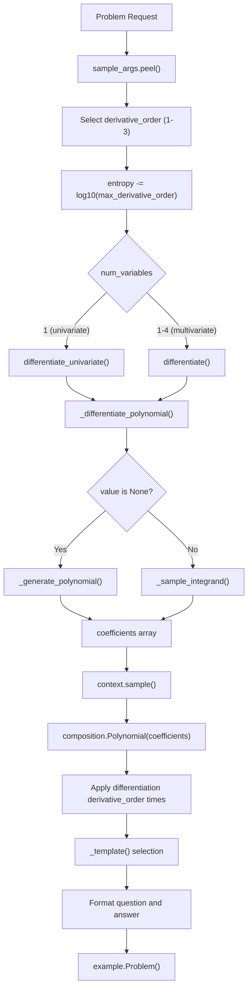
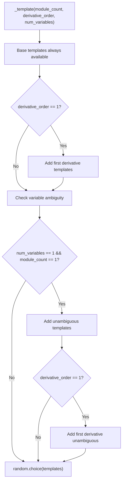

<!-- source: DeepWiki mcp.deepwiki.com · repo google-deepmind/mathematics_dataset · page 4.3 Calculus Module · fetched 2026-10-26 -->

# Calculus Module

<details>
<summary>Relevant source files</summary>

The following files were used as context for generating this wiki page:

- [mathematics_dataset/modules/calculus.py](mathematics_dataset/modules/calculus.py)
- [mathematics_dataset/modules/calculus_test.py](mathematics_dataset/modules/calculus_test.py)

</details>


## Purpose and Scope

The Calculus Module generates differentiation problems for polynomial expressions. It creates questions that ask for derivatives of various orders (1st, 2nd, 3rd) for both univariate and multivariate polynomials. The module supports different complexity levels through entropy-based difficulty control and can generate both standalone problems and composed problems that integrate with other mathematical operations.

For information about other mathematical domains, see [Mathematical Domain Modules](#4). For details on polynomial manipulation utilities, see [Other Mathematical Modules](#4.4).

## Module Structure and Entry Points

The calculus module follows the standard module interface pattern with `train()`, `test()`, and `test_extra()` entry points that return dictionaries of problem generators.

### Module Architecture

```mermaid
graph TB
    subgraph "Entry Points"
        TRAIN["train(entropy_fn)"]
        TEST["test()"]
        TEST_EXTRA["test_extra()"]
    end
    
    subgraph "Module Factory"
        MAKE_MODULES["_make_modules(entropy)"]
        ENTROPY_TRAIN["_ENTROPY_TRAIN = (3, 10)"]
        ENTROPY_INTERP["_ENTROPY_INTERPOLATE = (8, 8)"]
    end
    
    subgraph "Problem Types"
        DIFF_COMPOSED["differentiate_composed"]
        DIFF_PURE["differentiate"]
    end
    
    subgraph "Core Functions"
        DIFF_UNIVAR["differentiate_univariate()"]
        DIFF_POLY["_differentiate_polynomial()"]
        DIFF_MAIN["differentiate()"]
    end
    
    subgraph "Sample Arguments"
        PURE_ARGS["PreSampleArgs(1, 1, entropy)"]
        COMPOSED_ARGS["PreSampleArgs(2, 4, entropy)"]
    end
    
    TRAIN --> MAKE_MODULES
    TEST --> MAKE_MODULES
    TEST_EXTRA --> "Empty Dict"
    
    TRAIN --> ENTROPY_TRAIN
    TEST --> ENTROPY_INTERP
    
    MAKE_MODULES --> DIFF_COMPOSED
    MAKE_MODULES --> DIFF_PURE
    
    DIFF_COMPOSED --> DIFF_UNIVAR
    DIFF_PURE --> DIFF_MAIN
    
    DIFF_UNIVAR --> DIFF_POLY
    DIFF_MAIN --> DIFF_POLY
    
    COMPOSED_ARGS --> DIFF_COMPOSED
    PURE_ARGS --> DIFF_PURE
```

Sources: [mathematics_dataset/modules/calculus.py:39-64]()

### Module Configuration

| Component | Configuration | Purpose |
|-----------|---------------|---------|
| Training Entropy | `(3, 10)` | Controls difficulty range for training problems |
| Interpolation Entropy | `(8, 8)` | Fixed difficulty for interpolation testing |
| Pure Sample Args | `PreSampleArgs(1, 1, entropy)` | Simple differentiation problems |
| Composed Sample Args | `PreSampleArgs(2, 4, entropy)` | Complex composed differentiation problems |

Sources: [mathematics_dataset/modules/calculus.py:35-42]()

## Problem Generation Pipeline

The calculus module generates differentiation problems through a multi-stage pipeline that creates polynomials, applies differentiation operations, and formats the results into natural language questions.

### Generation Flow



Sources: [mathematics_dataset/modules/calculus.py:134-189]()

### Polynomial Generation Strategy

The module uses two different strategies for generating polynomials based on whether it's creating a standalone problem or composing with other operations:

1. **Direct Generation** (`_generate_polynomial`): Creates polynomials with random degrees and coefficients
2. **Integration-based Generation** (`_sample_integrand`): Generates polynomials by integrating target derivatives and adding constant terms

Sources: [mathematics_dataset/modules/calculus.py:67-132]()

## Polynomial Generation and Differentiation

### Polynomial Construction

```mermaid
graph LR
    subgraph "Polynomial Generation"
        DEGREES["degrees = randint(1, 4, [num_variables])"]
        DERIV_AXIS["degrees[derivative_axis] = randint(0, 4)"]
        COEFFS["polynomials.sample_coefficients()"]
    end
    
    subgraph "Extra Terms for Differentiation"
        EXTRA_DEGREES["degrees[derivative_axis] = derivative_order - 1"]
        EXTRA_COEFFS["polynomials.sample_coefficients()"]
        CONCAT["np.concatenate()"]
    end
    
    subgraph "Differentiation Process"
        DIFF_LOOP["for _ in range(derivative_order)"]
        POLY_DIFF["polynomials.differentiate(axis=derivative_axis)"]
        RESULT["Final derivative coefficients"]
    end
    
    DEGREES --> DERIV_AXIS
    DERIV_AXIS --> COEFFS
    
    COEFFS --> EXTRA_DEGREES
    EXTRA_DEGREES --> EXTRA_COEFFS
    EXTRA_COEFFS --> CONCAT
    
    CONCAT --> DIFF_LOOP
    DIFF_LOOP --> POLY_DIFF
    POLY_DIFF --> RESULT
```



Sources: [mathematics_dataset/modules/calculus.py:67-84](), [mathematics_dataset/modules/calculus.py:159-161]()

### Derivative Order and Variable Selection

| Parameter | Range | Purpose |
|-----------|--------|---------|
| `derivative_order` | 1-3 | Order of derivative to compute |
| `num_variables` | 1-4 | Number of variables in polynomial |
| `derivative_axis` | 0 to `num_variables-1` | Which variable to differentiate with respect to |
| `degrees` | 1-4 per variable | Maximum degree for each variable |

Sources: [mathematics_dataset/modules/calculus.py:144-148](), [mathematics_dataset/modules/calculus.py:197]()

## Question Templates and Formatting

The module provides multiple question templates that vary based on derivative order, number of variables, and context ambiguity.

### Template Selection Logic



Sources: [mathematics_dataset/modules/calculus.py:86-111]()

### Available Question Templates

| Template Type | Example | Conditions |
|---------------|---------|------------|
| General nth derivative | `"Find the {nth} derivative of {eq} wrt {var}."` | Always available |
| General question form | `"What is the {nth} derivative of {eq} wrt {var}?"` | Always available |
| First derivative imperative | `"Differentiate {eq} with respect to {var}."` | `derivative_order == 1` |
| First derivative abbreviated | `"Differentiate {eq} wrt {var}."` | `derivative_order == 1` |
| Unambiguous nth derivative | `"Find the {nth} derivative of {eq}."` | Single variable, single module |
| Unambiguous first derivative | `"Differentiate {eq}."` | Single variable, single module, first order |

Sources: [mathematics_dataset/modules/calculus.py:88-110]()

### Answer Generation

The module generates symbolic answers using SymPy expressions converted from polynomial coefficient arrays:

```python
answer = polynomials.coefficients_to_polynomial(value, variables).sympy()
```

For composed problems, it returns `composition.Entity` objects with function handles and descriptions for further composition.

Sources: [mathematics_dataset/modules/calculus.py:174-188]()

---

