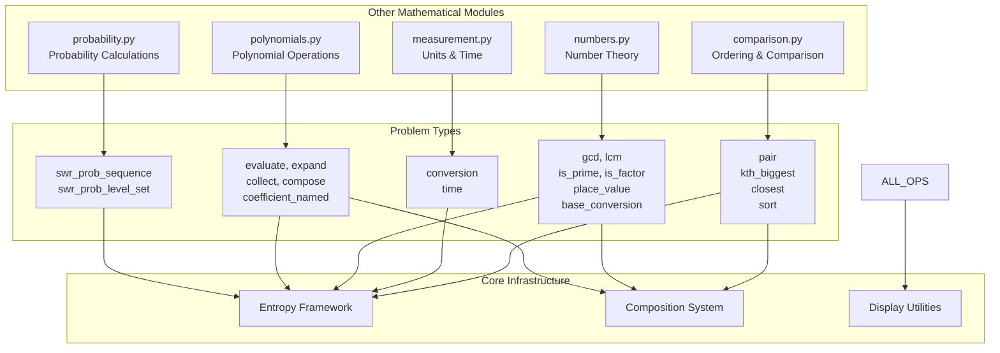
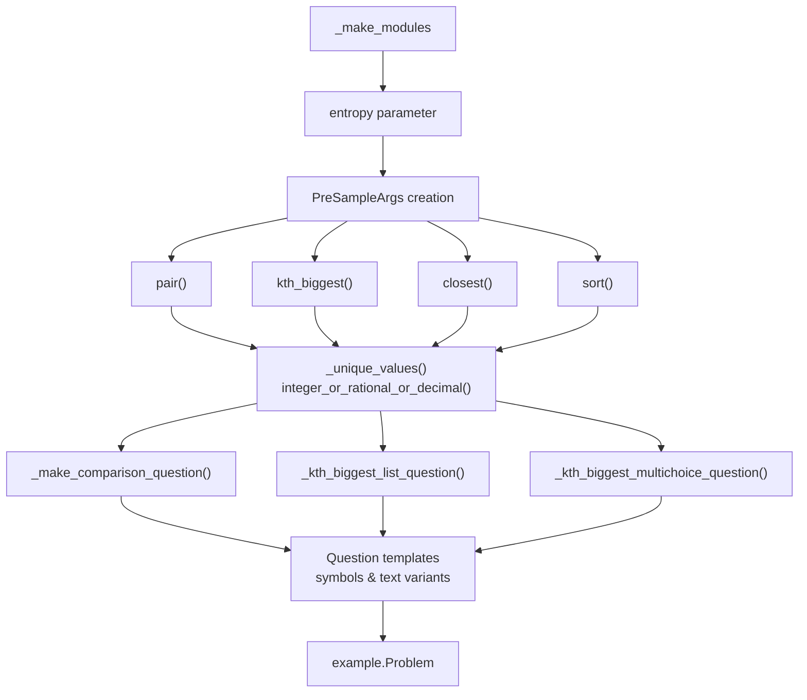
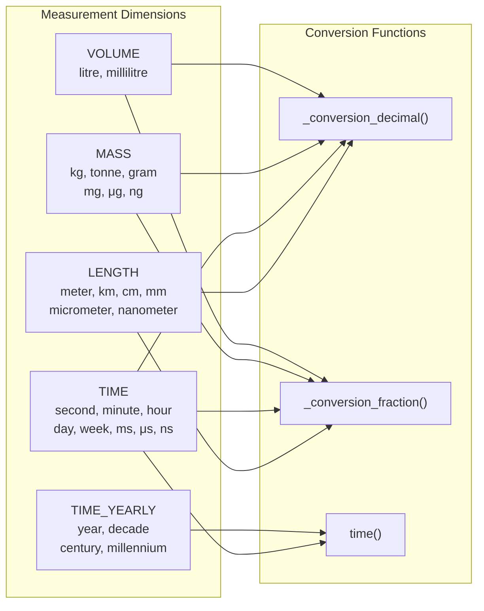
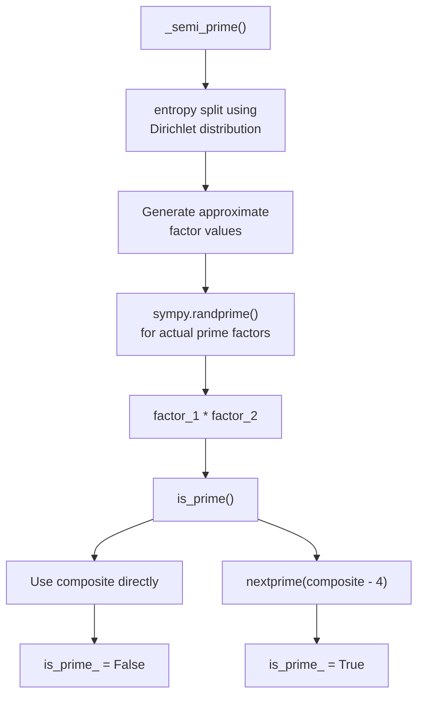
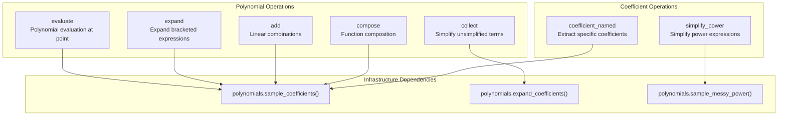
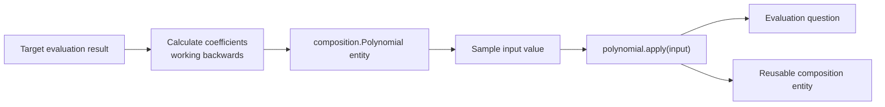
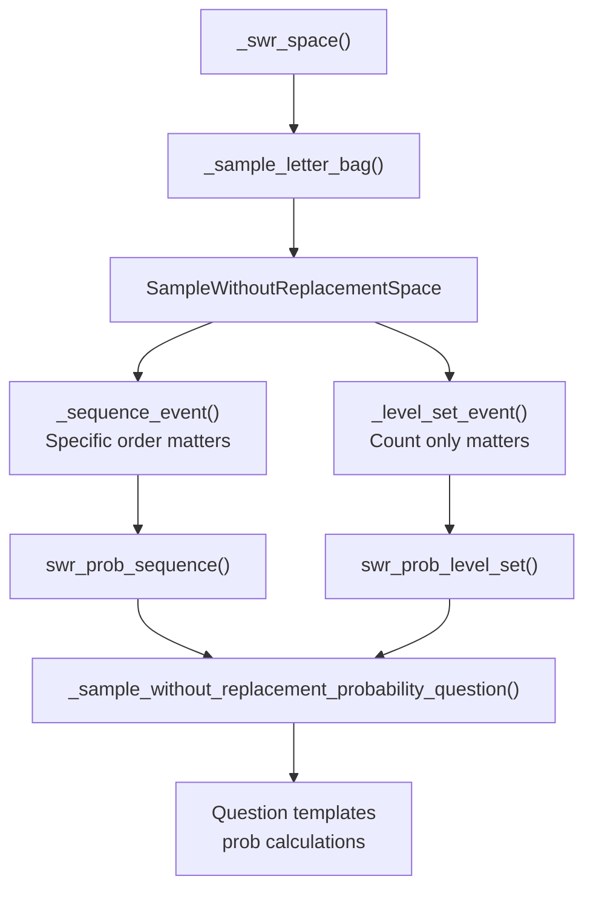
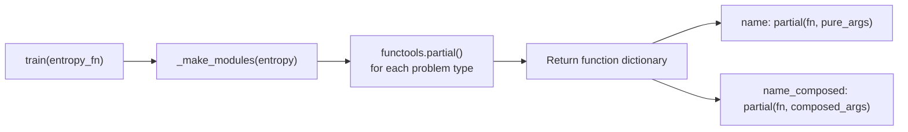

<!-- source: DeepWiki mcp.deepwiki.com · repo google-deepmind/mathematics_dataset · page 4.4 Other Mathematical Modules · fetched 2026-10-26 -->

# Other Mathematical Modules

Relevant source files

The following files were used as context for generating this wiki page:

- [mathematics_dataset/modules/comparison.py](mathematics_dataset/modules/comparison.py)
- [mathematics_dataset/modules/measurement.py](mathematics_dataset/modules/measurement.py)
- [mathematics_dataset/modules/numbers.py](mathematics_dataset/modules/numbers.py)
- [mathematics_dataset/modules/polynomials.py](mathematics_dataset/modules/polynomials.py)
- [mathematics_dataset/modules/probability.py](mathematics_dataset/modules/probability.py)

This document covers the remaining mathematical domain modules in the dataset generation system beyond the core algebra, arithmetic, and calculus modules. These modules handle specialized mathematical areas including comparisons, measurements, number theory, polynomial manipulation, and probability calculations. For information about the main algebraic problem generation, see [Algebra Module](#4.1). For arithmetic operations, see [Arithmetic Module](#4.2). For calculus problems, see [Calculus Module](#4.3).

## Module Overview and Organization

The mathematics dataset includes five additional specialized modules that generate problems in distinct mathematical domains. Each module follows the standard training/testing entropy framework while implementing domain-specific problem generation logic.

### Module Taxonomy

Sources: [mathematics_dataset/modules/comparison.py:44-59](), [mathematics_dataset/modules/measurement.py:35-41](), [mathematics_dataset/modules/numbers.py:45-72](), [mathematics_dataset/modules/polynomials.py:40-66](), [mathematics_dataset/modules/probability.py:55-63]()

## Comparison Module

The comparison module generates problems involving ordering, ranking, and comparing mathematical values. It supports both direct comparisons and multi-choice question formats.

### Comparison Problem Types

| Function | Problem Type | Example |
|----------|-------------|---------|
| `pair` | Direct comparison | "Is 1/2 < 0.5?" |
| `kth_biggest` | Ranking problems | "What is the 2nd biggest value in 3, 7, 1, 9?" |
| `closest` | Proximity questions | "Which is closest to 5 in 3, 8, 4, 7?" |
| `sort` | Ordering problems | "Sort 2.5, 3, 1/2 in ascending order" |

### Question Generation Flow

Sources: [mathematics_dataset/modules/comparison.py:96-171](), [mathematics_dataset/modules/comparison.py:307-341](), [mathematics_dataset/modules/comparison.py:372-412](), [mathematics_dataset/modules/comparison.py:415-452]()

### Entropy and Difficulty Scaling

The comparison module uses entropy ranges to control problem difficulty:

- **Training**: `_ENTROPY_TRAIN = (3, 10)`
- **Interpolation**: `_ENTROPY_INTERPOLATE = (8, 8)`  
- **Extrapolation**: `_ENTROPY_EXTRAPOLATE = (12, 12)`

Extrapolation testing includes increased item counts beyond training ranges via `_EXTRAPOLATION_EXTRA_COUNT = 2`.

Sources: [mathematics_dataset/modules/comparison.py:35-39](), [mathematics_dataset/modules/comparison.py:72-93]()

## Measurement Module

The measurement module handles unit conversion problems and time calculations across various measurement dimensions.

### Measurement Dimensions and Units

Sources: [mathematics_dataset/modules/measurement.py:69-112](), [mathematics_dataset/modules/measurement.py:145-177](), [mathematics_dataset/modules/measurement.py:180-216](), [mathematics_dataset/modules/measurement.py:230-277]()

### Problem Generation Logic

The measurement module generates two main types of problems:

1. **Unit Conversion**: Converting between units within the same dimension
2. **Time Calculations**: Computing time differences, start times, or end times

Unit conversions can be expressed as decimals or fractions, with the module automatically handling non-decimal scale factors using `_factor_non_decimal()`.

Sources: [mathematics_dataset/modules/measurement.py:123-131](), [mathematics_dataset/modules/measurement.py:133-142]()

## Numbers Module

The numbers module implements problems related to number theory, place value, rounding, and base conversion. It provides both pure and composed versions of most problem types.

### Number Theory Operations

| Function | Mathematical Concept | Example Question |
|----------|---------------------|------------------|
| `gcd` | Greatest Common Divisor | "What is the GCD of 48 and 18?" |
| `lcm` | Least Common Multiple | "Calculate the LCM of 12 and 8" |
| `is_prime` | Primality Testing | "Is 97 prime?" |
| `is_factor` | Divisibility | "Is 7 a factor of 91?" |
| `div_remainder` | Division Remainder | "What is 27 mod 5?" |
| `list_prime_factors` | Prime Factorization | "List prime factors of 60" |

### Specialized Number Operations

The module also handles more advanced formatting and representation problems:

- `place_value`: Digit identification in large numbers
- `round_number`: Rounding to specified precision
- `base_conversion`: Converting between number bases (2-16)

### Prime Number Generation

Sources: [mathematics_dataset/modules/numbers.py:207-225](), [mathematics_dataset/modules/numbers.py:228-261]()

### Composition Integration

The numbers module extensively uses the composition system, with functions like `gcd` and `div_remainder` serving as both standalone questions and building blocks for more complex problems.

Sources: [mathematics_dataset/modules/numbers.py:408-446](), [mathematics_dataset/modules/numbers.py:449-486]()

## Polynomials Module

The polynomials module handles polynomial manipulation, evaluation, and algebraic operations. It integrates heavily with the composition system to create complex polynomial expressions.

### Polynomial Problem Categories

Sources: [mathematics_dataset/modules/polynomials.py:85-125](), [mathematics_dataset/modules/polynomials.py:136-189](), [mathematics_dataset/modules/polynomials.py:246-265](), [mathematics_dataset/modules/polynomials.py:327-355]()

### Polynomial Evaluation with Composition

The `evaluate` function demonstrates sophisticated integration with the composition system:

Sources: [mathematics_dataset/modules/polynomials.py:136-189]()

## Probability Module

The probability module focuses on sampling without replacement scenarios, generating problems about sequences and level sets of sampled items.

### Letter Bag Sampling Framework

The module uses a "bag of letters" metaphor for probability problems:

| Component | Purpose | Implementation |
|-----------|---------|----------------|
| `LetterBag` | Container structure | Named tuple with weights, random variables |
| `_sample_letter_bag` | Bag generation | Creates letter distribution with train/test split |
| `_swr_space` | Probability space | `SampleWithoutReplacementSpace` |

### Problem Types and Event Generation

Sources: [mathematics_dataset/modules/probability.py:150-188](), [mathematics_dataset/modules/probability.py:191-206](), [mathematics_dataset/modules/probability.py:209-250]()

### Probability Event Types

The module generates two distinct types of probability events:

1. **Sequence Events**: Order matters (e.g., "probability of sequence 'abc'")
2. **Level Set Events**: Only counts matter (e.g., "probability of picking 2 a's and 1 b")

Event complexity is controlled by limiting computation size to avoid intractable probability calculations.

Sources: [mathematics_dataset/modules/probability.py:89-107](), [mathematics_dataset/modules/probability.py:120-142]()

## Module Integration Patterns

### Common Architecture Elements

All specialized modules follow consistent patterns for integration with the core generation system:

| Pattern | Implementation | Modules Using |
|---------|---------------|---------------|
| Entropy-based difficulty | `_ENTROPY_TRAIN`, `_ENTROPY_INTERPOLATE` | comparison, numbers, polynomials |
| Train/test splitting | `train_test_split.is_train()` | measurement, probability |
| Pure/composed variants | `PreSampleArgs` with different ranges | comparison, numbers, polynomials |
| Template-based questions | `example.question()` with templates | All modules |

### Function Registration Pattern

Sources: [mathematics_dataset/modules/comparison.py:44-59](), [mathematics_dataset/modules/numbers.py:45-72](), [mathematics_dataset/modules/polynomials.py:40-66]()

This standardized approach enables the main generation system to treat all modules uniformly while allowing each module to implement domain-specific logic for mathematical problem generation.

---

