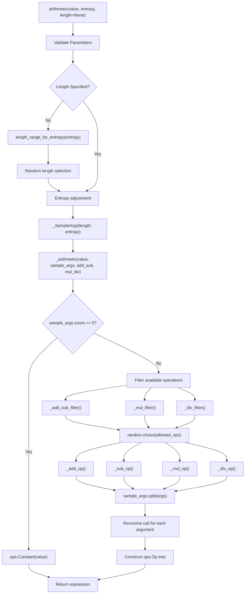
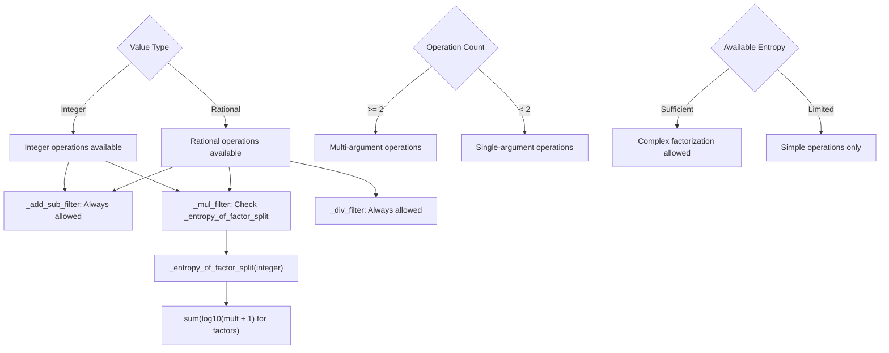
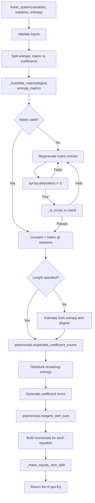
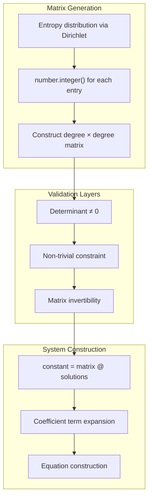
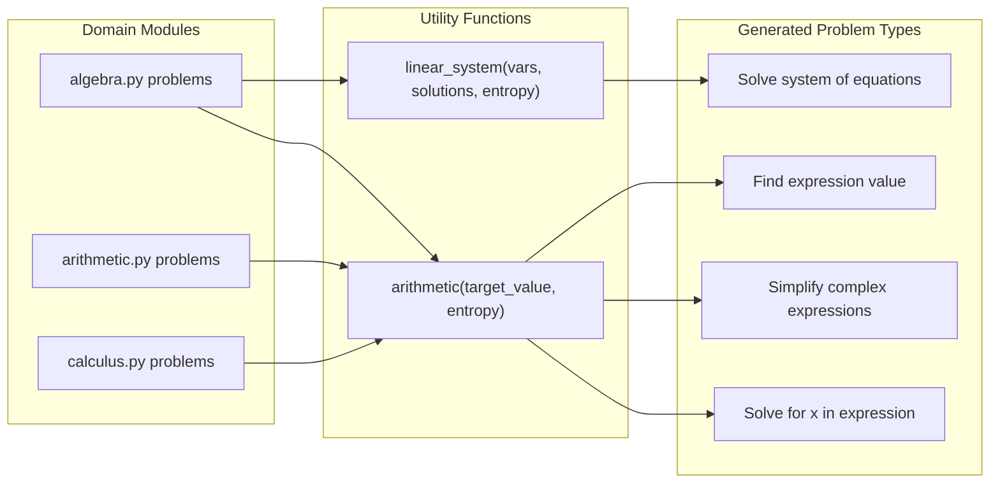

<!-- source: DeepWiki mcp.deepwiki.com · repo google-deepmind/mathematics_dataset · page 5 Advanced Problem Generation · fetched 2026-10-26 -->

# Advanced Problem Generation

<details>
<summary>Relevant source files</summary>

The following files were used as context for generating this wiki page:

- [mathematics_dataset/sample/arithmetic.py](mathematics_dataset/sample/arithmetic.py)
- [mathematics_dataset/sample/linear_system.py](mathematics_dataset/sample/linear_system.py)

</details>


This document covers specialized utilities for generating complex mathematical structures that serve as building blocks for more sophisticated problem types. The system provides two main advanced generation capabilities: controlled arithmetic expression generation and linear system construction with predetermined solutions.

For basic mathematical infrastructure like number generation and expression trees, see [Mathematical Infrastructure](#3.2). For how these utilities integrate into domain-specific problem generation, see [Mathematical Domain Modules](#4).

## System Overview

The advanced problem generation system consists of two primary utilities that generate mathematical structures with precise control over complexity and target outcomes:

```mermaid
graph TB
    subgraph "Domain_Modules" ["Domain Modules"]
        ALG["algebra.py"]
        ARITH_MOD["arithmetic.py (module)"]
        CALC["calculus.py"]
    end
    
    subgraph "Advanced_Generation" ["Advanced Generation Utilities"]
        ARITH_SAMPLE["sample/arithmetic.py"]
        LINEAR_SAMPLE["sample/linear_system.py"]
    end
    
    subgraph "Core_Infrastructure" ["Core Mathematical Infrastructure"]
        NUMBER["sample/number.py"]
        OPS["sample/ops.py"]
        POLY["sample/polynomials.py"]
    end
    
    subgraph "Generated_Structures" ["Generated Mathematical Structures"]
        EXPR["Arithmetic Expressions"]
        SYSTEMS["Linear Equation Systems"]
    end
    
    ALG --> ARITH_SAMPLE
    ALG --> LINEAR_SAMPLE
    ARITH_MOD --> ARITH_SAMPLE
    CALC --> ARITH_SAMPLE
    
    ARITH_SAMPLE --> EXPR
    LINEAR_SAMPLE --> SYSTEMS
    
    ARITH_SAMPLE --> NUMBER
    ARITH_SAMPLE --> OPS
    LINEAR_SAMPLE --> NUMBER
    LINEAR_SAMPLE --> OPS
    LINEAR_SAMPLE --> POLY
    
    EXPR --> "Target Value Problems"
    SYSTEMS --> "System Solving Problems"
```

**Sources:** [mathematics_dataset/sample/arithmetic.py:1-261](), [mathematics_dataset/sample/linear_system.py:1-145]()

## Arithmetic Expression Generator

The arithmetic expression generator creates mathematical expressions that evaluate to a specified target value while controlling complexity through entropy-based sampling.

### Core Generation Process



**Sources:** [mathematics_dataset/sample/arithmetic.py:229-261](), [mathematics_dataset/sample/arithmetic.py:193-220]()

### Entropy Management and Operation Selection

The system uses a sophisticated entropy distribution mechanism through the `_SampleArgs` class:

| Method | Purpose | Implementation |
|--------|---------|----------------|
| `peel(frac=1)` | Allocates portion of entropy to current operation | [mathematics_dataset/sample/arithmetic.py:38-42]() |
| `split(args)` | Distributes remaining entropy among child expressions | [mathematics_dataset/sample/arithmetic.py:44-61]() |

The operation selection follows these filtering rules:



**Sources:** [mathematics_dataset/sample/arithmetic.py:63-128](), [mathematics_dataset/sample/arithmetic.py:95-103]()

### Operation Implementation Details

Each operation type implements specific logic for maintaining the target value:

| Operation | Strategy | Key Function |
|-----------|----------|--------------|
| Addition | `value = x + (value - x)` | [mathematics_dataset/sample/arithmetic.py:67-78]() |
| Subtraction | `value = (value + x) - x` or `value = x - (x - value)` | [mathematics_dataset/sample/arithmetic.py:81-92]() |
| Multiplication | Factor splitting with `_split_factors()` | [mathematics_dataset/sample/arithmetic.py:130-152]() |
| Division | Rational construction preserving value | [mathematics_dataset/sample/arithmetic.py:161-190]() |

**Sources:** [mathematics_dataset/sample/arithmetic.py:105-119](), [mathematics_dataset/sample/arithmetic.py:67-190]()

## Linear System Generator

The linear system generator creates systems of linear equations with predetermined solutions, ensuring mathematical consistency while controlling problem complexity.

### System Construction Process



**Sources:** [mathematics_dataset/sample/linear_system.py:88-144](), [mathematics_dataset/sample/linear_system.py:68-85]()

### Matrix Generation and Validation

The system ensures mathematical validity through multiple validation layers:



The non-triviality check prevents systems where one equation reduces to a single variable:

**Sources:** [mathematics_dataset/sample/linear_system.py:50-66](), [mathematics_dataset/sample/linear_system.py:68-85]()

### Equation Assembly

The final equations are constructed by distributing coefficient terms and creating balanced expressions:

| Component | Purpose | Implementation |
|-----------|---------|----------------|
| Monomial construction | Creates `term * variable^power` expressions | [mathematics_dataset/sample/linear_system.py:139]() |
| Zero-sum splitting | Randomly distributes terms between equation sides | [mathematics_dataset/sample/linear_system.py:32-47]() |
| Equation balancing | Ensures left side equals right side | [mathematics_dataset/sample/linear_system.py:45-47]() |

**Sources:** [mathematics_dataset/sample/linear_system.py:126-144](), [mathematics_dataset/sample/linear_system.py:32-47]()

## Integration with Problem Generation

These advanced utilities serve as foundational components for higher-level problem generation across multiple mathematical domains:



The entropy-based complexity control allows these utilities to generate problems appropriate for different difficulty levels while maintaining mathematical correctness and educational value.

**Sources:** [mathematics_dataset/sample/arithmetic.py:229-261](), [mathematics_dataset/sample/linear_system.py:88-144]()

---

