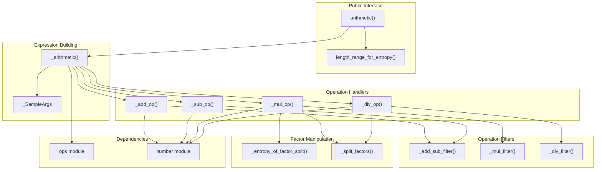
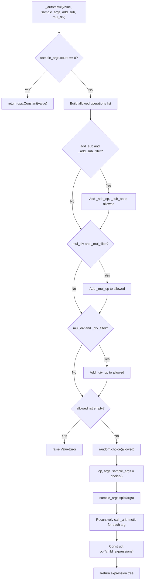
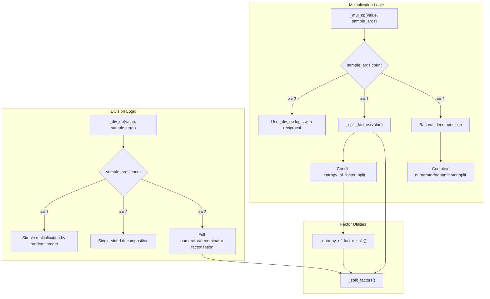

<!-- source: DeepWiki mcp.deepwiki.com · repo google-deepmind/mathematics_dataset · page 5.1 Arithmetic Expression Generation · fetched 2026-10-26 -->

# Arithmetic Expression Generation

<details>
<summary>Relevant source files</summary>

The following files were used as context for generating this wiki page:

- [mathematics_dataset/sample/arithmetic.py](mathematics_dataset/sample/arithmetic.py)
- [mathematics_dataset/sample/arithmetic_test.py](mathematics_dataset/sample/arithmetic_test.py)

</details>


This document covers the specialized system for generating arithmetic expressions with controlled complexity and predetermined values. The arithmetic expression generator creates complex mathematical expressions by recursively building expression trees using addition, subtraction, multiplication, and division operations while maintaining a target result value.

This system is distinct from the arithmetic problem module covered in [Arithmetic Module](#4.2). While the arithmetic module generates complete mathematical problems and questions, this expression generator focuses specifically on creating the arithmetic expressions themselves that can be used as components within larger mathematical problems.

## Purpose and Core Functionality

The arithmetic expression generation system provides a single primary interface through the `arithmetic()` function in [mathematics_dataset/sample/arithmetic.py:229-261](). This function generates mathematical expressions that evaluate to a specified target value while using a controlled amount of entropy to determine expression complexity.

The system works by recursively decomposing a target value into sub-expressions using mathematical operations, ensuring the final expression tree evaluates to the original target while maintaining complexity constraints specified through entropy parameters.

## Core Architecture Components

The arithmetic expression generator is built around several key components that work together to create controlled mathematical expressions.



Sources: [mathematics_dataset/sample/arithmetic.py:1-261]()

### SampleArgs Class

The `_SampleArgs` class manages entropy distribution and operation counting throughout expression generation. It is implemented as a named tuple with two core methods:

| Method | Purpose | Returns |
|--------|---------|---------|
| `peel(frac=1)` | Allocates entropy for a single operation | `(entropy, new_sample_args)` |
| `split(args)` | Distributes entropy across multiple sub-expressions | `List[_SampleArgs]` |

The class tracks two key parameters:
- `count`: Number of operations remaining to be generated
- `entropy`: Total entropy budget for generating complexity

Sources: [mathematics_dataset/sample/arithmetic.py:35-61]()

## Expression Generation Algorithm

The core generation algorithm follows a recursive pattern implemented in the `_arithmetic()` function. The algorithm selects appropriate mathematical operations based on the current value, remaining operation count, and available entropy.



Sources: [mathematics_dataset/sample/arithmetic.py:193-220]()

### Operation Selection Logic

Each mathematical operation has associated filter and generation functions that determine when it can be applied and how to decompose the target value:

| Operation | Filter Function | Generator Function | Constraint |
|-----------|----------------|-------------------|------------|
| Addition | `_add_sub_filter` | `_add_op` | `count >= 2` or `value.is_Integer` |
| Subtraction | `_add_sub_filter` | `_sub_op` | `count >= 2` or `value.is_Integer` |
| Multiplication | `_mul_filter` | `_mul_op` | `count >= 2` or sufficient factor entropy |
| Division | `_div_filter` | `_div_op` | Always allowed when rationals enabled |

Sources: [mathematics_dataset/sample/arithmetic.py:63-64](), [mathematics_dataset/sample/arithmetic.py:122-128](), [mathematics_dataset/sample/arithmetic.py:155-158]()

## Operation Implementation Details

### Addition and Subtraction Operations

Addition and subtraction operations generate complementary pairs of values that sum or subtract to the target value. The implementation uses entropy to determine the complexity of the generated operands.

For addition (`_add_op`):
- Generates random value `x` using available entropy
- Returns operands `[x, value - x]` or `[value - x, x]` randomly

For subtraction (`_sub_op`):
- Generates random value `x` using available entropy  
- Returns operands `[x, x - value]` or `[value + x, x]` randomly

Sources: [mathematics_dataset/sample/arithmetic.py:67-92]()

### Multiplication and Division Operations

Multiplication and division operations handle more complex decomposition logic, particularly for integer factorization and rational number manipulation.



Sources: [mathematics_dataset/sample/arithmetic.py:130-190]()

### Factor Splitting Algorithm

The factor splitting functionality enables multiplication operations by decomposing integers into products of two factors:

1. **Entropy Calculation**: `_entropy_of_factor_split()` computes the entropy required to decompose an integer based on its prime factorization
2. **Factor Generation**: `_split_factors()` randomly distributes prime factors between two result integers

The entropy calculation uses the formula: `sum(log10(multiplicity + 1))` for each prime factor's multiplicity.

Sources: [mathematics_dataset/sample/arithmetic.py:95-119]()

## Entropy and Complexity Control

The expression generator uses entropy to control both the length and complexity of generated expressions. Higher entropy values produce longer expressions with more complex numeric components.

### Length Determination

The `length_range_for_entropy()` function establishes the relationship between entropy and expression length:

```python
min_length = 3
max_length = min_length + int(entropy / 2)
```

This creates expressions with lengths proportional to available entropy, with a minimum of 3 operations.

### Entropy Distribution

Entropy gets distributed across the expression tree using several mechanisms:
- **Length Sampling**: Entropy is consumed when randomly selecting expression length
- **Operation Selection**: Each operation consumes entropy for generating operands
- **Tree Structure**: Additional entropy accounts for different possible binary tree structures

The tree structure adjustment uses `combinatorics.log_number_binary_trees()` to account for the fact that different tree structures can produce identical expressions.

Sources: [mathematics_dataset/sample/arithmetic.py:222-257]()

## Configuration Parameters

The `arithmetic()` function accepts several configuration parameters that control expression generation behavior:

| Parameter | Type | Default | Purpose |
|-----------|------|---------|---------|
| `value` | `sympy.Expr` | Required | Target value for the expression |
| `entropy` | `float` | Required | Complexity budget for generation |
| `length` | `int` | `None` | Fixed number of operations (auto-calculated if None) |
| `add_sub` | `bool` | `True` | Enable addition and subtraction operations |
| `mul_div` | `bool` | `True` | Enable multiplication and division operations |

When `length` is not specified, it gets sampled from the range determined by `length_range_for_entropy()`. The `add_sub` and `mul_div` parameters allow selective enabling of operation types, with at least one category required to be enabled.

Sources: [mathematics_dataset/sample/arithmetic.py:229-261]()

---

