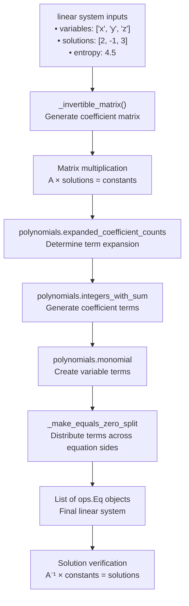
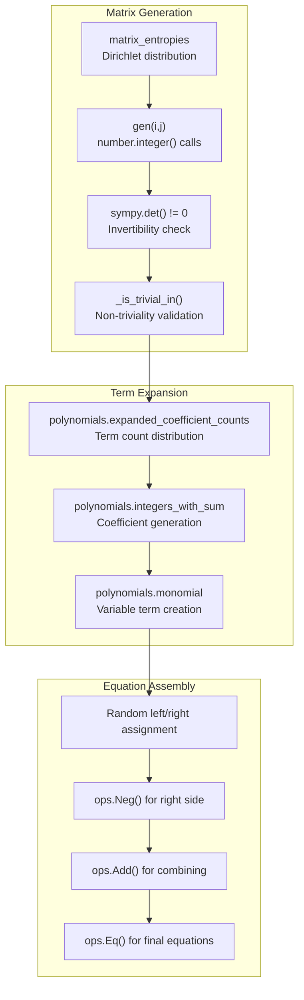
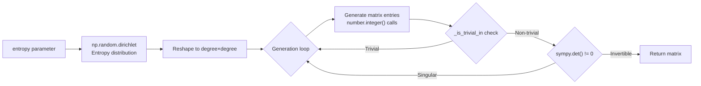
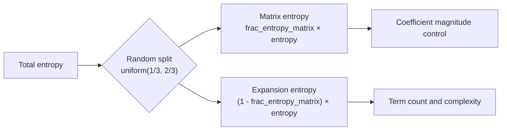

<!-- source: DeepWiki mcp.deepwiki.com · repo google-deepmind/mathematics_dataset · page 5.2 Linear System Generation · fetched 2026-10-26 -->

# Linear System Generation

Relevant source files

The following files were used as context for generating this wiki page:

- [mathematics_dataset/sample/linear_system.py](mathematics_dataset/sample/linear_system.py)

## Purpose and Scope

The linear system generation module provides functionality for creating systems of linear equations with predetermined solutions. This specialized utility is used within the mathematics dataset generation system to produce algebraic problems involving multiple variables and equations. The system ensures that generated linear systems have known solutions while maintaining mathematical complexity through configurable entropy parameters.

For general problem generation across mathematical domains, see [4](#4). For polynomial manipulation utilities used by this system, see [3.2](#3.2).

## System Overview

The linear system generator creates systems of linear equations by working backwards from desired solutions. It constructs an invertible coefficient matrix, computes corresponding constants, and then expands terms to create realistic-looking equations that maintain the predetermined solutions.

### Linear System Generation Pipeline

Sources: [mathematics_dataset/sample/linear_system.py:88-144]()

### Core Components Architecture

Sources: [mathematics_dataset/sample/linear_system.py:68-85](), [mathematics_dataset/sample/linear_system.py:120-143]()

## Core Functions

### `linear_system()`

The main entry point for generating linear systems. Takes variables, their solutions, and configuration parameters to produce a list of `ops.Eq` objects representing the system.

**Parameters:**
- `variables`: List of variable names (e.g., ['x', 'y', 'z'])
- `solutions`: Corresponding solution values
- `entropy`: Complexity control parameter
- `non_trivial_in`: Optional variable index to prevent trivial solutions
- `length`: Total number of terms (auto-calculated if None)

**Process Flow:**
1. Generate invertible coefficient matrix using entropy allocation
2. Compute constant vector: `constant = matrix × solutions`
3. Expand terms using polynomial utilities for realistic appearance
4. Create equations by distributing monomials across equation sides

Sources: [mathematics_dataset/sample/linear_system.py:88-144]()

### `_invertible_matrix()`

Generates random invertible matrices with controlled entropy distribution.

Sources: [mathematics_dataset/sample/linear_system.py:68-85]()

### `_make_equals_zero_split()`

Creates equations by randomly distributing monomials between left and right sides of an equality.

**Algorithm:**
1. Randomly assign each monomial to left or right side
2. Negate terms assigned to right side using `ops.Neg()`
3. Combine terms on each side using `ops.Add()`
4. Create final equation with `ops.Eq(left, right)`

Sources: [mathematics_dataset/sample/linear_system.py:32-47]()

### `_is_trivial_in()`

Validates that the matrix doesn't produce trivial solutions for specified variables by checking if any row has zeros in all positions except the target variable.

Sources: [mathematics_dataset/sample/linear_system.py:50-65]()

## Integration with Mathematical Infrastructure

### Dependency Relationships

| Component | Purpose | Usage in Linear Systems |
|-----------|---------|------------------------|
| `number.integer()` | Random integer generation | Matrix coefficient generation |
| `polynomials.expanded_coefficient_counts()` | Term count distribution | Determines equation complexity |
| `polynomials.integers_with_sum()` | Coefficient expansion | Creates multiple terms per coefficient |
| `polynomials.monomial()` | Variable term creation | Builds individual terms |
| `ops.Add`, `ops.Neg`, `ops.Eq` | Expression tree construction | Assembles final equations |
| `sympy.det()`, `sympy.Matrix` | Mathematical validation | Ensures matrix invertibility |

Sources: [mathematics_dataset/sample/linear_system.py:24-29]()

### Entropy Distribution Strategy

The system allocates entropy between matrix generation and term expansion:

Sources: [mathematics_dataset/sample/linear_system.py:107-124]()

## Usage Examples

The linear system generator produces equations like:
- `2*x + 3*y - z = 5`
- `x - 2*y + 4*z = 1`  
- `3*x + y + 2*z = 8`

With predetermined solutions (e.g., x=2, y=-1, z=3), ensuring the system is solvable and mathematically consistent.

The generated equations maintain complexity through term expansion while preserving the fundamental mathematical relationships required for the known solutions.

Sources: [mathematics_dataset/sample/linear_system.py:135-143]()

---

