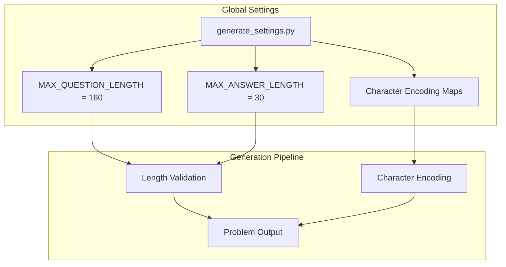
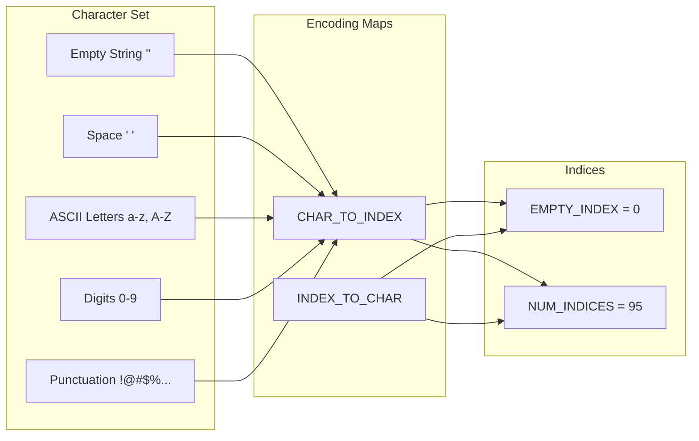
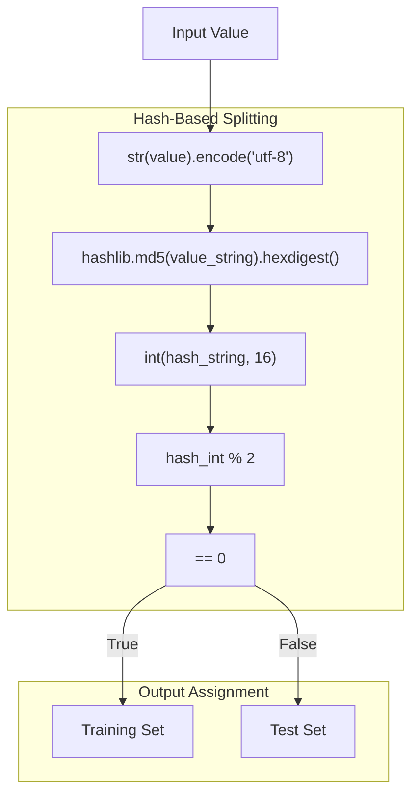
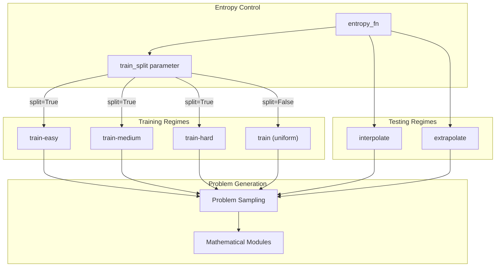
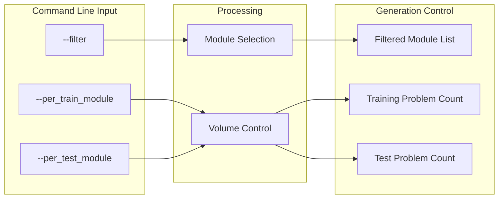

<!-- source: DeepWiki mcp.deepwiki.com · repo google-deepmind/mathematics_dataset · page 6 Configuration and Settings · fetched 2026-10-26 -->

# Configuration and Settings

<details>
<summary>Relevant source files</summary>

The following files were used as context for generating this wiki page:

- [mathematics_dataset/__init__.py](mathematics_dataset/__init__.py)
- [mathematics_dataset/generate_settings.py](mathematics_dataset/generate_settings.py)
- [mathematics_dataset/modules/__init__.py](mathematics_dataset/modules/__init__.py)
- [mathematics_dataset/modules/train_test_split.py](mathematics_dataset/modules/train_test_split.py)

</details>


This document covers the configuration options and settings that control how the mathematics dataset generation system operates. This includes global generation parameters, character encoding configuration, train/test data splitting mechanisms, and command-line options for controlling problem generation.

For information about the actual problem generation process, see [Question Generation Pipeline](#3.1). For details about individual mathematical modules, see [Mathematical Domain Modules](#4).

## Global Generation Settings

The system defines several key configuration constants that control the fundamental parameters of problem generation.

### Length Constraints

The most critical settings control the maximum lengths of generated questions and answers:

| Setting | Value | Purpose |
|---------|-------|---------|
| `MAX_QUESTION_LENGTH` | 160 | Maximum character length for generated questions |
| `MAX_ANSWER_LENGTH` | 30 | Maximum character length for generated answers |

These constraints are defined in [mathematics_dataset/generate_settings.py:24-25]() and are used throughout the generation pipeline to validate that generated problems don't exceed acceptable lengths.

### Configuration Flow



**Sources:** [mathematics_dataset/generate_settings.py:24-25]()

## Character Encoding Configuration

The system implements a comprehensive character encoding scheme to convert mathematical text into numerical indices for machine learning applications.

### Character Set Definition

The allowed character set includes:
- Empty string (`''`)
- Space character (`' '`)
- All ASCII letters (`string.ascii_letters`)
- All digits (`string.digits`) 
- All punctuation (`string.punctuation`)

This character set is defined in [mathematics_dataset/generate_settings.py:26-27]() as:

```python
QUESTION_CHARS = (
    ['', ' '] + list(string.ascii_letters + string.digits + string.punctuation))
```

### Encoding Mappings

The system creates bidirectional mappings between characters and indices:

| Mapping | Purpose |
|---------|---------|
| `CHAR_TO_INDEX` | Convert characters to numerical indices |
| `INDEX_TO_CHAR` | Convert numerical indices back to characters |
| `EMPTY_INDEX` | Special index for empty string |
| `NUM_INDICES` | Total number of possible character indices |

### Character Encoding System



**Sources:** [mathematics_dataset/generate_settings.py:26-32]()

## Train/Test Data Splitting

The system implements a deterministic hash-based approach to split data between training and testing sets.

### Hash-Based Splitting Algorithm

The `is_train` function in [mathematics_dataset/modules/train_test_split.py:24-27]() uses MD5 hashing to determine whether a given value should be included in the training set:

```python
def is_train(value):
  """Returns whether `value` should be used in a training question."""
  value_as_string = str(value).encode('utf-8')
  return int(hashlib.md5(value_as_string).hexdigest(), 16) % 2 == 0
```

This approach ensures:
- **Deterministic splitting**: The same input always produces the same train/test assignment
- **Balanced distribution**: Approximately 50% of values go to training, 50% to testing
- **Content-based splitting**: The split is based on the actual content, not arbitrary ordering

### Train/Test Split Process



**Sources:** [mathematics_dataset/modules/train_test_split.py:24-27]()

## Training Regime Configuration

The system supports multiple training regimes that control the difficulty distribution of generated problems.

### Difficulty-Based Regimes

| Regime | Description | Entropy Range |
|--------|-------------|---------------|
| `train-easy` | Lower difficulty problems | Bottom 1/3 of entropy range |
| `train-medium` | Medium difficulty problems | Middle 1/3 of entropy range |
| `train-hard` | Higher difficulty problems | Top 1/3 of entropy range |
| `train` | Uniform difficulty distribution | Full entropy range |

### Testing Regimes

| Regime | Description | Purpose |
|--------|-------------|---------|
| `interpolate` | Problems within training difficulty range | Test generalization within known difficulty |
| `extrapolate` | Problems beyond training difficulty range | Test generalization to higher difficulty |

### Regime Selection Architecture



**Sources:** Based on system architecture diagrams and training regime descriptions

## Command Line Configuration

The system accepts various command-line flags to control generation behavior.

### Module Filtering Options

| Flag | Purpose | Example |
|------|---------|---------|
| `--filter` | Filter which mathematical modules to include | `--filter=algebra,arithmetic` |
| `--per_train_module` | Number of problems per training module | `--per_train_module=1000` |
| `--per_test_module` | Number of problems per test module | `--per_test_module=100` |

### Configuration Flow



**Sources:** Based on system architecture diagrams showing command-line flag processing

---

