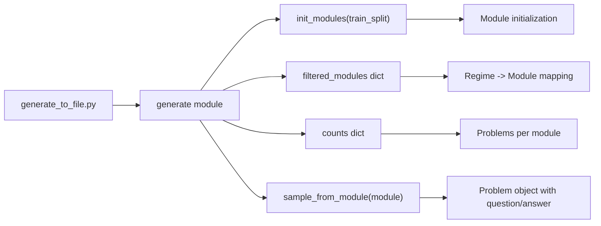

<!-- source: DeepWiki mcp.deepwiki.com · repo google-deepmind/mathematics_dataset · page 7 Development Tools · fetched 2026-10-26 -->

# Development Tools

<details>
<summary>Relevant source files</summary>

The following files were used as context for generating this wiki page:

- [mathematics_dataset/generate_to_file.py](mathematics_dataset/generate_to_file.py)

</details>


This page documents the development tools and utilities available for working with the mathematics dataset generation system. These tools support developers in generating datasets to files, testing problem generation, and validating system behavior.

For information about core configuration options and settings, see [Configuration and Settings](#6). For details about the main generation pipeline, see [Question Generation Pipeline](#3.1).

## File Output Utilities

The primary development tool for generating datasets to persistent storage is the `generate_to_file.py` utility. This tool creates structured directory hierarchies containing text files with question-answer pairs organized by training regime and mathematical module.

### Directory Structure Generation

The file output utility creates a standardized directory structure based on training regimes:

```mermaid
graph TD
    output_dir["output_dir (root)"] --> train_easy["train-easy/"]
    output_dir --> train_medium["train-medium/"]  
    output_dir --> train_hard["train-hard/"]
    output_dir --> interpolate["interpolate/"]
    output_dir --> extrapolate["extrapolate/"]
    
    train_easy --> algebra_easy["algebra.txt"]
    train_easy --> arithmetic_easy["arithmetic.txt"]
    train_easy --> calculus_easy["calculus.txt"]
    
    train_medium --> algebra_medium["algebra.txt"]
    train_medium --> arithmetic_medium["arithmetic.txt"]
    train_medium --> calculus_medium["calculus.txt"]
    
    train_hard --> algebra_hard["algebra.txt"]
    train_hard --> arithmetic_hard["arithmetic.txt"]
    train_hard --> calculus_hard["calculus.txt"]
```

**generate_to_file.py Workflow**

Sources: [mathematics_dataset/generate_to_file.py:55-76]()

### Command Line Interface

The `generate_to_file.py` utility provides command-line flags for configuration:

| Flag | Type | Purpose | Required |
|------|------|---------|----------|
| `--output_dir` | string | Target directory for generated files | Yes |
| `--train_split` | boolean | Whether to split training data by difficulty | No (default: True) |

When `--train_split=False` is specified, the utility creates a single `train/` directory instead of the three difficulty-based training directories.

Sources: [mathematics_dataset/generate_to_file.py:49-52]()

### File Format and Content Generation

Each generated text file contains alternating lines of questions and answers:


**File Generation Process**

The generation process follows this sequence:

1. **Module Initialization**: Calls `generate.init_modules()` with the train split configuration
2. **Directory Creation**: Creates the output directory and regime subdirectories  
3. **Module Iteration**: Iterates through `generate.filtered_modules` for each regime
4. **Problem Sampling**: Uses `generate.sample_from_module()` to generate problems
5. **File Writing**: Writes alternating question and answer lines to text files

Sources: [mathematics_dataset/generate_to_file.py:64-75]()

### Error Handling and Validation

The utility includes safety checks to prevent accidental data overwrites:

- **Directory Existence Check**: Fails with `logging.fatal()` if the output directory already exists
- **Path Expansion**: Uses `os.path.expanduser()` to handle tilde paths
- **Logging**: Provides progress feedback with `logging.info()` for each written file

Sources: [mathematics_dataset/generate_to_file.py:58-62](), [mathematics_dataset/generate_to_file.py:75]()

## Integration with Generation System

The file output utility integrates with the core generation system through several key interfaces:



**Core System Integration Points**

The utility relies on these components from the main generation system:

- **`generate.init_modules()`**: Initializes the module system with difficulty splitting
- **`generate.filtered_modules`**: Dictionary mapping regimes to available modules
- **`generate.counts`**: Dictionary specifying how many problems to generate per module
- **`generate.sample_from_module()`**: Core sampling function that returns problem objects

Sources: [mathematics_dataset/generate_to_file.py:56](), [mathematics_dataset/generate_to_file.py:64](), [mathematics_dataset/generate_to_file.py:67](), [mathematics_dataset/generate_to_file.py:72]()

## Development Workflow Support

The development tools support several common workflows:

### Dataset Generation Workflow

1. **Configure Generation Parameters**: Set module filters, difficulty splits, and output locations
2. **Run File Generation**: Execute `generate_to_file.py` with appropriate flags
3. **Validate Output**: Check generated files for expected format and content
4. **Iterate on Configuration**: Adjust parameters and regenerate as needed

### Testing and Validation

While specific testing framework files were not provided, the system architecture suggests several validation approaches:

- **Length Validation**: The generation system includes question and answer length constraints
- **Format Validation**: Problems must conform to expected text format requirements  
- **Content Validation**: Mathematical expressions must be valid and solvable

The `generate.sample_from_module()` function includes built-in validation that ensures generated problems meet quality criteria before inclusion in output files.

Sources: [mathematics_dataset/generate_to_file.py:72-74]()