# Page: Overview

# Overview

<details>
<summary>Relevant source files</summary>

The following files were used as context for generating this wiki page:

- [README.md](README.md)

</details>


This document introduces the mathematics dataset generation system, which creates school-level mathematical question-answer pairs designed to test AI model reasoning abilities. The system generates problems across multiple mathematical domains with configurable difficulty levels and supports curriculum-based training through structured data splits.

For information about specific mathematical domains, see [Mathematical Domain Modules](#4). For configuration and advanced usage, see [Configuration and Settings](#6).

## Purpose and Capabilities

The mathematics dataset generation system produces large-scale training and evaluation datasets for mathematical reasoning tasks. The system generates question-answer pairs that cover fundamental mathematical concepts typically taught at school level, including algebra, arithmetic, calculus, and probability.

Key capabilities include:
- **Multi-domain coverage**: Eight mathematical subject areas from basic arithmetic to calculus
- **Curriculum learning support**: Three difficulty levels (easy, medium, hard) plus interpolation/extrapolation test sets
- **Configurable complexity**: Entropy-based difficulty control with length constraints
- **Scalable generation**: Designed to produce millions of question-answer pairs per domain
- **Multiple output formats**: Command-line interface, file output, and pre-generated cloud datasets

The system enforces strict formatting constraints with questions limited to 160 characters and answers to 30 characters to ensure consistency across the dataset.

Sources: [README.md:1-56]()

## System Architecture

The mathematics dataset generation system follows a modular architecture with clear separation between domain logic, mathematical infrastructure, and output formatting.

### High-Level Component Organization

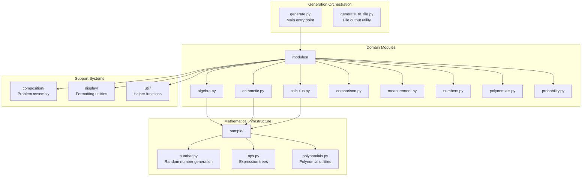

The system uses a three-tier architecture:
- **Orchestration layer**: `generate.py` coordinates module selection, sampling, and output
- **Domain layer**: Subject-specific modules implement problem generation logic
- **Infrastructure layer**: Shared utilities for mathematical operations and formatting

Sources: [README.md:77-91]()

### Problem Generation Pipeline

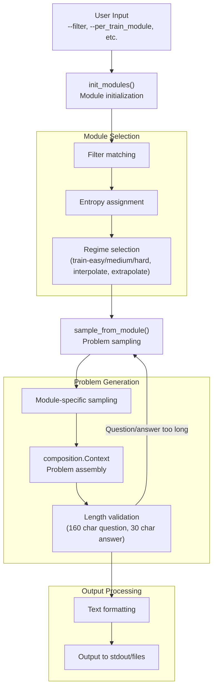

The pipeline implements a rejection sampling approach where problems exceeding length limits are discarded and regeneration is attempted.

Sources: [README.md:83-84]()

## Mathematical Domains

The system covers eight primary mathematical domains, each implemented as a separate module with domain-specific problem generation logic:

| Domain | Module | Problem Types |
|--------|---------|---------------|
| **Algebra** | `modules/algebra.py` | Linear equations, polynomial roots, sequences |
| **Arithmetic** | `modules/arithmetic.py` | Basic operations, mixed expressions, surds |
| **Calculus** | `modules/calculus.py` | Differentiation problems |
| **Comparison** | `modules/comparison.py` | Sorting, closest numbers, pairwise comparisons |
| **Measurement** | `modules/measurement.py` | Unit conversion, time calculations |
| **Numbers** | `modules/numbers.py` | Base conversion, GCD/LCM, primality, place value |
| **Polynomials** | `modules/polynomials.py` | Addition, simplification, composition, evaluation |
| **Probability** | `modules/probability.py` | Sampling without replacement |

Each domain module implements standardized interfaces for problem generation while maintaining domain-specific mathematical logic and constraints.

Sources: [README.md:45-55]()

## Training Curriculum Structure

The system supports curriculum learning through a structured difficulty progression:

```mermaid
graph TB
    entropy_fn["entropy_fn<br/>Difficulty controller"]
    train_split["train_split parameter"]
    
    subgraph "Training Regimes"
        train_easy["train-easy<br/>Lower 1/3 entropy range"]
        train_medium["train-medium<br/>Middle 1/3 entropy range"] 
        train_hard["train-hard<br/>Upper 1/3 entropy range"]
        train_uniform["train<br/>Uniform difficulty"]
    end
    
    subgraph "Evaluation Regimes"
        interpolate["interpolate<br/>Within training range"]
        extrapolate["extrapolate<br/>Beyond training range"]
    end
    
    subgraph "Output Organization"
        regime_dirs["Regime directories<br/>train-easy/, train-medium/, train-hard/"]
        module_files["Module files<br/>algebra.txt, arithmetic.txt, etc."]
    end
    
    entropy_fn --> train_split
    train_split -->|"split=True"| train_easy
    train_split -->|"split=True"| train_medium
    train_split -->|"split=True"| train_hard
    train_split -->|"split=False"| train_uniform
    
    entropy_fn --> interpolate
    entropy_fn --> extrapolate
    
    train_easy --> regime_dirs
    train_medium --> regime_dirs
    train_hard --> regime_dirs
    
    regime_dirs --> module_files
```

The curriculum structure enables progressive training where models can be trained on easier problems first, then gradually exposed to more complex problems. The interpolation and extrapolation test sets evaluate generalization within and beyond the training difficulty range.

Sources: [README.md:37-44]()

## Data Access and Usage

The system provides multiple access methods for generated mathematical problems:

### Pre-generated Datasets
Pre-generated datasets containing 2 million question-answer pairs per module are available on Google Cloud Storage. These datasets follow the curriculum structure with separate directories for each training regime and mathematical domain.

### Command Line Generation
Interactive problem generation using the `generate` script:
```bash
python -m mathematics_dataset.generate --filter=linear_1d
```

### Programmatic Access
The system can be installed via PyPI and used programmatically for custom dataset generation needs.

The `generate_to_file.py` utility provides an example implementation for batch file generation that can be adapted for specific training workflows.

Sources: [README.md:33-36](), [README.md:59-91]()

---

# Page: Getting Started

# Getting Started

<details>
<summary>Relevant source files</summary>

The following files were used as context for generating this wiki page:

- [README.md](README.md)
- [setup.py](setup.py)

</details>


This page guides you through installing the mathematics dataset generation system and running your first mathematical problem generations. The system generates school-level mathematical question-answer pairs across multiple domains for testing AI model reasoning abilities.

For detailed information about the mathematical domains and problem types available, see [Mathematical Domain Modules](#4). For advanced configuration options, see [Configuration and Settings](#6).

## Installation

The mathematics dataset system can be installed through two methods: PyPI package installation or direct GitHub installation.

### PyPI Installation

The simplest installation method uses pip to install the packaged version:

```bash
pip install mathematics_dataset
```

This installs the system as a Python module with all required dependencies specified in [setup.py:46-51]().

### GitHub Installation  

For development or the latest version, clone and install directly from the repository:

```bash
git clone https://github.com/deepmind/mathematics_dataset
pip install --upgrade mathematics_dataset/
```

### System Requirements

The system requires the following Python packages as defined in [setup.py:46-51]():

| Package | Version | Purpose |
|---------|---------|---------|
| `absl-py` | >=0.1.0 | Command-line flag parsing |
| `numpy` | >=1.10 | Numerical operations |
| `six` | (latest) | Python 2/3 compatibility |
| `sympy` | >=1.2 | Symbolic mathematics |

**Installation Flow**
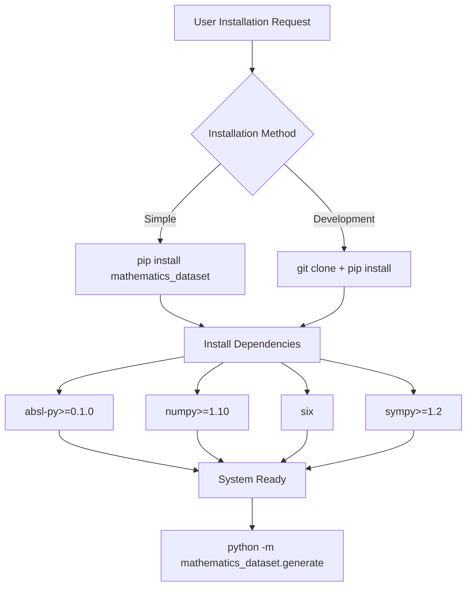

Sources: [README.md:59-75](), [setup.py:46-51]()

## Quick Start Examples

Once installed, you can immediately start generating mathematical problems using the command-line interface.

### Basic Problem Generation

Generate problems by running the main `generate` module:

```bash
python -m mathematics_dataset.generate --filter=linear_1d
```

This command will output question-answer pairs for linear equations in one variable to stdout, such as:

```
Question: Solve -42*r + 27*c = -1167 and 130*r + 4*c = 372 for r.
Answer: 4
```

### Domain-Specific Generation

Filter problems by mathematical domain using the `--filter` flag:

```bash
# Generate arithmetic problems
python -m mathematics_dataset.generate --filter=arithmetic

# Generate calculus problems  
python -m mathematics_dataset.generate --filter=calculus

# Generate probability problems
python -m mathematics_dataset.generate --filter=probability
```

### Generation Workflow

**Command-Line to Code Mapping**
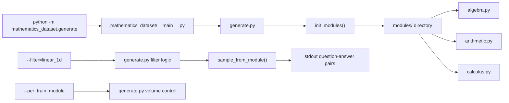

Sources: [README.md:79-91]()

## Pre-Generated Datasets

For immediate use without generation, pre-built datasets are available containing millions of question-answer pairs.

### Accessing Pre-Generated Data

The complete dataset is hosted on Google Cloud Storage and can be accessed at:

**Dataset Location**: [Google Cloud Storage - mathematics-dataset](https://console.cloud.google.com/storage/browser/mathematics-dataset)

### Dataset Structure

The pre-generated dataset (Version 1.0) contains:

| Characteristic | Value |
|----------------|--------|
| **Questions per module** | 2 million |
| **Question length limit** | 160 characters |
| **Answer length limit** | 30 characters |
| **Training split** | train-easy, train-medium, train-hard |
| **Test sets** | interpolate, extrapolate |

### Mathematical Domains Available

The dataset covers eight mathematical domains as defined in [README.md:46-55]():

| Domain | Description |
|--------|-------------|
| **algebra** | Linear equations, polynomial roots, sequences |
| **arithmetic** | Pairwise operations, mixed expressions, surds |
| **calculus** | Differentiation |
| **comparison** | Closest numbers, pairwise comparisons, sorting |
| **measurement** | Conversion, working with time |
| **numbers** | Base conversion, remainders, divisors, primality |
| **polynomials** | Addition, simplification, composition, evaluation |
| **probability** | Sampling without replacement |

**Dataset Organization**
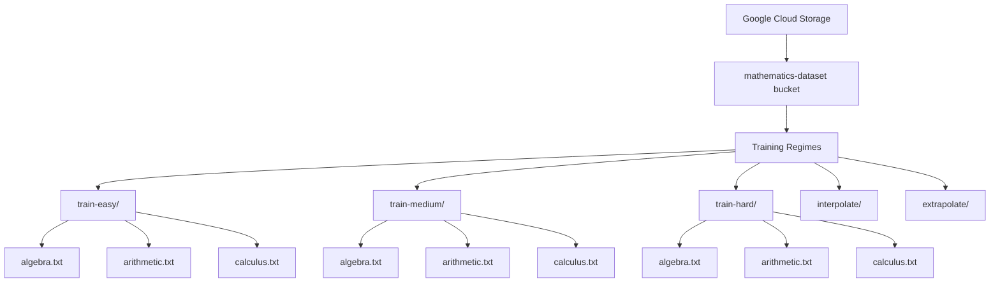

Sources: [README.md:33-55]()

## File Output Generation

For saving generated problems to files, the system includes an example script demonstrating file-based output.

### Using generate_to_file.py

The included [generate_to_file.py]() script shows how to write generated problems to text files:

```bash
python generate_to_file.py
```

This script can be adapted for specific generation and training needs, providing a template for:
- Custom file organization
- Batch generation 
- Output formatting control

### File Format

Generated files contain alternating lines of questions and answers:

```
Question: Calculate -841880142.544 + 411127.
Answer: -841469015.544
Question: Let x(g) = 9*g + 1. Let q(c) = 2*c + 1...
Answer: 54*a - 30
```

Sources: [README.md:89-91]()

## Next Steps

After completing the installation and basic usage:

1. **Explore Mathematical Domains**: See [Mathematical Domain Modules](#4) for detailed information about each subject area
2. **Advanced Configuration**: Learn about difficulty levels, filtering, and output control in [Configuration and Settings](#6)  
3. **System Architecture**: Understand the underlying generation pipeline in [Core Architecture](#3)
4. **Development Tools**: For custom implementations, see [Development Tools](#7)

The system is now ready to generate mathematical problems for your specific use case, whether for model training, evaluation, or research purposes.

---

# Page: Core Architecture

# Core Architecture

<details>
<summary>Relevant source files</summary>

The following files were used as context for generating this wiki page:

- [mathematics_dataset/generate.py](mathematics_dataset/generate.py)

</details>


This document explains the fundamental systems that power the mathematical problem generation in the mathematics dataset. It covers the high-level architecture, the orchestration mechanisms, and how the various components interact to generate mathematical question-answer pairs.

For detailed information about specific aspects: the generation pipeline flow is covered in [Question Generation Pipeline](#3.1), mathematical building blocks in [Mathematical Infrastructure](#3.2), problem assembly in [Composition and Display System](#3.3), and individual problem structure in [Problem Structure and Templates](#3.4).

## System Overview

The mathematics dataset generation system is built around a modular architecture that separates concerns between problem orchestration, mathematical domain logic, and infrastructure utilities. The system generates problems across multiple difficulty levels and mathematical domains through a pipeline that can be configured for different training and testing regimes.

### High-Level Architecture

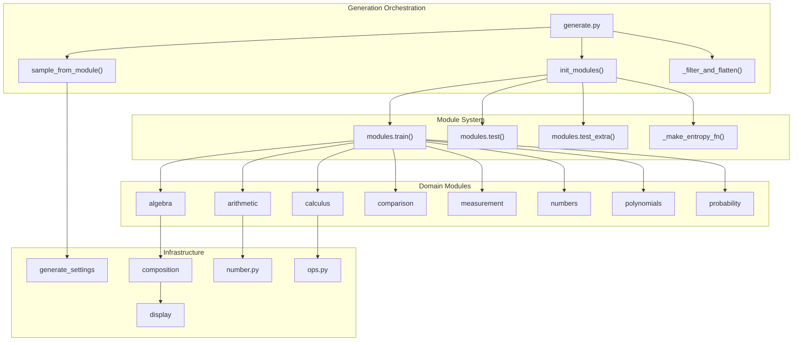

Sources: [mathematics_dataset/generate.py:1-173]()

## Generation Orchestration

The primary orchestration layer is implemented in `generate.py`, which manages the entire question generation process through several key functions:

### Module Initialization

The `init_modules()` function sets up the problem generation modules for different training regimes:

| Regime | Description | Entropy Function |
|--------|-------------|------------------|
| `train-easy` | Lower 1/3 difficulty range | `_make_entropy_fn(0, 3)` |
| `train-medium` | Middle 1/3 difficulty range | `_make_entropy_fn(1, 3)` |
| `train-hard` | Upper 1/3 difficulty range | `_make_entropy_fn(2, 3)` |
| `interpolate` | Test within training range | `modules.test()` |
| `extrapolate` | Test beyond training range | `modules.test_extra()` |

The system maintains global state in `filtered_modules` and `counts` dictionaries to track available modules and generation quotas.

Sources: [mathematics_dataset/generate.py:92-117]()

### Entropy-Based Difficulty Control

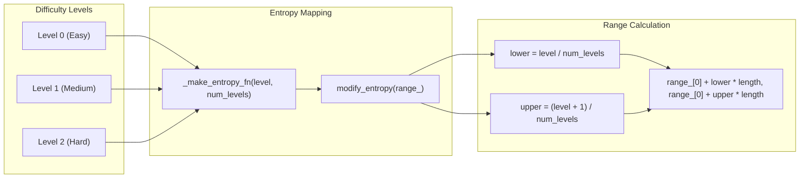

The `_make_entropy_fn()` creates difficulty control functions that map entropy ranges to specific difficulty levels. Each level gets an equal subdivision of the total entropy range.

Sources: [mathematics_dataset/generate.py:46-65]()

## Module System Architecture

The module system provides a hierarchical structure for organizing mathematical domains and problem types. The system uses a nested dictionary structure that gets flattened and filtered during initialization.

### Module Filtering and Organization

The `_filter_and_flatten()` function processes the hierarchical module structure:

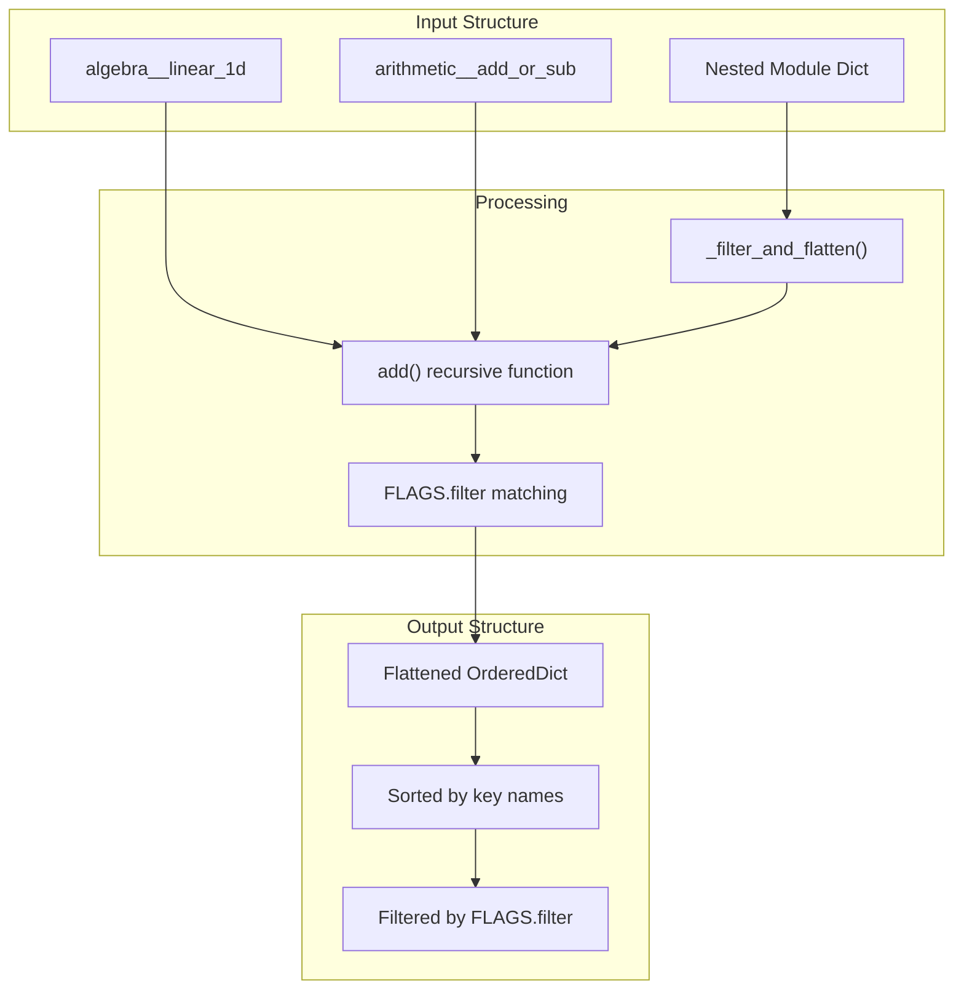

This flattening process creates fully qualified module names using double underscores as separators (e.g., `algebra__linear_1d__solve`), enabling precise filtering and deterministic ordering across multiple machines.

Sources: [mathematics_dataset/generate.py:68-89]()

## Problem Sampling and Validation

The `sample_from_module()` function implements the core sampling logic with built-in validation:

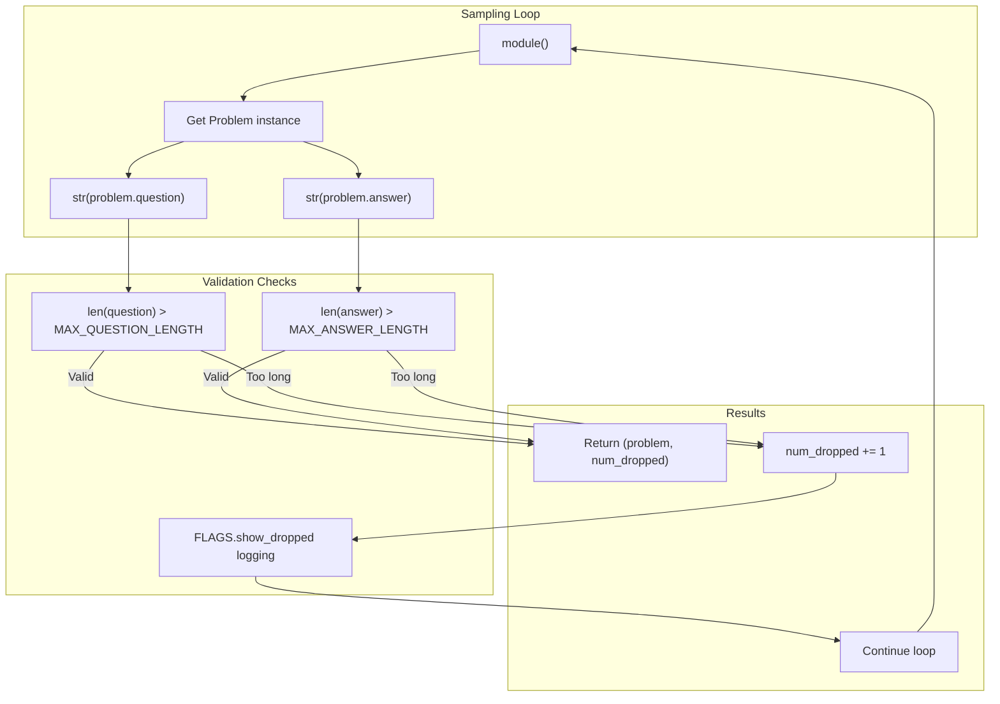

The sampling process continues until a valid problem is generated, tracking dropped samples for monitoring purposes. Length constraints are defined in `generate_settings.MAX_QUESTION_LENGTH` and `generate_settings.MAX_ANSWER_LENGTH`.

Sources: [mathematics_dataset/generate.py:119-145]()

## Configuration and Control Flow

The system accepts several command-line flags that control generation behavior:

| Flag | Purpose | Default |
|------|---------|---------|
| `--filter` | Restrict to matching module names | `''` (empty) |
| `--per_train_module` | Examples per training module | `10` |
| `--per_test_module` | Examples per testing module | `10` |
| `--show_dropped` | Print dropped questions for debugging | `False` |

The main execution flow processes all filtered modules across all regimes, generating the specified number of problems per module while tracking and reporting dropped samples.

Sources: [mathematics_dataset/generate.py:34-39](), [mathematics_dataset/generate.py:148-172]()

---

# Page: Question Generation Pipeline

# Question Generation Pipeline

<details>
<summary>Relevant source files</summary>

The following files were used as context for generating this wiki page:

- [mathematics_dataset/generate.py](mathematics_dataset/generate.py)
- [mathematics_dataset/generate_test.py](mathematics_dataset/generate_test.py)

</details>


This document describes the core orchestration system that coordinates mathematical problem generation across different domains and difficulty levels. The pipeline manages module initialization, difficulty control, problem sampling, and output formatting to produce question-answer pairs for training and testing AI models.

For information about the specific mathematical building blocks used in problem generation, see [Mathematical Infrastructure](#3.2). For details about individual domain modules, see [Mathematical Domain Modules](#4).

## Pipeline Overview

The question generation pipeline operates as the central coordination layer that orchestrates the entire problem generation process. It manages the flow from user configuration through module selection, difficulty assignment, problem sampling, and final output formatting.

### Core Pipeline Flow

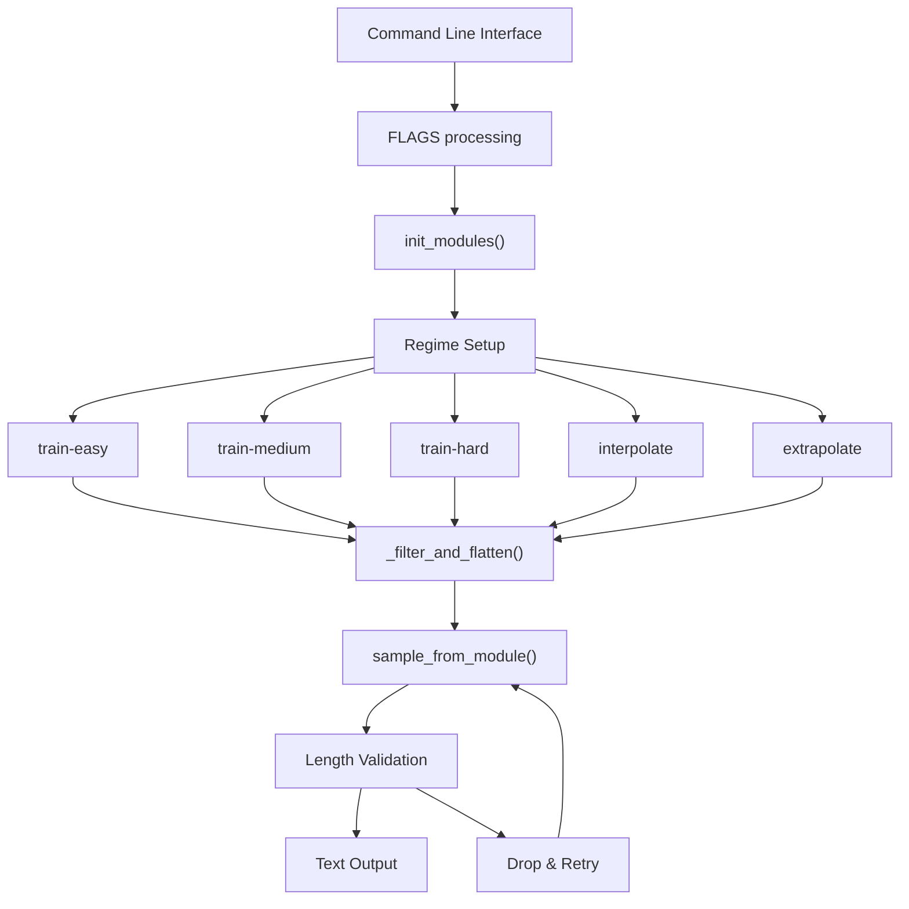

Sources: [mathematics_dataset/generate.py:148-169]()

## Module Initialization System

The `init_modules` function serves as the central setup mechanism that configures all mathematical domains according to the specified training regime and difficulty parameters.

### Initialization Process

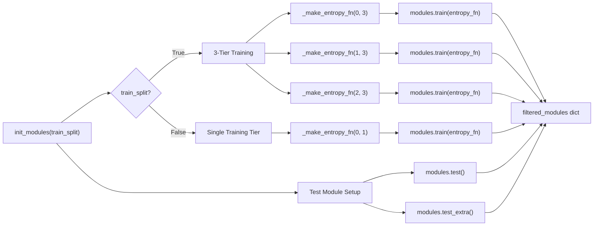

The initialization system creates a global `filtered_modules` dictionary that maps regime names to their corresponding module collections. Each regime is populated with modules from the `mathematics_dataset.modules.modules` package, configured with appropriate entropy functions for difficulty control.

| Regime | Entropy Function | Purpose |
|--------|------------------|---------|
| `train-easy` | `_make_entropy_fn(0, 3)` | Lower 1/3 difficulty range |
| `train-medium` | `_make_entropy_fn(1, 3)` | Middle 1/3 difficulty range |
| `train-hard` | `_make_entropy_fn(2, 3)` | Upper 1/3 difficulty range |
| `interpolate` | N/A | Testing within training range |
| `extrapolate` | N/A | Testing beyond training range |

Sources: [mathematics_dataset/generate.py:92-117]()

## Difficulty Control and Entropy Functions

The pipeline implements sophisticated difficulty control through entropy functions that map problem complexity to specific ranges within each regime's difficulty spectrum.

### Entropy Function Mechanism

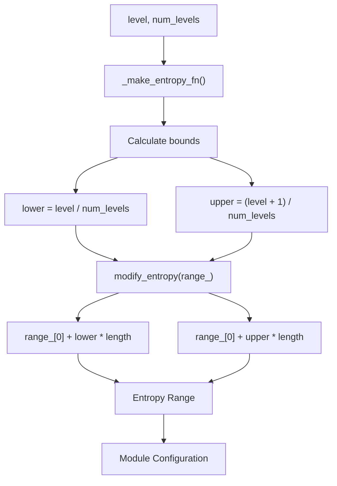

The entropy function system enables precise control over problem difficulty by subdividing the full complexity range into specific segments. For example, with `level=1` and `num_levels=3`, the function maps an input range `[x, x + y]` to the middle third `[x + y/3, x + 2y/3]`.

Sources: [mathematics_dataset/generate.py:46-65]()

## Problem Sampling and Validation

The `sample_from_module` function implements the core problem generation loop with built-in quality control through length validation and retry mechanisms.

### Sampling Process

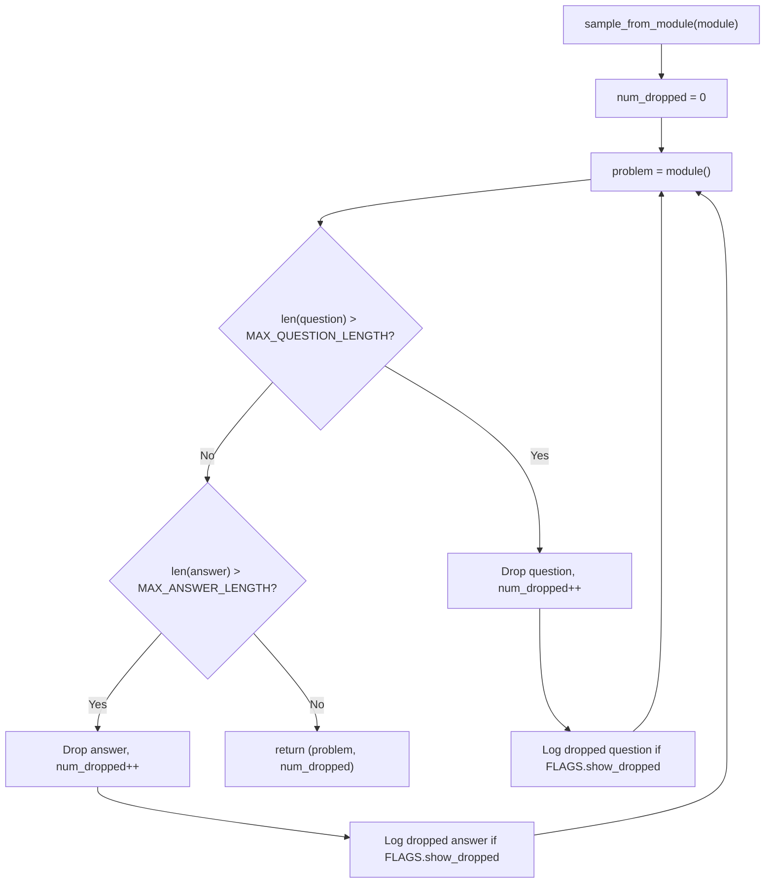

The sampling system ensures output quality by enforcing maximum length constraints defined in `generate_settings`. Problems exceeding these limits are automatically discarded and regenerated, with optional logging of dropped examples for debugging purposes.

| Validation Check | Constraint | Action on Violation |
|------------------|------------|-------------------|
| Question Length | `MAX_QUESTION_LENGTH` | Drop and regenerate |
| Answer Length | `MAX_ANSWER_LENGTH` | Drop and regenerate |

Sources: [mathematics_dataset/generate.py:119-145]()

## Module Filtering and Organization

The pipeline includes a sophisticated filtering system that processes the hierarchical module structure into a flat, deterministic ordering suitable for distributed generation.

### Filtering Architecture

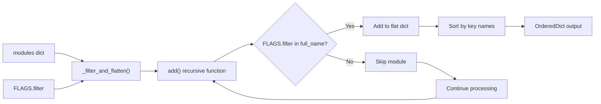

The filtering process transforms the nested module hierarchy into a flat `OrderedDict` where:
- Keys represent full module paths (e.g., `algebra__linear_1d`)
- Values are callable functions that generate problems
- Ordering is deterministic across different machines
- Only modules matching the filter string are included

Sources: [mathematics_dataset/generate.py:68-89]()

## Output Generation and Formatting

The main execution loop coordinates the generation process across all filtered modules and regimes, with formatted terminal output and progress tracking.

### Output Pipeline

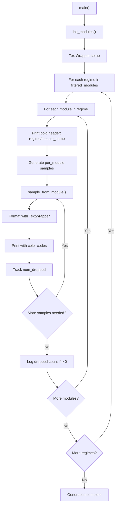

The output system provides:
- **Colored terminal output** with bold headers for regime/module identification
- **Text wrapping** at 80 characters with proper indentation
- **Progress tracking** through dropped sample counts
- **Structured formatting** with questions in normal text and answers in green

Sources: [mathematics_dataset/generate.py:148-169]()

## Configuration Parameters

The pipeline exposes several command-line flags for controlling generation behavior:

| Flag | Type | Default | Purpose |
|------|------|---------|---------|
| `--filter` | string | '' | Restrict to matching module names |
| `--per_train_module` | integer | 10 | Number of examples per training module |
| `--per_test_module` | integer | 10 | Number of examples per testing module |
| `--show_dropped` | boolean | False | Whether to print dropped questions |

The count distribution for split training regimes automatically divides `per_train_module` by 3 across the easy/medium/hard tiers, ensuring balanced representation across difficulty levels.

Sources: [mathematics_dataset/generate.py:36-39](), [mathematics_dataset/generate.py:108-113]()

---

# Page: Mathematical Infrastructure

# Mathematical Infrastructure

<details>
<summary>Relevant source files</summary>

The following files were used as context for generating this wiki page:

- [mathematics_dataset/sample/number.py](mathematics_dataset/sample/number.py)
- [mathematics_dataset/sample/ops.py](mathematics_dataset/sample/ops.py)
- [mathematics_dataset/sample/polynomials.py](mathematics_dataset/sample/polynomials.py)

</details>


This document explains the core mathematical building blocks that power the mathematics dataset generation system. The mathematical infrastructure provides three fundamental capabilities: controlled random number generation, expression tree construction, and polynomial manipulation. These components work together to create the mathematical content that appears in generated problems.

For information about how these mathematical components are assembled into complete problems, see [Composition and Display System](#3.3). For details on domain-specific problem generation that uses this infrastructure, see [Mathematical Domain Modules](#4).

## Number Generation System

The number generation system provides entropy-controlled random sampling of integers, rationals, and decimals. This system ensures that generated numbers have appropriate complexity for the target difficulty level while satisfying mathematical constraints.

### Core Number Generation Functions

The `number.py` module implements the primary number generation interface through several key functions:

| Function | Purpose | Parameters |
|----------|---------|------------|
| `integer()` | Generate random integers | entropy, signed, min_abs, coprime_to |
| `non_integer_rational()` | Generate rational numbers | entropy, signed |
| `integer_or_rational()` | Generate integers or rationals | entropy, signed, min_abs |
| `non_integer_decimal()` | Generate decimal numbers | entropy, signed |
| `integer_or_decimal()` | Generate integers or decimals | entropy, signed |

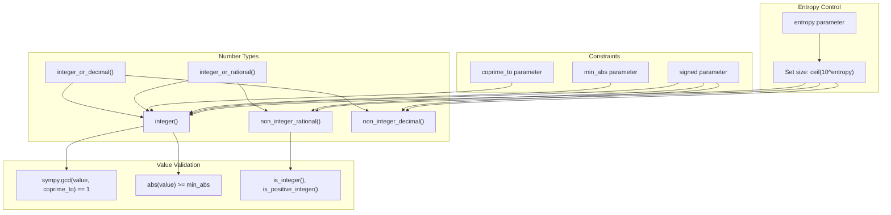

### Entropy-Based Sampling

The system uses entropy as a measure of complexity, where higher entropy values produce numbers from larger ranges. The entropy calculation follows logarithmic scaling:

- For integers: sample from range approximately `[-10^entropy/2, 10^entropy/2]` when signed
- For rationals: entropy is split between numerator and denominator
- For decimals: entropy determines both the base value and decimal precision

Sources: [mathematics_dataset/sample/number.py:40-78](), [mathematics_dataset/sample/number.py:80-95](), [mathematics_dataset/sample/number.py:97-124]()

## Expression Tree System

The expression tree system provides a framework for building mathematical expressions that can be displayed exactly as constructed, without automatic simplification. This is implemented through the `ops.py` module using an object-oriented hierarchy of operation classes.

### Operation Class Hierarchy

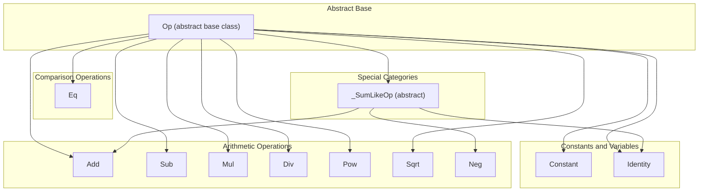

### Expression Tree Construction and Evaluation

Each operation class implements three key methods:

- `__str__()`: Returns formatted string representation with appropriate bracketing
- `sympy()`: Converts to SymPy object for mathematical evaluation
- `precedence`: Returns operator precedence for bracket insertion logic

The precedence hierarchy controls when brackets are inserted:

| Precedence Level | Operations | Value |
|------------------|------------|-------|
| Equality | `Eq` | 0 |
| Constants | `Constant` | 1 |
| Power | `Pow`, `Sqrt` | 2, 3 |
| Multiplication | `Mul`, `Div` | 4 |
| Addition | `Add`, `Sub`, `Neg` | 5 |

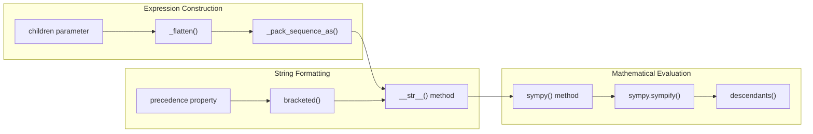

Sources: [mathematics_dataset/sample/ops.py:114-174](), [mathematics_dataset/sample/ops.py:175-221](), [mathematics_dataset/sample/ops.py:300-326]()

## Polynomial Generation System

The polynomial generation system creates polynomials with controlled complexity and specific mathematical properties. This system supports both univariate and multivariate polynomials with configurable coefficient distributions.

### Coefficient Generation Pipeline

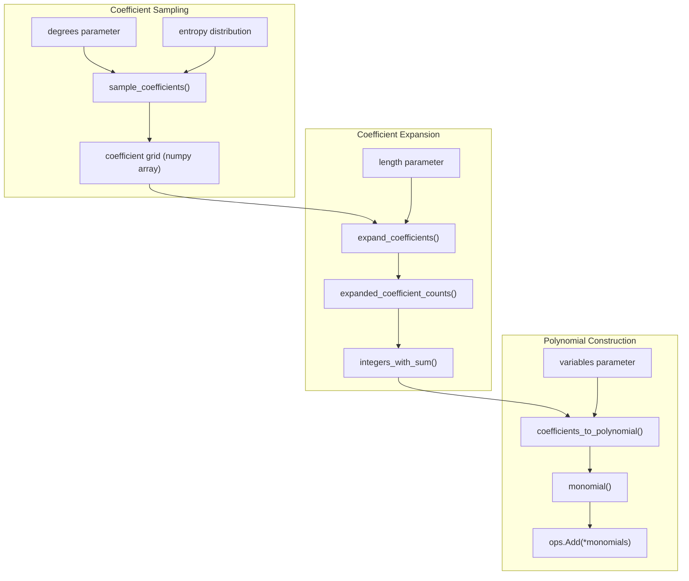

### Main Polynomial Generation Functions

| Function | Purpose | Key Parameters |
|----------|---------|----------------|
| `sample()` | Generate basic polynomials | variables, degrees, entropy, length |
| `sample_with_brackets()` | Generate polynomials with parentheses | variables, degrees, entropy, length |
| `sample_with_small_evaluation()` | Generate bounded-evaluation polynomials | variable, degree, max_abs_input, entropy |
| `sample_messy_power()` | Generate complex power expressions | variable, entropy |

### Advanced Polynomial Operations

The system provides sophisticated polynomial manipulation capabilities:

- **Coefficient splitting**: `coefficients_linear_split()` decomposes polynomials into linear combinations
- **Differentiation**: `differentiate()` computes derivatives of coefficient arrays
- **Integration**: `integrate()` computes antiderivatives of coefficient arrays
- **Trimming**: `trim()` removes unnecessary zero coefficients

```mermaid
graph LR
    subgraph "Input Polynomials"
        POLY1["polynomial_1"]
        POLY2["polynomial_2"]
        COEFFS["coefficients array"]
    end
    
    subgraph "Manipulation Operations"
        ADD_COEFFS["add_coefficients()"]
        LINEAR_SPLIT["coefficients_linear_split()"]
        DIFF["differentiate(coeffs, axis)"]
        INTEGRATE_OP["integrate(coeffs, axis)"]
        TRIM_OP["trim()"]
    end
    
    subgraph "Mathematical Utilities"
        RANDOM_FACTOR["_random_factor()"]
        DIOPHANTINE["diophantine_solve_linear_2d()"]
        DEGREE_CHECK["_degree_of_variable()"]
    end
    
    POLY1 --> ADD_COEFFS
    POLY2 --> ADD_COEFFS
    COEFFS --> LINEAR_SPLIT
    COEFFS --> DIFF
    COEFFS --> INTEGRATE_OP
    
    LINEAR_SPLIT --> RANDOM_FACTOR
    LINEAR_SPLIT --> DIOPHANTINE
    DIFF --> TRIM_OP
    INTEGRATE_OP --> TRIM_OP
```

Sources: [mathematics_dataset/sample/polynomials.py:172-225](), [mathematics_dataset/sample/polynomials.py:270-300](), [mathematics_dataset/sample/polynomials.py:462-489]()

## System Integration

The three mathematical infrastructure components work together through well-defined interfaces:

1. **Number generation** provides the raw numerical content for coefficients and constants
2. **Expression trees** structure the mathematical relationships and handle display formatting  
3. **Polynomial generation** combines both systems to create complex algebraic expressions

The integration follows this pattern:
- Polynomial functions call `number.integer()` and related functions to generate coefficients
- Coefficient arrays are converted to expression trees using `ops.Add()`, `ops.Mul()`, and `ops.Pow()`
- Expression trees provide both string representation and SymPy evaluation capabilities

Sources: [mathematics_dataset/sample/polynomials.py:276-295](), [mathematics_dataset/sample/polynomials.py:136-170](), [mathematics_dataset/sample/ops.py:442-452]()

---

# Page: Composition and Display System

# Composition and Display System

<details>
<summary>Relevant source files</summary>

The following files were used as context for generating this wiki page:

- [mathematics_dataset/util/composition_test.py](mathematics_dataset/util/composition_test.py)
- [mathematics_dataset/util/display_test.py](mathematics_dataset/util/display_test.py)

</details>


## Purpose and Scope

The Composition and Display System provides the foundational framework for assembling mathematical problems and formatting their output in the mathematics dataset generation system. This system consists of two main components:

1. **Composition Framework** - Manages the context, entities, and function handles used to construct complex mathematical problems from simpler components
2. **Display System** - Handles formatting and presentation of mathematical content, including numbers, expressions, and specialized mathematical notation

For information about the mathematical building blocks that feed into this system, see [Mathematical Infrastructure](#3.2). For details about how problems are structured using these composition tools, see [Problem Structure and Templates](#3.4).

## Composition Framework Architecture

The composition framework provides the scaffolding for building complex mathematical problems by managing context, entities, and relationships between mathematical components.

```mermaid
graph TB
    subgraph "Composition Framework"
        Context["Context<br/>mathematics_dataset.util.composition.Context"]
        Entity["Entity<br/>mathematics_dataset.util.composition.Entity"]
        FunctionHandle["FunctionHandle<br/>mathematics_dataset.util.composition.FunctionHandle"]
        SampleArgs["SampleArgs<br/>mathematics_dataset.util.composition.SampleArgs"]
    end
    
    subgraph "Entity Management"
        Value["value<br/>Mathematical content"]
        Description["description<br/>Text template with {self}"]
        Handle["handle<br/>Function reference"]
    end
    
    subgraph "Sampling Control"
        NumModules["num_modules<br/>Module count"]
        Entropy["entropy<br/>Difficulty parameter"]
        Peel["peel()<br/>Extract entropy portion"]
        Split["split()<br/>Divide among children"]
    end
    
    subgraph "Function Application"
        Apply["apply()<br/>Apply function to arguments"]
        Compose["Composition<br/>f(g(x, y))"]
    end
    
    Context --> Entity
    Entity --> Value
    Entity --> Description
    Entity --> Handle
    
    SampleArgs --> NumModules
    SampleArgs --> Entropy
    SampleArgs --> Peel
    SampleArgs --> Split
    
    FunctionHandle --> Apply
    Apply --> Compose
    
    Entity -.-> FunctionHandle
```

**Core Composition Classes**

| Class | Purpose | Key Methods |
|-------|---------|-------------|
| `Context` | Manages problem generation context | Context initialization and state |
| `Entity` | Represents mathematical objects with descriptions | Value storage and template handling |
| `FunctionHandle` | Manages function composition | `apply()` for function application |
| `SampleArgs` | Controls entropy distribution | `peel()`, `split()` for entropy management |

Sources: [mathematics_dataset/util/composition_test.py:27-62]()

## Display System Architecture

The display system provides specialized formatting classes for different types of mathematical content, ensuring consistent and readable output across all problem types.

```mermaid
graph TB
    subgraph "Number Display Classes"
        Decimal["Decimal<br/>mathematics_dataset.util.display.Decimal"]
        Percentage["Percentage<br/>mathematics_dataset.util.display.Percentage"]
        NonSimpleRational["NonSimpleRational<br/>mathematics_dataset.util.display.NonSimpleRational"]
        NumberInBase["NumberInBase<br/>mathematics_dataset.util.display.NumberInBase"]
    end
    
    subgraph "Text Conversion Classes"
        StringNumber["StringNumber<br/>mathematics_dataset.util.display.StringNumber"]
        StringOrdinal["StringOrdinal<br/>mathematics_dataset.util.display.StringOrdinal"]
        NumberList["NumberList<br/>mathematics_dataset.util.display.NumberList"]
    end
    
    subgraph "Operations"
        DecimalOps["Arithmetic Operations<br/>+, -, *, round()"]
        TextConversion["Number to Words<br/>integer_to_words()"]
        BaseConversion["Base Representation<br/>Binary, Hex, etc."]
        ListFormatting["Comma-separated Lists<br/>2, 3, 1"]
    end
    
    subgraph "SymPy Integration"
        SympyCompat["sympy.sympify()<br/>Conversion compatibility"]
        RationalSupport["sympy.Rational<br/>Exact fraction handling"]
    end
    
    Decimal --> DecimalOps
    Decimal --> SympyCompat
    
    StringNumber --> TextConversion
    StringNumber --> RationalSupport
    
    NumberInBase --> BaseConversion
    NumberList --> ListFormatting
    
    Percentage --> DecimalOps
    NonSimpleRational --> RationalSupport
    StringOrdinal --> TextConversion
```

**Display Class Capabilities**

| Class | Input Types | Output Examples | Special Features |
|-------|-------------|-----------------|------------------|
| `Decimal` | Rational, Integer | `1.23`, `0.000000001` | Avoids scientific notation, arithmetic operations |
| `Percentage` | Rational, Float | `67%`, `6.7%` | Automatic percentage conversion |
| `StringNumber` | Integer, Rational | `fifteen-million...`, `two thirds` | Full word conversion |
| `NumberInBase` | Integer | `10` (binary), `a` (hex) | Arbitrary base support |
| `NumberList` | List of numbers | `2, 3, 1` | Comma-separated formatting |

Sources: [mathematics_dataset/util/display_test.py:27-204]()

## Entity and Context Management

The composition system uses entities to encapsulate mathematical objects along with their textual descriptions, enabling flexible problem construction.

```mermaid
graph LR
    subgraph "Entity Construction"
        EntityInit["Entity(__init__)<br/>context, value, description, handle"]
        ValueStorage["value<br/>Mathematical content"]
        DescTemplate["description<br/>Template with {self} placeholder"]
        HandleRef["handle<br/>Optional function reference"]
    end
    
    subgraph "Validation Rules"
        SelfCheck["Self-reference Detection<br/>Checks for {self} in description"]
        HandleConflict["Handle Conflict Check<br/>Cannot have both {self} and handle"]
        ValueError["ValueError<br/>Cannot specify handle with {self}"]
    end
    
    subgraph "Context Integration"
        ContextState["Context State<br/>Problem generation context"]
        EntityRegistry["Entity Registry<br/>Tracks created entities"]
    end
    
    EntityInit --> ValueStorage
    EntityInit --> DescTemplate
    EntityInit --> HandleRef
    
    DescTemplate --> SelfCheck
    SelfCheck --> HandleConflict
    HandleConflict --> ValueError
    
    EntityInit --> ContextState
    ContextState --> EntityRegistry
```

The `Entity` class enforces a key constraint: entities cannot simultaneously use `{self}` placeholders in their descriptions and specify external function handles, preventing ambiguous reference resolution.

Sources: [mathematics_dataset/util/composition_test.py:54-62]()

## Entropy Management and Sampling

The `SampleArgs` class manages difficulty distribution across problem components through entropy allocation and splitting mechanisms.

```mermaid
graph TB
    subgraph "SampleArgs Structure"
        SampleArgsInit["SampleArgs(num_modules, entropy)"]
        NumModulesField["num_modules: int<br/>Number of participating modules"]
        EntropyField["entropy: float<br/>Total difficulty budget"]
    end
    
    subgraph "Entropy Operations"
        PeelOp["peel()<br/>Extract portion of entropy"]
        SplitOp["split(n)<br/>Divide among n children"]
        EntropyCalc["Entropy Calculation<br/>entropy / num_modules"]
        Redistribution["Child Entropy Distribution<br/>Maintains total entropy"]
    end
    
    subgraph "Example: peel()"
        PeelInput["SampleArgs(4, 3.0)"]
        PeelOutput["entropy=0.75, new_args(4, 2.25)"]
        PeelLogic["0.75 = 3.0 / 4<br/>2.25 = 3.0 - 0.75"]
    end
    
    subgraph "Example: split(2)"
        SplitInput["SampleArgs(4, 5.0)"]
        SplitOutput["2 children with total<br/>num_modules=3, entropy=5.0"]
        SplitLogic["Maintains entropy conservation<br/>Reduces module count"]
    end
    
    SampleArgsInit --> NumModulesField
    SampleArgsInit --> EntropyField
    
    NumModulesField --> PeelOp
    EntropyField --> PeelOp
    PeelOp --> EntropyCalc
    
    EntropyField --> SplitOp
    SplitOp --> Redistribution
    
    PeelInput --> PeelOutput
    PeelLogic --> PeelOutput
    
    SplitInput --> SplitOutput
    SplitLogic --> SplitOutput
```

The entropy system ensures that problem difficulty is distributed proportionally across all participating modules while maintaining precise control over the total complexity budget.

Sources: [mathematics_dataset/util/composition_test.py:39-52]()

## Function Handle System

Function handles enable composition of mathematical functions, allowing complex expressions to be built from simpler components through function application.

```mermaid
graph LR
    subgraph "FunctionHandle Creation"
        FHandleInit["FunctionHandle('f', 'g')"]
        OuterFunc["Outer Function: 'f'"]
        InnerFunc["Inner Function: 'g'"]
    end
    
    subgraph "Function Application"
        ApplyMethod["apply(*args)<br/>Apply composed function"]
        SingleArg["apply(x)<br/>→ f(g(x))"]
        MultiArg["apply(x, y)<br/>→ f(g(x, y))"]
    end
    
    subgraph "SymPy Integration"
        SympySymbols["sympy.symbols('x y')"]
        ExpressionTree["SymPy Expression Tree"]
        StringRepr["String Representation<br/>'f(g(x, y))'"]
    end
    
    FHandleInit --> OuterFunc
    FHandleInit --> InnerFunc
    
    OuterFunc --> ApplyMethod
    InnerFunc --> ApplyMethod
    
    ApplyMethod --> SingleArg
    ApplyMethod --> MultiArg
    
    SympySymbols --> ApplyMethod
    ApplyMethod --> ExpressionTree
    ExpressionTree --> StringRepr
```

Function handles integrate seamlessly with SymPy's symbolic mathematics system, enabling the creation of complex mathematical expressions that can be manipulated algebraically.

Sources: [mathematics_dataset/util/composition_test.py:27-35]()

## Integration with Problem Generation

The composition and display systems work together to transform mathematical concepts into human-readable problems through a coordinated process.

```mermaid
graph TB
    subgraph "Problem Assembly Pipeline"
        MathConcept["Mathematical Concept<br/>From domain modules"]
        ContextCreation["Context Creation<br/>composition.Context()"]
        EntityCreation["Entity Creation<br/>Values + Descriptions"]
        DisplayFormatting["Display Formatting<br/>Number/text conversion"]
        FinalOutput["Formatted Question Text"]
    end
    
    subgraph "Composition Layer"
        SampleArgsFlow["SampleArgs<br/>Entropy management"]
        EntityFlow["Entity<br/>Object encapsulation"]
        HandleFlow["FunctionHandle<br/>Function composition"]
    end
    
    subgraph "Display Layer"
        DecimalFlow["Decimal<br/>Number formatting"]
        StringFlow["StringNumber<br/>Text conversion"]
        ListFlow["NumberList<br/>List formatting"]
    end
    
    MathConcept --> ContextCreation
    ContextCreation --> EntityCreation
    
    SampleArgsFlow --> EntityCreation
    EntityFlow --> EntityCreation
    HandleFlow --> EntityCreation
    
    EntityCreation --> DisplayFormatting
    
    DecimalFlow --> DisplayFormatting
    StringFlow --> DisplayFormatting
    ListFlow --> DisplayFormatting
    
    DisplayFormatting --> FinalOutput
```

This integrated approach ensures that mathematical content maintains its precision through the composition layer while being presented in formats suitable for natural language understanding.

Sources: [mathematics_dataset/util/composition_test.py:15-66](), [mathematics_dataset/util/display_test.py:15-208]()

---

# Page: Problem Structure and Templates

# Problem Structure and Templates

<details>
<summary>Relevant source files</summary>

The following files were used as context for generating this wiki page:

- [mathematics_dataset/example.py](mathematics_dataset/example.py)

</details>


This document explains the fundamental structure of mathematical problems in the dataset and the template system used to generate question text. It covers the `Problem` data structure, the question template formatting system, and how mathematical entities are incorporated into natural language questions.

For information about the broader composition framework that supports templates, see [Composition and Display System](#3.3). For details on domain-specific problem generation implementations, see [Mathematical Domain Modules](#4).

## Problem Data Structure

Every generated mathematical problem follows a consistent structure defined by the `Problem` namedtuple. This simple but fundamental data structure serves as the container for all question-answer pairs in the system.

```mermaid
graph TB
    subgraph "Problem Structure"
        Problem["Problem<br/>(namedtuple)"]
        Question["question<br/>(str)"]
        Answer["answer<br/>(str)"]
    end
    
    subgraph "Generation Process"
        Template["Question Template"]
        Context["composition.Context"]
        Entities["Mathematical Entities"]
        Format["question() Function"]
    end
    
    Problem --> Question
    Problem --> Answer
    
    Template --> Format
    Context --> Format
    Entities --> Format
    Format --> Question
    
    style Problem fill:#e1f5fe
    style Format fill:#f9f9f9
```

**Problem Structure Components**
The `Problem` namedtuple contains exactly two fields:

| Field | Type | Description |
|-------|------|-------------|
| `question` | `str` | The natural language question text |
| `answer` | `str` | The expected answer as a string |

Sources: [mathematics_dataset/example.py:57]()

## Question Template System

The core of the template system is the `question` function, which transforms mathematical templates into natural language questions. This function bridges the gap between mathematical entities and human-readable text.

```mermaid
flowchart TD
    Input["Template + Args"] --> QFunc["question() Function"]
    Context["composition.Context"] --> QFunc
    QFunc --> Expand["expand_entities()"]
    Expand --> Prefix["Entity Descriptions"]
    Expand --> CleanArgs["Cleaned Arguments"]
    Prefix --> Format["String Formatting"]
    CleanArgs --> Format
    Format --> Output["Final Question Text"]
    
    style QFunc fill:#e1f5fe
    style Expand fill:#f9f9f9
```

**Template Function Signature**
```python
question(context, template, **kwargs)
```

**Parameters:**
- `context`: Instance of `composition.Context` for entity management
- `template`: String template with format placeholders (e.g., "What is {} plus {p}?")
- `**kwargs`: Named arguments mapping placeholders to mathematical values

Sources: [mathematics_dataset/example.py:26-54]()

## Template Processing Pipeline

The question generation follows a specific processing pipeline that handles mathematical entities and formatting:

```mermaid
sequenceDiagram
    participant Caller
    participant question
    participant expand_entities
    participant format
    
    Caller->>question: template, context, **kwargs
    question->>expand_entities: context, **kwargs
    expand_entities->>expand_entities: Process Entity objects
    expand_entities->>question: prefix, cleaned_kwargs
    question->>format: template.format(**cleaned_kwargs)
    format->>question: formatted_string
    question->>Caller: prefix + formatted_string
```

**Processing Steps:**

1. **Entity Expansion**: The `composition.expand_entities` function processes any `Entity` objects in the arguments
2. **Prefix Generation**: Entity descriptions are collected into a prefix string
3. **Argument Cleaning**: Entity objects are replaced with their string representations
4. **Template Formatting**: Standard Python string formatting is applied
5. **Final Assembly**: Prefix and formatted template are combined

Sources: [mathematics_dataset/example.py:49-54]()

## Template Usage Patterns

Mathematical problems use several common template patterns to generate questions:

**Basic Value Substitution**
```python
question(context, 'What is {} plus {p} over {q}?', 2, p=3, q=4)
# Result: "What is 2 plus 3 over 4?"
```

**Named Parameter Templates**
```python
question(context, 'Calculate the value of {exp}.', exp=sympy.Add(2, 3, evaluate=False))
# Result: "Calculate the value of 2 + 3."
```

**Entity-Based Templates**
When arguments contain `Entity` objects, their descriptions are automatically prefixed:
```python
# If 'x' is an Entity representing a variable
question(context, 'Solve for {var} in {equation}.', var=x, equation=equation_expr)
# Result: "Let x be a real number. Solve for x in 2*x + 3 = 7."
```

Sources: [mathematics_dataset/example.py:29-44]()

## Integration with Composition System

The template system is tightly integrated with the composition framework, which manages mathematical entities and their descriptions:

```mermaid
graph LR
    subgraph "Template Layer"
        QuestionFunc["question()"]
        Template["Template String"]
    end
    
    subgraph "Composition Layer"
        Context["composition.Context"]
        ExpandEntities["expand_entities()"]
        Entity["Entity Objects"]
    end
    
    subgraph "Mathematical Layer"
        MathObjects["Mathematical Objects<br/>(SymPy expressions, etc.)"]
        Descriptions["Entity Descriptions"]
    end
    
    Template --> QuestionFunc
    Context --> QuestionFunc
    QuestionFunc --> ExpandEntities
    ExpandEntities --> Entity
    Entity --> MathObjects
    Entity --> Descriptions
    ExpandEntities --> QuestionFunc
```

**Key Integration Points:**
- **Context Management**: The `composition.Context` tracks all entities used in a problem
- **Entity Expansion**: Mathematical objects wrapped as entities get automatic descriptions
- **Description Prefixing**: Entity descriptions are prepended to questions when needed
- **Argument Processing**: Entity objects are converted to appropriate string representations

Sources: [mathematics_dataset/example.py:49-51]()

## Template System Benefits

The template system provides several key advantages for mathematical problem generation:

**Separation of Concerns**
- Mathematical logic is separated from natural language presentation
- Templates can be reused across different mathematical contexts
- Entity descriptions are handled automatically

**Consistency**
- All problems follow the same formatting pipeline
- Entity descriptions follow consistent patterns
- Mathematical notation is standardized

**Flexibility**
- Templates support both positional and named arguments
- Complex mathematical expressions are handled transparently
- New entity types can be added without changing template code

**Maintainability**
- Question text can be modified without changing mathematical logic
- Template changes affect all problems using that template
- Entity description logic is centralized

Sources: [mathematics_dataset/example.py:26-54]()

---

# Page: Mathematical Domain Modules

# Mathematical Domain Modules

<details>
<summary>Relevant source files</summary>

The following files were used as context for generating this wiki page:

- [mathematics_dataset/modules/modules.py](mathematics_dataset/modules/modules.py)

</details>


## Purpose and Scope

This document covers the mathematical domain modules that form the core of the problem generation system. These modules implement domain-specific logic for generating questions across eight mathematical subject areas: algebra, arithmetic, calculus, comparison, measurement, numbers, polynomials, and probability. Each module provides structured problem generators that can be configured for different difficulty levels and training/testing regimes.

For detailed documentation of individual modules, see [Algebra Module](#4.1), [Arithmetic Module](#4.2), [Calculus Module](#4.3), and [Other Mathematical Modules](#4.4). For information about the underlying mathematical infrastructure used by these modules, see [Mathematical Infrastructure](#3.2).

## Module Organization and Registry

The mathematical domain modules are organized through a centralized registry system implemented in [mathematics_dataset/modules/modules.py](). This registry provides a unified interface for accessing and initializing all mathematical domains.

### Module Registry Structure

```mermaid
graph TB
    subgraph "modules.py Registry"
        ALL_DICT["all_ = {...}"]
        TRAIN_FN["train(entropy_fn)"]
        TEST_FN["test()"]
        TEST_EXTRA_FN["test_extra()"]
    end
    
    subgraph "Domain Module Imports"
        ALG_IMP["algebra"]
        ARITH_IMP["arithmetic"]
        CALC_IMP["calculus"]
        COMP_IMP["comparison"]
        MEAS_IMP["measurement"]
        NUM_IMP["numbers"]
        POLY_IMP["polynomials"]
        PROB_IMP["probability"]
    end
    
    subgraph "Module Instances"
        ALG_MOD["algebra.train()"]
        ARITH_MOD["arithmetic.train()"]
        CALC_MOD["calculus.train()"]
        COMP_MOD["comparison.train()"]
        MEAS_MOD["measurement.train()"]
        NUM_MOD["numbers.train()"]
        POLY_MOD["polynomials.train()"]
        PROB_MOD["probability.train()"]
    end
    
    ALG_IMP --> ALL_DICT
    ARITH_IMP --> ALL_DICT
    CALC_IMP --> ALL_DICT
    COMP_IMP --> ALL_DICT
    MEAS_IMP --> ALL_DICT
    NUM_IMP --> ALL_DICT
    POLY_IMP --> ALL_DICT
    PROB_IMP --> ALL_DICT
    
    ALL_DICT --> TRAIN_FN
    ALL_DICT --> TEST_FN
    ALL_DICT --> TEST_EXTRA_FN
    
    TRAIN_FN --> ALG_MOD
    TRAIN_FN --> ARITH_MOD
    TRAIN_FN --> CALC_MOD
    TRAIN_FN --> COMP_MOD
    TRAIN_FN --> MEAS_MOD
    TRAIN_FN --> NUM_MOD
    TRAIN_FN --> POLY_MOD
    TRAIN_FN --> PROB_MOD
```

The `all_` dictionary [mathematics_dataset/modules/modules.py:32-41]() serves as the master registry, mapping module names to their corresponding module objects. This centralized approach ensures consistent access patterns across the system.

**Sources:** [mathematics_dataset/modules/modules.py:21-41]()

### Module Interface Functions

The registry provides three key functions that return dictionaries of configured modules:

| Function | Purpose | Configuration |
|----------|---------|---------------|
| `train(entropy_fn)` | Training modules | Configured with entropy function for difficulty control |
| `test()` | Standard testing modules | Default testing configuration |
| `test_extra()` | Extrapolation testing modules | Extended difficulty range for testing |

Each function iterates through the `all_` dictionary and calls the corresponding method on each domain module [mathematics_dataset/modules/modules.py:44-58]().

**Sources:** [mathematics_dataset/modules/modules.py:44-58]()

## Training and Testing Regimes

Mathematical domain modules support different operational regimes that control problem difficulty and sampling behavior. The regime system enables curriculum learning by providing graduated difficulty levels.

### Regime Configuration Flow

```mermaid
flowchart TD
    ENTROPY_FN["entropy_fn"]
    TRAIN_CALL["modules.train(entropy_fn)"]
    TEST_CALL["modules.test()"]
    TEST_EXTRA_CALL["modules.test_extra()"]
    
    subgraph "Module Initialization"
        MOD_TRAIN["module.train(entropy_fn)"]
        MOD_TEST["module.test()"]
        MOD_TEST_EXTRA["module.test_extra()"]
    end
    
    subgraph "Configured Module Sets"
        TRAIN_DICT["{'algebra': algebra_train, 'arithmetic': arithmetic_train, ...}"]
        TEST_DICT["{'algebra': algebra_test, 'arithmetic': arithmetic_test, ...}"]
        TEST_EXTRA_DICT["{'algebra': algebra_extra, 'arithmetic': arithmetic_extra, ...}"]
    end
    
    ENTROPY_FN --> TRAIN_CALL
    TRAIN_CALL --> MOD_TRAIN
    TEST_CALL --> MOD_TEST
    TEST_EXTRA_CALL --> MOD_TEST_EXTRA
    
    MOD_TRAIN --> TRAIN_DICT
    MOD_TEST --> TEST_DICT
    MOD_TEST_EXTRA --> TEST_EXTRA_DICT
```

### Regime Types

**Training Regime (`train`)**
- Accepts an `entropy_fn` parameter for difficulty control
- Enables curriculum learning through entropy-based problem selection
- Used for generating training datasets with controlled difficulty progression

**Testing Regime (`test`)**
- Uses default difficulty settings appropriate for evaluation
- Provides consistent baseline for model assessment
- No entropy function parameterization

**Extrapolation Testing Regime (`test_extra`)**
- Generates problems beyond the typical training difficulty range
- Tests model generalization to unseen problem complexities
- Used for measuring extrapolation capabilities

**Sources:** [mathematics_dataset/modules/modules.py:44-58]()

## Domain Overview

The system includes eight mathematical domains, each implementing specialized problem generation logic for their respective subject areas. Each domain module follows a consistent interface pattern, providing `train()`, `test()`, and `test_extra()` methods.

### Domain Module Mapping

| Domain | Module Name | Primary Focus Areas |
|--------|-------------|-------------------|
| `algebra` | Linear equations, polynomial roots, sequences |
| `arithmetic` | Basic operations, mixed expressions, surds |
| `calculus` | Differentiation problems |
| `comparison` | Sorting and ordering operations |
| `measurement` | Unit conversions, time calculations |
| `numbers` | Number theory (GCD, LCM, primality, bases) |
| `polynomials` | Polynomial manipulation and evaluation |
| `probability` | Sampling without replacement |

### Module Dependencies

```mermaid
graph TB
    subgraph "Domain Modules"
        ALG["algebra"]
        ARITH["arithmetic"]
        CALC["calculus"]
        COMP["comparison"]
        MEAS["measurement"]
        NUM["numbers"]
        POLY["polynomials"]
        PROB["probability"]
    end
    
    subgraph "Shared Infrastructure"
        NUMBER["number.py"]
        OPS["ops.py"]
        DISPLAY["display/"]
        COMPOSITION["composition/"]
    end
    
    ALG --> NUMBER
    ALG --> OPS
    ALG --> COMPOSITION
    
    ARITH --> NUMBER
    ARITH --> OPS
    ARITH --> DISPLAY
    
    CALC --> NUMBER
    CALC --> OPS
    
    POLY --> NUMBER
    POLY --> OPS
    
    NUM --> NUMBER
    NUM --> DISPLAY
    
    MEAS --> NUMBER
    MEAS --> DISPLAY
    
    COMP --> NUMBER
    COMP --> DISPLAY
    
    PROB --> NUMBER
    PROB --> COMPOSITION
```

Each domain module leverages the shared mathematical infrastructure while implementing domain-specific problem generation logic. The modules are designed to be self-contained, allowing for independent development and testing of individual mathematical areas.

**Sources:** [mathematics_dataset/modules/modules.py:21-28](), [mathematics_dataset/modules/modules.py:32-41]()

---

# Page: Algebra Module

# Algebra Module

<details>
<summary>Relevant source files</summary>

The following files were used as context for generating this wiki page:

- [mathematics_dataset/modules/algebra.py](mathematics_dataset/modules/algebra.py)
- [mathematics_dataset/modules/algebra_test.py](mathematics_dataset/modules/algebra_test.py)

</details>


## Purpose and Scope

The Algebra Module generates mathematical problems related to algebraic concepts including polynomial equation solving, linear system solving, and sequence analysis. This module produces questions like "Solve 2*x**2 - 18 = 0" and "What is the next term in the sequence 1, 4, 9?". 

For arithmetic operations and basic mathematical expressions, see [Arithmetic Module](#4.2). For polynomial manipulation utilities used across modules, see [Other Mathematical Modules](#4.4).

## Module Structure and Entry Points

The algebra module follows the standard mathematics dataset module pattern with three main entry points that return dictionaries of problem generators.

```mermaid
graph TB
    subgraph "Entry Points"
        train["train(entropy_fn)"]
        test["test()"]
        test_extra["test_extra()"]
    end
    
    subgraph "Internal Module Creation"
        make_modules["_make_modules(entropy)"]
    end
    
    subgraph "Problem Types"
        poly_roots["polynomial_roots"]
        poly_roots_comp["polynomial_roots_composed"]
        linear_1d["linear_1d"]
        linear_1d_comp["linear_1d_composed"]
        linear_2d["linear_2d"]
        linear_2d_comp["linear_2d_composed"]
        seq_next["sequence_next_term"]
        seq_nth["sequence_nth_term"]
        poly_roots_big["polynomial_roots_big"]
    end
    
    subgraph "Entropy Configuration"
        entropy_train["_ENTROPY_TRAIN (3, 10)"]
        entropy_interp["_ENTROPY_INTERPOLATE (8, 8)"]
        entropy_extrap["_ENTROPY_EXTRAPOLATE (12, 12)"]
    end
    
    train --> make_modules
    test --> make_modules
    test_extra --> make_modules
    
    make_modules --> poly_roots
    make_modules --> poly_roots_comp
    make_modules --> linear_1d
    make_modules --> linear_1d_comp
    make_modules --> linear_2d
    make_modules --> linear_2d_comp
    make_modules --> seq_next
    make_modules --> seq_nth
    
    test_extra --> poly_roots_big
    
    entropy_train --> train
    entropy_interp --> test
    entropy_extrap --> test_extra
```

**Sources:** [mathematics_dataset/modules/algebra.py:49-92]()

## Problem Generation Categories

The algebra module generates four main categories of problems, each with varying complexity levels.

| Problem Category | Function Names | Description |
|------------------|----------------|-------------|
| Polynomial Roots | `polynomial_roots`, `polynomial_roots_composed`, `polynomial_roots_big` | Solve polynomial equations or factor polynomials |
| Linear Systems 1D | `linear_1d`, `linear_1d_composed` | Solve single-variable linear equations |
| Linear Systems 2D | `linear_2d`, `linear_2d_composed` | Solve two-variable linear systems |
| Sequences | `sequence_next_term`, `sequence_nth_term` | Analyze polynomial-based sequences |

### Polynomial Root Problems

The `polynomial_roots` function generates two types of problems: solving for roots or factoring polynomials.

```mermaid
flowchart TD
    start["polynomial_roots()"] --> sample_roots["_sample_roots(entropy)"]
    sample_roots --> generate_coeffs["_polynomial_coeffs_with_roots()"]
    generate_coeffs --> branch{Random Choice}
    
    branch -->|"Solve for roots"| solve_path["Create equality equation"]
    branch -->|"Factor polynomial"| factor_path["Create factorization problem"]
    
    solve_path --> solve_templates["Templates:<br/>- 'Solve {equality} for {variable}'<br/>- 'What is {variable} in {equality}?'<br/>- 'Find {variable} such that {equality}'"]
    factor_path --> factor_templates["Templates:<br/>- 'Factor {expression}'"]
    
    solve_templates --> solve_answer["Answer: roots as NumberList"]
    factor_templates --> factor_answer["Answer: factored form"]
```

The root generation process uses controlled randomness with repeated roots:

- **Root Count**: 2-5 roots per polynomial
- **Repeated Roots**: Binomial distribution with probability `_POLY_PROBABILITY_REPEATED_ROOT = 0.2`
- **Root Types**: Mostly integers with 10% rational numbers to avoid large coefficients

**Sources:** [mathematics_dataset/modules/algebra.py:94-221]()

### Linear System Problems

Linear equation solving is handled by the `_solve_linear_system` function, which supports both 1D and 2D systems.

```mermaid
graph LR
    subgraph "Linear System Generation"
        solve_linear["_solve_linear_system(degree, value, sample_args)"]
        linear_system_gen["linear_system.linear_system()"]
        sample_constants["sample_by_replacing_constants()"]
    end
    
    subgraph "Problem Types"
        linear_1d["solve_linear_1d<br/>@composition.module"]
        linear_2d["solve_linear_2d<br/>@composition.module"]
    end
    
    subgraph "Output Forms"
        question_form["Question:<br/>'Solve {equations} for {variable}'"]
        entity_form["Entity:<br/>Variable with description"]
    end
    
    linear_1d --> solve_linear
    linear_2d --> solve_linear
    solve_linear --> linear_system_gen
    linear_system_gen --> sample_constants
    
    solve_linear --> question_form
    solve_linear --> entity_form
```

The linear system generator ensures non-trivial problems by requiring constants that can be replaced by handles from other modules when used in composed problems.

**Sources:** [mathematics_dataset/modules/algebra.py:223-293]()

### Sequence Problems

Sequence problems use the `_PolynomialSequence` class to generate polynomial-based sequences with predictable patterns.

```mermaid
classDiagram
    class _PolynomialSequence {
        -_degree: int
        -_variable: Symbol
        -_sympy: Polynomial
        +__init__(variable, entropy, min_degree, max_degree)
        +min_num_terms: int
        +sympy: Polynomial
        +term(n): Value
    }
    
    class SequenceProblems {
        +sequence_next_term(min_entropy, max_entropy)
        +sequence_nth_term(min_entropy, max_entropy)
    }
    
    _PolynomialSequence --> SequenceProblems: "used by"
```

**Sequence Generation Process**:
1. Random polynomial degree (1-3)
2. Generate polynomial using `polynomials.sample_with_small_evaluation`
3. Calculate required number of terms (`degree + 2`)
4. Generate sequence samples and format as `NumberList`

**Templates**:
- Next term: "What is next in {sequence}?", "What comes next: {sequence}?"
- Nth term: "What is the {variable}'th term of {sequence}?"

**Sources:** [mathematics_dataset/modules/algebra.py:295-379]()

## Difficulty Control and Entropy Configuration

The algebra module uses three entropy configurations to control problem difficulty:

| Configuration | Range | Usage |
|---------------|-------|-------|
| `_ENTROPY_TRAIN` | (3, 10) | Training problems with variable difficulty |
| `_ENTROPY_INTERPOLATE` | (8, 8) | Standard test problems |
| `_ENTROPY_EXTRAPOLATE` | (12, 12) | Harder extrapolation test problems |

### Composition Support

Problems are available in both pure and composed versions:
- **Pure**: Single module problems (1 entity, 1 sample)
- **Composed**: Multi-module problems (2-4 entities, 2-4 samples)

```mermaid
graph TB
    subgraph "Sample Arguments"
        pure["PreSampleArgs(1, 1, *entropy)"]
        composed["PreSampleArgs(2, 4, *entropy)"]
    end
    
    subgraph "Problem Variants"
        poly_pure["polynomial_roots"]
        poly_comp["polynomial_roots_composed"]
        linear1d_pure["linear_1d"]
        linear1d_comp["linear_1d_composed"]
        linear2d_pure["linear_2d"]
        linear2d_comp["linear_2d_composed"]
    end
    
    pure --> poly_pure
    pure --> linear1d_pure
    pure --> linear2d_pure
    
    composed --> poly_comp
    composed --> linear1d_comp
    composed --> linear2d_comp
```

**Sources:** [mathematics_dataset/modules/algebra.py:37-72]()

## Key Implementation Functions

### Root Sampling and Polynomial Construction

The polynomial generation process carefully balances complexity and solvability:

```mermaid
sequenceDiagram
    participant SR as "_sample_roots()"
    participant PC as "_polynomial_coeffs_with_roots()"
    participant SP as "sympy.Poly"
    
    SR->>SR: Generate 2-5 roots
    SR->>SR: Add repeated roots (20% probability)
    SR->>SR: Mix integers (90%) and rationals (10%)
    SR->>PC: Pass roots and scale_entropy
    PC->>SP: Create polynomial from roots
    PC->>PC: Scale coefficients to integers
    PC->>PC: Apply random scaling factor
    PC-->>SR: Return coefficient list
```

### Linear System Integration

Linear problems integrate with the broader composition system through the `@composition.module` decorator, allowing them to be used as entities in other problems.

**Sources:** [mathematics_dataset/modules/algebra.py:127-158](), [mathematics_dataset/modules/algebra.py:285-292]()

---

# Page: Arithmetic Module

# Arithmetic Module

<details>
<summary>Relevant source files</summary>

The following files were used as context for generating this wiki page:

- [mathematics_dataset/modules/arithmetic.py](mathematics_dataset/modules/arithmetic.py)
- [mathematics_dataset/modules/arithmetic_test.py](mathematics_dataset/modules/arithmetic_test.py)

</details>


The Arithmetic Module generates mathematical problems involving basic arithmetic operations including addition, subtraction, multiplication, division, and related computations. This module produces questions ranging from simple two-number operations to complex multi-term expressions, root calculations, and surd simplifications. Problems are generated with configurable difficulty levels using entropy-based sampling.

For algebraic problem generation involving polynomial equations and sequences, see [Algebra Module](#4.1). For advanced arithmetic expression generation utilities, see [Arithmetic Expression Generation](#5.1).

## Module Structure and Problem Types

The arithmetic module organizes problem generation into distinct categories based on operation types and complexity levels. Each category supports configurable entropy parameters to control problem difficulty.

```mermaid
graph TB
    subgraph "Arithmetic Module Structure"
        MAKE_MODULES["_make_modules()"]
        TRAIN["train()"]
        TEST["test()"] 
        TEST_EXTRA["test_extra()"]
    end
    
    subgraph "Basic Operations"
        ADD_SUB["add_or_sub()"]
        ADD_SUB_BASE["add_or_sub_in_base()"]
        MUL["mul()"]
        DIV["div()"]
    end
    
    subgraph "Multi-term Operations"
        ADD_SUB_MULT["add_sub_multiple()"]
        MUL_DIV_MULT["mul_div_multiple()"]
        MIXED["mixed()"]
    end
    
    subgraph "Advanced Operations"
        ROOT["nearest_integer_root()"]
        SURD["simplify_surd()"]
    end
    
    TRAIN --> MAKE_MODULES
    TEST --> MAKE_MODULES
    TEST_EXTRA --> MAKE_MODULES
    
    MAKE_MODULES --> ADD_SUB
    MAKE_MODULES --> ADD_SUB_BASE
    MAKE_MODULES --> MUL
    MAKE_MODULES --> DIV
    MAKE_MODULES --> ADD_SUB_MULT
    MAKE_MODULES --> MUL_DIV_MULT
    MAKE_MODULES --> MIXED
    MAKE_MODULES --> ROOT
    MAKE_MODULES --> SURD
```

Sources: [mathematics_dataset/modules/arithmetic.py:50-78]()

## Entropy Configuration and Difficulty Levels

The module uses entropy parameters to control problem complexity across different training and testing regimes. Higher entropy values generate more complex problems with larger numbers and longer expressions.

| Regime | Entropy Range | Add/Sub Entropy Range | Purpose |
|--------|---------------|----------------------|---------|
| Training | (3, 10) | (4, 16) | General training problems |
| Interpolation | (8, 8) | (12, 12) | Testing within training range |
| Extrapolation | (10, 12) | (16, 20) | Testing beyond training range |

```mermaid
graph LR
    subgraph "Entropy Flow"
        ENTROPY_TRAIN["_ENTROPY_TRAIN<br/>(3, 10)"]
        ENTROPY_INTERP["_ENTROPY_INTERPOLATE<br/>(8, 8)"]
        ENTROPY_EXTRAP["_ENTROPY_EXTRAPOLATE<br/>(10, 12)"]
        
        ADD_SUB_TRAIN["_ADD_SUB_ENTROPY_TRAIN<br/>(4, 16)"]
        ADD_SUB_INTERP["_ADD_SUB_ENTROPY_INTERPOLATE<br/>(12, 12)"]
        ADD_SUB_EXTRAP["_ADD_SUB_ENTROPY_EXTRAPOLATE<br/>(16, 20)"]
    end
    
    subgraph "Value Types"
        INT["_INT = 'int'"]
        INT_RATIONAL["_INT_OR_RATIONAL = 'rational'"]
    end
    
    subgraph "Sampling Functions"
        ENTROPY_PAIR["_entropy_for_pair()"]
        VALUE_SAMPLER["_value_sampler()"]
    end
    
    ENTROPY_TRAIN --> ENTROPY_PAIR
    ADD_SUB_TRAIN --> ENTROPY_PAIR
    
    INT --> VALUE_SAMPLER
    INT_RATIONAL --> VALUE_SAMPLER
    
    ENTROPY_PAIR --> VALUE_SAMPLER
```

Sources: [mathematics_dataset/modules/arithmetic.py:35-47](), [mathematics_dataset/modules/arithmetic.py:197-200](), [mathematics_dataset/modules/arithmetic.py:124-133]()

## Basic Arithmetic Operations

### Addition and Subtraction

The `add_or_sub` function generates problems involving two-number addition or subtraction with multiple question templates and answer formats.

```mermaid
graph TD
    subgraph "add_or_sub Function Flow"
        INPUT["add_or_sub(value, sample_args, context)"]
        IS_QUESTION{"is_question = context is None"}
        IS_ADDITION{"random.choice([False, True])"}
        
        VALUE_CHECK{"value is None?"}
        ENTROPY_PAIR["_entropy_for_pair(entropy)"]
        SAMPLE_NUMBERS["Sample p, q numbers"]
        
        VALUE_SAMPLER_PATH["Use _value_sampler(value)"]
        CALCULATE_OPERANDS["Calculate p, q from target value"]
        
        CONTEXT_SAMPLE["context.sample(sample_args, [p, q])"]
        
        ADD_ENTITY["_add_question_or_entity()"]
        SUB_ENTITY["_sub_question_or_entity()"]
    end
    
    INPUT --> IS_QUESTION
    IS_QUESTION --> IS_ADDITION
    IS_ADDITION --> VALUE_CHECK
    
    VALUE_CHECK -->|Yes| ENTROPY_PAIR
    VALUE_CHECK -->|No| VALUE_SAMPLER_PATH
    
    ENTROPY_PAIR --> SAMPLE_NUMBERS
    VALUE_SAMPLER_PATH --> CALCULATE_OPERANDS
    
    SAMPLE_NUMBERS --> CONTEXT_SAMPLE
    CALCULATE_OPERANDS --> CONTEXT_SAMPLE
    
    CONTEXT_SAMPLE --> ADD_ENTITY
    CONTEXT_SAMPLE --> SUB_ENTITY
```

Question templates for addition include:
- `{p} + {q}`
- `Work out {p} + {q}.`
- `Add {p} and {q}.`
- `What is {p} plus {q}?`

Question templates for subtraction include:
- `{p} - {q}`
- `What is {p} minus {q}?`
- `Subtract {q} from {p}.`
- `What is the difference between {p} and {q}?`

Sources: [mathematics_dataset/modules/arithmetic.py:203-237](), [mathematics_dataset/modules/arithmetic.py:136-194]()

### Multiplication and Division

The `mul` and `div` functions generate multiplication and division problems with varied question formats and answer types.

```mermaid
graph LR
    subgraph "Multiplication Module"
        MUL_INPUT["mul(value, sample_args, context)"]
        MUL_ENTROPY["_entropy_for_pair(entropy)"]
        MUL_SAMPLE["Sample p, q numbers"]
        MUL_TEMPLATES["Question templates"]
        MUL_ANSWER["answer = p.value * q.value"]
    end
    
    subgraph "Division Module"
        DIV_INPUT["div(value, sample_args, context)"]
        DIV_CHOICE{"random.choice([False, True])"}
        DIV_NICE["Pick p/q with integer result"]
        DIV_RATIONAL["Allow rational result"]
        DIV_TEMPLATES["Question templates"]
    end
    
    MUL_INPUT --> MUL_ENTROPY
    MUL_ENTROPY --> MUL_SAMPLE
    MUL_SAMPLE --> MUL_TEMPLATES
    MUL_TEMPLATES --> MUL_ANSWER
    
    DIV_INPUT --> DIV_CHOICE
    DIV_CHOICE --> DIV_NICE
    DIV_CHOICE --> DIV_RATIONAL
    DIV_NICE --> DIV_TEMPLATES
    DIV_RATIONAL --> DIV_TEMPLATES
```

Multiplication templates include:
- `{p}` + `ops.MUL_SYMBOL` + `{q}`
- `Multiply {p} and {q}.`
- `What is the product of {p} and {q}?`

Division templates include:
- `Divide {p} by {q}.`
- `{p} divided by {q}`
- `What is {p} divided by {q}?`

Sources: [mathematics_dataset/modules/arithmetic.py:264-300](), [mathematics_dataset/modules/arithmetic.py:302-340]()

## Multi-term Arithmetic Expressions

### Expression Generation Framework

The `_calculate` function serves as the core framework for generating multi-term arithmetic expressions. It delegates to the `arithmetic.arithmetic` function for expression construction.

```mermaid
graph TB
    subgraph "Multi-term Expression Generation"
        CALCULATE["_calculate(value, sample_args, context, add_sub, mul_div, length)"]
        
        VALUE_ENTROPY["Extract value_entropy from total entropy"]
        VALUE_SAMPLER_CALL["_value_sampler(value)"]
        
        ARITHMETIC_CALL["arithmetic.arithmetic(value, entropy, add_sub, mul_div, length)"]
        
        SAMPLE_CONSTANTS["context.sample_by_replacing_constants()"]
        
        QUESTION_TEMPLATES["Question templates"]
        ENTITY_DESC["Entity description"]
    end
    
    subgraph "Specialized Functions"
        ADD_SUB_MULT["add_sub_multiple()"]
        MUL_DIV_MULT["mul_div_multiple()"]
        MIXED_FUNC["mixed()"]
    end
    
    CALCULATE --> VALUE_ENTROPY
    VALUE_ENTROPY --> VALUE_SAMPLER_CALL
    VALUE_SAMPLER_CALL --> ARITHMETIC_CALL
    ARITHMETIC_CALL --> SAMPLE_CONSTANTS
    SAMPLE_CONSTANTS --> QUESTION_TEMPLATES
    SAMPLE_CONSTANTS --> ENTITY_DESC
    
    ADD_SUB_MULT --> CALCULATE
    MUL_DIV_MULT --> CALCULATE
    MIXED_FUNC --> CALCULATE
```

The specialized functions configure different operation types:
- `add_sub_multiple`: Only addition and subtraction (`add_sub=True, mul_div=False`)
- `mul_div_multiple`: Only multiplication and division (`add_sub=False, mul_div=True`)
- `mixed`: All operations (`add_sub=True, mul_div=True`)

Sources: [mathematics_dataset/modules/arithmetic.py:388-424](), [mathematics_dataset/modules/arithmetic.py:427-440]()

## Advanced Arithmetic Operations

### Root Calculations

The `nearest_integer_root` function generates problems asking for nth roots rounded to the nearest integer.

```mermaid
graph TD
    subgraph "Root Calculation Generation"
        ROOT_INPUT["nearest_integer_root(sample_args)"]
        
        ROOT_CHOICE{"random.choice([False, True])"}
        COMMON_ROOTS["Square/cube root (2-3)"]
        GENERAL_ROOTS["General roots (2-10)"]
        
        VALUE_SAMPLE["Sample integer value"]
        CALCULATE_ANSWER["answer = int(round(value ** (1/one_over_exponent)))"]
        
        TEMPLATE_CHOICE["Select question template"]
        ORDINAL_DISPLAY["display.StringOrdinal()"]
    end
    
    ROOT_INPUT --> ROOT_CHOICE
    ROOT_CHOICE -->|50% chance| COMMON_ROOTS
    ROOT_CHOICE -->|50% chance| GENERAL_ROOTS
    
    COMMON_ROOTS --> VALUE_SAMPLE
    GENERAL_ROOTS --> VALUE_SAMPLE
    
    VALUE_SAMPLE --> CALCULATE_ANSWER
    CALCULATE_ANSWER --> TEMPLATE_CHOICE
    TEMPLATE_CHOICE --> ORDINAL_DISPLAY
```

Question templates vary by root type:
- General: `What is {value} to the power of 1/{one_over_exponent}, to the nearest integer?`
- Square root: `What is the square root of {value} to the nearest integer?`
- Cube root: `What is the cube root of {value} to the nearest integer?`
- Ordinal form: `What is the {ordinal} root of {value} to the nearest integer?`

Sources: [mathematics_dataset/modules/arithmetic.py:343-385]()

### Surd Simplification

The `simplify_surd` function generates complex expressions involving square roots that can be simplified to the form `a + b * sqrt(base)`.

```mermaid
graph TB
    subgraph "Surd Generation System"
        SIMPLIFY_SURD["simplify_surd(value, sample_args, context)"]
        
        BASE_SELECT["Select prime base (2-20)"]
        SAMPLE_SURD["_sample_surd(base, entropy, max_power=2, multiples_only=False)"]
        
        SURD_OPERATIONS["Surd Operation Selection"]
        ADD_OR_SUB_OP["add_or_sub_()"]
        MUL_BY_INT["mul_by_integer()"]
        DIV_BY_SQRT["div_by_sqrt_k()"]
        SQUARE_K_OP["square_k()"]
        SURD_PLUS_INT["surd_plus_integer()"]
        POWER_OP["power()"]
        
        SYMPY_SIMPLIFY["sympy.expand(sympy.simplify(exp))"]
        COEFFICIENTS["_surd_coefficients()"]
    end
    
    SIMPLIFY_SURD --> BASE_SELECT
    BASE_SELECT --> SAMPLE_SURD
    
    SAMPLE_SURD --> SURD_OPERATIONS
    SURD_OPERATIONS --> ADD_OR_SUB_OP
    SURD_OPERATIONS --> MUL_BY_INT
    SURD_OPERATIONS --> DIV_BY_SQRT
    SURD_OPERATIONS --> SQUARE_K_OP
    SURD_OPERATIONS --> SURD_PLUS_INT
    SURD_OPERATIONS --> POWER_OP
    
    SAMPLE_SURD --> SYMPY_SIMPLIFY
    SYMPY_SIMPLIFY --> COEFFICIENTS
```

The `_sample_surd` function recursively builds complex surd expressions using various operations:
- Addition/subtraction of surds
- Multiplication by integers
- Division by square roots
- Squaring operations
- Addition of integers to surds

Sources: [mathematics_dataset/modules/arithmetic.py:575-597](), [mathematics_dataset/modules/arithmetic.py:484-572](), [mathematics_dataset/modules/arithmetic.py:443-471]()

## Base Conversion Arithmetic

The `add_or_sub_in_base` function generates arithmetic problems in bases other than decimal (base 2-16).

```mermaid
graph LR
    subgraph "Base Conversion Arithmetic"
        BASE_INPUT["add_or_sub_in_base(sample_args)"]
        
        ENTROPY_SPLIT["_entropy_for_pair(entropy)"]
        SAMPLE_INTEGERS["Sample p, q integers"]
        BASE_SELECTION["random.randint(2, 16)"]
        
        OPERATION_CHOICE{"Addition or Subtraction"}
        ADD_CALC["answer = p + q"]
        SUB_CALC["answer = p - q"]
        
        DISPLAY_BASE["display.NumberInBase()"]
        TEMPLATE_FORMAT["Format question template"]
    end
    
    BASE_INPUT --> ENTROPY_SPLIT
    ENTROPY_SPLIT --> SAMPLE_INTEGERS
    SAMPLE_INTEGERS --> BASE_SELECTION
    
    BASE_SELECTION --> OPERATION_CHOICE
    OPERATION_CHOICE --> ADD_CALC
    OPERATION_CHOICE --> SUB_CALC
    
    ADD_CALC --> DISPLAY_BASE
    SUB_CALC --> DISPLAY_BASE
    DISPLAY_BASE --> TEMPLATE_FORMAT
```

Example question formats:
- `In base {base}, what is {p} + {q}?`
- `In base {base}, what is {p} - {q}?`

Both operands and answers are displayed using `display.NumberInBase` for proper base representation.

Sources: [mathematics_dataset/modules/arithmetic.py:240-261]()

## Testing and Validation

The module includes comprehensive test coverage for surd coefficient extraction functionality.

```mermaid
graph TD
    subgraph "Test Coverage"
        TEST_CLASS["ArithmeticTest"]
        SURD_COEFF_TEST["testSurdCoefficients()"]
        
        TEST_CASES["Test Cases"]
        RATIONAL_ONLY["Rational numbers: 1, 1/2"]
        SURD_ONLY["Pure surds: sqrt(2), 3*sqrt(2)"]
        MIXED_FORM["Mixed: 1 + 3*sqrt(2)"]
        COMPLEX_EXPR["Complex: sqrt(2)/(-1 + 2*sqrt(2))**2"]
        
        SURD_COEFFICIENTS["_surd_coefficients(exp)"]
        RETURN_FORMAT["Returns (a, b) where exp = a + b*sqrt(base)"]
    end
    
    TEST_CLASS --> SURD_COEFF_TEST
    SURD_COEFF_TEST --> TEST_CASES
    
    TEST_CASES --> RATIONAL_ONLY
    TEST_CASES --> SURD_ONLY
    TEST_CASES --> MIXED_FORM
    TEST_CASES --> COMPLEX_EXPR
    
    RATIONAL_ONLY --> SURD_COEFFICIENTS
    SURD_ONLY --> SURD_COEFFICIENTS
    MIXED_FORM --> SURD_COEFFICIENTS
    COMPLEX_EXPR --> SURD_COEFFICIENTS
    
    SURD_COEFFICIENTS --> RETURN_FORMAT
```

The test validates that `_surd_coefficients` correctly extracts coefficients from various surd expressions, ensuring proper simplification of complex square root expressions.

Sources: [mathematics_dataset/modules/arithmetic_test.py:27-61]()

---

# Page: Calculus Module

# Calculus Module

<details>
<summary>Relevant source files</summary>

The following files were used as context for generating this wiki page:

- [mathematics_dataset/modules/calculus.py](mathematics_dataset/modules/calculus.py)
- [mathematics_dataset/modules/calculus_test.py](mathematics_dataset/modules/calculus_test.py)

</details>


## Purpose and Scope

The Calculus Module generates differentiation problems for polynomial expressions. It creates questions that ask for derivatives of various orders (1st, 2nd, 3rd) for both univariate and multivariate polynomials. The module supports different complexity levels through entropy-based difficulty control and can generate both standalone problems and composed problems that integrate with other mathematical operations.

For information about other mathematical domains, see [Mathematical Domain Modules](#4). For details on polynomial manipulation utilities, see [Other Mathematical Modules](#4.4).

## Module Structure and Entry Points

The calculus module follows the standard module interface pattern with `train()`, `test()`, and `test_extra()` entry points that return dictionaries of problem generators.

### Module Architecture

```mermaid
graph TB
    subgraph "Entry Points"
        TRAIN["train(entropy_fn)"]
        TEST["test()"]
        TEST_EXTRA["test_extra()"]
    end
    
    subgraph "Module Factory"
        MAKE_MODULES["_make_modules(entropy)"]
        ENTROPY_TRAIN["_ENTROPY_TRAIN = (3, 10)"]
        ENTROPY_INTERP["_ENTROPY_INTERPOLATE = (8, 8)"]
    end
    
    subgraph "Problem Types"
        DIFF_COMPOSED["differentiate_composed"]
        DIFF_PURE["differentiate"]
    end
    
    subgraph "Core Functions"
        DIFF_UNIVAR["differentiate_univariate()"]
        DIFF_POLY["_differentiate_polynomial()"]
        DIFF_MAIN["differentiate()"]
    end
    
    subgraph "Sample Arguments"
        PURE_ARGS["PreSampleArgs(1, 1, entropy)"]
        COMPOSED_ARGS["PreSampleArgs(2, 4, entropy)"]
    end
    
    TRAIN --> MAKE_MODULES
    TEST --> MAKE_MODULES
    TEST_EXTRA --> "Empty Dict"
    
    TRAIN --> ENTROPY_TRAIN
    TEST --> ENTROPY_INTERP
    
    MAKE_MODULES --> DIFF_COMPOSED
    MAKE_MODULES --> DIFF_PURE
    
    DIFF_COMPOSED --> DIFF_UNIVAR
    DIFF_PURE --> DIFF_MAIN
    
    DIFF_UNIVAR --> DIFF_POLY
    DIFF_MAIN --> DIFF_POLY
    
    COMPOSED_ARGS --> DIFF_COMPOSED
    PURE_ARGS --> DIFF_PURE
```

Sources: [mathematics_dataset/modules/calculus.py:39-64]()

### Module Configuration

| Component | Configuration | Purpose |
|-----------|---------------|---------|
| Training Entropy | `(3, 10)` | Controls difficulty range for training problems |
| Interpolation Entropy | `(8, 8)` | Fixed difficulty for interpolation testing |
| Pure Sample Args | `PreSampleArgs(1, 1, entropy)` | Simple differentiation problems |
| Composed Sample Args | `PreSampleArgs(2, 4, entropy)` | Complex composed differentiation problems |

Sources: [mathematics_dataset/modules/calculus.py:35-42]()

## Problem Generation Pipeline

The calculus module generates differentiation problems through a multi-stage pipeline that creates polynomials, applies differentiation operations, and formats the results into natural language questions.

### Generation Flow

```mermaid
flowchart TD
    START["Problem Request"] --> SAMPLE_ARGS["sample_args.peel()"]
    SAMPLE_ARGS --> DERIVATIVE_ORDER["Select derivative_order (1-3)"]
    DERIVATIVE_ORDER --> ENTROPY_ADJUST["entropy -= log10(max_derivative_order)"]
    
    ENTROPY_ADJUST --> NUM_VARS{"num_variables"}
    NUM_VARS -->|"1 (univariate)"| UNIV["differentiate_univariate()"]
    NUM_VARS -->|"1-4 (multivariate)"| MULTI["differentiate()"]
    
    UNIV --> DIFF_POLY["_differentiate_polynomial()"]
    MULTI --> DIFF_POLY
    
    DIFF_POLY --> VALUE_CHECK{"value is None?"}
    VALUE_CHECK -->|"Yes"| GEN_POLY["_generate_polynomial()"]
    VALUE_CHECK -->|"No"| SAMPLE_INT["_sample_integrand()"]
    
    GEN_POLY --> COEFFS["coefficients array"]
    SAMPLE_INT --> COEFFS
    
    COEFFS --> CONTEXT["context.sample()"]
    CONTEXT --> ENTITY["composition.Polynomial(coefficients)"]
    
    ENTITY --> DIFFERENTIATE["Apply differentiation derivative_order times"]
    DIFFERENTIATE --> TEMPLATE["_template() selection"]
    TEMPLATE --> FORMAT["Format question and answer"]
    FORMAT --> PROBLEM["example.Problem()"]
```

Sources: [mathematics_dataset/modules/calculus.py:134-189]()

### Polynomial Generation Strategy

The module uses two different strategies for generating polynomials based on whether it's creating a standalone problem or composing with other operations:

1. **Direct Generation** (`_generate_polynomial`): Creates polynomials with random degrees and coefficients
2. **Integration-based Generation** (`_sample_integrand`): Generates polynomials by integrating target derivatives and adding constant terms

Sources: [mathematics_dataset/modules/calculus.py:67-132]()

## Polynomial Generation and Differentiation

### Polynomial Construction

```mermaid
graph LR
    subgraph "Polynomial Generation"
        DEGREES["degrees = randint(1, 4, [num_variables])"]
        DERIV_AXIS["degrees[derivative_axis] = randint(0, 4)"]
        COEFFS["polynomials.sample_coefficients()"]
    end
    
    subgraph "Extra Terms for Differentiation"
        EXTRA_DEGREES["degrees[derivative_axis] = derivative_order - 1"]
        EXTRA_COEFFS["polynomials.sample_coefficients()"]
        CONCAT["np.concatenate()"]
    end
    
    subgraph "Differentiation Process"
        DIFF_LOOP["for _ in range(derivative_order)"]
        POLY_DIFF["polynomials.differentiate(axis=derivative_axis)"]
        RESULT["Final derivative coefficients"]
    end
    
    DEGREES --> DERIV_AXIS
    DERIV_AXIS --> COEFFS
    
    COEFFS --> EXTRA_DEGREES
    EXTRA_DEGREES --> EXTRA_COEFFS
    EXTRA_COEFFS --> CONCAT
    
    CONCAT --> DIFF_LOOP
    DIFF_LOOP --> POLY_DIFF
    POLY_DIFF --> RESULT
```

Sources: [mathematics_dataset/modules/calculus.py:67-84](), [mathematics_dataset/modules/calculus.py:159-161]()

### Derivative Order and Variable Selection

| Parameter | Range | Purpose |
|-----------|--------|---------|
| `derivative_order` | 1-3 | Order of derivative to compute |
| `num_variables` | 1-4 | Number of variables in polynomial |
| `derivative_axis` | 0 to `num_variables-1` | Which variable to differentiate with respect to |
| `degrees` | 1-4 per variable | Maximum degree for each variable |

Sources: [mathematics_dataset/modules/calculus.py:144-148](), [mathematics_dataset/modules/calculus.py:197]()

## Question Templates and Formatting

The module provides multiple question templates that vary based on derivative order, number of variables, and context ambiguity.

### Template Selection Logic

```mermaid
flowchart TD
    TEMPLATE_START["_template(module_count, derivative_order, num_variables)"] --> BASE_TEMPLATES["Base templates always available"]
    
    BASE_TEMPLATES --> FIRST_ORDER{"derivative_order == 1?"}
    FIRST_ORDER -->|"Yes"| ADD_FIRST["Add first derivative templates"]
    FIRST_ORDER -->|"No"| CHECK_AMBIG["Check variable ambiguity"]
    
    ADD_FIRST --> CHECK_AMBIG
    CHECK_AMBIG --> UNAMBIG{"num_variables == 1 && module_count == 1?"}
    
    UNAMBIG -->|"Yes"| ADD_UNAMBIG["Add unambiguous templates"]
    UNAMBIG -->|"No"| RANDOM_CHOICE["random.choice(templates)"]
    
    ADD_UNAMBIG --> FIRST_UNAMBIG{"derivative_order == 1?"}
    FIRST_UNAMBIG -->|"Yes"| ADD_FIRST_UNAMBIG["Add first derivative unambiguous"]
    FIRST_UNAMBIG -->|"No"| RANDOM_CHOICE
    
    ADD_FIRST_UNAMBIG --> RANDOM_CHOICE
```

Sources: [mathematics_dataset/modules/calculus.py:86-111]()

### Available Question Templates

| Template Type | Example | Conditions |
|---------------|---------|------------|
| General nth derivative | `"Find the {nth} derivative of {eq} wrt {var}."` | Always available |
| General question form | `"What is the {nth} derivative of {eq} wrt {var}?"` | Always available |
| First derivative imperative | `"Differentiate {eq} with respect to {var}."` | `derivative_order == 1` |
| First derivative abbreviated | `"Differentiate {eq} wrt {var}."` | `derivative_order == 1` |
| Unambiguous nth derivative | `"Find the {nth} derivative of {eq}."` | Single variable, single module |
| Unambiguous first derivative | `"Differentiate {eq}."` | Single variable, single module, first order |

Sources: [mathematics_dataset/modules/calculus.py:88-110]()

### Answer Generation

The module generates symbolic answers using SymPy expressions converted from polynomial coefficient arrays:

```python
answer = polynomials.coefficients_to_polynomial(value, variables).sympy()
```

For composed problems, it returns `composition.Entity` objects with function handles and descriptions for further composition.

Sources: [mathematics_dataset/modules/calculus.py:174-188]()

---

# Page: Other Mathematical Modules

# Other Mathematical Modules

<details>
<summary>Relevant source files</summary>

The following files were used as context for generating this wiki page:

- [mathematics_dataset/modules/comparison.py](mathematics_dataset/modules/comparison.py)
- [mathematics_dataset/modules/measurement.py](mathematics_dataset/modules/measurement.py)
- [mathematics_dataset/modules/numbers.py](mathematics_dataset/modules/numbers.py)
- [mathematics_dataset/modules/polynomials.py](mathematics_dataset/modules/polynomials.py)
- [mathematics_dataset/modules/probability.py](mathematics_dataset/modules/probability.py)

</details>


This document covers the remaining mathematical domain modules in the dataset generation system beyond the core algebra, arithmetic, and calculus modules. These modules handle specialized mathematical areas including comparisons, measurements, number theory, polynomial manipulation, and probability calculations. For information about the main algebraic problem generation, see [Algebra Module](#4.1). For arithmetic operations, see [Arithmetic Module](#4.2). For calculus problems, see [Calculus Module](#4.3).

## Module Overview and Organization

The mathematics dataset includes five additional specialized modules that generate problems in distinct mathematical domains. Each module follows the standard training/testing entropy framework while implementing domain-specific problem generation logic.

### Module Taxonomy

```mermaid
graph TB
    subgraph "Other Mathematical Modules"
        COMP["comparison.py<br/>Ordering & Comparison"]
        MEAS["measurement.py<br/>Units & Time"]
        NUM["numbers.py<br/>Number Theory"]
        POLY["polynomials.py<br/>Polynomial Operations"]
        PROB["probability.py<br/>Probability Calculations"]
    end
    
    subgraph "Problem Types"
        COMP --> COMP_OPS["pair<br/>kth_biggest<br/>closest<br/>sort"]
        MEAS --> MEAS_OPS["conversion<br/>time"]
        NUM --> NUM_OPS["gcd, lcm<br/>is_prime, is_factor<br/>place_value<br/>base_conversion"]
        POLY --> POLY_OPS["evaluate, expand<br/>collect, compose<br/>coefficient_named"]
        PROB --> PROB_OPS["swr_prob_sequence<br/>swr_prob_level_set"]
    end
    
    subgraph "Core Infrastructure"
        ENTROPY["Entropy Framework"]
        COMPOSITION["Composition System"]
        DISPLAY["Display Utilities"]
    end
    
    COMP_OPS --> ENTROPY
    MEAS_OPS --> ENTROPY
    NUM_OPS --> ENTROPY
    POLY_OPS --> ENTROPY
    PROB_OPS --> ENTROPY
    
    COMP_OPS --> COMPOSITION
    NUM_OPS --> COMPOSITION
    POLY_OPS --> COMPOSITION
    
    ALL_OPS --> DISPLAY
```

Sources: [mathematics_dataset/modules/comparison.py:44-59](), [mathematics_dataset/modules/measurement.py:35-41](), [mathematics_dataset/modules/numbers.py:45-72](), [mathematics_dataset/modules/polynomials.py:40-66](), [mathematics_dataset/modules/probability.py:55-63]()

## Comparison Module

The comparison module generates problems involving ordering, ranking, and comparing mathematical values. It supports both direct comparisons and multi-choice question formats.

### Comparison Problem Types

| Function | Problem Type | Example |
|----------|-------------|---------|
| `pair` | Direct comparison | "Is 1/2 < 0.5?" |
| `kth_biggest` | Ranking problems | "What is the 2nd biggest value in 3, 7, 1, 9?" |
| `closest` | Proximity questions | "Which is closest to 5 in 3, 8, 4, 7?" |
| `sort` | Ordering problems | "Sort 2.5, 3, 1/2 in ascending order" |

### Question Generation Flow

```mermaid
flowchart TD
    START["_make_modules"] --> ENTROPY_CONFIG["entropy parameter"]
    ENTROPY_CONFIG --> SAMPLE_ARGS["PreSampleArgs creation"]
    
    SAMPLE_ARGS --> PAIR["pair()"]
    SAMPLE_ARGS --> KTH["kth_biggest()"]  
    SAMPLE_ARGS --> CLOSEST["closest()"]
    SAMPLE_ARGS --> SORT["sort()"]
    
    PAIR --> VALUE_GEN["_unique_values()<br/>integer_or_rational_or_decimal()"]
    KTH --> VALUE_GEN
    CLOSEST --> VALUE_GEN
    SORT --> VALUE_GEN
    
    VALUE_GEN --> COMPARISON_Q["_make_comparison_question()"]
    VALUE_GEN --> LIST_Q["_kth_biggest_list_question()"]
    VALUE_GEN --> MULTICHOICE_Q["_kth_biggest_multichoice_question()"]
    
    COMPARISON_Q --> TEMPLATES["Question templates<br/>symbols & text variants"]
    LIST_Q --> TEMPLATES
    MULTICHOICE_Q --> TEMPLATES
    
    TEMPLATES --> PROBLEM["example.Problem"]
```

Sources: [mathematics_dataset/modules/comparison.py:96-171](), [mathematics_dataset/modules/comparison.py:307-341](), [mathematics_dataset/modules/comparison.py:372-412](), [mathematics_dataset/modules/comparison.py:415-452]()

### Entropy and Difficulty Scaling

The comparison module uses entropy ranges to control problem difficulty:

- **Training**: `_ENTROPY_TRAIN = (3, 10)`
- **Interpolation**: `_ENTROPY_INTERPOLATE = (8, 8)`  
- **Extrapolation**: `_ENTROPY_EXTRAPOLATE = (12, 12)`

Extrapolation testing includes increased item counts beyond training ranges via `_EXTRAPOLATION_EXTRA_COUNT = 2`.

Sources: [mathematics_dataset/modules/comparison.py:35-39](), [mathematics_dataset/modules/comparison.py:72-93]()

## Measurement Module

The measurement module handles unit conversion problems and time calculations across various measurement dimensions.

### Measurement Dimensions and Units

```mermaid
graph LR
    subgraph "Measurement Dimensions"
        LENGTH["LENGTH<br/>meter, km, cm, mm<br/>micrometer, nanometer"]
        TIME["TIME<br/>second, minute, hour<br/>day, week, ms, μs, ns"]
        TIME_YEARLY["TIME_YEARLY<br/>year, decade<br/>century, millennium"]
        MASS["MASS<br/>kg, tonne, gram<br/>mg, μg, ng"]
        VOLUME["VOLUME<br/>litre, millilitre"]
    end
    
    subgraph "Conversion Functions"
        DECIMAL_CONV["_conversion_decimal()"]
        FRAC_CONV["_conversion_fraction()"]
        TIME_CALC["time()"]
    end
    
    LENGTH --> DECIMAL_CONV
    TIME --> DECIMAL_CONV
    MASS --> DECIMAL_CONV
    VOLUME --> DECIMAL_CONV
    
    LENGTH --> FRAC_CONV
    TIME --> FRAC_CONV
    MASS --> FRAC_CONV
    VOLUME --> FRAC_CONV
    
    TIME --> TIME_CALC
    TIME_YEARLY --> TIME_CALC
```

Sources: [mathematics_dataset/modules/measurement.py:69-112](), [mathematics_dataset/modules/measurement.py:145-177](), [mathematics_dataset/modules/measurement.py:180-216](), [mathematics_dataset/modules/measurement.py:230-277]()

### Problem Generation Logic

The measurement module generates two main types of problems:

1. **Unit Conversion**: Converting between units within the same dimension
2. **Time Calculations**: Computing time differences, start times, or end times

Unit conversions can be expressed as decimals or fractions, with the module automatically handling non-decimal scale factors using `_factor_non_decimal()`.

Sources: [mathematics_dataset/modules/measurement.py:123-131](), [mathematics_dataset/modules/measurement.py:133-142]()

## Numbers Module

The numbers module implements problems related to number theory, place value, rounding, and base conversion. It provides both pure and composed versions of most problem types.

### Number Theory Operations

| Function | Mathematical Concept | Example Question |
|----------|---------------------|------------------|
| `gcd` | Greatest Common Divisor | "What is the GCD of 48 and 18?" |
| `lcm` | Least Common Multiple | "Calculate the LCM of 12 and 8" |
| `is_prime` | Primality Testing | "Is 97 prime?" |
| `is_factor` | Divisibility | "Is 7 a factor of 91?" |
| `div_remainder` | Division Remainder | "What is 27 mod 5?" |
| `list_prime_factors` | Prime Factorization | "List prime factors of 60" |

### Specialized Number Operations

The module also handles more advanced formatting and representation problems:

- `place_value`: Digit identification in large numbers
- `round_number`: Rounding to specified precision
- `base_conversion`: Converting between number bases (2-16)

### Prime Number Generation

```mermaid
flowchart TD
    SEMI_PRIME["_semi_prime()"] --> ENTROPY_SPLIT["entropy split using<br/>Dirichlet distribution"]
    ENTROPY_SPLIT --> APPROX_FACTORS["Generate approximate<br/>factor values"]
    APPROX_FACTORS --> RANDPRIME["sympy.randprime()<br/>for actual prime factors"]
    RANDPRIME --> PRODUCT["factor_1 * factor_2"]
    
    PRODUCT --> IS_PRIME_Q["is_prime()"]
    IS_PRIME_Q --> COMPOSITE_USE["Use composite directly"]
    IS_PRIME_Q --> NEXT_PRIME["nextprime(composite - 4)"]
    
    COMPOSITE_USE --> FALSE_ANSWER["is_prime_ = False"]
    NEXT_PRIME --> TRUE_ANSWER["is_prime_ = True"]
```

Sources: [mathematics_dataset/modules/numbers.py:207-225](), [mathematics_dataset/modules/numbers.py:228-261]()

### Composition Integration

The numbers module extensively uses the composition system, with functions like `gcd` and `div_remainder` serving as both standalone questions and building blocks for more complex problems.

Sources: [mathematics_dataset/modules/numbers.py:408-446](), [mathematics_dataset/modules/numbers.py:449-486]()

## Polynomials Module

The polynomials module handles polynomial manipulation, evaluation, and algebraic operations. It integrates heavily with the composition system to create complex polynomial expressions.

### Polynomial Problem Categories

```mermaid
graph TB
    subgraph "Polynomial Operations"
        EVAL["evaluate<br/>Polynomial evaluation at point"]
        EXPAND["expand<br/>Expand bracketed expressions"]
        COLLECT["collect<br/>Simplify unsimplified terms"]
        ADD["add<br/>Linear combinations"]
        COMPOSE["compose<br/>Function composition"]
    end
    
    subgraph "Coefficient Operations"
        COEFF_NAMED["coefficient_named<br/>Extract specific coefficients"]
        SIMPLIFY_POW["simplify_power<br/>Simplify power expressions"]
    end
    
    subgraph "Infrastructure Dependencies"
        POLY_SAMPLE["polynomials.sample_coefficients()"]
        POLY_EXPAND["polynomials.expand_coefficients()"]
        POLY_MESSY["polynomials.sample_messy_power()"]
    end
    
    EVAL --> POLY_SAMPLE
    EXPAND --> POLY_SAMPLE
    COLLECT --> POLY_EXPAND
    ADD --> POLY_SAMPLE
    COMPOSE --> POLY_SAMPLE
    
    COEFF_NAMED --> POLY_SAMPLE
    SIMPLIFY_POW --> POLY_MESSY
```

Sources: [mathematics_dataset/modules/polynomials.py:85-125](), [mathematics_dataset/modules/polynomials.py:136-189](), [mathematics_dataset/modules/polynomials.py:246-265](), [mathematics_dataset/modules/polynomials.py:327-355]()

### Polynomial Evaluation with Composition

The `evaluate` function demonstrates sophisticated integration with the composition system:

```mermaid
flowchart LR
    TARGET_VALUE["Target evaluation result"] --> COEFF_CALC["Calculate coefficients<br/>working backwards"]
    COEFF_CALC --> POLY_ENTITY["composition.Polynomial entity"]
    POLY_ENTITY --> INPUT_SAMPLE["Sample input value"]
    INPUT_SAMPLE --> COMPOSED_EXPR["polynomial.apply(input)"]
    COMPOSED_EXPR --> QUESTION["Evaluation question"]
    COMPOSED_EXPR --> COMPOSITION_ENTITY["Reusable composition entity"]
```

Sources: [mathematics_dataset/modules/polynomials.py:136-189]()

## Probability Module

The probability module focuses on sampling without replacement scenarios, generating problems about sequences and level sets of sampled items.

### Letter Bag Sampling Framework

The module uses a "bag of letters" metaphor for probability problems:

| Component | Purpose | Implementation |
|-----------|---------|----------------|
| `LetterBag` | Container structure | Named tuple with weights, random variables |
| `_sample_letter_bag` | Bag generation | Creates letter distribution with train/test split |
| `_swr_space` | Probability space | `SampleWithoutReplacementSpace` |

### Problem Types and Event Generation

```mermaid
flowchart TD
    SWR_SPACE["_swr_space()"] --> LETTER_BAG["_sample_letter_bag()"]
    LETTER_BAG --> SPACE_CREATION["SampleWithoutReplacementSpace"]
    
    SPACE_CREATION --> SEQ_EVENT["_sequence_event()<br/>Specific order matters"]
    SPACE_CREATION --> LEVEL_EVENT["_level_set_event()<br/>Count only matters"]
    
    SEQ_EVENT --> SEQ_PROB["swr_prob_sequence()"]
    LEVEL_EVENT --> LEVEL_PROB["swr_prob_level_set()"]
    
    SEQ_PROB --> QUESTION_GEN["_sample_without_replacement_probability_question()"]
    LEVEL_PROB --> QUESTION_GEN
    
    QUESTION_GEN --> TEMPLATES["Question templates<br/>prob calculations"]
```

Sources: [mathematics_dataset/modules/probability.py:150-188](), [mathematics_dataset/modules/probability.py:191-206](), [mathematics_dataset/modules/probability.py:209-250]()

### Probability Event Types

The module generates two distinct types of probability events:

1. **Sequence Events**: Order matters (e.g., "probability of sequence 'abc'")
2. **Level Set Events**: Only counts matter (e.g., "probability of picking 2 a's and 1 b")

Event complexity is controlled by limiting computation size to avoid intractable probability calculations.

Sources: [mathematics_dataset/modules/probability.py:89-107](), [mathematics_dataset/modules/probability.py:120-142]()

## Module Integration Patterns

### Common Architecture Elements

All specialized modules follow consistent patterns for integration with the core generation system:

| Pattern | Implementation | Modules Using |
|---------|---------------|---------------|
| Entropy-based difficulty | `_ENTROPY_TRAIN`, `_ENTROPY_INTERPOLATE` | comparison, numbers, polynomials |
| Train/test splitting | `train_test_split.is_train()` | measurement, probability |
| Pure/composed variants | `PreSampleArgs` with different ranges | comparison, numbers, polynomials |
| Template-based questions | `example.question()` with templates | All modules |

### Function Registration Pattern

```mermaid
graph LR
    MODULE_FN["train(entropy_fn)"] --> MAKE_MODULES["_make_modules(entropy)"]
    MAKE_MODULES --> PARTIAL_FNS["functools.partial()<br/>for each problem type"]
    PARTIAL_FNS --> MODULE_DICT["Return function dictionary"]
    
    MODULE_DICT --> PURE_VERSION["name: partial(fn, pure_args)"]
    MODULE_DICT --> COMPOSED_VERSION["name_composed: partial(fn, composed_args)"]
```

Sources: [mathematics_dataset/modules/comparison.py:44-59](), [mathematics_dataset/modules/numbers.py:45-72](), [mathematics_dataset/modules/polynomials.py:40-66]()

This standardized approach enables the main generation system to treat all modules uniformly while allowing each module to implement domain-specific logic for mathematical problem generation.

---

# Page: Advanced Problem Generation

# Advanced Problem Generation

<details>
<summary>Relevant source files</summary>

The following files were used as context for generating this wiki page:

- [mathematics_dataset/sample/arithmetic.py](mathematics_dataset/sample/arithmetic.py)
- [mathematics_dataset/sample/linear_system.py](mathematics_dataset/sample/linear_system.py)

</details>


This document covers specialized utilities for generating complex mathematical structures that serve as building blocks for more sophisticated problem types. The system provides two main advanced generation capabilities: controlled arithmetic expression generation and linear system construction with predetermined solutions.

For basic mathematical infrastructure like number generation and expression trees, see [Mathematical Infrastructure](#3.2). For how these utilities integrate into domain-specific problem generation, see [Mathematical Domain Modules](#4).

## System Overview

The advanced problem generation system consists of two primary utilities that generate mathematical structures with precise control over complexity and target outcomes:

```mermaid
graph TB
    subgraph "Domain_Modules" ["Domain Modules"]
        ALG["algebra.py"]
        ARITH_MOD["arithmetic.py (module)"]
        CALC["calculus.py"]
    end
    
    subgraph "Advanced_Generation" ["Advanced Generation Utilities"]
        ARITH_SAMPLE["sample/arithmetic.py"]
        LINEAR_SAMPLE["sample/linear_system.py"]
    end
    
    subgraph "Core_Infrastructure" ["Core Mathematical Infrastructure"]
        NUMBER["sample/number.py"]
        OPS["sample/ops.py"]
        POLY["sample/polynomials.py"]
    end
    
    subgraph "Generated_Structures" ["Generated Mathematical Structures"]
        EXPR["Arithmetic Expressions"]
        SYSTEMS["Linear Equation Systems"]
    end
    
    ALG --> ARITH_SAMPLE
    ALG --> LINEAR_SAMPLE
    ARITH_MOD --> ARITH_SAMPLE
    CALC --> ARITH_SAMPLE
    
    ARITH_SAMPLE --> EXPR
    LINEAR_SAMPLE --> SYSTEMS
    
    ARITH_SAMPLE --> NUMBER
    ARITH_SAMPLE --> OPS
    LINEAR_SAMPLE --> NUMBER
    LINEAR_SAMPLE --> OPS
    LINEAR_SAMPLE --> POLY
    
    EXPR --> "Target Value Problems"
    SYSTEMS --> "System Solving Problems"
```

**Sources:** [mathematics_dataset/sample/arithmetic.py:1-261](), [mathematics_dataset/sample/linear_system.py:1-145]()

## Arithmetic Expression Generator

The arithmetic expression generator creates mathematical expressions that evaluate to a specified target value while controlling complexity through entropy-based sampling.

### Core Generation Process

```mermaid
flowchart TD
    START["arithmetic(value, entropy, length=None)"] --> VALIDATE["Validate Parameters"]
    VALIDATE --> LENGTH_CALC{"Length Specified?"}
    
    LENGTH_CALC -->|No| LENGTH_EST["length_range_for_entropy(entropy)"]
    LENGTH_EST --> LENGTH_SAMPLE["Random length selection"]
    LENGTH_SAMPLE --> ENTROPY_ADJ["Entropy adjustment"]
    
    LENGTH_CALC -->|Yes| ENTROPY_ADJ
    ENTROPY_ADJ --> SAMPLE_ARGS["_SampleArgs(length, entropy)"]
    
    SAMPLE_ARGS --> RECURSIVE["_arithmetic(value, sample_args, add_sub, mul_div)"]
    
    RECURSIVE --> COUNT_CHECK{"sample_args.count == 0?"}
    COUNT_CHECK -->|Yes| CONSTANT["ops.Constant(value)"]
    COUNT_CHECK -->|No| OP_FILTER["Filter available operations"]
    
    OP_FILTER --> ADD_SUB_CHECK["_add_sub_filter()"]
    OP_FILTER --> MUL_FILTER["_mul_filter()"]
    OP_FILTER --> DIV_FILTER["_div_filter()"]
    
    ADD_SUB_CHECK --> OP_CHOICE["random.choice(allowed_ops)"]
    MUL_FILTER --> OP_CHOICE
    DIV_FILTER --> OP_CHOICE
    
    OP_CHOICE --> ADD_OP["_add_op()"]
    OP_CHOICE --> SUB_OP["_sub_op()"]
    OP_CHOICE --> MUL_OP["_mul_op()"]
    OP_CHOICE --> DIV_OP["_div_op()"]
    
    ADD_OP --> SPLIT_ENTROPY["sample_args.split(args)"]
    SUB_OP --> SPLIT_ENTROPY
    MUL_OP --> SPLIT_ENTROPY
    DIV_OP --> SPLIT_ENTROPY
    
    SPLIT_ENTROPY --> RECURSE["Recursive call for each argument"]
    RECURSE --> CONSTRUCT["Construct ops.Op tree"]
    
    CONSTANT --> RETURN["Return expression"]
    CONSTRUCT --> RETURN
```

**Sources:** [mathematics_dataset/sample/arithmetic.py:229-261](), [mathematics_dataset/sample/arithmetic.py:193-220]()

### Entropy Management and Operation Selection

The system uses a sophisticated entropy distribution mechanism through the `_SampleArgs` class:

| Method | Purpose | Implementation |
|--------|---------|----------------|
| `peel(frac=1)` | Allocates portion of entropy to current operation | [mathematics_dataset/sample/arithmetic.py:38-42]() |
| `split(args)` | Distributes remaining entropy among child expressions | [mathematics_dataset/sample/arithmetic.py:44-61]() |

The operation selection follows these filtering rules:

```mermaid
graph TB
    VALUE_TYPE{"Value Type"}
    COUNT_CHECK{"Operation Count"}
    ENTROPY_CHECK{"Available Entropy"}
    
    VALUE_TYPE -->|Integer| INT_PATH["Integer operations available"]
    VALUE_TYPE -->|Rational| RAT_PATH["Rational operations available"]
    
    COUNT_CHECK -->|>= 2| MULTI_OP["Multi-argument operations"]
    COUNT_CHECK -->|< 2| SINGLE_OP["Single-argument operations"]
    
    ENTROPY_CHECK -->|Sufficient| COMPLEX_OP["Complex factorization allowed"]
    ENTROPY_CHECK -->|Limited| SIMPLE_OP["Simple operations only"]
    
    INT_PATH --> ADD_SUB_ALLOW["_add_sub_filter: Always allowed"]
    INT_PATH --> MUL_ALLOW["_mul_filter: Check _entropy_of_factor_split"]
    
    RAT_PATH --> ADD_SUB_ALLOW
    RAT_PATH --> MUL_ALLOW
    RAT_PATH --> DIV_ALLOW["_div_filter: Always allowed"]
    
    MUL_ALLOW --> FACTOR_ENTROPY["_entropy_of_factor_split(integer)"]
    FACTOR_ENTROPY --> FACTOR_CALC["sum(log10(mult + 1) for factors)"]
```

**Sources:** [mathematics_dataset/sample/arithmetic.py:63-128](), [mathematics_dataset/sample/arithmetic.py:95-103]()

### Operation Implementation Details

Each operation type implements specific logic for maintaining the target value:

| Operation | Strategy | Key Function |
|-----------|----------|--------------|
| Addition | `value = x + (value - x)` | [mathematics_dataset/sample/arithmetic.py:67-78]() |
| Subtraction | `value = (value + x) - x` or `value = x - (x - value)` | [mathematics_dataset/sample/arithmetic.py:81-92]() |
| Multiplication | Factor splitting with `_split_factors()` | [mathematics_dataset/sample/arithmetic.py:130-152]() |
| Division | Rational construction preserving value | [mathematics_dataset/sample/arithmetic.py:161-190]() |

**Sources:** [mathematics_dataset/sample/arithmetic.py:105-119](), [mathematics_dataset/sample/arithmetic.py:67-190]()

## Linear System Generator

The linear system generator creates systems of linear equations with predetermined solutions, ensuring mathematical consistency while controlling problem complexity.

### System Construction Process

```mermaid
flowchart TD
    START["linear_system(variables, solutions, entropy)"] --> VALIDATE["Validate inputs"]
    VALIDATE --> ENTROPY_SPLIT["Split entropy: matrix vs coefficients"]
    
    ENTROPY_SPLIT --> MATRIX_GEN["_invertible_matrix(degree, entropy_matrix)"]
    MATRIX_GEN --> MATRIX_LOOP{"Matrix valid?"}
    
    MATRIX_LOOP -->|No| MATRIX_REGEN["Regenerate matrix entries"]
    MATRIX_REGEN --> DET_CHECK["sympy.det(matrix) != 0"]
    DET_CHECK -->|False| MATRIX_REGEN
    DET_CHECK -->|True| TRIVIAL_CHECK["_is_trivial_in check"]
    
    MATRIX_LOOP -->|Yes| CONSTANT_CALC["constant = matrix @ solutions"]
    TRIVIAL_CHECK -->|Passes| CONSTANT_CALC
    TRIVIAL_CHECK -->|Fails| MATRIX_REGEN
    
    CONSTANT_CALC --> LENGTH_CALC{"Length specified?"}
    LENGTH_CALC -->|No| LENGTH_EST["Estimate from entropy and degree"]
    LENGTH_CALC -->|Yes| COEFF_DIST["polynomials.expanded_coefficient_counts"]
    LENGTH_EST --> COEFF_DIST
    
    COEFF_DIST --> ENTROPY_DIST["Distribute remaining entropy"]
    ENTROPY_DIST --> TERM_GEN["Generate coefficient terms"]
    
    TERM_GEN --> POLY_TERMS["polynomials.integers_with_sum"]
    POLY_TERMS --> MONOMIAL_BUILD["Build monomials for each equation"]
    MONOMIAL_BUILD --> EQUATION_SPLIT["_make_equals_zero_split"]
    
    EQUATION_SPLIT --> RETURN["Return list of ops.Eq"]
```

**Sources:** [mathematics_dataset/sample/linear_system.py:88-144](), [mathematics_dataset/sample/linear_system.py:68-85]()

### Matrix Generation and Validation

The system ensures mathematical validity through multiple validation layers:

```mermaid
graph TB
    subgraph "Matrix_Generation" ["Matrix Generation"]
        ENTROPY_DIST["Entropy distribution via Dirichlet"]
        ENTRY_GEN["number.integer() for each entry"]
        MATRIX_CONSTRUCT["Construct degree × degree matrix"]
    end
    
    subgraph "Validation_Layers" ["Validation Layers"]
        DET_CHECK["Determinant ≠ 0"]
        TRIVIAL_CHECK["Non-trivial constraint"]
        INVERTIBLE["Matrix invertibility"]
    end
    
    subgraph "System_Construction" ["System Construction"]
        SOLUTION_MULT["constant = matrix @ solutions"]
        COEFF_EXPANSION["Coefficient term expansion"]
        EQUATION_BUILD["Equation construction"]
    end
    
    ENTROPY_DIST --> ENTRY_GEN
    ENTRY_GEN --> MATRIX_CONSTRUCT
    MATRIX_CONSTRUCT --> DET_CHECK
    DET_CHECK --> TRIVIAL_CHECK
    TRIVIAL_CHECK --> INVERTIBLE
    
    INVERTIBLE --> SOLUTION_MULT
    SOLUTION_MULT --> COEFF_EXPANSION
    COEFF_EXPANSION --> EQUATION_BUILD
```

The non-triviality check prevents systems where one equation reduces to a single variable:

**Sources:** [mathematics_dataset/sample/linear_system.py:50-66](), [mathematics_dataset/sample/linear_system.py:68-85]()

### Equation Assembly

The final equations are constructed by distributing coefficient terms and creating balanced expressions:

| Component | Purpose | Implementation |
|-----------|---------|----------------|
| Monomial construction | Creates `term * variable^power` expressions | [mathematics_dataset/sample/linear_system.py:139]() |
| Zero-sum splitting | Randomly distributes terms between equation sides | [mathematics_dataset/sample/linear_system.py:32-47]() |
| Equation balancing | Ensures left side equals right side | [mathematics_dataset/sample/linear_system.py:45-47]() |

**Sources:** [mathematics_dataset/sample/linear_system.py:126-144](), [mathematics_dataset/sample/linear_system.py:32-47]()

## Integration with Problem Generation

These advanced utilities serve as foundational components for higher-level problem generation across multiple mathematical domains:

```mermaid
graph LR
    subgraph "Problem_Types" ["Generated Problem Types"]
        SOLVE_EQ["Solve for x in expression"]
        SIMPLIFY["Simplify complex expressions"]
        SYSTEM_SOLVE["Solve system of equations"]
        VALUE_FIND["Find expression value"]
    end
    
    subgraph "Utility_Usage" ["Utility Functions"]
        ARITH_GEN["arithmetic(target_value, entropy)"]
        LINEAR_GEN["linear_system(vars, solutions, entropy)"]
    end
    
    subgraph "Domain_Integration" ["Domain Modules"]
        ALG_MODULE["algebra.py problems"]
        ARITH_MODULE["arithmetic.py problems"]
        CALC_MODULE["calculus.py problems"]
    end
    
    ARITH_GEN --> SOLVE_EQ
    ARITH_GEN --> SIMPLIFY
    ARITH_GEN --> VALUE_FIND
    
    LINEAR_GEN --> SYSTEM_SOLVE
    
    ALG_MODULE --> ARITH_GEN
    ALG_MODULE --> LINEAR_GEN
    ARITH_MODULE --> ARITH_GEN
    CALC_MODULE --> ARITH_GEN
```

The entropy-based complexity control allows these utilities to generate problems appropriate for different difficulty levels while maintaining mathematical correctness and educational value.

**Sources:** [mathematics_dataset/sample/arithmetic.py:229-261](), [mathematics_dataset/sample/linear_system.py:88-144]()

---

# Page: Arithmetic Expression Generation

# Arithmetic Expression Generation

<details>
<summary>Relevant source files</summary>

The following files were used as context for generating this wiki page:

- [mathematics_dataset/sample/arithmetic.py](mathematics_dataset/sample/arithmetic.py)
- [mathematics_dataset/sample/arithmetic_test.py](mathematics_dataset/sample/arithmetic_test.py)

</details>


This document covers the specialized system for generating arithmetic expressions with controlled complexity and predetermined values. The arithmetic expression generator creates complex mathematical expressions by recursively building expression trees using addition, subtraction, multiplication, and division operations while maintaining a target result value.

This system is distinct from the arithmetic problem module covered in [Arithmetic Module](#4.2). While the arithmetic module generates complete mathematical problems and questions, this expression generator focuses specifically on creating the arithmetic expressions themselves that can be used as components within larger mathematical problems.

## Purpose and Core Functionality

The arithmetic expression generation system provides a single primary interface through the `arithmetic()` function in [mathematics_dataset/sample/arithmetic.py:229-261](). This function generates mathematical expressions that evaluate to a specified target value while using a controlled amount of entropy to determine expression complexity.

The system works by recursively decomposing a target value into sub-expressions using mathematical operations, ensuring the final expression tree evaluates to the original target while maintaining complexity constraints specified through entropy parameters.

## Core Architecture Components

The arithmetic expression generator is built around several key components that work together to create controlled mathematical expressions.

```mermaid
graph TB
    subgraph "Public Interface"
        ARITHMETIC_FN["arithmetic()"]
        LENGTH_RANGE["length_range_for_entropy()"]
    end
    
    subgraph "Expression Building"
        INTERNAL_ARITH["_arithmetic()"]
        SAMPLE_ARGS["_SampleArgs"]
    end
    
    subgraph "Operation Handlers"
        ADD_OP["_add_op()"]
        SUB_OP["_sub_op()"]
        MUL_OP["_mul_op()"]
        DIV_OP["_div_op()"]
    end
    
    subgraph "Operation Filters"
        ADD_SUB_FILTER["_add_sub_filter()"]
        MUL_FILTER["_mul_filter()"]
        DIV_FILTER["_div_filter()"]
    end
    
    subgraph "Factor Manipulation"
        ENTROPY_FACTOR["_entropy_of_factor_split()"]
        SPLIT_FACTORS["_split_factors()"]
    end
    
    subgraph "Dependencies"
        OPS["ops module"]
        NUMBER["number module"]
    end
    
    ARITHMETIC_FN --> INTERNAL_ARITH
    ARITHMETIC_FN --> LENGTH_RANGE
    INTERNAL_ARITH --> SAMPLE_ARGS
    INTERNAL_ARITH --> ADD_OP
    INTERNAL_ARITH --> SUB_OP
    INTERNAL_ARITH --> MUL_OP
    INTERNAL_ARITH --> DIV_OP
    
    ADD_OP --> ADD_SUB_FILTER
    SUB_OP --> ADD_SUB_FILTER
    MUL_OP --> MUL_FILTER
    MUL_OP --> ENTROPY_FACTOR
    MUL_OP --> SPLIT_FACTORS
    DIV_OP --> DIV_FILTER
    DIV_OP --> SPLIT_FACTORS
    
    INTERNAL_ARITH --> OPS
    ADD_OP --> NUMBER
    SUB_OP --> NUMBER
    MUL_OP --> NUMBER
    DIV_OP --> NUMBER
```

Sources: [mathematics_dataset/sample/arithmetic.py:1-261]()

### SampleArgs Class

The `_SampleArgs` class manages entropy distribution and operation counting throughout expression generation. It is implemented as a named tuple with two core methods:

| Method | Purpose | Returns |
|--------|---------|---------|
| `peel(frac=1)` | Allocates entropy for a single operation | `(entropy, new_sample_args)` |
| `split(args)` | Distributes entropy across multiple sub-expressions | `List[_SampleArgs]` |

The class tracks two key parameters:
- `count`: Number of operations remaining to be generated
- `entropy`: Total entropy budget for generating complexity

Sources: [mathematics_dataset/sample/arithmetic.py:35-61]()

## Expression Generation Algorithm

The core generation algorithm follows a recursive pattern implemented in the `_arithmetic()` function. The algorithm selects appropriate mathematical operations based on the current value, remaining operation count, and available entropy.

```mermaid
flowchart TD
    START["_arithmetic(value, sample_args, add_sub, mul_div)"] --> CHECK_COUNT{"sample_args.count == 0?"}
    
    CHECK_COUNT -->|Yes| CONSTANT["return ops.Constant(value)"]
    CHECK_COUNT -->|No| BUILD_ALLOWED["Build allowed operations list"]
    
    BUILD_ALLOWED --> CHECK_ADD_SUB{"add_sub and _add_sub_filter?"}
    CHECK_ADD_SUB -->|Yes| ADD_ADD_SUB["Add _add_op, _sub_op to allowed"]
    CHECK_ADD_SUB -->|No| CHECK_MUL
    ADD_ADD_SUB --> CHECK_MUL
    
    CHECK_MUL{"mul_div and _mul_filter?"} -->|Yes| ADD_MUL["Add _mul_op to allowed"]
    CHECK_MUL -->|No| CHECK_DIV
    ADD_MUL --> CHECK_DIV
    
    CHECK_DIV{"mul_div and _div_filter?"} -->|Yes| ADD_DIV["Add _div_op to allowed"]
    CHECK_DIV -->|No| VALIDATE
    ADD_DIV --> VALIDATE
    
    VALIDATE{"allowed list empty?"} -->|Yes| ERROR["raise ValueError"]
    VALIDATE -->|No| CHOOSE["random.choice(allowed)"]
    
    CHOOSE --> EXECUTE["op, args, sample_args = choice()"]
    EXECUTE --> SPLIT["sample_args.split(args)"]
    SPLIT --> RECURSE["Recursively call _arithmetic for each arg"]
    RECURSE --> CONSTRUCT["Construct op(*child_expressions)"]
    CONSTRUCT --> RETURN["Return expression tree"]
```

Sources: [mathematics_dataset/sample/arithmetic.py:193-220]()

### Operation Selection Logic

Each mathematical operation has associated filter and generation functions that determine when it can be applied and how to decompose the target value:

| Operation | Filter Function | Generator Function | Constraint |
|-----------|----------------|-------------------|------------|
| Addition | `_add_sub_filter` | `_add_op` | `count >= 2` or `value.is_Integer` |
| Subtraction | `_add_sub_filter` | `_sub_op` | `count >= 2` or `value.is_Integer` |
| Multiplication | `_mul_filter` | `_mul_op` | `count >= 2` or sufficient factor entropy |
| Division | `_div_filter` | `_div_op` | Always allowed when rationals enabled |

Sources: [mathematics_dataset/sample/arithmetic.py:63-64](), [mathematics_dataset/sample/arithmetic.py:122-128](), [mathematics_dataset/sample/arithmetic.py:155-158]()

## Operation Implementation Details

### Addition and Subtraction Operations

Addition and subtraction operations generate complementary pairs of values that sum or subtract to the target value. The implementation uses entropy to determine the complexity of the generated operands.

For addition (`_add_op`):
- Generates random value `x` using available entropy
- Returns operands `[x, value - x]` or `[value - x, x]` randomly

For subtraction (`_sub_op`):
- Generates random value `x` using available entropy  
- Returns operands `[x, x - value]` or `[value + x, x]` randomly

Sources: [mathematics_dataset/sample/arithmetic.py:67-92]()

### Multiplication and Division Operations

Multiplication and division operations handle more complex decomposition logic, particularly for integer factorization and rational number manipulation.

```mermaid
graph TD
    subgraph "Multiplication Logic"
        MUL_START["_mul_op(value, sample_args)"] --> MUL_COUNT{"sample_args.count"}
        MUL_COUNT -->|">= 3"| MUL_VIA_DIV["Use _div_op logic with reciprocal"]
        MUL_COUNT -->|"== 1"| MUL_FACTOR["_split_factors(value)"]
        MUL_COUNT -->|"== 2"| MUL_RATIONAL["Rational decomposition"]
        
        MUL_FACTOR --> MUL_ENTROPY_CHECK["Check _entropy_of_factor_split"]
        MUL_RATIONAL --> MUL_COMPLEX["Complex numerator/denominator split"]
    end
    
    subgraph "Division Logic"
        DIV_START["_div_op(value, sample_args)"] --> DIV_COUNT{"sample_args.count"}
        DIV_COUNT -->|"== 1"| DIV_SIMPLE["Simple multiplication by random integer"]
        DIV_COUNT -->|"== 2"| DIV_MEDIUM["Single-sided decomposition"]
        DIV_COUNT -->|">= 3"| DIV_COMPLEX["Full numerator/denominator factorization"]
    end
    
    subgraph "Factor Utilities"
        FACTOR_ENTROPY["_entropy_of_factor_split()"]
        FACTOR_SPLIT["_split_factors()"]
        FACTOR_ENTROPY --> FACTOR_SPLIT
    end
    
    MUL_ENTROPY_CHECK --> FACTOR_ENTROPY
    MUL_FACTOR --> FACTOR_SPLIT
    DIV_COMPLEX --> FACTOR_SPLIT
```

Sources: [mathematics_dataset/sample/arithmetic.py:130-190]()

### Factor Splitting Algorithm

The factor splitting functionality enables multiplication operations by decomposing integers into products of two factors:

1. **Entropy Calculation**: `_entropy_of_factor_split()` computes the entropy required to decompose an integer based on its prime factorization
2. **Factor Generation**: `_split_factors()` randomly distributes prime factors between two result integers

The entropy calculation uses the formula: `sum(log10(multiplicity + 1))` for each prime factor's multiplicity.

Sources: [mathematics_dataset/sample/arithmetic.py:95-119]()

## Entropy and Complexity Control

The expression generator uses entropy to control both the length and complexity of generated expressions. Higher entropy values produce longer expressions with more complex numeric components.

### Length Determination

The `length_range_for_entropy()` function establishes the relationship between entropy and expression length:

```python
min_length = 3
max_length = min_length + int(entropy / 2)
```

This creates expressions with lengths proportional to available entropy, with a minimum of 3 operations.

### Entropy Distribution

Entropy gets distributed across the expression tree using several mechanisms:
- **Length Sampling**: Entropy is consumed when randomly selecting expression length
- **Operation Selection**: Each operation consumes entropy for generating operands
- **Tree Structure**: Additional entropy accounts for different possible binary tree structures

The tree structure adjustment uses `combinatorics.log_number_binary_trees()` to account for the fact that different tree structures can produce identical expressions.

Sources: [mathematics_dataset/sample/arithmetic.py:222-257]()

## Configuration Parameters

The `arithmetic()` function accepts several configuration parameters that control expression generation behavior:

| Parameter | Type | Default | Purpose |
|-----------|------|---------|---------|
| `value` | `sympy.Expr` | Required | Target value for the expression |
| `entropy` | `float` | Required | Complexity budget for generation |
| `length` | `int` | `None` | Fixed number of operations (auto-calculated if None) |
| `add_sub` | `bool` | `True` | Enable addition and subtraction operations |
| `mul_div` | `bool` | `True` | Enable multiplication and division operations |

When `length` is not specified, it gets sampled from the range determined by `length_range_for_entropy()`. The `add_sub` and `mul_div` parameters allow selective enabling of operation types, with at least one category required to be enabled.

Sources: [mathematics_dataset/sample/arithmetic.py:229-261]()

---

# Page: Linear System Generation

# Linear System Generation

<details>
<summary>Relevant source files</summary>

The following files were used as context for generating this wiki page:

- [mathematics_dataset/sample/linear_system.py](mathematics_dataset/sample/linear_system.py)

</details>


## Purpose and Scope

The linear system generation module provides functionality for creating systems of linear equations with predetermined solutions. This specialized utility is used within the mathematics dataset generation system to produce algebraic problems involving multiple variables and equations. The system ensures that generated linear systems have known solutions while maintaining mathematical complexity through configurable entropy parameters.

For general problem generation across mathematical domains, see [4](#4). For polynomial manipulation utilities used by this system, see [3.2](#3.2).

## System Overview

The linear system generator creates systems of linear equations by working backwards from desired solutions. It constructs an invertible coefficient matrix, computes corresponding constants, and then expands terms to create realistic-looking equations that maintain the predetermined solutions.

### Linear System Generation Pipeline

```mermaid
flowchart TD
    INPUT["linear system inputs<br/>• variables: ['x', 'y', 'z']<br/>• solutions: [2, -1, 3]<br/>• entropy: 4.5"] --> MATRIX["_invertible_matrix()<br/>Generate coefficient matrix"]
    
    MATRIX --> CONSTANTS["Matrix multiplication<br/>A × solutions = constants"]
    
    CONSTANTS --> EXPAND["polynomials.expanded_coefficient_counts<br/>Determine term expansion"]
    
    EXPAND --> TERMS["polynomials.integers_with_sum<br/>Generate coefficient terms"]
    
    TERMS --> MONOMIALS["polynomials.monomial<br/>Create variable terms"]
    
    MONOMIALS --> SPLIT["_make_equals_zero_split<br/>Distribute terms across equation sides"]
    
    SPLIT --> EQUATIONS["List of ops.Eq objects<br/>Final linear system"]
    
    EQUATIONS --> VERIFY["Solution verification<br/>A⁻¹ × constants = solutions"]
```

Sources: [mathematics_dataset/sample/linear_system.py:88-144]()

### Core Components Architecture

```mermaid
graph TB
    subgraph "Matrix Generation"
        MATRIX_ENT["matrix_entropies<br/>Dirichlet distribution"]
        GEN_FUNC["gen(i,j)<br/>number.integer() calls"]
        INV_CHECK["sympy.det() != 0<br/>Invertibility check"]
        TRIV_CHECK["_is_trivial_in()<br/>Non-triviality validation"]
    end
    
    subgraph "Term Expansion"
        COEFF_COUNTS["polynomials.expanded_coefficient_counts<br/>Term count distribution"]
        INT_SUM["polynomials.integers_with_sum<br/>Coefficient generation"]
        MONOMIAL_GEN["polynomials.monomial<br/>Variable term creation"]
    end
    
    subgraph "Equation Assembly"
        TERM_SPLIT["Random left/right assignment"]
        NEG_TERMS["ops.Neg() for right side"]
        ADD_TERMS["ops.Add() for combining"]
        EQ_CREATE["ops.Eq() for final equations"]
    end
    
    MATRIX_ENT --> GEN_FUNC
    GEN_FUNC --> INV_CHECK
    INV_CHECK --> TRIV_CHECK
    
    TRIV_CHECK --> COEFF_COUNTS
    COEFF_COUNTS --> INT_SUM
    INT_SUM --> MONOMIAL_GEN
    
    MONOMIAL_GEN --> TERM_SPLIT
    TERM_SPLIT --> NEG_TERMS
    NEG_TERMS --> ADD_TERMS
    ADD_TERMS --> EQ_CREATE
```

Sources: [mathematics_dataset/sample/linear_system.py:68-85](), [mathematics_dataset/sample/linear_system.py:120-143]()

## Core Functions

### `linear_system()`

The main entry point for generating linear systems. Takes variables, their solutions, and configuration parameters to produce a list of `ops.Eq` objects representing the system.

**Parameters:**
- `variables`: List of variable names (e.g., ['x', 'y', 'z'])
- `solutions`: Corresponding solution values
- `entropy`: Complexity control parameter
- `non_trivial_in`: Optional variable index to prevent trivial solutions
- `length`: Total number of terms (auto-calculated if None)

**Process Flow:**
1. Generate invertible coefficient matrix using entropy allocation
2. Compute constant vector: `constant = matrix × solutions`
3. Expand terms using polynomial utilities for realistic appearance
4. Create equations by distributing monomials across equation sides

Sources: [mathematics_dataset/sample/linear_system.py:88-144]()

### `_invertible_matrix()`

Generates random invertible matrices with controlled entropy distribution.

```mermaid
flowchart LR
    ENTROPY["entropy parameter"] --> DIRICHLET["np.random.dirichlet<br/>Entropy distribution"]
    DIRICHLET --> RESHAPE["Reshape to degree×degree"]
    RESHAPE --> LOOP_START{"Generation loop"}
    
    LOOP_START --> GEN_MATRIX["Generate matrix entries<br/>number.integer() calls"]
    GEN_MATRIX --> TRIV_CHECK{"_is_trivial_in check"}
    TRIV_CHECK -->|Trivial| LOOP_START
    TRIV_CHECK -->|Non-trivial| DET_CHECK{"sympy.det() != 0"}
    DET_CHECK -->|Singular| LOOP_START
    DET_CHECK -->|Invertible| RETURN["Return matrix"]
```

Sources: [mathematics_dataset/sample/linear_system.py:68-85]()

### `_make_equals_zero_split()`

Creates equations by randomly distributing monomials between left and right sides of an equality.

**Algorithm:**
1. Randomly assign each monomial to left or right side
2. Negate terms assigned to right side using `ops.Neg()`
3. Combine terms on each side using `ops.Add()`
4. Create final equation with `ops.Eq(left, right)`

Sources: [mathematics_dataset/sample/linear_system.py:32-47]()

### `_is_trivial_in()`

Validates that the matrix doesn't produce trivial solutions for specified variables by checking if any row has zeros in all positions except the target variable.

Sources: [mathematics_dataset/sample/linear_system.py:50-65]()

## Integration with Mathematical Infrastructure

### Dependency Relationships

| Component | Purpose | Usage in Linear Systems |
|-----------|---------|------------------------|
| `number.integer()` | Random integer generation | Matrix coefficient generation |
| `polynomials.expanded_coefficient_counts()` | Term count distribution | Determines equation complexity |
| `polynomials.integers_with_sum()` | Coefficient expansion | Creates multiple terms per coefficient |
| `polynomials.monomial()` | Variable term creation | Builds individual terms |
| `ops.Add`, `ops.Neg`, `ops.Eq` | Expression tree construction | Assembles final equations |
| `sympy.det()`, `sympy.Matrix` | Mathematical validation | Ensures matrix invertibility |

Sources: [mathematics_dataset/sample/linear_system.py:24-29]()

### Entropy Distribution Strategy

The system allocates entropy between matrix generation and term expansion:

```mermaid
graph LR
    TOTAL_ENTROPY["Total entropy"] --> SPLIT{"Random split<br/>uniform(1/3, 2/3)"}
    
    SPLIT --> MATRIX_ENTROPY["Matrix entropy<br/>frac_entropy_matrix × entropy"]
    SPLIT --> EXPANSION_ENTROPY["Expansion entropy<br/>(1 - frac_entropy_matrix) × entropy"]
    
    MATRIX_ENTROPY --> COEFF_GEN["Coefficient magnitude control"]
    EXPANSION_ENTROPY --> TERM_EXPANSION["Term count and complexity"]
```

Sources: [mathematics_dataset/sample/linear_system.py:107-124]()

## Usage Examples

The linear system generator produces equations like:
- `2*x + 3*y - z = 5`
- `x - 2*y + 4*z = 1`  
- `3*x + y + 2*z = 8`

With predetermined solutions (e.g., x=2, y=-1, z=3), ensuring the system is solvable and mathematically consistent.

The generated equations maintain complexity through term expansion while preserving the fundamental mathematical relationships required for the known solutions.

Sources: [mathematics_dataset/sample/linear_system.py:135-143]()

---

# Page: Configuration and Settings

# Configuration and Settings

<details>
<summary>Relevant source files</summary>

The following files were used as context for generating this wiki page:

- [mathematics_dataset/__init__.py](mathematics_dataset/__init__.py)
- [mathematics_dataset/generate_settings.py](mathematics_dataset/generate_settings.py)
- [mathematics_dataset/modules/__init__.py](mathematics_dataset/modules/__init__.py)
- [mathematics_dataset/modules/train_test_split.py](mathematics_dataset/modules/train_test_split.py)

</details>


This document covers the configuration options and settings that control how the mathematics dataset generation system operates. This includes global generation parameters, character encoding configuration, train/test data splitting mechanisms, and command-line options for controlling problem generation.

For information about the actual problem generation process, see [Question Generation Pipeline](#3.1). For details about individual mathematical modules, see [Mathematical Domain Modules](#4).

## Global Generation Settings

The system defines several key configuration constants that control the fundamental parameters of problem generation.

### Length Constraints

The most critical settings control the maximum lengths of generated questions and answers:

| Setting | Value | Purpose |
|---------|-------|---------|
| `MAX_QUESTION_LENGTH` | 160 | Maximum character length for generated questions |
| `MAX_ANSWER_LENGTH` | 30 | Maximum character length for generated answers |

These constraints are defined in [mathematics_dataset/generate_settings.py:24-25]() and are used throughout the generation pipeline to validate that generated problems don't exceed acceptable lengths.

### Configuration Flow

```mermaid
graph TB
    subgraph "Global Settings"
        GS["generate_settings.py"]
        MAXQ["MAX_QUESTION_LENGTH = 160"]
        MAXA["MAX_ANSWER_LENGTH = 30"]
        CHARS["Character Encoding Maps"]
    end
    
    subgraph "Generation Pipeline"
        VALIDATE["Length Validation"]
        ENCODE["Character Encoding"]
        OUTPUT["Problem Output"]
    end
    
    GS --> MAXQ
    GS --> MAXA
    GS --> CHARS
    
    MAXQ --> VALIDATE
    MAXA --> VALIDATE
    CHARS --> ENCODE
    
    VALIDATE --> OUTPUT
    ENCODE --> OUTPUT
```

**Sources:** [mathematics_dataset/generate_settings.py:24-25]()

## Character Encoding Configuration

The system implements a comprehensive character encoding scheme to convert mathematical text into numerical indices for machine learning applications.

### Character Set Definition

The allowed character set includes:
- Empty string (`''`)
- Space character (`' '`)
- All ASCII letters (`string.ascii_letters`)
- All digits (`string.digits`) 
- All punctuation (`string.punctuation`)

This character set is defined in [mathematics_dataset/generate_settings.py:26-27]() as:

```python
QUESTION_CHARS = (
    ['', ' '] + list(string.ascii_letters + string.digits + string.punctuation))
```

### Encoding Mappings

The system creates bidirectional mappings between characters and indices:

| Mapping | Purpose |
|---------|---------|
| `CHAR_TO_INDEX` | Convert characters to numerical indices |
| `INDEX_TO_CHAR` | Convert numerical indices back to characters |
| `EMPTY_INDEX` | Special index for empty string |
| `NUM_INDICES` | Total number of possible character indices |

### Character Encoding System

```mermaid
graph LR
    subgraph "Character Set"
        EMPTY["Empty String ''"]
        SPACE["Space ' '"]
        ASCII["ASCII Letters a-z, A-Z"]
        DIGITS["Digits 0-9"]
        PUNCT["Punctuation !@#$%..."]
    end
    
    subgraph "Encoding Maps"
        CHAR_TO_IDX["CHAR_TO_INDEX"]
        IDX_TO_CHAR["INDEX_TO_CHAR"]
    end
    
    subgraph "Indices"
        EMPTY_IDX["EMPTY_INDEX = 0"]
        NUM_IDX["NUM_INDICES = 95"]
    end
    
    EMPTY --> CHAR_TO_IDX
    SPACE --> CHAR_TO_IDX
    ASCII --> CHAR_TO_IDX
    DIGITS --> CHAR_TO_IDX
    PUNCT --> CHAR_TO_IDX
    
    CHAR_TO_IDX --> EMPTY_IDX
    CHAR_TO_IDX --> NUM_IDX
    IDX_TO_CHAR --> EMPTY_IDX
    IDX_TO_CHAR --> NUM_IDX
```

**Sources:** [mathematics_dataset/generate_settings.py:26-32]()

## Train/Test Data Splitting

The system implements a deterministic hash-based approach to split data between training and testing sets.

### Hash-Based Splitting Algorithm

The `is_train` function in [mathematics_dataset/modules/train_test_split.py:24-27]() uses MD5 hashing to determine whether a given value should be included in the training set:

```python
def is_train(value):
  """Returns whether `value` should be used in a training question."""
  value_as_string = str(value).encode('utf-8')
  return int(hashlib.md5(value_as_string).hexdigest(), 16) % 2 == 0
```

This approach ensures:
- **Deterministic splitting**: The same input always produces the same train/test assignment
- **Balanced distribution**: Approximately 50% of values go to training, 50% to testing
- **Content-based splitting**: The split is based on the actual content, not arbitrary ordering

### Train/Test Split Process

```mermaid
graph TB
    INPUT["Input Value"]
    
    subgraph "Hash-Based Splitting"
        ENCODE["str(value).encode('utf-8')"]
        HASH["hashlib.md5(value_string).hexdigest()"]
        INT["int(hash_string, 16)"]
        MOD["hash_int % 2"]
        COMPARE["== 0"]
    end
    
    subgraph "Output Assignment"
        TRAIN["Training Set"]
        TEST["Test Set"]
    end
    
    INPUT --> ENCODE
    ENCODE --> HASH
    HASH --> INT
    INT --> MOD
    MOD --> COMPARE
    
    COMPARE -->|True| TRAIN
    COMPARE -->|False| TEST
```

**Sources:** [mathematics_dataset/modules/train_test_split.py:24-27]()

## Training Regime Configuration

The system supports multiple training regimes that control the difficulty distribution of generated problems.

### Difficulty-Based Regimes

| Regime | Description | Entropy Range |
|--------|-------------|---------------|
| `train-easy` | Lower difficulty problems | Bottom 1/3 of entropy range |
| `train-medium` | Medium difficulty problems | Middle 1/3 of entropy range |
| `train-hard` | Higher difficulty problems | Top 1/3 of entropy range |
| `train` | Uniform difficulty distribution | Full entropy range |

### Testing Regimes

| Regime | Description | Purpose |
|--------|-------------|---------|
| `interpolate` | Problems within training difficulty range | Test generalization within known difficulty |
| `extrapolate` | Problems beyond training difficulty range | Test generalization to higher difficulty |

### Regime Selection Architecture

```mermaid
graph TB
    subgraph "Entropy Control"
        ENTROPY_FN["entropy_fn"]
        TRAIN_SPLIT["train_split parameter"]
    end
    
    subgraph "Training Regimes"
        EASY["train-easy"]
        MEDIUM["train-medium"] 
        HARD["train-hard"]
        UNIFORM["train (uniform)"]
    end
    
    subgraph "Testing Regimes"
        INTERPOLATE["interpolate"]
        EXTRAPOLATE["extrapolate"]
    end
    
    subgraph "Problem Generation"
        SAMPLE["Problem Sampling"]
        MODULES["Mathematical Modules"]
    end
    
    ENTROPY_FN --> TRAIN_SPLIT
    TRAIN_SPLIT -->|split=True| EASY
    TRAIN_SPLIT -->|split=True| MEDIUM
    TRAIN_SPLIT -->|split=True| HARD
    TRAIN_SPLIT -->|split=False| UNIFORM
    
    ENTROPY_FN --> INTERPOLATE
    ENTROPY_FN --> EXTRAPOLATE
    
    EASY --> SAMPLE
    MEDIUM --> SAMPLE
    HARD --> SAMPLE
    UNIFORM --> SAMPLE
    INTERPOLATE --> SAMPLE
    EXTRAPOLATE --> SAMPLE
    
    SAMPLE --> MODULES
```

**Sources:** Based on system architecture diagrams and training regime descriptions

## Command Line Configuration

The system accepts various command-line flags to control generation behavior.

### Module Filtering Options

| Flag | Purpose | Example |
|------|---------|---------|
| `--filter` | Filter which mathematical modules to include | `--filter=algebra,arithmetic` |
| `--per_train_module` | Number of problems per training module | `--per_train_module=1000` |
| `--per_test_module` | Number of problems per test module | `--per_test_module=100` |

### Configuration Flow

```mermaid
graph LR
    subgraph "Command Line Input"
        FILTER["--filter"]
        TRAIN_COUNT["--per_train_module"]
        TEST_COUNT["--per_test_module"]
    end
    
    subgraph "Processing"
        MODULE_SELECT["Module Selection"]
        VOLUME_CONTROL["Volume Control"]
    end
    
    subgraph "Generation Control"
        FILTERED_MODULES["Filtered Module List"]
        TRAIN_VOLUME["Training Problem Count"]
        TEST_VOLUME["Test Problem Count"]
    end
    
    FILTER --> MODULE_SELECT
    TRAIN_COUNT --> VOLUME_CONTROL
    TEST_COUNT --> VOLUME_CONTROL
    
    MODULE_SELECT --> FILTERED_MODULES
    VOLUME_CONTROL --> TRAIN_VOLUME
    VOLUME_CONTROL --> TEST_VOLUME
```

**Sources:** Based on system architecture diagrams showing command-line flag processing

---

# Page: Development Tools

# Development Tools

<details>
<summary>Relevant source files</summary>

The following files were used as context for generating this wiki page:

- [mathematics_dataset/generate_to_file.py](mathematics_dataset/generate_to_file.py)

</details>


This page documents the development tools and utilities available for working with the mathematics dataset generation system. These tools support developers in generating datasets to files, testing problem generation, and validating system behavior.

For information about core configuration options and settings, see [Configuration and Settings](#6). For details about the main generation pipeline, see [Question Generation Pipeline](#3.1).

## File Output Utilities

The primary development tool for generating datasets to persistent storage is the `generate_to_file.py` utility. This tool creates structured directory hierarchies containing text files with question-answer pairs organized by training regime and mathematical module.

### Directory Structure Generation

The file output utility creates a standardized directory structure based on training regimes:

```mermaid
graph TD
    output_dir["output_dir (root)"] --> train_easy["train-easy/"]
    output_dir --> train_medium["train-medium/"]  
    output_dir --> train_hard["train-hard/"]
    output_dir --> interpolate["interpolate/"]
    output_dir --> extrapolate["extrapolate/"]
    
    train_easy --> algebra_easy["algebra.txt"]
    train_easy --> arithmetic_easy["arithmetic.txt"]
    train_easy --> calculus_easy["calculus.txt"]
    
    train_medium --> algebra_medium["algebra.txt"]
    train_medium --> arithmetic_medium["arithmetic.txt"]
    train_medium --> calculus_medium["calculus.txt"]
    
    train_hard --> algebra_hard["algebra.txt"]
    train_hard --> arithmetic_hard["arithmetic.txt"]
    train_hard --> calculus_hard["calculus.txt"]
```

**generate_to_file.py Workflow**

Sources: [mathematics_dataset/generate_to_file.py:55-76]()

### Command Line Interface

The `generate_to_file.py` utility provides command-line flags for configuration:

| Flag | Type | Purpose | Required |
|------|------|---------|----------|
| `--output_dir` | string | Target directory for generated files | Yes |
| `--train_split` | boolean | Whether to split training data by difficulty | No (default: True) |

When `--train_split=False` is specified, the utility creates a single `train/` directory instead of the three difficulty-based training directories.

Sources: [mathematics_dataset/generate_to_file.py:49-52]()

### File Format and Content Generation

Each generated text file contains alternating lines of questions and answers:

```mermaid
flowchart LR
    generate_init["generate.init_modules(FLAGS.train_split)"] --> filtered_modules["generate.filtered_modules"]
    filtered_modules --> regime_iteration["Iterate regimes"]
    regime_iteration --> module_iteration["Iterate modules"]
    module_iteration --> sample_problems["generate.sample_from_module(module)"]
    sample_problems --> write_question["Write problem.question"]
    write_question --> write_answer["Write problem.answer"]
    write_answer --> next_problem["Next problem or module"]
    next_problem --> sample_problems
```

**File Generation Process**

The generation process follows this sequence:

1. **Module Initialization**: Calls `generate.init_modules()` with the train split configuration
2. **Directory Creation**: Creates the output directory and regime subdirectories  
3. **Module Iteration**: Iterates through `generate.filtered_modules` for each regime
4. **Problem Sampling**: Uses `generate.sample_from_module()` to generate problems
5. **File Writing**: Writes alternating question and answer lines to text files

Sources: [mathematics_dataset/generate_to_file.py:64-75]()

### Error Handling and Validation

The utility includes safety checks to prevent accidental data overwrites:

- **Directory Existence Check**: Fails with `logging.fatal()` if the output directory already exists
- **Path Expansion**: Uses `os.path.expanduser()` to handle tilde paths
- **Logging**: Provides progress feedback with `logging.info()` for each written file

Sources: [mathematics_dataset/generate_to_file.py:58-62](), [mathematics_dataset/generate_to_file.py:75]()

## Integration with Generation System

The file output utility integrates with the core generation system through several key interfaces:

```mermaid
graph LR
    generate_to_file["generate_to_file.py"] --> generate_module["generate module"]
    generate_module --> init_modules["init_modules(train_split)"]
    generate_module --> filtered_modules["filtered_modules dict"]
    generate_module --> counts["counts dict"]
    generate_module --> sample_from_module["sample_from_module(module)"]
    
    init_modules --> module_setup["Module initialization"]
    filtered_modules --> regime_modules["Regime -> Module mapping"]
    counts --> per_module_count["Problems per module"]
    sample_from_module --> problem_object["Problem object with question/answer"]
```

**Core System Integration Points**

The utility relies on these components from the main generation system:

- **`generate.init_modules()`**: Initializes the module system with difficulty splitting
- **`generate.filtered_modules`**: Dictionary mapping regimes to available modules
- **`generate.counts`**: Dictionary specifying how many problems to generate per module
- **`generate.sample_from_module()`**: Core sampling function that returns problem objects

Sources: [mathematics_dataset/generate_to_file.py:56](), [mathematics_dataset/generate_to_file.py:64](), [mathematics_dataset/generate_to_file.py:67](), [mathematics_dataset/generate_to_file.py:72]()

## Development Workflow Support

The development tools support several common workflows:

### Dataset Generation Workflow

1. **Configure Generation Parameters**: Set module filters, difficulty splits, and output locations
2. **Run File Generation**: Execute `generate_to_file.py` with appropriate flags
3. **Validate Output**: Check generated files for expected format and content
4. **Iterate on Configuration**: Adjust parameters and regenerate as needed

### Testing and Validation

While specific testing framework files were not provided, the system architecture suggests several validation approaches:

- **Length Validation**: The generation system includes question and answer length constraints
- **Format Validation**: Problems must conform to expected text format requirements  
- **Content Validation**: Mathematical expressions must be valid and solvable

The `generate.sample_from_module()` function includes built-in validation that ensures generated problems meet quality criteria before inclusion in output files.

Sources: [mathematics_dataset/generate_to_file.py:72-74]()