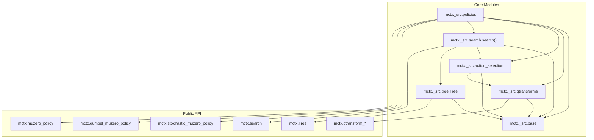

<!-- source: DeepWiki mcp.deepwiki.com · repo google-deepmind/mctx · page 1 Overview · fetched 2026-10-26 -->

# Overview

<details>
<summary>Relevant source files</summary>

The following files were used as context for generating this wiki page:

- [README.md](README.md)
- [mctx/__init__.py](mctx/__init__.py)

</details>


This page provides an introduction to `mctx`, a JAX-native library for Monte Carlo Tree Search (MCTS) algorithms. It covers the library's purpose, key features, component architecture, and primary algorithms. For detailed installation and package organization, see the child pages [Getting Started](#1.1) and [Package Structure](#1.2).

Sources: [README.md:3-11](), [README.md:28-52]()

## Purpose and Scope

The `mctx` library implements efficient Monte Carlo Tree Search algorithms in JAX [mctx/__init__.py:15-15](), with a focus on advanced variants such as AlphaZero, MuZero, and Gumbel MuZero [README.md:3-7](). It is designed to enable researchers to easily incorporate tree search into reinforcement learning systems while maintaining high computational efficiency via JIT-compilation [README.md:8-11]().

The library aims to strike a balance between performance and usability, allowing researchers to explore search-based algorithms in Python [README.md:46-52](). 

Sources: [README.md:3-11](), [README.md:28-52]()

## Key Features

- **JAX-Native Implementation**: Fully compatible with JAX's JIT-compilation, auto-differentiation, and hardware acceleration [README.md:8-11]().
- **Batched Processing**: Operates on batches of inputs in parallel for efficient use of accelerators [README.md:8-11]().
- **Modular Design**: Separates core concerns into composable modules such as `search` [mctx/_src/search.py](), `Tree` [mctx/_src/tree.py](), and policy functions [mctx/_src/policies.py]() [mctx/__init__.py:17-64]().
- **Multiple Algorithm Variants**: Supports standard MuZero, Gumbel MuZero, and Stochastic MuZero through a common interface [mctx/__init__.py:31-33]().
- **Configurable**: Offers various options for action selection and Q-value transformations [README.md:50-52]().

Sources: [README.md:8-11](), [mctx/__init__.py:15-65]()

## Library Architecture

The following diagram illustrates the core code components of the `mctx` library and their relationships:

### Figure 1: Core Component Architecture


Sources: [mctx/__init__.py:17-64]()

## MCTS Process Flow

The Monte Carlo Tree Search process operates iteratively across simulations, invoking environment models and updating tree statistics:

### Figure 2: Simulation Search Loop Flow
```mermaid
flowchart TD
    Start(["Start"]) --> Init["Initialize \"Tree\" with \"RootFnOutput\""]
    Init --> Loop["Loop for \"num_simulations\""]
    
    subgraph "Simulation Phase"
        Loop --> Select["Select Node via Action Selection"]
        Select --> Expand["Expand Node via \"recurrent_fn\""]
        Expand --> Backprop["Backpropagate Values & Apply Q-transforms"]
    end
    
    Backprop --> Decision{"More Simulations?"}
    Decision -->|"Yes"| Loop
    Decision -->|"No"| PolicyExtract["Extract \"PolicyOutput\" action_weights"]
    PolicyExtract --> End(["End"])
```

Sources: [README.md:76-88]()

## Data Flow and User-Provided Components

To execute a search, users must provide root and recurrent functions matching the interfaces defined in `base.py` [mctx/_src/base.py]():

### Figure 3: User Component Data Flow
```mermaid
flowchart TB
    subgraph "User Provided Components"
        style UserProvided fill:#f9f9f9,stroke:#333
        UserProvided["User Provided Functions"]
        RepFn["Root Function<br>\"RootFnOutput\""]
        RecFn["Recurrent Function<br>\"RecurrentFnOutput\""]
    end
    
    subgraph "mctx Core Components"
        SearchAlg["mctx._src.search.search()"]
        PolicyFn["mctx._src.policies"]
        Tree["mctx._src.tree.Tree"]
    end
    
    subgraph "Inputs/Outputs"
        RootOut["RootFnOutput<br>\"prior_logits\", \"value\", \"embedding\""]
        RecOut["RecurrentFnOutput<br>\"reward\", \"discount\", \"prior_logits\", \"value\""]
        PolicyOut["PolicyOutput<br>\"action\", \"action_weights\", \"search_tree\""]
    end
    
    RepFn -->|"produces"| RootOut
    RecFn -->|"produces"| RecOut
    
    RootOut --> PolicyFn
    RootOut --> SearchAlg
    
    PolicyFn -->|"calls"| SearchAlg
    SearchAlg -->|"updates"| Tree
    RecFn -->|"used by"| SearchAlg
    
    SearchAlg --> PolicyOut
    PolicyFn --> PolicyOut
```

Sources: [README.md:82-107](), [mctx/_src/base.py:26-30]()

## Child Sections

For further details on setting up and exploring the library, refer to the following child pages:
- [Getting Started](#1.1) — Installation, dependencies, and a minimal usage walkthrough of `mctx` policies [README.md:13-25](), [README.md:77-113]().
- [Package Structure](#1.2) — Explanation of the organization of the package (`mctx/`, `_src/`, `examples/`) and build layout.

Sources: [README.md:13-25](), [README.md:77-113]()

---

