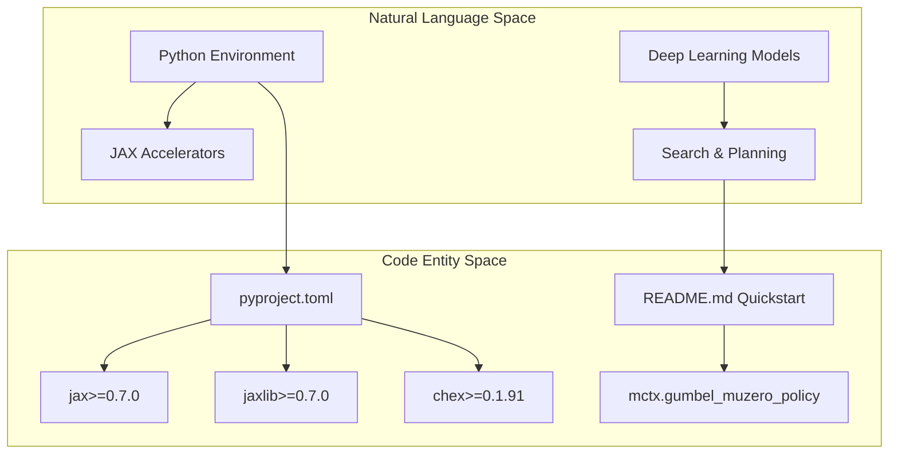
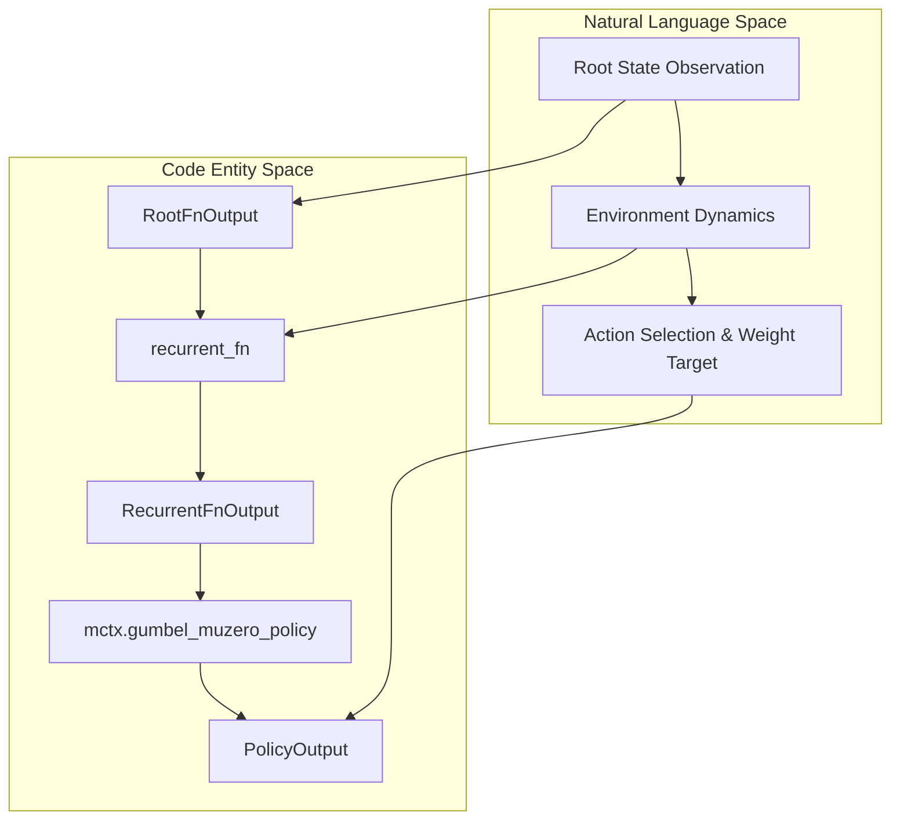

<!-- source: DeepWiki mcp.deepwiki.com · repo google-deepmind/mctx · page 1.1 Getting Started · fetched 2026-10-26 -->

# Getting Started

<details>
<summary>Relevant source files</summary>

The following files were used as context for generating this wiki page:

- [README.md](README.md)
- [pyproject.toml](pyproject.toml)

</details>


## Purpose and Scope
This page covers the installation requirements, package dependencies, and a minimal usage walkthrough for `mctx`. It outlines how to set up the library, configure required environment models using JAX, and execute high-level search policies such as `gumbel_muzero_policy` [README.md:77-102]().

Sources: [README.md:1-144](), [pyproject.toml:1-120]()

---

## Installation and System Requirements

`mctx` requires Python 3.11 or higher and relies on `jax` and `chex` for accelerated tensor computations and JIT compilation [README.md:3-11](), [pyproject.toml:11-38]().

### Core Dependencies
* `jax >= 0.7.0` [pyproject.toml:36-36]()
* `jaxlib >= 0.7.0` [pyproject.toml:37-37]()
* `chex >= 0.1.91` [pyproject.toml:35-35]()

### Installation Commands
You can install the stable release from PyPI or fetch the latest development version directly from GitHub:

```sh
# Install released version from PyPI
pip install mctx

# Install latest development version from GitHub
pip install git+https://github.com/google-deepmind/mctx.git
```
Sources: [README.md:13-25](), [pyproject.toml:34-38]()

### Optional Dependencies
For running test suites or visual examples, optional dependencies can be installed:
* **Testing:** `absl-py >= 2.3.1`, `numpy >= 1.24.1` [pyproject.toml:45-48]()
* **Examples:** `absl-py >= 2.3.1`, `pygraphviz >= 1.7` [pyproject.toml:49-52]()

Sources: [pyproject.toml:44-52]()

---

## Architecture and Dependency Mapping

The following diagram maps high-level conceptual components of search-based reinforcement learning to their concrete Python packages and requirements in `mctx`.


Sources: [README.md:1-25](), [pyproject.toml:34-38]()

---

## Minimal Usage Walkthrough

To execute a search policy in `mctx`, the user must provide a root state representation (`RootFnOutput`) and an environment dynamics model (`recurrent_fn`) [README.md:79-95]().

### 1. Root State Representation (`RootFnOutput`)
The root state function output defines the prior policy logits, the estimated value of the root state, and any internal state embedding required by the environment model [README.md:84-87]().

### 2. Dynamics Model (`recurrent_fn`)
The environment model is defined via a recurrent function with the signature:
`recurrent_fn(params, rng_key, action, embedding)` [README.md:89-92]().
It returns a tuple: `(recurrent_fn_output, new_embedding)` [README.md:91-92]().
* `RecurrentFnOutput`: Contains scalar `reward`, `discount`, policy `prior_logits`, and state `value` [README.md:93-94]().

### 3. Policy Execution
High-level policies such as `gumbel_muzero_policy` orchestrate batched tree search and return recommended actions alongside probability weights for policy improvement [README.md:79-107]().

```python
import jax
import mctx

# Example policy invocation
policy_output = mctx.gumbel_muzero_policy(
    params, rng_key, root, recurrent_fn, num_simulations=32
)

selected_action = policy_output.action
improved_weights = policy_output.action_weights
```
Sources: [README.md:77-114]()

---

## Data Flow and Execution Mapping

The following diagram maps the logical data flow of an MCTS search iteration to the corresponding data structures and functions invoked in the codebase.


Sources: [README.md:77-114]()

---

