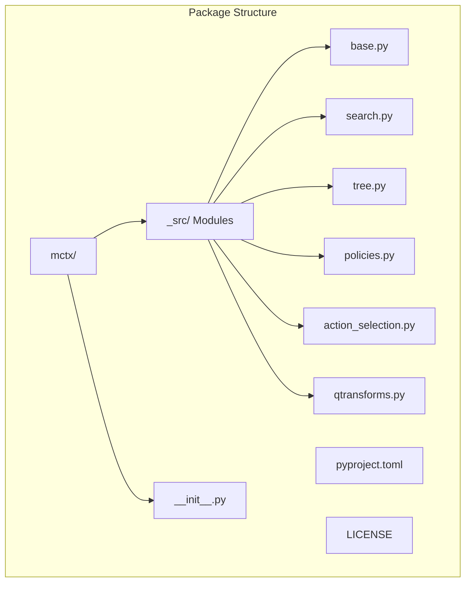
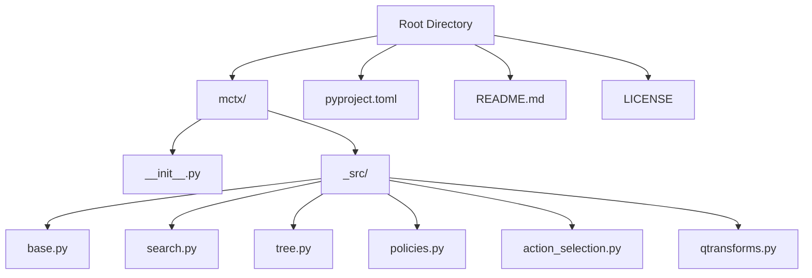
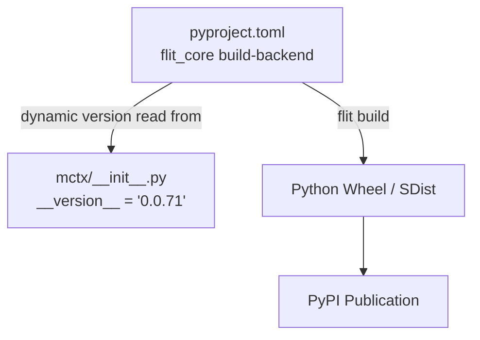

<!-- source: DeepWiki mcp.deepwiki.com · repo google-deepmind/mctx · page 1.2 Package Structure · fetched 2026-10-26 -->

# Package Structure

<details>
<summary>Relevant source files</summary>

The following files were used as context for generating this wiki page:

- [LICENSE](LICENSE)
- [mctx/__init__.py](mctx/__init__.py)
- [mctx/_src/__init__.py](mctx/_src/__init__.py)
- [pyproject.toml](pyproject.toml)

</details>


This document explains the organization of the MCTX package and its build process. It serves as a guide for developers who want to understand the codebase structure, dependencies, and how the package is built and distributed.

## Overview

MCTX is structured as a modern Python package following standard conventions for JAX-based libraries using `pyproject.toml` and Flit [pyproject.toml:1-3](). The codebase is organized to separate core functionality into distinct modules within the `mctx/_src/` directory, while exposing a clean public API surface through `mctx/__init__.py` [mctx/__init__.py:17-65]().



Sources: [pyproject.toml:1-3](), [mctx/__init__.py:1-76]()

## Directory Structure

The MCTX package follows a clean directory structure with core source files residing inside `mctx/_src/` and public exports exposed at the package root [mctx/__init__.py:17-65]().



Sources: [mctx/__init__.py:17-65]()

### Key Directories

- **mctx/**: The main package directory containing public exports in `__init__.py` [mctx/__init__.py:1-76]() and internal implementations in `_src/`.
- **Root directory**: Contains configuration metadata like `pyproject.toml`, `README.md`, and `LICENSE` [pyproject.toml:1-120]().

Sources: [pyproject.toml:1-120](), [mctx/__init__.py:1-76]()

## Module Organization & Public API

The MCTX codebase separates public exports from internal implementations. Symbols defined under `_src/` are considered internal implementation details, and users should import exclusively from the top-level `mctx` namespace [mctx/__init__.py:67-76]().

```mermaid
classDiagram
    class "__init__.py" {
        Public API exports
        __version__ = "0.0.71"
        __all__ tuple
    }
    
    class "base.py" {
        Core Types & Interfaces
        RecurrentFn, LoopFn, etc.
    }
    
    class "search.py" {
        search()
        MCTS algorithm implementation
    }
    
    class "tree.py" {
        Tree class & search summary
    }
    
    class "policies.py" {
        muzero_policy()
        gumbel_muzero_policy()
        stochastic_muzero_policy()
    }
    
    class "action_selection.py" {
        PUCT & Gumbel action selection
    }
    
    class "qtransforms.py" {
        Q-value transformations
    }
    
    "__init__.py" --> "policies.py"
    "__init__.py" --> "search.py"
    "__init__.py" --> "qtransforms.py"
    "__init__.py" --> "tree.py"
    "__init__.py" --> "action_selection.py"
    "__init__.py" --> "base.py"
```

Sources: [mctx/__init__.py:17-65]()

## Dependencies

MCTX specifies its dependencies and build requirements in `pyproject.toml` [pyproject.toml:1-38]():

| Dependency | Version Requirement | Purpose |
|------------|---------------------|---------|
| jax        | >=0.7.0             | Core framework for array computations [pyproject.toml:36]() |
| jaxlib     | >=0.7.0             | JAX's backend implementation [pyproject.toml:37]() |
| chex       | >=0.1.91            | Testing and utility functions for JAX [pyproject.toml:35]() |

The package requires Python `>=3.11` [pyproject.toml:11](). Optional dependencies are defined for testing (`absl-py>=2.3.1`, `numpy>=1.24.1`) and examples (`absl-py>=2.3.1`, `pygraphviz>=1.7`) [pyproject.toml:44-52]().

Sources: [pyproject.toml:11-52]()

## Package Configuration and Building

MCTX uses `flit_core` as its build backend, configured via `pyproject.toml` [pyproject.toml:1-3]().

### pyproject.toml

- **Build System**: Uses `flit_core.buildapi` [pyproject.toml:1-3]().
- **Metadata**: Defines project name `mctx`, description, license, keywords, classifiers, and authors [pyproject.toml:5-33]().
- **Version**: Dynamically loaded (`dynamic = ["version"]`) [pyproject.toml:7]() from `mctx/__init__.py` (`__version__ = "0.0.71"`) [mctx/__init__.py:40]().

Sources: [pyproject.toml:1-38](), [mctx/__init__.py:40]()

## Code Style and Linting Tools

The project configures static analysis and formatting tools in `pyproject.toml`:

- **Ruff**: Configured with a line length of 80 and specific select/ignore rules [pyproject.toml:58-74]().
- **Pylint**: Disables various stylistic messages for JAX compatibility and code flow [pyproject.toml:76-111]().
- **Pyink**: Configured with Google-internal formatting compatibility (`pyink = true`, 2-space indentation) [pyproject.toml:113-120]().

Sources: [pyproject.toml:58-120]()

## Build and Version Management Workflow



Sources: [pyproject.toml:1-7](), [mctx/__init__.py:40]()

## Extending the Package

To extend the MCTX package with new functionality, contributors should follow the established module organization pattern under `mctx/_src/`:

1. Core types and interfaces should be defined in `base.py`
2. New policy variants should be added to `policies.py`
3. New action selection mechanisms should go in `action_selection.py`
4. New Q-value transformations should go in `qtransforms.py`
5. Test files should be named with the `_test.py` suffix

Sources: [mctx/__init__.py:17-65]()

---

