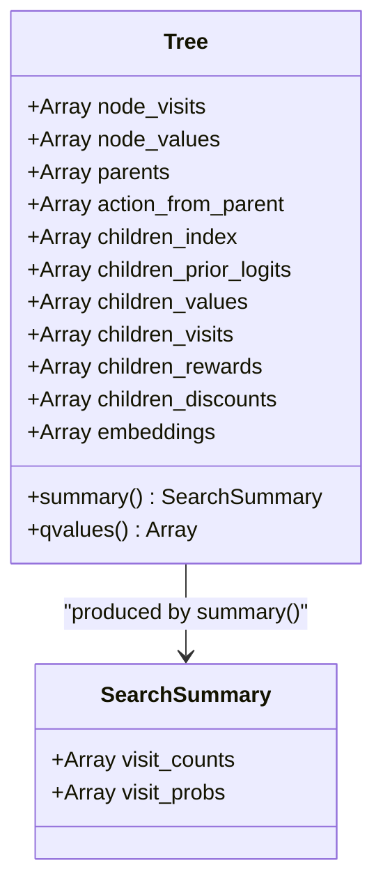
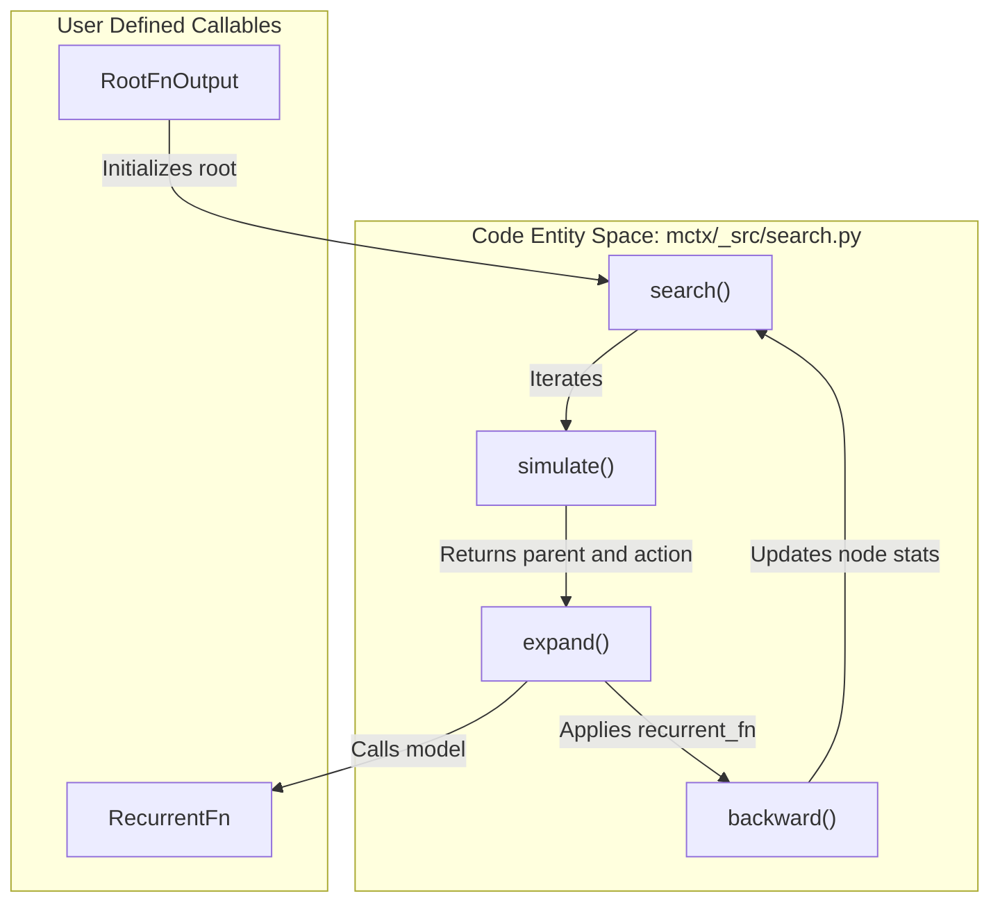
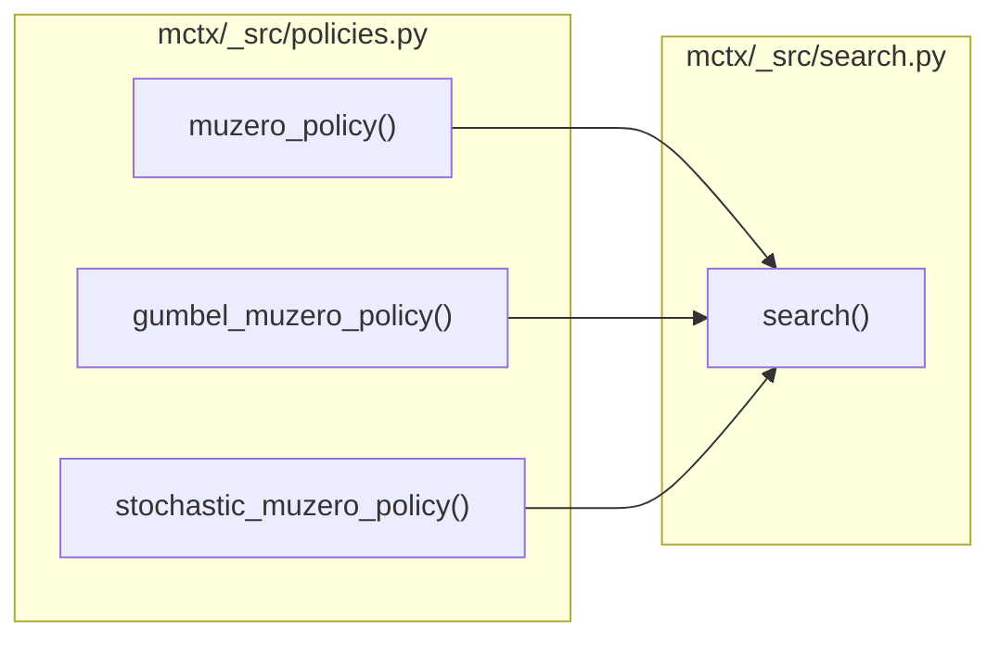

<!-- source: DeepWiki mcp.deepwiki.com · repo google-deepmind/mctx · page 2 Core Concepts · fetched 2026-10-26 -->

# Core Concepts

<details>
<summary>Relevant source files</summary>

The following files were used as context for generating this wiki page:

- [README.md](README.md)

</details>


This document explains the theoretical foundations and key concepts behind Monte Carlo Tree Search (MCTS) and its implementation in the `mctx` library [README.md:1-11](). It covers the fundamental algorithms, data structures, and processes that power the batched JAX search capabilities [README.md:8-10]().

As a parent page, this provides a high-level overview. For implementation details and deeper technical breakdowns of specific algorithms, see the dedicated child pages:
- [Monte Carlo Tree Search Basics](#2.1) — Fundamentals of MCTS algorithms and their JAX implementation.
- [MuZero Algorithm](#2.2) — The MuZero algorithm and its implementation in `mctx` [README.md:6-6]().
- [Gumbel MuZero](#2.3) — The Gumbel MuZero variant, sequential halving, and policy improvement [README.md:7-7]().
- [Stochastic MuZero](#2.4) — Handling environments with stochastic transitions and chance nodes.

For API documentation, see [API Reference](#3).

---

## Monte Carlo Tree Search Overview

Monte Carlo Tree Search is a heuristic search algorithm that builds a search tree through repeated simulation cycles to find optimal decisions [README.md:64-67](). In reinforcement learning, MCTS enables an agent to plan its actions by simulating possible futures using a learned environment model [README.md:66-67]().

The search balances exploration and exploitation through targeted sampling of paths, guided by policy priors and value estimates [README.md:71-75]().

```mermaid
flowchart TD
    Start[""Start Search (mctx/_src/search.py)""] --> Init[""Initialize Tree Root (ROOT_INDEX=0)""]
    Init --> Simulate[""Run Simulations (num_simulations)""]
    
    subgraph "Single Simulation Loop"
        Simulate --> Select[""Selection: mctx/_src/search.py:simulate()""]
        Select --> Expand[""Expansion: mctx/_src/search.py:expand()""]
        Expand --> Evaluate[""Evaluation via recurrent_fn""]
        Evaluate --> Backprop[""Backpropagation: mctx/_src/search.py:backward()""]
    end
    
    Backprop --> MoreSims{""More sims?""}
    MoreSims -->|"Yes"| Simulate
    MoreSims -->|"No"| Extract[""Extract Policy (SearchSummary)""]
```
Sources: [mctx/_src/search.py:31-114](), [README.md:53-75]()

---

## Tree Data Structure

The search tree is the central data structure in `mctx`, implemented as a batched dataclass (`Tree`) to support parallel execution across multiple environments on hardware accelerators [README.md:8-10]().


The `Tree` structure manages dimensions for the batch size (`B`), number of simulation nodes (`N`), and number of actions (`A`) [mctx/_src/search.py:345-385](). For detailed layout information, see [Tree Data Structure Implementation](#5.4).

Sources: [mctx/_src/search.py:345-385]()

---

## Search Process

The core execution flow in `mctx` is orchestrated by the `search` function, which coordinates the selection, expansion, and backpropagation phases across a fixed number of iterations [mctx/_src/search.py:31-114]().


For deep algorithmic mechanics, see [Monte Carlo Tree Search Basics](#2.1) and [Search Implementation](#5.1).

Sources: [mctx/_src/search.py:31-114](), [mctx/_src/search.py:128-292]()

---

## Action Selection

Action selection mechanisms determine how the search traverses the tree. Different algorithms employ specialized strategies to balance exploration and exploitation:

1. **PUCT Selection**: Used in standard MuZero, balancing prior probabilities and Q-values [mctx/_src/policies.py:30-123]().
2. **Gumbel Action Selection**: Uses Gumbel noise and Sequential Halving at the root node for robust policy improvement [mctx/_src/policies.py:125-231]().
3. **Stochastic Selection**: Handles decision and chance nodes for stochastic environments [mctx/_src/policies.py:234-371]().

For details, see [Action Selection Mechanisms](#5.3) and child pages [Monte Carlo Tree Search Basics](#2.1) through [Stochastic MuZero](#2.4).

Sources: [mctx/_src/policies.py:30-371]()

---

## Policy Implementation

High-level policy wrappers integrate the search engine with environment models and neural network outputs [README.md:79-95](). 


For complete details on each variant, refer to the child pages:
- [MuZero Algorithm](#2.2)
- [Gumbel MuZero](#2.3)
- [Stochastic MuZero](#2.4)

Sources: [mctx/_src/policies.py:30-371](), [README.md:79-80]()

---

## Q-Value Transforms

Q-value transforms normalize and complete action values for unvisited nodes or across sibling nodes to stabilize learning and improve search guidance [mctx/_src/policies.py:41](). Functions like `qtransform_by_parent_and_siblings` and `qtransform_completed_by_mix_value` are detailed in [QTransforms](#3.3).

Sources: [mctx/_src/policies.py:41](), [mctx/_src/policies.py:135](), [mctx/_src/policies.py:245]()

---

## Search-Policy Integration

The integration of search with reinforcement learning loops allows agents to generate improved action distributions (`action_weights`) that serve as targets for neural network training [README.md:105-107]().

For practical examples, see [Policy Improvement Example](#4.2).

Sources: [README.md:104-107](), [mctx/_src/policies.py:118-371]()

---

## Related Concepts

- [Monte Carlo Tree Search Basics](#2.1)
- [MuZero Algorithm](#2.2)
- [Gumbel MuZero](#2.3)
- [Stochastic MuZero](#2.4)
- [API Reference](#3)

---

