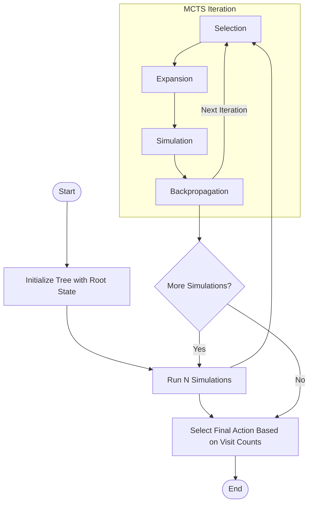
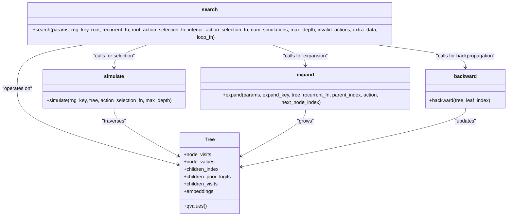
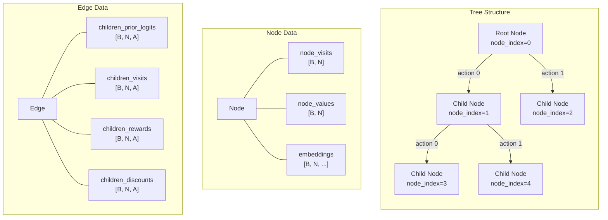
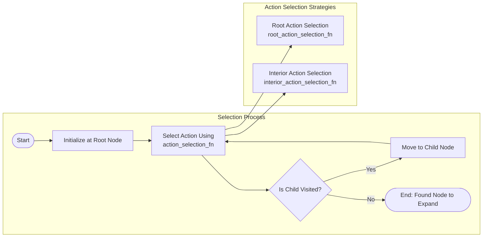
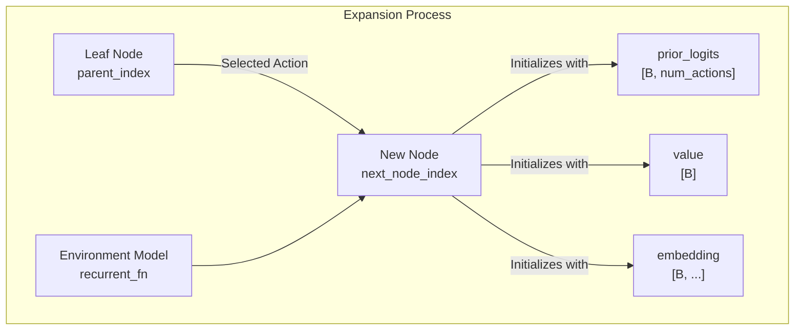
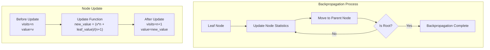
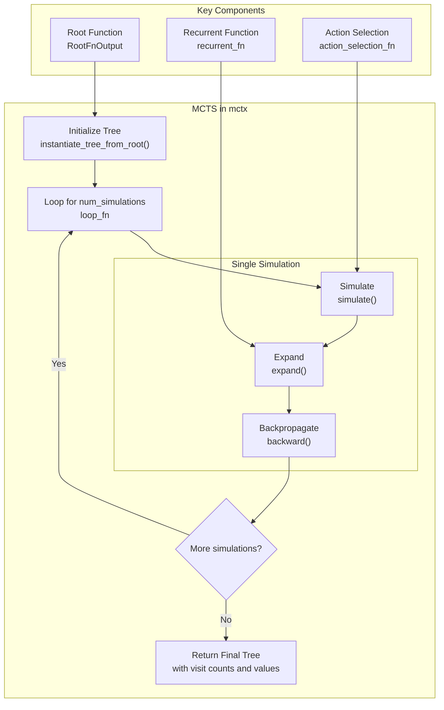
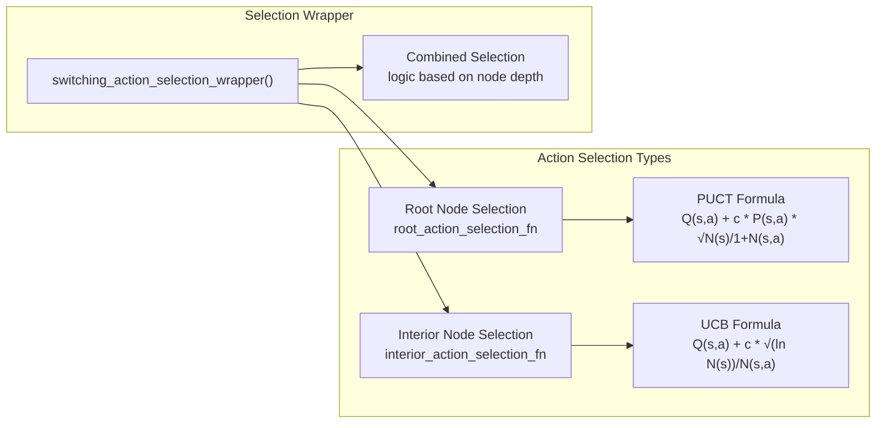
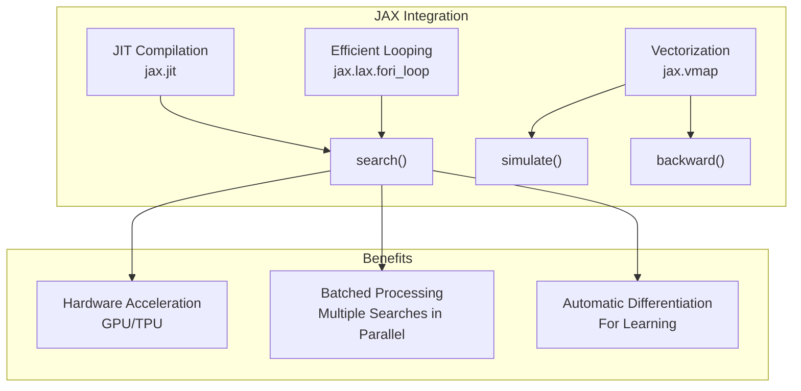

<!-- source: DeepWiki mcp.deepwiki.com · repo google-deepmind/mctx · page 2.1 Monte Carlo Tree Search Basics · fetched 2026-10-26 -->

# Monte Carlo Tree Search Basics

Relevant source files

The following files were used as context for generating this wiki page:

- [README.md](README.md)
- [mctx/_src/search.py](mctx/_src/search.py)

This document explains the fundamental concepts of Monte Carlo Tree Search (MCTS) and how it's implemented in the `mctx` library. It covers the core MCTS algorithm, its key components, and how they interact to create an effective search and planning mechanism. For specific algorithm variants like MuZero, Gumbel MuZero, or Stochastic MuZero, see their respective wiki pages ([MuZero Algorithm](#2.2), [Gumbel MuZero](#2.3), and [Stochastic MuZero](#2.4)).

Sources: [README.md:54-76]()

## What is Monte Carlo Tree Search?

Monte Carlo Tree Search is a heuristic search algorithm that combines tree search with random sampling to find optimal decisions in a given domain. It has been highly successful in domains with large state spaces, particularly in games and planning problems. MCTS builds a search tree incrementally through simulation, focusing the search on the most promising parts of the tree.

The algorithm's strength comes from its ability to balance exploration (trying new, potentially better moves) and exploitation (focusing on known good moves), making it particularly effective in reinforcement learning applications.

Sources: [README.md:54-76]()

## Core MCTS Process

MCTS operates through an iterative process consisting of four main phases:

1. **Selection**: Starting from the root, the algorithm traverses the tree by selecting actions according to a policy that balances exploration and exploitation until it reaches a leaf node.
2. **Expansion**: When a leaf node is reached, one or more child nodes are added to expand the tree.
3. **Simulation**: From the new node, a simulation is run to estimate the value of the state (in `mctx`, this often uses a learned model rather than random playouts).
4. **Backpropagation**: The result of the simulation is propagated back up the tree, updating statistics for all nodes along the path.

Sources: [mctx/_src/search.py:31-114](), [README.md:54-76]()

## MCTS in `mctx` Implementation

In `mctx`, the MCTS algorithm is implemented through the core `search` function (`mctx._src.search.search`) which orchestrates the entire process:

The `search` function takes several key components:

1. **Root Function Output**: Contains the prior policy logits, value estimate, and embedding for the root state.
2. **Recurrent Function**: Evaluates new states during expansion, returning rewards, values, and policy logits.
3. **Action Selection Functions**: Separate functions for selecting actions at the root and interior nodes.
4. **Number of Simulations**: Controls how many complete iterations of MCTS to run.

Sources: [mctx/_src/search.py:31-114]()

## Tree Data Structure

The MCTS process builds and operates on a tree data structure that stores the search state. In `mctx`, this is represented by the `Tree` dataclass (`mctx._src.tree.Tree`):

Key elements of the tree structure:
- **Nodes**: Each node represents a state in the search space.
- **Edges**: Connect nodes via actions.
- **Statistics**: Visit counts, values, prior probabilities stored for each node and edge.
- **Batched Arrays**: All data is stored in batched arrays for efficient parallel processing with JAX.

Sources: [mctx/_src/tree.py:18-90]()

## Selection Process

During the selection phase, MCTS traverses the tree from the root to a leaf by repeatedly selecting actions according to a policy:

In `mctx`, the selection process is implemented in the `simulate` function (`mctx._src.search.simulate`):
- It traverses the tree until reaching an unvisited action or the maximum depth.
- Different action selection strategies can be used at the root vs. interior nodes via `switching_action_selection_wrapper` (`mctx._src.action_selection.switching_action_selection_wrapper`).
- The process is vectorized for batch processing across multiple search instances using `jax.vmap`.

Sources: [mctx/_src/search.py:75-78](), [mctx/_src/search.py:128-187]()

## Expansion Process

Once a leaf node is reached, MCTS expands the tree by adding a new node:

The expansion process in `mctx` (`mctx._src.tree.expand` or internal expansion logic):
1. Takes the leaf node and selected action from the simulation step.
2. Calls the recurrent function (`recurrent_fn`) to evaluate the new state.
3. Creates a new node with the resulting prior logits, value, and embedding.
4. Updates the tree topology to connect the new node to its parent.

Sources: [mctx/_src/search.py:90-104]()

## Backpropagation Process

After expansion, MCTS updates the tree by propagating values back up to the root:

The backpropagation process in `mctx` (`mctx._src.tree.backward`):
1. Starts at the newly expanded node.
2. Updates visit counts and value estimates for the node.
3. Moves to the parent node.
4. Recursively continues until reaching the root.
5. Values are updated using incremental averaging based on visit counts.

Sources: [mctx/_src/search.py:104-104]()

## Complete Search Process Integration

Putting it all together, here's how the full MCTS process works in `mctx`:

The complete search process:
1. Initialize the tree with the root state using `instantiate_tree_from_root` (`mctx._src.tree.instantiate_tree_from_root`).
2. For a specified number of simulations:
   a. Select a path through the tree to a leaf node via `simulate()`.
   b. Expand the leaf node by adding a new child via `expand()`.
   c. Backpropagate the new node's value up the tree via `backward()`.
3. Return the final `Tree` structure containing visit counts, values, and edge statistics.

Sources: [mctx/_src/search.py:31-114]()

## Action Selection Mechanisms

A critical component of MCTS is the action selection mechanism that balances exploration and exploitation:

Action selection in `mctx`:
1. Different selection strategies can be used at the root and interior nodes.
2. A wrapper function `switching_action_selection_wrapper` (`mctx._src.action_selection.switching_action_selection_wrapper`) provides a unified interface.
3. Selection balances exploration (trying new actions) and exploitation (selecting high-value actions).
4. Common approaches include PUCT (Predictor + UCT) and Gumbel-based selection strategies.

Sources: [mctx/_src/action_selection.py:1-50]()

## Integration with JAX

A key feature of `mctx` is its integration with JAX for efficient computation:

JAX integration in `mctx`:
1. Functions are designed to be compatible with JAX's functional programming model.
2. Vectorization (`jax.vmap`) is used extensively to process multiple search instances in parallel.
3. Just-in-time compilation (`jax.jit`) improves computational efficiency.
4. Tree structure uses batched arrays for parallel operations.

Sources: [mctx/_src/search.py:127-128](), [README.md:7-11]()

## Conclusion

Monte Carlo Tree Search as implemented in `mctx` provides a powerful, flexible framework for decision-making and planning. The library's modular design allows for customization of key components like action selection and value estimation, while its JAX integration enables efficient computation on modern hardware.

Understanding these basics is essential for working with the more specialized variants like MuZero, Gumbel MuZero, and Stochastic MuZero, which build upon this foundation with additional features and optimizations.

Sources: [README.md:1-139]()

---

