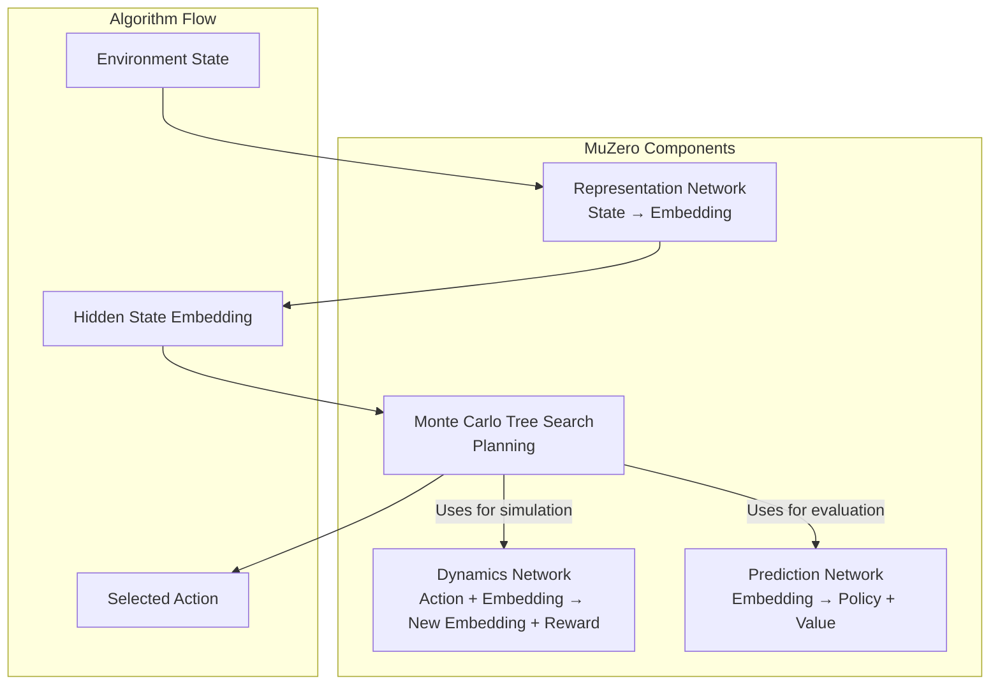
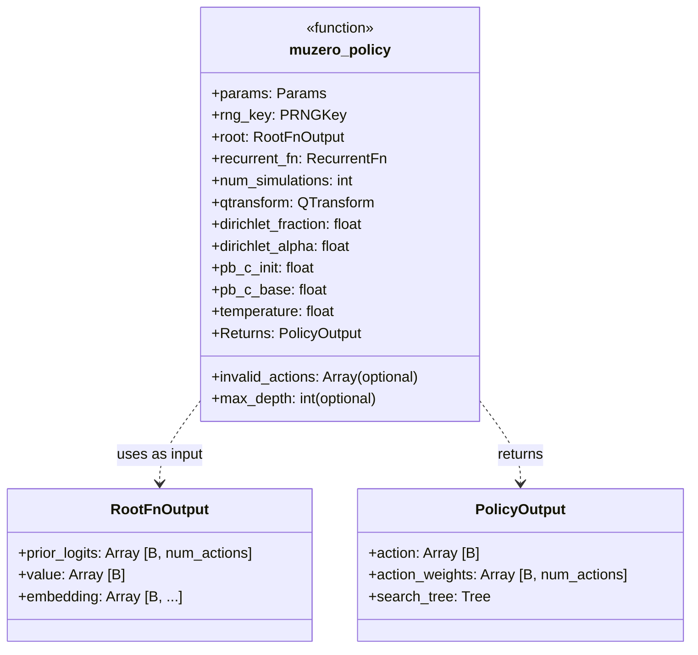
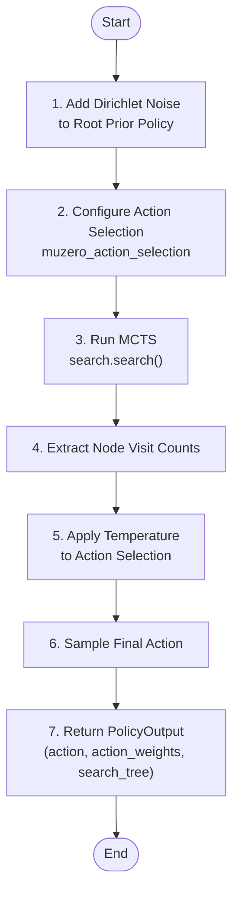
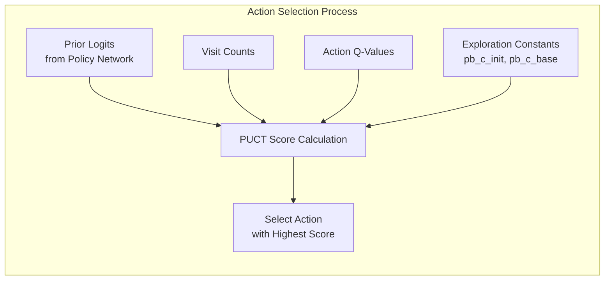
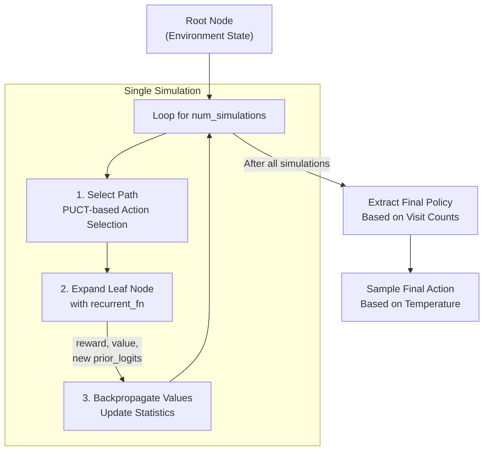
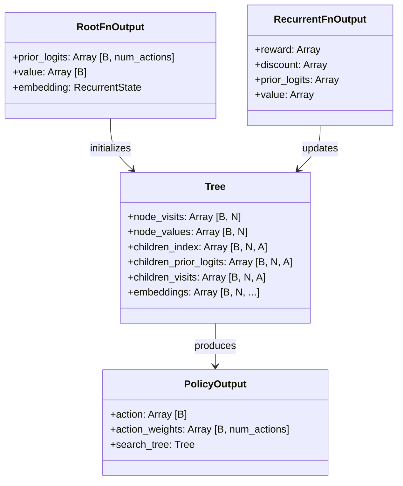

<!-- source: DeepWiki mcp.deepwiki.com · repo google-deepmind/mctx · page 2.2 MuZero Algorithm · fetched 2026-10-26 -->

# MuZero Algorithm

<details>
<summary>Relevant source files</summary>

The following files were used as context for generating this wiki page:

- [README.md](README.md)
- [mctx/_src/policies.py](mctx/_src/policies.py)

</details>


This document details the MuZero algorithm implementation in the `mctx` library. MuZero combines Monte Carlo Tree Search (MCTS) with learned neural network models to achieve planning and policy improvement. For information about other algorithm variants, see [Gumbel MuZero](#2.3) or [Stochastic MuZero](#2.4).

## Algorithm Overview

MuZero learns a model of the environment and performs search-based planning using this model. Unlike classical planning methods that require environment rules, MuZero learns everything from data: a representation function, a dynamics model, and a prediction function.



Sources: [mctx/_src/policies.py:30-122](), [README.md:1-10]()

## Implementation in MCTX

The `muzero_policy` function in `mctx` implements the core MuZero algorithm [mctx/_src/policies.py:30-45](). It performs MCTS using learned models and returns a proposed action with corresponding policy statistics [mctx/_src/policies.py:76-122]().



Sources: [mctx/_src/policies.py:30-122]()

## Key Algorithm Steps

The MuZero implementation follows these key steps:

1. **Root Initialization**: Setup the search root with prior policy logits, estimated value, and state embedding [mctx/_src/policies.py:33]()
2. **Add Exploration Noise**: Apply Dirichlet noise to the root prior policy for exploration [mctx/_src/policies.py:82-90]()
3. **Run Tree Search**: Execute MCTS for a specified number of simulations via `search.search` [mctx/_src/policies.py:101-111]()
4. **Extract Policy**: Sample action from the improved policy based on visit counts [mctx/_src/policies.py:113-122]()



Sources: [mctx/_src/policies.py:30-122]()

## Action Selection Mechanism

MuZero employs the PUCT (Predictor + UCT) algorithm for action selection during search via `action_selection.muzero_action_selection`. This balances exploration and exploitation by combining prior policy knowledge with value estimates.

For interior nodes, the selection formula is:

$$\text{PUCT Score} = Q(s,a) + c \cdot P(s,a) \cdot \frac{\sqrt{\sum_b N(s,b)}}{1 + N(s,a)}$$

Where:
- $Q(s,a)$ is the estimated action value
- $P(s,a)$ is the prior probability from the policy network
- $N(s,a)$ is the visit count for the action
- $c$ is calculated based on parameters `pb_c_init` and `pb_c_base`



Sources: [mctx/_src/policies.py:92-100](), [mctx/_src/action_selection.py]()

## Q-Value Transformation

MuZero supports different methods to transform raw Q-values through a configurable `qtransform` function [mctx/_src/policies.py:40](). The default implementation for MuZero is `qtransforms.qtransform_by_parent_and_siblings`, which normalizes Q-values based on the parent node and sibling actions.

This transformation helps with:
- Stability during learning
- Better generalization across different value ranges
- Improved exploration-exploitation balance

Sources: [mctx/_src/policies.py:40](), [mctx/_src/qtransforms.py]()

## Search Process

The search procedure works as follows:



Sources: [mctx/_src/policies.py:101-118](), [mctx/_src/search.py]()

## Key Parameters

The MuZero implementation exposes several important parameters that control the algorithm's behavior:

| Parameter | Default Value | Description |
|-----------|---------------|-------------|
| `num_simulations` | - | Number of MCTS simulations to perform |
| `dirichlet_fraction` | 0.25 | Controls mixture of prior policy and Dirichlet noise |
| `dirichlet_alpha` | 0.3 | Concentration parameter for Dirichlet distribution |
| `pb_c_init` | 1.25 | Constant c₁ in PUCT formula for exploration control |
| `pb_c_base` | 19652 | Constant c₂ in PUCT formula for exploration control |
| `temperature` | 1.0 | Controls determinism of final action selection |
| `max_depth` | None | Maximum tree depth (unlimited if None) |

Sources: [mctx/_src/policies.py:30-74]()

## Input and Output Types

The MuZero algorithm operates on and produces the following data structures:



Sources: [mctx/_src/policies.py:30-122](), [mctx/_src/base.py]()

## Relationship with Other MCTS Algorithms

MuZero forms the foundation for other algorithm variants in the `mctx` library, including Gumbel MuZero and Stochastic MuZero. These variants modify aspects of the search procedure while maintaining the core model-based planning approach.

```mermaid
graph TD
    subgraph "MCTS Family in mctx"
        MuZero["muzero_policy<br>- PUCT Selection<br>- Dirichlet Exploration"]
        Gumbel["gumbel_muzero_policy<br>- Gumbel Noise<br>- Sequential Halving"]
        Stochastic["stochastic_muzero_policy<br>- Decision + Chance Nodes<br>- Stochastic Transitions"]
    end
    
    MuZero --> Gumbel: "extends with<br>Gumbel noise"
    MuZero --> Stochastic: "extends with<br>stochastic dynamics"
    
    subgraph "Common Components"
        Search["search.py<br>Core Search Algorithm"]
        Tree["tree.py<br>Tree Data Structure"]
        QTransform["qtransforms.py<br>Value Transformations"]
    end
    
    MuZero --> Search: uses
    Gumbel --> Search: uses
    Stochastic --> Search: uses
    
    MuZero --> Tree: maintains
    MuZero --> QTransform: applies
```

Sources: [mctx/_src/policies.py:30-554]()

## Usage Example

To use the MuZero algorithm in `mctx`, you need to:
1. Define a representation function that outputs `RootFnOutput`
2. Define a dynamics function (`recurrent_fn`) that simulates the environment
3. Call `muzero_policy` with these components and appropriate parameters

The resulting `PolicyOutput` contains the selected action, improved policy weights for training, and the search tree.

Sources: [mctx/_src/policies.py:30-122](), [README.md:76-104]()

---

