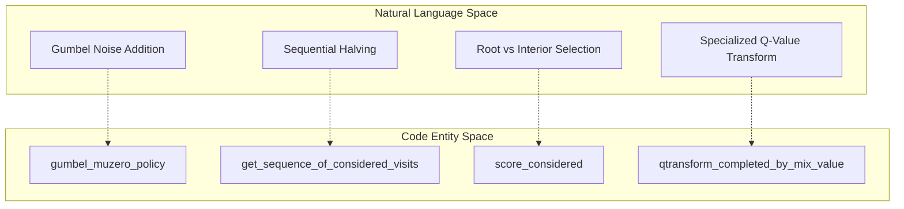
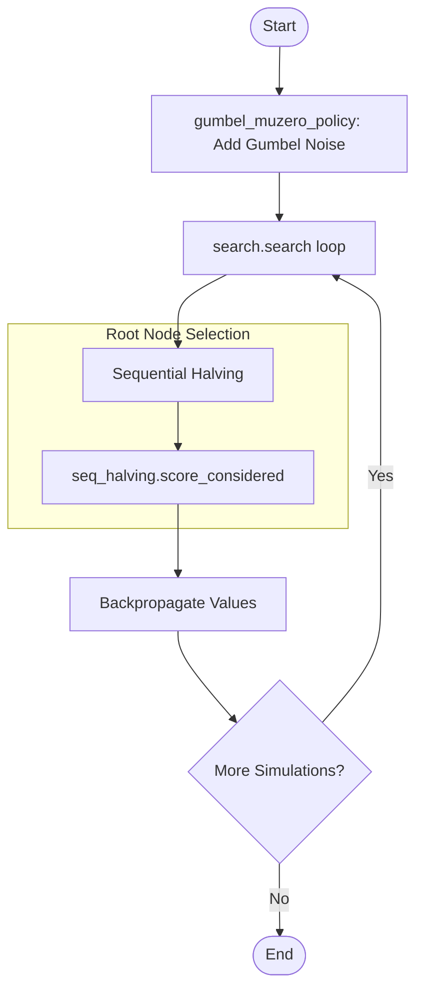
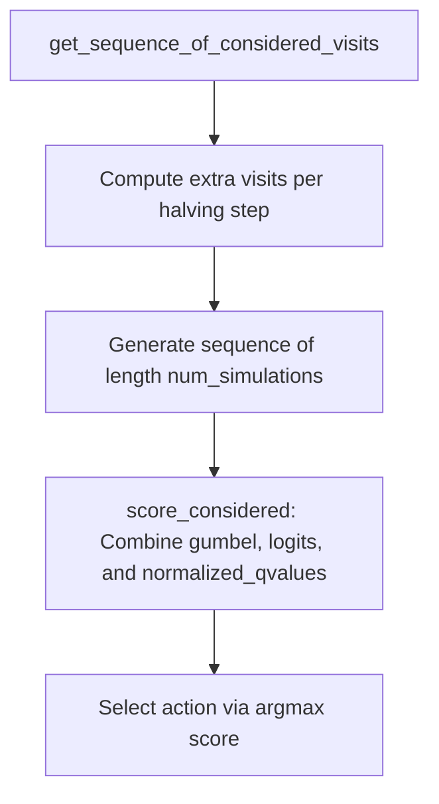

<!-- source: DeepWiki mcp.deepwiki.com · repo google-deepmind/mctx · page 2.3 Gumbel MuZero · fetched 2026-10-26 -->

# Gumbel MuZero

Relevant source files

The following files were used as context for generating this wiki page:

- [mctx/_src/policies.py](mctx/_src/policies.py)
- [mctx/_src/seq_halving.py](mctx/_src/seq_halving.py)

## Purpose and Scope

This document describes the Gumbel MuZero variant implemented in the MCTX library (`mctx._src.policies.gumbel_muzero_policy`). Gumbel MuZero enhances standard MuZero by incorporating Gumbel noise and Sequential Halving techniques to improve planning efficiency, based on the paper "Policy improvement by planning with Gumbel". For information about the standard MuZero algorithm, see [MuZero Algorithm](#2.2). For Stochastic MuZero, see [Stochastic MuZero](#2.4).

Sources: [mctx/_src/policies.py:125-143]()

## Core Concepts

Gumbel MuZero introduces two key innovations to the standard Monte Carlo Tree Search algorithm:

1. **Gumbel noise**: Applied to action selection at the root node to improve exploration without relying on Dirichlet noise.
2. **Sequential Halving**: A pure exploration algorithm for multi-armed bandits that efficiently allocates search budget by focusing on top considered actions [mctx/_src/seq_halving.py:36-42]().

Sources: [mctx/_src/policies.py:125-143](), [mctx/_src/seq_halving.py:36-42]()

## Algorithm Overview

Gumbel MuZero differs from standard MuZero in how it selects actions at different nodes in the search tree:

1. **Root Node**: Uses Sequential Halving with Gumbel noise to prioritize promising actions using visit sequences generated by `get_sequence_of_considered_visits` [mctx/_src/seq_halving.py:36-70]().
2. **Interior Nodes**: Uses a deterministic action selection strategy specific to Gumbel MuZero.

Sources: [mctx/_src/policies.py:125-163](), [mctx/_src/seq_halving.py:23-70]()

## Sequential Halving with Gumbel

Sequential halving is implemented via sequence generation functions in `mctx/_src/seq_halving.py`. The visit counts allow implementing Sequential Halving by selecting the best action from the actions with the currently considered visit count [mctx/_src/seq_halving.py:36-55]().

Sources: [mctx/_src/seq_halving.py:23-70]()

## Configuration Parameters

The `gumbel_muzero_policy` function accepts parameters controlling its search behavior:

| Parameter | Default | Description |
|-----------|---------|-------------|
| `params` | Required | Parameters to be forwarded to root and recurrent functions [mctx/_src/policies.py:151-152]() |
| `rng_key` | Required | Random number generator state [mctx/_src/policies.py:153]() |
| `root` | Required | Initial state with prior logits, value, and embedding [mctx/_src/policies.py:154-156]() |
| `recurrent_fn` | Required | Callable for dynamics model simulation [mctx/_src/policies.py:157-160]() |
| `num_simulations` | Required | Number of simulations to run [mctx/_src/policies.py:161]() |
| `invalid_actions` | `None` | Mask for invalid actions (1=invalid, 0=valid) [mctx/_src/policies.py:162-163]() |
| `max_depth` | `None` | Maximum search tree depth [mctx/_src/policies.py:132]() |
| `qtransform` | `qtransform_completed_by_mix_value` | Function to obtain completed Q-values [mctx/_src/policies.py:135]() |
| `max_num_considered_actions` | `16` | Maximum number of actions to consider at root [mctx/_src/policies.py:136]() |
| `gumbel_scale` | `1.0` | Scale factor for Gumbel noise [mctx/_src/policies.py:137]() |

Sources: [mctx/_src/policies.py:125-163]()

## Comparison with Standard MuZero

| Feature | Standard MuZero | Gumbel MuZero |
|---------|----------------|---------------|
| Root action selection | PUCT formula with Dirichlet noise [mctx/_src/policies.py:93-100]() | Sequential Halving with Gumbel noise [mctx/_src/policies.py:145-147]() |
| Default Q-transform | `qtransform_by_parent_and_siblings` [mctx/_src/policies.py:40]() | `qtransform_completed_by_mix_value` [mctx/_src/policies.py:135]() |
| Exploration Noise | Dirichlet [mctx/_src/policies.py:41-42]() | Gumbel [mctx/_src/policies.py:137]() |

Sources: [mctx/_src/policies.py:30-44](), [mctx/_src/policies.py:125-138]()

---

