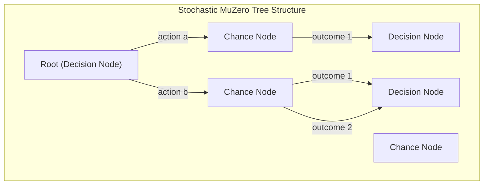
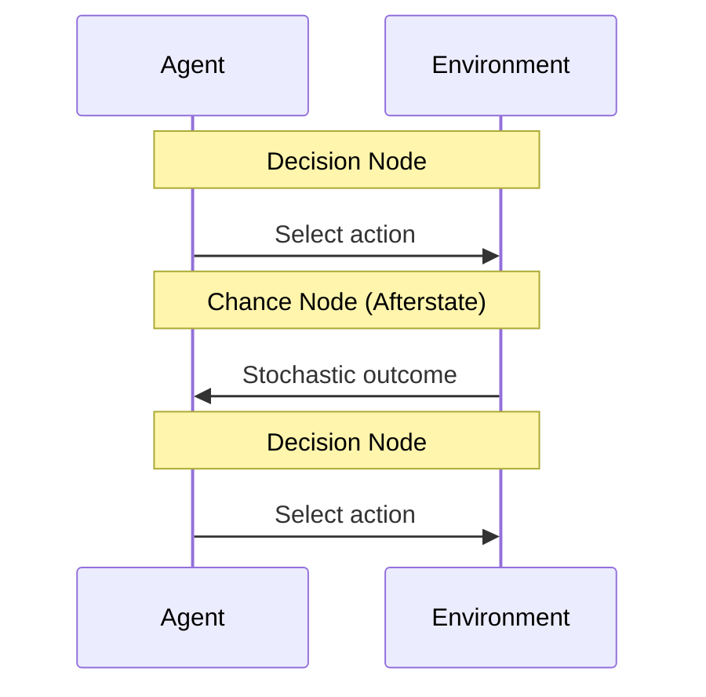
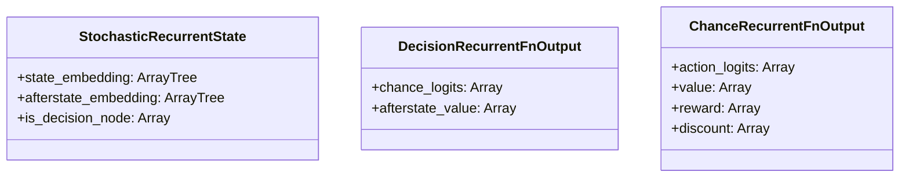
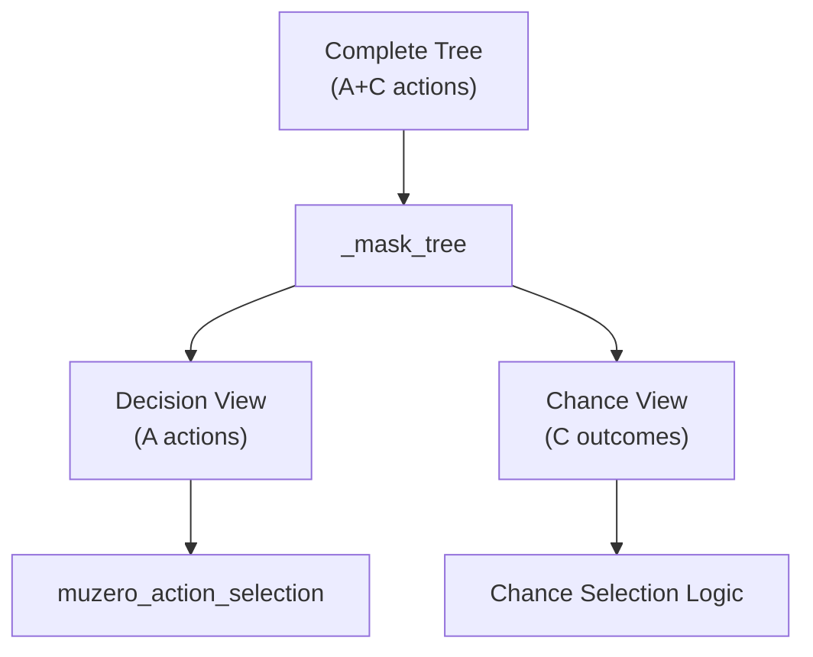
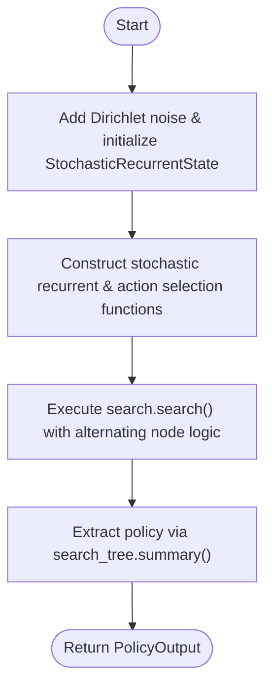
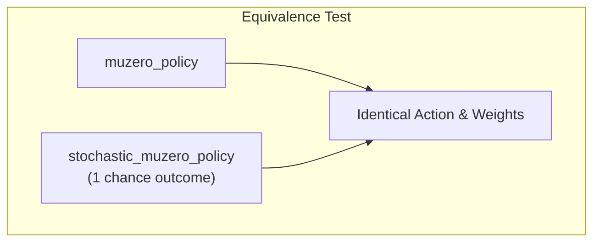

<!-- source: DeepWiki mcp.deepwiki.com · repo google-deepmind/mctx · page 2.4 Stochastic MuZero · fetched 2026-10-26 -->

# Stochastic MuZero

<details>
<summary>Relevant source files</summary>

The following files were used as context for generating this wiki page:

- [mctx/_src/base.py](mctx/_src/base.py)
- [mctx/_src/policies.py](mctx/_src/policies.py)

</details>


## Purpose and Scope
Stochastic MuZero is an extension of the MuZero algorithm that handles environments with stochastic transitions. Unlike standard MuZero [2.2] which assumes deterministic state transitions, Stochastic MuZero explicitly models chance outcomes resulting from actions, using decision nodes and chance nodes. This wiki page covers the implementation details, data flow, key functions, and data structures of Stochastic MuZero in the `mctx` library.

Sources: [mctx/_src/policies.py:234-371](), [mctx/_src/base.py:102-170]()

## Core Concepts

### Decision and Chance Nodes
The fundamental innovation in Stochastic MuZero is the introduction of two alternating node types in the search tree:
1. **Decision Nodes**: Represent states where the agent selects an action.
2. **Chance Nodes**: Represent the stochastic outcomes that occur after an action is taken (afterstates).



Sources: [mctx/_src/base.py:102-162](), [mctx/_src/policies.py:415-485]()

### Alternating Node Structure
The search tree alternates between decision layers and chance layers. 



Sources: [mctx/_src/policies.py:469-470]()

## Implementation Details

### Function Signature
The main entry point for Stochastic MuZero search is `stochastic_muzero_policy`, which coordinates tree search with decision and chance recurrent functions.

```python
stochastic_muzero_policy(
    params, rng_key, root, decision_recurrent_fn, chance_recurrent_fn,
    num_simulations, invalid_actions=None, max_depth=None,
    loop_fn=jax.lax.fori_loop, qtransform=qtransforms.qtransform_by_parent_and_siblings,
    dirichlet_fraction=0.25, dirichlet_alpha=0.3, pb_c_init=1.25,
    pb_c_base=19652, temperature=1.0)
```

Sources: [mctx/_src/policies.py:234-290]()

### Data Structures

Stochastic MuZero relies on distinct input and state wrappers defined in `mctx/_src/base.py`:
- `DecisionRecurrentFnOutput`: Contains `chance_logits` (`[B, C]`) and `afterstate_value` (`[B]`) [mctx/_src/base.py:102-118]().
- `ChanceRecurrentFnOutput`: Contains `action_logits` (`[B, A]`), `value` (`[B]`), `reward` (`[B]`), and `discount` (`[B]`) [mctx/_src/base.py:120-139]().
- `StochasticRecurrentState`: Wraps `state_embedding`, `afterstate_embedding`, and `is_decision_node` flags [mctx/_src/base.py:141-162]().



Sources: [mctx/_src/base.py:102-162]()

### Action Space and Masking
Stochastic MuZero maps both action choices and chance outcomes into an expanded unified action space of size $A + C$ (where $A$ is the number of actions and $C$ is the number of chance outcomes). Decision nodes use the first $A$ indices, and chance nodes use the last $C$ indices. Tree masking via helper functions ensures only valid transitions are chosen per node type.



Sources: [mctx/_src/policies.py:315-324](), [mctx/_src/policies.py:488-520]()

## Algorithm Flow



Sources: [mctx/_src/policies.py:234-371]()

## Comparison with Standard MuZero

| Feature | Standard MuZero [2.2] | Stochastic MuZero [2.4] |
|---------|-----------------------|-------------------------|
| Node Types | Single node type | Decision and chance nodes [mctx/_src/base.py:141-162]() |
| Recurrent Functions | Single `recurrent_fn` [mctx/_src/base.py:51-53]() | `decision_recurrent_fn` and `chance_recurrent_fn` [mctx/_src/base.py:166-170]() |
| Transition Model | Deterministic | Stochastic with explicit afterstates [mctx/_src/base.py:102-118]() |
| Internal Action Space | Size $A$ | Size $A + C$ [mctx/_src/policies.py:315-324]() |

Sources: [mctx/_src/base.py:51-170](), [mctx/_src/policies.py:234-371]()

## Testing and Verification
Tests in `mctx/_src/tests/policies_test.py` verify that configuring Stochastic MuZero with trivial single-outcome chance nodes matches the output of standard MuZero.



Sources: [mctx/_src/tests/policies_test.py:311-360]()

---

