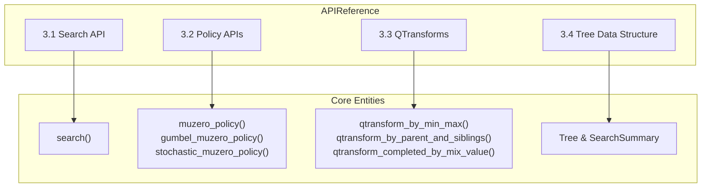

<!-- source: DeepWiki mcp.deepwiki.com · repo google-deepmind/mctx · page 3 API Reference · fetched 2026-10-26 -->

# API Reference

Relevant source files

The following files were used as context for generating this wiki page:

- [mctx/__init__.py](mctx/__init__.py)

This page provides a high-level overview of the public API for the `mctx` library, covering core search capabilities, policy variants, Q-value transformations, and data structures. As a parent reference page, it outlines the architectural layout of the API; detailed technical specifications, parameter lists, and internal implementations are delegated to the child pages.

Sources: [mctx/__init__.py:14-65]()

## 3.1. Search API

The core `search` function is the underlying engine for all Monte Carlo Tree Search variants in `mctx`. It executes batched JAX loops to perform simulation, expansion, and backup phases using a user-supplied recurrent environment model.

For complete details on function signatures, optional arguments, configuration parameters (such as Dirichlet noise, PUCT constants, and Gumbel scaling), and return structures, see [Search API](#3.1).

Sources: [mctx/_src/search.py](), [mctx/__init__.py:37-37]()

## 3.2. Policy APIs

High-level policy interfaces wrap the core search function to provide ready-to-use action selection and tree-search routines tailored to specific algorithms:
- `muzero_policy`: Standard MuZero search using PUCT action selection [mctx/_src/policies.py](), [mctx/__init__.py:32-32]().
- `gumbel_muzero_policy`: Gumbel MuZero search using sequential halving [mctx/_src/policies.py](), [mctx/__init__.py:31-31]().
- `stochastic_muzero_policy`: Extension for stochastic environment transitions supporting decision and chance nodes [mctx/_src/policies.py](), [mctx/__init__.py:33-33]().

For detailed documentation on each policy wrapper and its parameters, see [Policy APIs](#3.2).

Sources: [mctx/_src/policies.py](), [mctx/__init__.py:31-33]()

## 3.3. QTransforms

Q-value transformations modify raw Q-values during search backup and evaluation to stabilize learning and balance exploration. `mctx` provides several transformation utilities:
- `qtransform_by_min_max`: Rescales Q-values based on historical minimum and maximum bounds [mctx/_src/qtransforms.py](), [mctx/__init__.py:34-34]().
- `qtransform_by_parent_and_siblings`: Normalizes Q-values relative to parent and sibling nodes [mctx/_src/qtransforms.py](), [mctx/__init__.py:35-35]().
- `qtransform_completed_by_mix_value`: Mixes incomplete path estimates with bootstrap values [mctx/_src/qtransforms.py](), [mctx/__init__.py:36-36]().

For detailed math, signatures, and usage guidelines, see [QTransforms](#3.3).

Sources: [mctx/_src/qtransforms.py](), [mctx/__init__.py:34-36]()

## 3.4. Tree Data Structure

The `Tree` class is a JAX-friendly dataclass representing the search tree across batched simulations. It tracks node visits, values, prior logits, child indices, and state embeddings. It also provides helper methods like `qvalues` and summary generators.

For a comprehensive breakdown of `Tree` fields, shapes, and auxiliary methods, see [Tree Data Structure](#3.4).

Sources: [mctx/_src/tree.py](), [mctx/__init__.py:38-38]()

---

