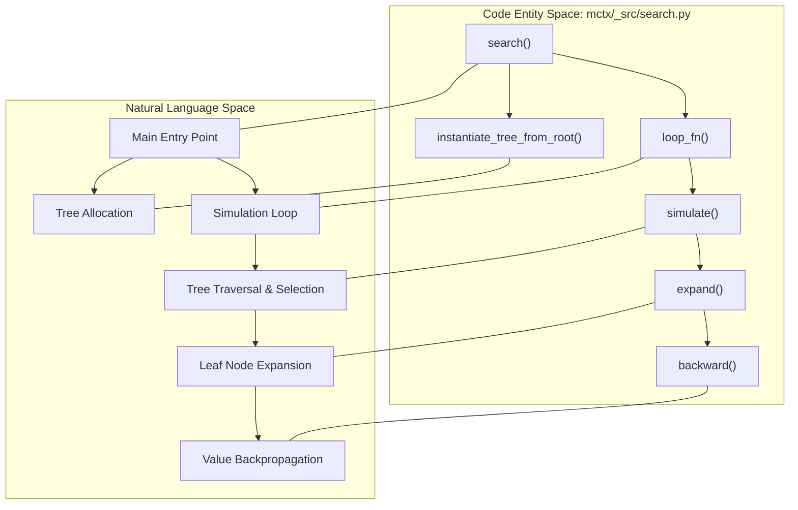
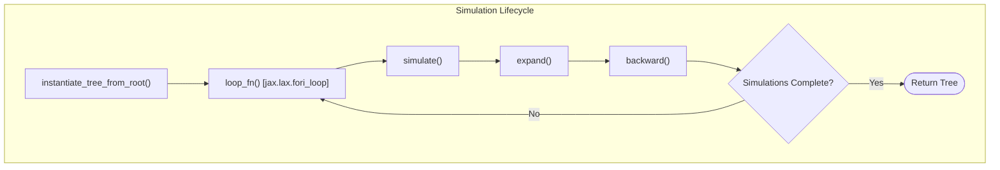
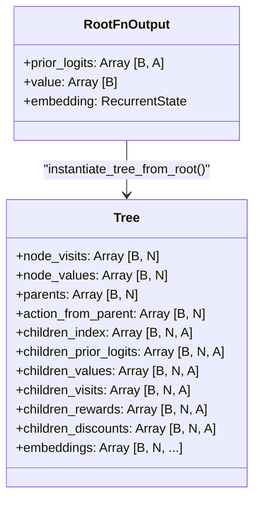
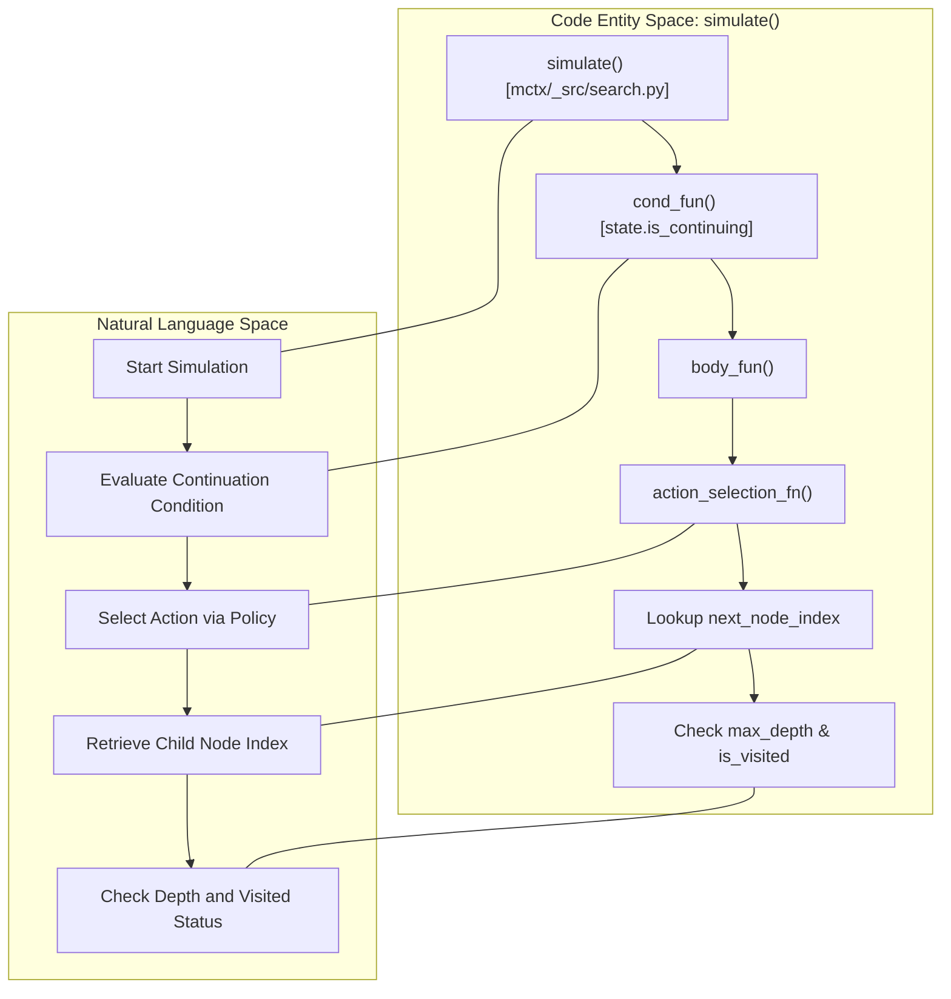

<!-- source: DeepWiki mcp.deepwiki.com · repo google-deepmind/mctx · page 3.1 Search API · fetched 2026-10-26 -->

# Search API

<details>
<summary>Relevant source files</summary>

The following files were used as context for generating this wiki page:

- [mctx/_src/search.py](mctx/_src/search.py)

</details>


The Search API is the core of the `mctx` library, providing the fundamental functionality for Monte Carlo Tree Search (MCTS) implemented in JAX. This document details the primary `search` function, its parameters, data structures, and the internal mechanics of the search loop. For higher-level policy wrappers that leverage this search function, see [Policy APIs](#3.2).

Sources: [mctx/_src/search.py:15-43]()

## Core Search Function

The `mctx` library exposes the `search` function (`[mctx/_src/search.py:31]`), which executes a batched Monte Carlo Tree Search. It coordinates tree initialization, recurrent simulations, node expansion, and backpropagation over a fixed number of simulation steps (`num_simulations`).



Sources: [mctx/_src/search.py:31-114]()

## Function Signature and Parameters

```python
def search(
    params: base.Params,
    rng_key: chex.PRNGKey,
    *,
    root: base.RootFnOutput,
    recurrent_fn: base.RecurrentFn,
    root_action_selection_fn: base.RootActionSelectionFn,
    interior_action_selection_fn: base.InteriorActionSelectionFn,
    num_simulations: int,
    max_depth: Optional[int] = None,
    invalid_actions: Optional[chex.Array] = None,
    extra_data: Any = None,
    loop_fn: base.LoopFn = jax.lax.fori_loop) -> Tree:
```

The search function accepts the parameters defined in `[mctx/_src/search.py:31-43]()`:

| Parameter | Type | Description |
|-----------|------|-------------|
| `params` | `base.Params` | Parameters to be forwarded to root and recurrent functions. |
| `rng_key` | `chex.PRNGKey` | Random number generator state (consumed). |
| `root` | `base.RootFnOutput` | Contains `prior_logits`, `value`, and `embedding` for the root state (`[B, num_actions]`, `[B]`, `[B, ...]`). |
| `recurrent_fn` | `base.RecurrentFn` | Callable applied on leaf nodes and unvisited actions. |
| `root_action_selection_fn` | `base.RootActionSelectionFn` | Function used to select an action at the root node. |
| `interior_action_selection_fn` | `base.InteriorActionSelectionFn` | Function used to select actions during interior tree simulation. |
| `num_simulations` | `int` | The total number of simulations to execute. |
| `max_depth` | `Optional[int]` | Maximum tree depth allowed during simulation (defaults to `num_simulations`). |
| `invalid_actions` | `chex.Array` | Mask of invalid actions at the root with shape `[B, num_actions]` (ones for invalid, zeros for valid). |
| `extra_data` | `Any` | Additional arbitrary data stored in the tree (`[B, ...]`). |
| `loop_fn` | `base.LoopFn` | Function used to run the simulation loop (defaults to `jax.lax.fori_loop`). |

Sources: [mctx/_src/search.py:31-43]()

## Return Value

The `search` function returns a `Tree` dataclass instance (`[mctx/_src/tree.py]`) containing all accumulated statistics, node visits, values, and topological relationships resulting from the search iterations.

Sources: [mctx/_src/search.py:44-74](), [mctx/_src/tree.py]()

## MCTS Algorithm Components

The search procedure executes four primary phases per simulation step:



Sources: [mctx/_src/search.py:76-114]()

### 1. Initialization

Before simulations begin, `instantiate_tree_from_root` allocates tensors and populates the root node with prior policy logits, values, and state embeddings from the `root` argument.



Sources: [mctx/_src/search.py:109-111]()

### 2. Simulation (Selection)

The `simulate` function (`[mctx/_src/search.py:129]()`) traverses the tree from the root node downwards using `action_selection_fn` (a combination of `root_action_selection_fn` and `interior_action_selection_fn` wrapped by `switching_action_selection_wrapper`).



Sources: [mctx/_src/search.py:75-78](), [mctx/_src/search.py:127-187]()

### 3. Expansion

The `expand` function evaluates newly reached leaf states using the `recurrent_fn` callback, attaching the resulting values, rewards, discounts, and state embeddings to the tree topology.

Sources: [mctx/_src/search.py:100-103]()

### 4. Backpropagation

The `backward` function propagates values and visit updates from the newly expanded leaf node up to the root along the traversal path.

Sources: [mctx/_src/search.py:104]()

## Batched Implementation

The `search` function is fully vectorized across a batch dimension `B`. Functions like `simulate` are decorated with `jax.vmap` (`[mctx/_src/search.py:128]()`), enabling parallel execution of multiple independent search trees within a single JAX transformation context.

Sources: [mctx/_src/search.py:127-128]()

## Integration with Policy Functions

The search API is consumed by higher-level policy definitions to yield action distributions or selected actions:
- `muzero_policy`
- `gumbel_muzero_policy`
- `stochastic_muzero_policy`

Sources: [mctx/_src/search.py:31-43]()

---

