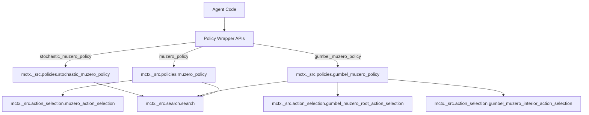
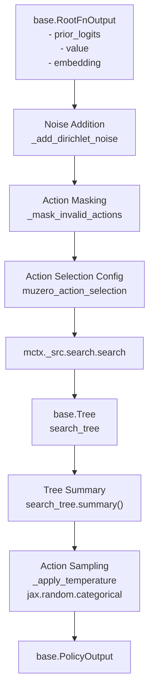

<!-- source: DeepWiki mcp.deepwiki.com · repo google-deepmind/mctx · page 3.2 Policy APIs · fetched 2026-10-26 -->

# Policy APIs

<details>
<summary>Relevant source files</summary>

The following files were used as context for generating this wiki page:

- [mctx/_src/policies.py](mctx/_src/policies.py)

</details>


## Purpose and Scope

This page documents the policy API functions provided by the MCTX library in `mctx/_src/policies.py`. These high-level APIs encapsulate the complete Monte Carlo Tree Search (MCTS) process in a single function call, making it easy to implement various MuZero-style planning algorithms. The page covers three core policy implementations: `muzero_policy`, `gumbel_muzero_policy`, and `stochastic_muzero_policy`.

Sources: [mctx/_src/policies.py:15-371]()

## Policy Architecture

The policy APIs provide a unified interface for different MCTS variants while invoking specific action selection and search modules internally.



Sources: [mctx/_src/policies.py:30-250](), [mctx/_src/search.py:1-50]()

## Standard MuZero Policy

The `muzero_policy` function implements the standard MuZero MCTS algorithm with PUCT-based action selection `[mctx/_src/policies.py:30-45]()`.

### Signature

```python
def muzero_policy(
    params: base.Params,
    rng_key: chex.PRNGKey,
    root: base.RootFnOutput,
    recurrent_fn: base.RecurrentFn,
    num_simulations: int,
    invalid_actions: Optional[chex.Array] = None,
    max_depth: Optional[int] = None,
    loop_fn: base.LoopFn = jax.lax.fori_loop,
    *,
    qtransform: base.QTransform = qtransforms.qtransform_by_parent_and_siblings,
    dirichlet_fraction: chex.Numeric = 0.25,
    dirichlet_alpha: chex.Numeric = 0.3,
    pb_c_init: chex.Numeric = 1.25,
    pb_c_base: chex.Numeric = 19652,
    temperature: chex.Numeric = 1.0) -> base.PolicyOutput[None]
```

Sources: [mctx/_src/policies.py:30-45]()

### Implementation Details

The execution flow of `muzero_policy` consists of the following steps:
1. Splits the random number generator key and adds Dirichlet noise to the root prior logits for exploration `[mctx/_src/policies.py:80-88]()`.
2. Masks out invalid actions using `_mask_invalid_actions` `[mctx/_src/policies.py:89-90]()`.
3. Configures interior and root action selection callables using `action_selection.muzero_action_selection` `[mctx/_src/policies.py:93-100]()`.
4. Executes the search loop via `search.search` `[mctx/_src/policies.py:101-111]()`.
5. Summarizes the tree and samples an action proportionally to visit counts modulated by the specified `temperature` `[mctx/_src/policies.py:113-122]`.

Sources: [mctx/_src/policies.py:80-123]()

## Gumbel MuZero Policy

The `gumbel_muzero_policy` function implements Full Gumbel MuZero as described in "Policy improvement by planning with Gumbel" `[mctx/_src/policies.py:125-143]`.

### Signature

```python
def gumbel_muzero_policy(
    params: base.Params,
    rng_key: chex.PRNGKey,
    root: base.RootFnOutput,
    recurrent_fn: base.RecurrentFn,
    num_simulations: int,
    invalid_actions: Optional[chex.Array] = None,
    max_depth: Optional[int] = None,
    loop_fn: base.LoopFn = jax.lax.fori_loop,
    *,
    qtransform: base.QTransform = qtransforms.qtransform_completed_by_mix_value,
    max_num_considered_actions: int = 16,
    gumbel_scale: chex.Numeric = 1.,
) -> base.PolicyOutput[action_selection.GumbelMuZeroExtraData]
```

Sources: [mctx/_src/policies.py:125-138]()

### Implementation Details

Key characteristics of `gumbel_muzero_policy`:
- At the root node, actions are selected using Sequential Halving with Gumbel noise `[mctx/_src/policies.py:145-147]()`.
- At interior nodes, deterministic action selection is used `[mctx/_src/policies.py:146-147]()`.
- Utilizes specialized Q-transformations such as `qtransforms.qtransform_completed_by_mix_value` `[mctx/_src/policies.py:135]()`.

Sources: [mctx/_src/policies.py:125-163]()

## Stochastic MuZero Policy

The `stochastic_muzero_policy` function adapts MCTS for environments featuring stochastic transitions by introducing decision nodes and chance nodes `[mctx/_src/policies.py:234-286]()`.

### Signature

```python
def stochastic_muzero_policy(
    params: chex.ArrayTree,
    rng_key: chex.PRNGKey,
    root: base.RootFnOutput,
    decision_recurrent_fn: base.DecisionRecurrentFn,
    chance_recurrent_fn: base.ChanceRecurrentFn,
    num_simulations: int,
    invalid_actions: Optional[chex.Array] = None,
    max_depth: Optional[int] = None,
    loop_fn: base.LoopFn = jax.lax.fori_loop,
    *,
    qtransform: base.QTransform = qtransforms.qtransform_by_parent_and_siblings,
    dirichlet_fraction: chex.Numeric = 0.25,
    dirichlet_alpha: chex.Numeric = 0.3,
    pb_c_init: chex.Numeric = 1.25,
    pb_c_base: chex.Numeric = 19652,
    temperature: chex.Numeric = 1.0) -> base.PolicyOutput[None]
```

Sources: [mctx/_src/policies.py:234-250]()

### Implementation Details

- Accepts two distinct recurrent functions: `decision_recurrent_fn` for agent actions and `chance_recurrent_fn` for environmental outcomes `[mctx/_src/policies.py:251-260]()`.
- Alternates tree expansion between decision and chance layers using specialized masking and transition logic `[mctx/_src/policies.py:415-484]()`.

Sources: [mctx/_src/policies.py:234-286]()

## Policy API Data Flow



Sources: [mctx/_src/policies.py:80-122]()

## Common Helper Functions and Return Value

Policy implementations rely on shared internal functions for preprocessing priors and scaling outputs:
- `_mask_invalid_actions`: Applies invalid action constraints `[mctx/_src/policies.py:374-385]()`.
- `_add_dirichlet_noise`: Injects exploration noise into root logits `[mctx/_src/policies.py:387-399]()`.
- `_apply_temperature`: Scales action logits by temperature `[mctx/_src/policies.py:401-408]()`.

All policy functions return a `base.PolicyOutput` container comprising the selected `action`, the probability distribution `action_weights`, and the resulting `search_tree` `[mctx/_src/base.py:50-70]()`.

Sources: [mctx/_src/policies.py:374-412]()

---

