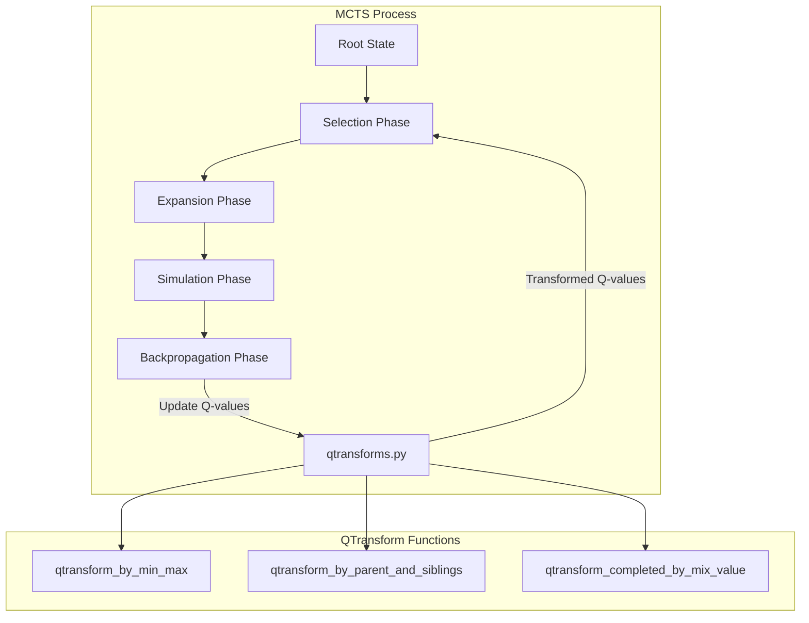
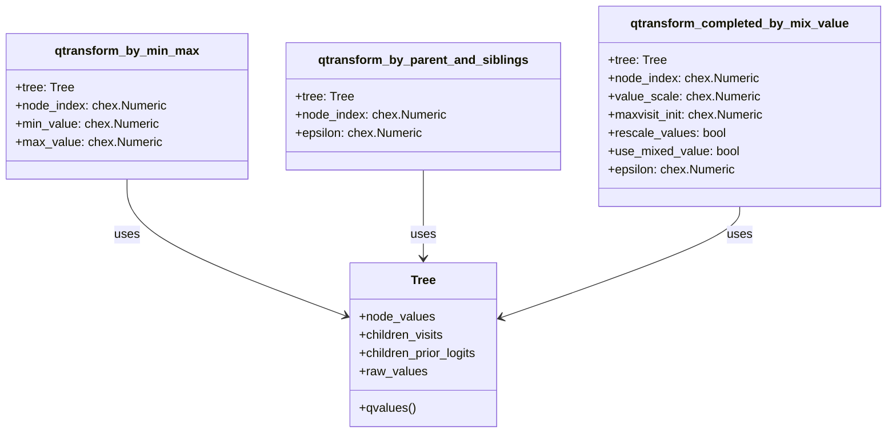
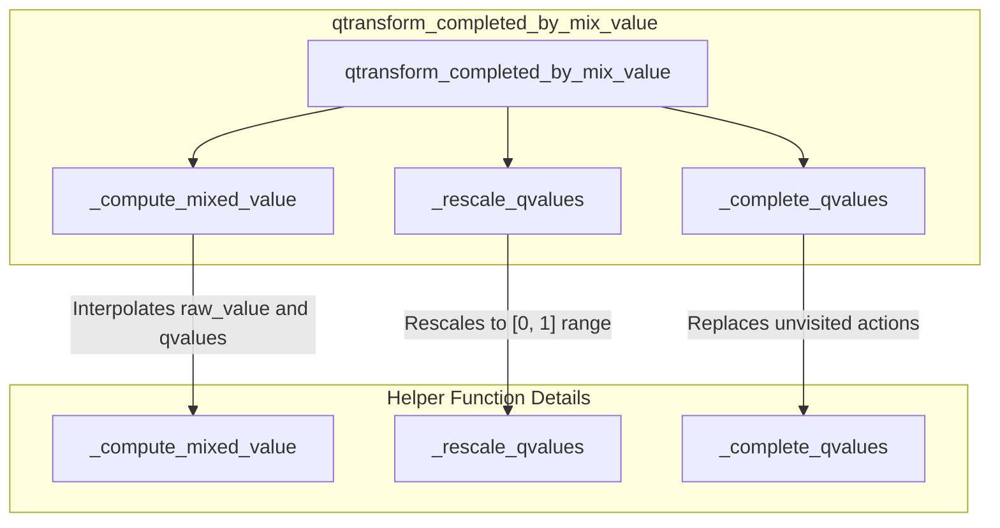

<!-- source: DeepWiki mcp.deepwiki.com · repo google-deepmind/mctx · page 3.3 QTransforms · fetched 2026-10-26 -->

# QTransforms

<details>
<summary>Relevant source files</summary>

The following files were used as context for generating this wiki page:

- [mctx/_src/qtransforms.py](mctx/_src/qtransforms.py)
- [mctx/_src/tests/qtransforms_test.py](mctx/_src/tests/qtransforms_test.py)

</details>


## Purpose and Scope

QTransforms in the mctx library are monotonic transformations applied to Q-values during Monte Carlo Tree Search (MCTS). They play a critical role in normalizing and scaling Q-values to ensure effective action selection during tree traversal. This document covers the various Q-value transformation functions available in `mctx._src.qtransforms`, their implementation details, and their role in different MCTS policy variants.

For information about the overall search process, see [Search API](#3.1). For information about policies that use these QTransforms, see [Policy APIs](#3.2).

Sources: [mctx/_src/qtransforms.py:15-22]()

## Role in MCTS

Q-value transformations serve several important purposes in MCTS algorithms:

1. **Normalization**: Scaling Q-values to a standard range (typically `[0, 1]`) to ensure consistent behavior across different value scales.
2. **Handling unvisited actions**: Providing appropriate values for actions that haven't been explored yet.
3. **Balancing exploration and exploitation**: Influencing the action selection process to balance between exploring new actions and exploiting known good actions.



Sources: [mctx/_src/qtransforms.py:15-22]()

## Available QTransform Functions

The mctx library provides three main Q-value transformation functions defined in `mctx/_src/qtransforms.py`:

| Function | Primary Purpose | Typical Usage |
|----------|----------------|---------------|
| `qtransform_by_min_max` | Simple min-max normalization using fixed bounds | General-purpose normalization |
| `qtransform_by_parent_and_siblings` | Adaptive normalization based on parent and sibling node values | Standard MuZero |
| `qtransform_completed_by_mix_value` | Completes missing Q-values and applies special scaling | Gumbel MuZero |



Sources: [mctx/_src/qtransforms.py:24-145]()

### qtransform_by_min_max

This function normalizes Q-values based on fixed minimum and maximum values [mctx/_src/qtransforms.py:24-31]():

```python
value_score = (value_score - min_value) / (max_value - min_value)
```

For unvisited actions (those with visit count of 0), the Q-value is set to `min_value` before normalization [mctx/_src/qtransforms.py:46-48]().

#### Parameters:
- `tree`: Unbatched MCTS tree state (`tree_lib.Tree`) [mctx/_src/qtransforms.py:34]()
- `node_index`: Scalar index of the parent node (`chex.Numeric`) [mctx/_src/qtransforms.py:35]()
- `min_value`: Given minimum value (`chex.Numeric`) [mctx/_src/qtransforms.py:36-37]()
- `max_value`: Given maximum value (`chex.Numeric`) [mctx/_src/qtransforms.py:38-39]()

#### Returns:
- Q-values normalized by `(qvalues - min_value) / (max_value - min_value)` with shape `[num_actions]` [mctx/_src/qtransforms.py:42-43]().

Sources: [mctx/_src/qtransforms.py:24-51]()

### qtransform_by_parent_and_siblings

This transformation normalizes Q-values based on the parent node's value and the values of sibling nodes [mctx/_src/qtransforms.py:54-85]():

```python
min_value = jnp.minimum(node_value, jnp.min(safe_qvalues, axis=-1))
max_value = jnp.maximum(node_value, jnp.max(safe_qvalues, axis=-1))
normalized = (completed_by_min - min_value) / (jnp.maximum(max_value - min_value, epsilon))
```

#### Parameters:
- `tree`: Unbatched MCTS tree state (`tree_lib.Tree`) [mctx/_src/qtransforms.py:63]()
- `node_index`: Scalar index of the parent node (`chex.Numeric`) [mctx/_src/qtransforms.py:64]()
- `epsilon`: Minimum denominator for the normalization (`chex.Numeric`) [mctx/_src/qtransforms.py:58(),65]()

#### Returns:
- Q-values normalized to be from the `[0, 1]` interval with shape `[num_actions]` [mctx/_src/qtransforms.py:68-69]().

Sources: [mctx/_src/qtransforms.py:54-86]()

### qtransform_completed_by_mix_value

This transformation is designed for Gumbel MuZero and completes missing Q-values for unvisited actions using a "mixed value" approach, then applies a scaling factor based on visit counts [mctx/_src/qtransforms.py:88-145]():

```python
visit_scale = maxvisit_init + maxvisit
return visit_scale * value_scale * completed_qvalues
```

#### Parameters:
- `tree`: Unbatched MCTS tree state (`tree_lib.Tree`) [mctx/_src/qtransforms.py:109]()
- `node_index`: Scalar index of the parent node (`chex.Numeric`) [mctx/_src/qtransforms.py:110]()
- `value_scale`: Scale for the Q-values (`chex.Numeric`) [mctx/_src/qtransforms.py:111]()
- `maxvisit_init`: Offset to the `max(visit_counts)` in the scaling factor (`chex.Numeric`) [mctx/_src/qtransforms.py:112]()
- `rescale_values`: If `True`, scale Q-values by `1 / (max_q - min_q)` (`bool`) [mctx/_src/qtransforms.py:113]()
- `use_mixed_value`: If `True`, complete Q-values with mixed value, otherwise with raw value (`bool`) [mctx/_src/qtransforms.py:114-115]()
- `epsilon`: Minimum denominator when using `rescale_values` (`chex.Numeric`) [mctx/_src/qtransforms.py:116]()

#### Returns:
- Completed Q-values with shape `[num_actions]` [mctx/_src/qtransforms.py:118-119]().

Sources: [mctx/_src/qtransforms.py:88-146]()

## Implementation Details

The QTransform functions rely on private helper utilities defined in `mctx/_src/qtransforms.py`:



Sources: [mctx/_src/qtransforms.py:148-182](), [mctx/_src/tests/qtransforms_test.py:25-53]()

### _compute_mixed_value

This helper function calculates an estimator of the state value by interpolating the raw value and weighted Q-values [mctx/_src/qtransforms.py:169-182]().

Sources: [mctx/_src/qtransforms.py:169-182](), [mctx/_src/tests/qtransforms_test.py:25-53]()

### _complete_qvalues

Returns completed Q-values, substituting unvisited action entries with the specified state `value` [mctx/_src/qtransforms.py:155-166]().

Sources: [mctx/_src/qtransforms.py:155-166]()

### _rescale_qvalues

Rescales the given completed Q-values to fall within the `[0, 1]` interval using `epsilon` for numerical stability [mctx/_src/qtransforms.py:148-152]().

Sources: [mctx/_src/qtransforms.py:148-152]()

## Summary

QTransforms are fundamental components in the MCTS routines provided by `mctx`, supplying consistent normalization and scale adjustments for action evaluation. The appropriate transform is selected based on the specific policy variant (`muzero_policy`, `gumbel_muzero_policy`, or `stochastic_muzero_policy`).

Sources: [mctx/_src/qtransforms.py:15-194]()

---

