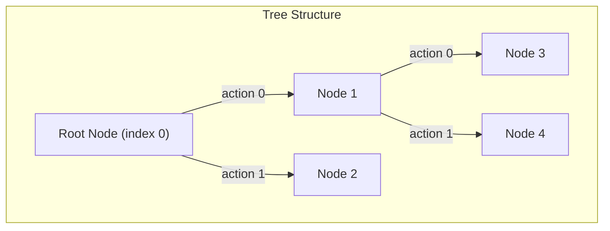
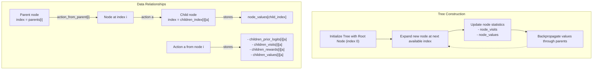
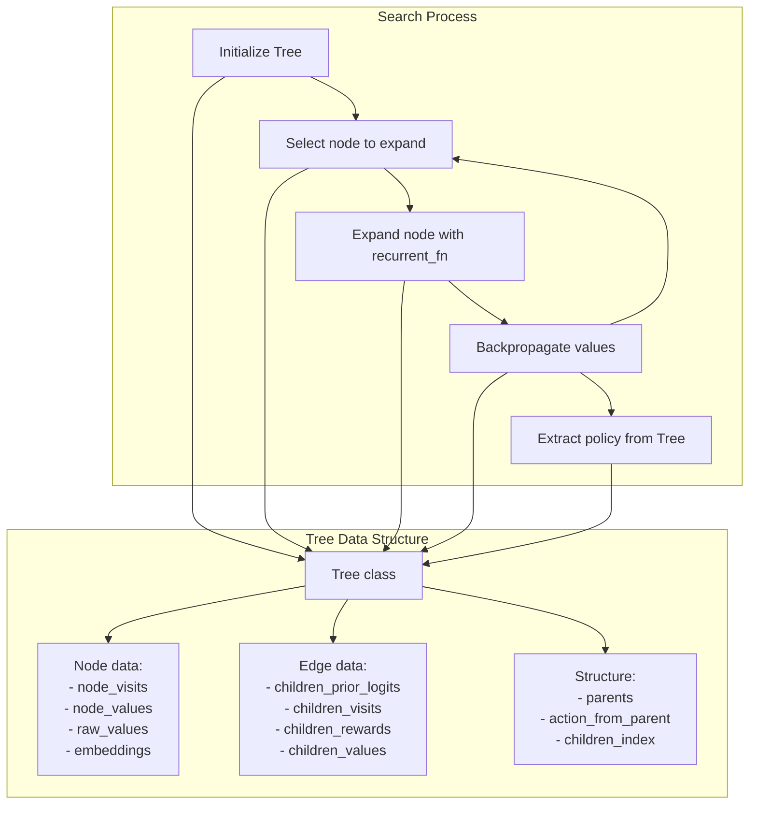

<!-- source: DeepWiki mcp.deepwiki.com · repo google-deepmind/mctx · page 3.4 Tree Data Structure · fetched 2026-10-26 -->

# Tree Data Structure

<details>
<summary>Relevant source files</summary>

The following files were used as context for generating this wiki page:

- [mctx/_src/tree.py](mctx/_src/tree.py)

</details>


This page documents the `Tree` data structure in the MCTX library, which is the core representation for Monte Carlo Tree Search (MCTS) trees. It covers the structure's fields, methods, and how they're used in the search process. For information on the search algorithm implementation that uses this tree structure, see [Search Implementation](#5.1).

## Purpose and Role

The `Tree` class provides a structured representation of the search tree built during Monte Carlo Tree Search. It maintains the state of all nodes, their relationships, statistics, and values as the search progresses. The tree structure is designed to support batched operations, enabling parallel search instances through JAX's vectorized operations.

Sources: [mctx/_src/tree.py:28-143]()

## Tree Structure Overview

The MCTX Tree data structure organizes nodes in a flat array with explicit parent-child relationships, rather than using a traditional recursive tree structure. This design enables efficient vectorized operations in JAX and simpler state management.



Each node stores statistics like visit counts and values, and each edge (action) stores associated rewards, prior probabilities, and child node indices. The flat array structure allows for efficient batch processing and is compatible with JAX's functional programming model.

Sources: [mctx/_src/tree.py:30-72]()

## Tree Fields and Their Shapes

The `Tree` dataclass contains several arrays that maintain the state of the search tree:

| Field | Shape | Description |
|-------|-------|-------------|
| `node_visits` | `[B, N]` | Visit counts for each node |
| `raw_values` | `[B, N]` | Raw value for each node (from value network) |
| `node_values` | `[B, N]` | Cumulative search value for each node |
| `parents` | `[B, N]` | Node index of the parent for each node |
| `action_from_parent` | `[B, N]` | Action taken from parent to reach this node |
| `children_index` | `[B, N, num_actions]` | Node indices of children for each action |
| `children_prior_logits` | `[B, N, num_actions]` | Action prior logits for each node |
| `children_visits` | `[B, N, num_actions]` | Visit counts for children of each action |
| `children_rewards` | `[B, N, num_actions]` | Immediate reward for each action |
| `children_discounts` | `[B, N, num_actions]` | Discounts between rewards and child values |
| `children_values` | `[B, N, num_actions]` | Value of the next node after each action |
| `embeddings` | `[B, N, ...]` | State embeddings of each node |
| `root_invalid_actions` | `[B, num_actions]` | Mask of invalid actions at the root |
| `extra_data` | `[B, ...]` | Extra data passed to the search |

Where:
- `B` is the batch dimension (number of parallel searches)
- `N` is the number of nodes in the tree
- `num_actions` is the number of discrete actions

Sources: [mctx/_src/tree.py:30-72]()

## Data Flow Through the Tree



Sources: [mctx/_src/tree.py:30-72](), [mctx/_src/tree.py:88-95]()

## Tree Constants

The `Tree` class defines several class constants for special values:

| Constant | Value | Purpose |
|----------|-------|---------|
| `ROOT_INDEX` | `0` | Index of the root node in the tree arrays |
| `NO_PARENT` | `-1` | Value indicating a node has no parent (e.g., root) |
| `UNVISITED` | `-1` | Value indicating a node hasn't been visited |

Sources: [mctx/_src/tree.py:74-78]()

## Tree Methods and Properties

The `Tree` class provides several methods and properties for accessing and manipulating tree data:

### Properties

```python
@property
def num_actions(self):
  return self.children_index.shape[-1]

@property
def num_simulations(self):
  return self.node_visits.shape[-1] - 1
```

- `num_actions`: Returns the number of discrete actions
- `num_simulations`: Returns the total number of nodes minus one (the root)

### Methods

#### qvalues(indices)

Computes Q-values for specified node indices in the tree. Q-values represent the expected return when taking each action from a given node.

```python
def qvalues(self, indices):
  """Compute q-values for any node indices in the tree."""
  if jnp.asarray(indices).shape:
    return jax.vmap(_unbatched_qvalues)(self, indices)
  else:
    return _unbatched_qvalues(self, indices)
```

The Q-value for a given node and action is computed as:
```
Q(node, action) = immediate_reward + discount * value_of_child_node
```

#### summary()

Returns a `SearchSummary` containing statistics about the root node:

```python
def summary(self) -> SearchSummary:
  """Extract summary statistics for the root node."""
  # Get state and action values for the root nodes.
  value = self.node_values[:, Tree.ROOT_INDEX]
  batch_size, = value.shape
  root_indices = jnp.full((batch_size,), Tree.ROOT_INDEX)
  qvalues = self.qvalues(root_indices)
  # Extract visit counts and induced probabilities for the root nodes.
  visit_counts = self.children_visits[:, Tree.ROOT_INDEX]
  total_counts = jnp.sum(visit_counts, axis=-1, keepdims=True)
  visit_probs = visit_counts / jnp.maximum(total_counts, 1)
  visit_probs = jnp.where(total_counts > 0, visit_probs, 1 / self.num_actions)
  # Return relevant stats.
  return SearchSummary(
      visit_counts=visit_counts,
      visit_probs=visit_probs,
      value=value,
      qvalues=qvalues)
```

Sources: [mctx/_src/tree.py:80-115]()

## SearchSummary Data Structure

The `SearchSummary` dataclass contains aggregate statistics and predictions extracted from the search tree:

```python
@chex.dataclass(frozen=True)
class SearchSummary:
  """Stats from MCTS search."""
  visit_counts: chex.Array
  visit_probs: chex.Array
  value: chex.Array
  qvalues: chex.Array
```

This provides a compact representation of the most important information from the search, particularly at the root node, which can be used for policy extraction and decision-making.

Sources: [mctx/_src/tree.py:128-134]()

## Helper Functions

### infer_batch_size(tree)

Utility function that recovers the batch size from a `Tree` data structure:

```python
def infer_batch_size(tree: Tree) -> int:
  """Recovers batch size from `Tree` data structure."""
  if tree.node_values.ndim != 2:
    raise ValueError("Input tree is not batched.")
  chex.assert_equal_shape_prefix(jax.tree_util.tree_leaves(tree), 1)
  return tree.node_values.shape[0]
```

Sources: [mctx/_src/tree.py:118-123]()

## Integration with MCTS Process



During the search process:

1. The tree is initialized with a root node
2. Nodes are selected for expansion based on tree statistics
3. New nodes are added to the tree during expansion
4. Values are backpropagated, updating node statistics
5. The final policy is extracted from the tree statistics

The `Tree` data structure provides the necessary storage and access patterns to support all these operations efficiently.

Sources: [mctx/_src/tree.py:30-72](), [mctx/_src/tree.py:97-115]()

## Usage Examples

The `Tree` data structure is returned as part of the `PolicyOutput` from policy functions like `muzero_policy`, allowing inspection of the search process:

```python
# Example usage (conceptual)
policy_output = mctx.muzero_policy(...)
tree = policy_output.search_tree

# Access tree statistics
summary = tree.summary()
visit_counts = summary.visit_counts
visit_probs = summary.visit_probs

# Compute Q-values for specific nodes
node_indices = jnp.array([0, 1, 2])  # Indices of nodes to analyze
qvalues = tree.qvalues(node_indices)
```

The tree can also be used for visualization and analysis of the search process, providing insights into the algorithm's decision-making.

Sources: [mctx/_src/tree.py:97-115]()

---

