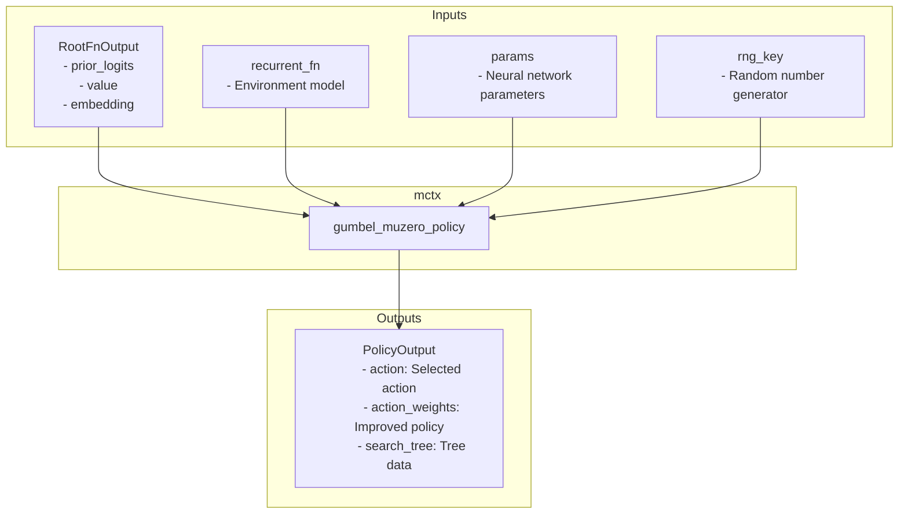
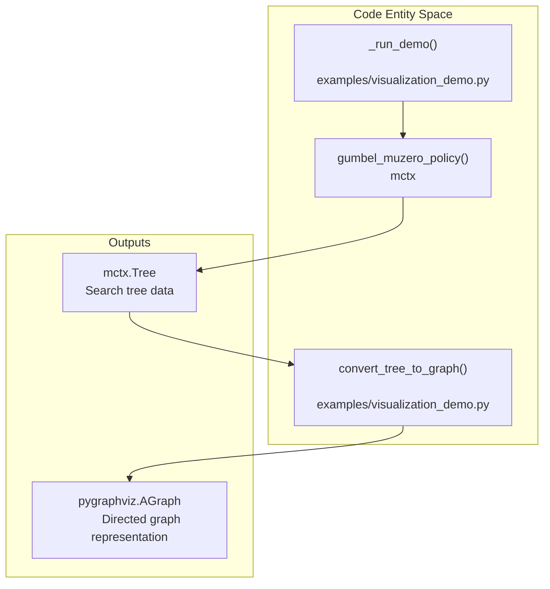
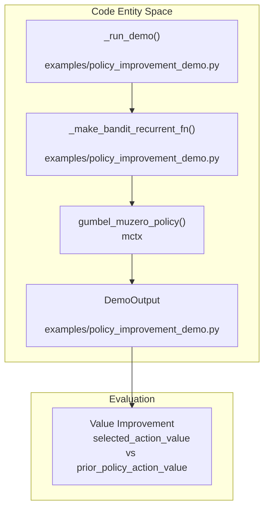

<!-- source: DeepWiki mcp.deepwiki.com · repo google-deepmind/mctx · page 4 Usage Examples · fetched 2026-10-26 -->

# Usage Examples

Relevant source files

The following files were used as context for generating this wiki page:

- [examples/policy_improvement_demo.py](examples/policy_improvement_demo.py)
- [examples/visualization_demo.py](examples/visualization_demo.py)

This page provides an overview of how to use the `mctx` library for Monte Carlo Tree Search in JAX. It highlights common integration patterns, toy environments, and examples demonstrating tree visualization and policy improvement. 

For core theoretical concepts, see [Core Concepts](#2), and for detailed API descriptions, see [API Reference](#3).

## Basic Usage Pattern

To execute a search using `mctx`, you supply a root state representation (`RootFnOutput`), a dynamics transition model (`recurrent_fn`), and select a policy function such as `mctx.gumbel_muzero_policy` [examples/visualization_demo.py:142-150]().

Sources: [examples/visualization_demo.py:142-150]()

---

## 4.1. Tree Visualization Example

The visualization demo illustrates how to run `mctx.gumbel_muzero_policy` on a deterministic toy environment and export the resulting search tree into a graphical format using `pygraphviz` [examples/visualization_demo.py:37-97](), [examples/visualization_demo.py:100-151]().

For complete implementation details, node attribute formatting, and step-by-step instructions, see [Visualization Example](#4.1).

Sources: [examples/visualization_demo.py:37-97](), [examples/visualization_demo.py:100-151]()

---

## 4.2. Policy Improvement Example

The policy improvement demo demonstrates how planning with Gumbel MuZero enhances a random prior policy in a bandit environment [examples/policy_improvement_demo.py:45-105](). It constructs a recurrent function returning reward signals from random Q-values and evaluates the value gains of the selected action [examples/policy_improvement_demo.py:108-128]().

For detailed code walkthroughs, execution metrics, and Q-value completion settings, see [Policy Improvement Example](#4.2).

Sources: [examples/policy_improvement_demo.py:37-43](), [examples/policy_improvement_demo.py:45-105](), [examples/policy_improvement_demo.py:108-128]()

---

## Integration with Neural Networks

When deploying `mctx` inside a full reinforcement learning loop (such as MuZero), your architecture typically comprises three neural components:
1. **Representation Network**: Maps raw observations to initial root embeddings [README.md:80-94]().
2. **Dynamics Network**: Implements `recurrent_fn` to predict subsequent states and rewards [README.md:80-94]().
3. **Prediction Network**: Outputs policy logits and value estimates for nodes [README.md:80-94]().

Sources: [README.md:80-94]()

## External Project Examples

Several third-party repositories integrate `mctx` for diverse environments and frameworks:
- **[Pgx](https://github.com/sotetsuk/pgx)**: Vectorized JAX board game environments (Chess, Shogi, Go)
- **[muax](https://github.com/bwfbowen/muax)**: MuZero implementation on Gym-style environments
- **[a0-jax](https://github.com/NTT123/a0-jax)**: AlphaZero implementations for Connect Four, Gomoku, and Go

Sources: [README.md:115-130]()

## Tips for Effective Usage

1. **JIT Compilation**: Wrap search functions with `jax.jit` to optimize performance across simulation loops.
2. **Batched Processing**: Take advantage of JAX vectorization by passing batch dimensions to `RootFnOutput` [examples/visualization_demo.py:169-175]().
3. **Q-Transform Selection**: Use `qtransform_completed_by_mix_value` for Gumbel-based policies and `qtransform_by_parent_and_siblings` for standard PUCT searches [examples/policy_improvement_demo.py:80-82]().

Sources: [README.md:108-113](), [examples/visualization_demo.py:169-175](), [examples/policy_improvement_demo.py:80-82]()

---

