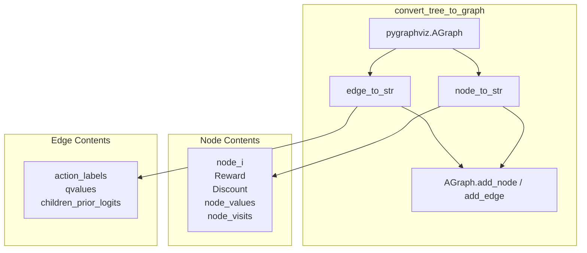
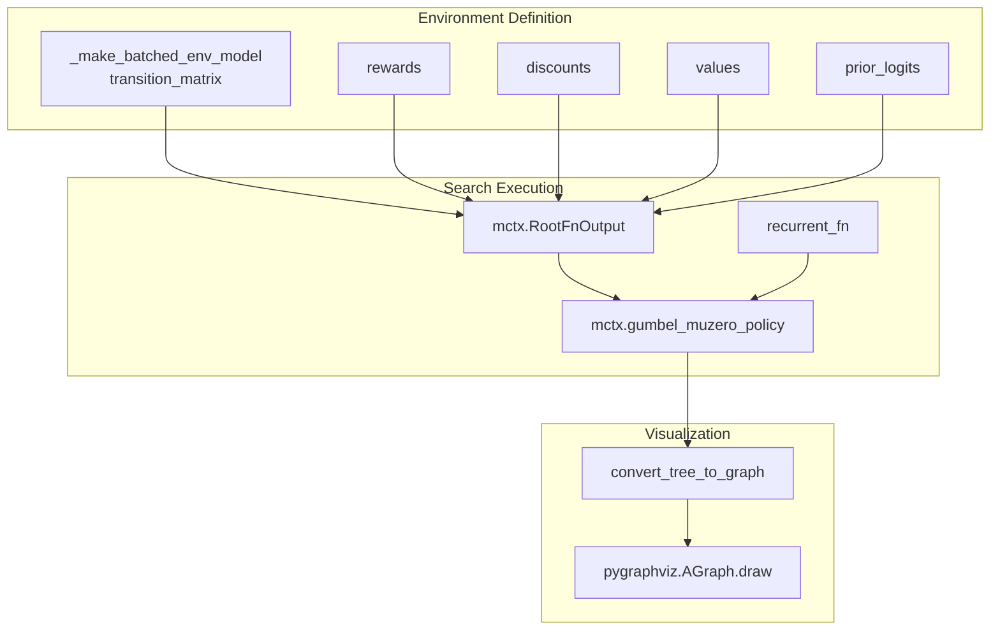
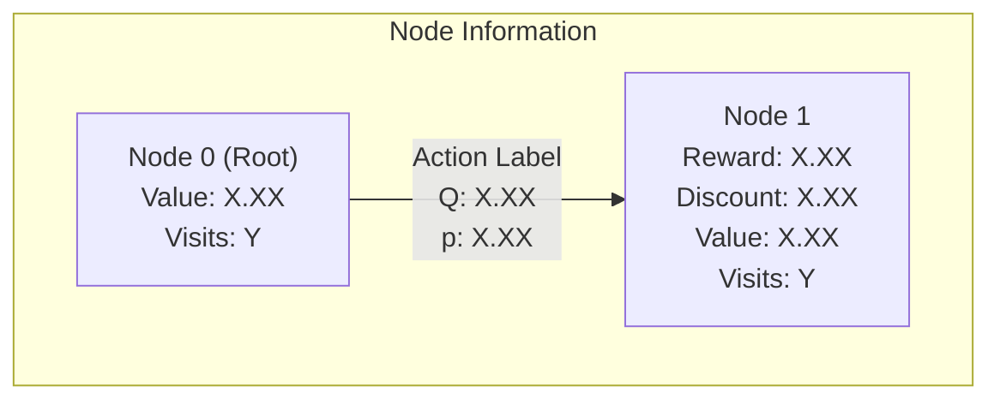
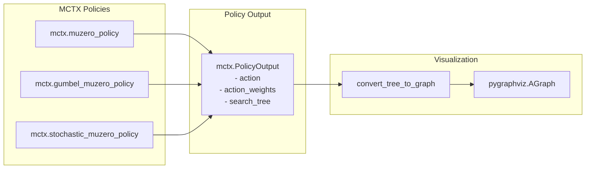

<!-- source: DeepWiki mcp.deepwiki.com · repo google-deepmind/mctx · page 4.1 Visualization Example · fetched 2026-10-26 -->

# Visualization Example

<details>
<summary>Relevant source files</summary>

The following files were used as context for generating this wiki page:

- [examples/visualization_demo.py](examples/visualization_demo.py)

</details>


This page demonstrates how to visualize Monte Carlo Tree Search (MCTS) trees generated by `mctx` using `pygraphviz`. Visualizations are useful for debugging search algorithms, understanding search behavior, and gaining insights into how the search explores the state space. For information about other usage examples, see [Usage Examples](#4).

## Overview of Tree Visualization

The `mctx` library doesn't include visualization capabilities directly in its core API, but it provides a structure that makes visualizing search trees straightforward using external libraries like Graphviz. This example shows how to convert an `mctx.Tree` object into a visual representation.

The visualization process involves these main steps:


Sources: [examples/visualization_demo.py:190-206]()

## Required Dependencies

To visualize `mctx` search trees, you need to install the following additional dependencies:

- `pygraphviz`: A Python interface to the Graphviz graph visualization software
- `graphviz`: The underlying visualization software

You can install these with pip:
```
pip install pygraphviz graphviz
```

## Converting a Tree to a Graph

The core of the visualization process is the `convert_tree_to_graph` function [examples/visualization_demo.py:37](), which transforms an `mctx.Tree` object into a Graphviz graph:



The function accepts three parameters [examples/visualization_demo.py:37-41]():
- `tree`: A `mctx.Tree` object containing search data
- `action_labels`: Optional labels for edges (defaults to the action index)
- `batch_index`: Index of the batch element to plot (for batched searches)

The function creates a directed graph where:
- Each node represents a state in the search tree
- Each edge represents an action taken from a state
- Nodes contain information about values and visit counts
- Edges contain information about Q-values and prior probabilities

Sources: [examples/visualization_demo.py:37-95]()

## Complete Example: Toy Environment Visualization

The following diagram illustrates the complete process of running a search and visualizing the resulting tree using a toy environment:



Let's examine the key components of this example:

### 1. Environment Model

The example creates a toy environment with [examples/visualization_demo.py:100-139]():
- A deterministic transition matrix that defines the next state for each `(state, action)` pair
- A reward matrix for each `(state, action)` pair
- Discount factors that determine if states are terminal (0) or not (1)
- Value estimates for each state
- Prior policy logits for each state

Sources: [examples/visualization_demo.py:98-137](), [examples/visualization_demo.py:152-187]()

### 2. Search Configuration

The example uses the `mctx.gumbel_muzero_policy` function [examples/visualization_demo.py:142]() with these key parameters:
- `num_simulations`: Number of simulations to run (default: 32)
- `max_depth`: Maximum search depth (optional)
- `max_num_considered_actions`: Maximum number of actions expanded at the root (default: 16)

Sources: [examples/visualization_demo.py:140-148]()

### 3. Visualization Output

The visualization produces a diagram with the following features:



- Root node is colored green [examples/visualization_demo.py:81]()
- Other nodes are colored red [examples/visualization_demo.py:94]()
- Nodes show their index, value, and visit count [examples/visualization_demo.py:64-68]()
- Non-root nodes also show the reward and discount received [examples/visualization_demo.py:65-66]()
- Edges show the action label, Q-value, and prior probability [examples/visualization_demo.py:74-76]()

Sources: [examples/visualization_demo.py:62-74](), [examples/visualization_demo.py:76-94]()

## Running the Example

The example can be run from the command line using the following command:

```
python -m examples.visualization_demo
```

You can customize the behavior with these flags [examples/visualization_demo.py:27-34]():
- `--seed`: Random seed (default: 42)
- `--num_simulations`: Number of simulations (default: 32)
- `--max_num_considered_actions`: Maximum number of actions expanded at the root (default: 16)
- `--max_depth`: Maximum search depth (optional)
- `--output_file`: The output file for the visualization (default: `"/tmp/search_tree.png"`)

For example:
```
python -m examples.visualization_demo --num_simulations=64 --output_file=my_tree.png
```

Sources: [examples/visualization_demo.py:27-34](), [examples/visualization_demo.py:190-209]()

## Example Output Interpretation

When running the visualization demo, you'll see output similar to:

```
Starting search.
Selected action: 3
Selected action Q-value: 10.0
Saving tree diagram to: /tmp/search_tree.png
```

The generated image will show the full search tree with all expanded nodes and their properties.

The key information to look for in the visualization:

1. **Visit distribution**: Nodes with more visits indicate areas of the state space that the search algorithm found promising (`tree.node_visits`)
2. **Value estimates**: Higher values indicate more promising states (`tree.node_values`)
3. **Exploration patterns**: The breadth and depth of the search tree reveal how the algorithm balances exploration and exploitation
4. **Action selection**: The selected action at the root shows what the policy ultimately chose (`policy_output.action`)

Sources: [examples/visualization_demo.py:196-205]()

## Adapting the Visualization for Your Environment

To adapt the visualization for your own environment:

1. Replace the toy environment with your own environment model (`root` and `recurrent_fn`)
2. Provide meaningful `action_labels` to make the visualization more interpretable
3. Adjust the node and edge formatting in `convert_tree_to_graph` if needed
4. Consider visualizing only a subset of the tree if it becomes too large

The visualization can be particularly useful for:
- Debugging search behavior
- Understanding exploration patterns
- Validating model predictions
- Explaining search decisions to others

Sources: [examples/visualization_demo.py:37-95]()

## Relationship to Other MCTX Components

The visualization functionality works with any of the policy implementations in `mctx`:



The example uses `mctx.gumbel_muzero_policy` [examples/visualization_demo.py:142](), but the visualization works with any policy that returns a `mctx.PolicyOutput` with a valid `search_tree`.

Sources: [examples/visualization_demo.py:140-148](), [examples/visualization_demo.py:203-205]()

---

