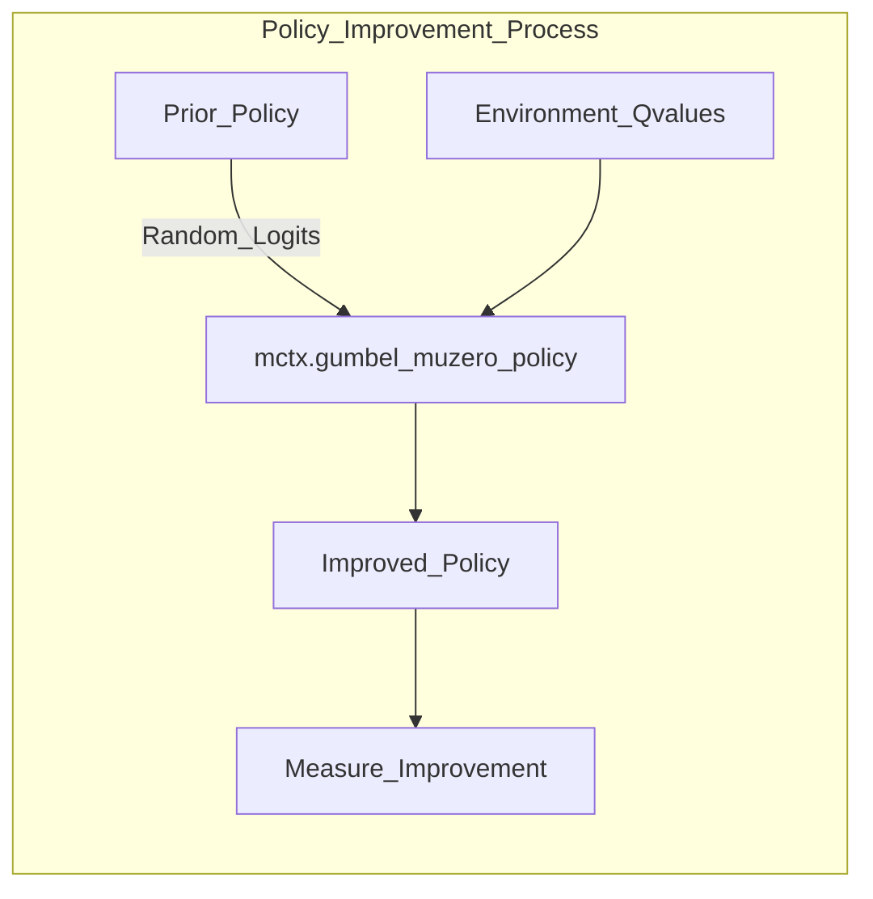
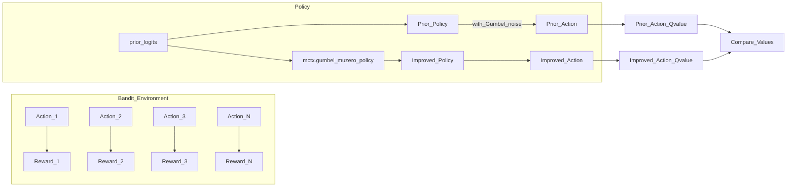
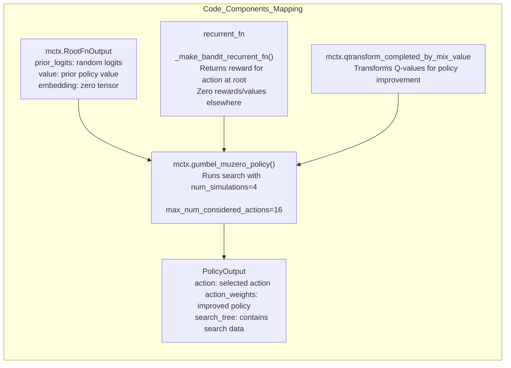
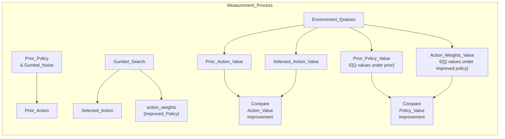
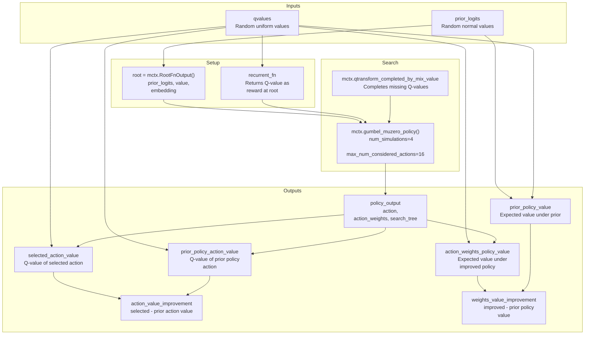

<!-- source: DeepWiki mcp.deepwiki.com · repo google-deepmind/mctx · page 4.2 Policy Improvement Example · fetched 2026-10-26 -->

# Policy Improvement Example

<details>
<summary>Relevant source files</summary>

The following files were used as context for generating this wiki page:

- [examples/policy_improvement_demo.py](examples/policy_improvement_demo.py)

</details>


## Purpose

This page demonstrates how to use MCTX's Gumbel MuZero implementation (`mctx.gumbel_muzero_policy`) to improve policies through planning in a simple multi-armed bandit environment (`examples/policy_improvement_demo.py`). The example shows concretely how search-based planning can achieve policy improvement by finding actions with higher values than those that would be selected by a prior policy.

For information about other example usages, see [Visualization Example](#4.1).

Sources: [examples/policy_improvement_demo.py:15-16]()

## Overview

The policy improvement example showcases a fundamental strength of Monte Carlo Tree Search: its ability to transform a prior policy into an improved policy through planning. This demonstration uses a multi-armed bandit scenario with the following properties:

- Random prior policy logits (simulating a policy network's output)
- Random Q-values representing action values in the environment
- Gumbel MuZero search to find better actions
- Measurement of improvement in both action selection and policy distribution



Sources: [examples/policy_improvement_demo.py:15-16]()

## Bandit Environment Setup

The example sets up a bandit environment using random Q-values and a custom recurrent function (`_make_bandit_recurrent_fn`):

1. Each action has a fixed reward value (Q-value)
2. The environment has no state transitions (single-step decision)
3. The prior policy is represented by random logits
4. Only the rewards for visited actions are revealed during search



Sources: [examples/policy_improvement_demo.py:47-59](), [examples/policy_improvement_demo.py:108-127]()

## Implementation Details

### Environment Implementation

The example sets up a bandit environment using random Q-values and a custom recurrent function:

1. Random prior logits simulate a policy network's output [examples/policy_improvement_demo.py:51-52]()
2. Random Q-values represent action values in the environment [examples/policy_improvement_demo.py:55-55]()
3. A custom recurrent function (`_make_bandit_recurrent_fn`) reveals Q-values only for selected actions [examples/policy_improvement_demo.py:108-128]()

The recurrent function is the environment simulator that returns:
- The reward for the selected action (only at the root level) [examples/policy_improvement_demo.py:114-116]()
- Discount factor (1.0 for single-player environments) [examples/policy_improvement_demo.py:119-119]()
- Dummy prior logits and value for non-root nodes [examples/policy_improvement_demo.py:123-124]()
- A simple counter as the embedding to track tree depth [examples/policy_improvement_demo.py:125-125]()

Sources: [examples/policy_improvement_demo.py:108-127]()

### Search Configuration

The example uses the Gumbel MuZero policy (`mctx.gumbel_muzero_policy`) with the following configuration:

- A small number of simulations (`num_simulations=4`) [examples/policy_improvement_demo.py:31-31](), [examples/policy_improvement_demo.py:78-78]()
- Limited number of considered actions at the root (`max_num_considered_actions=16`) [examples/policy_improvement_demo.py:32-33](), [examples/policy_improvement_demo.py:79-79]()
- Q-value transformation (`mctx.qtransform_completed_by_mix_value`) that can optionally use mixed values [examples/policy_improvement_demo.py:80-82]()
- Batch processing with a configurable batch size (`batch_size=256`) [examples/policy_improvement_demo.py:29-29](), [examples/policy_improvement_demo.py:47-47]()



Sources: [examples/policy_improvement_demo.py:63-83]()

## Measuring Policy Improvement

The example demonstrates two forms of policy improvement:

1. **Action Value Improvement**: Compares the Q-value of the action selected by the search versus the action that would have been selected by the prior policy (using the same Gumbel noise for fair comparison) [examples/policy_improvement_demo.py:85-93](), [examples/policy_improvement_demo.py:138-139]()

2. **Policy Distribution Improvement**: Compares the expected value under the improved policy distribution (`action_weights`) versus the expected value under the prior policy distribution (`raw_value`) [examples/policy_improvement_demo.py:95-97](), [examples/policy_improvement_demo.py:140-141]()



Sources: [examples/policy_improvement_demo.py:85-104](), [examples/policy_improvement_demo.py:137-145]()

## Complete Data Flow

The following diagram illustrates the complete data flow in the policy improvement demonstration:



Sources: [examples/policy_improvement_demo.py:45-145]()

## Code Usage Example

To run the example with default parameters:

```bash
python examples/policy_improvement_demo.py
```

Configurable flags include:
- `--seed`: Random seed (default: 42) [examples/policy_improvement_demo.py:28-28]()
- `--batch_size`: Batch size (default: 256) [examples/policy_improvement_demo.py:29-29]()
- `--num_actions`: Number of actions (default: 82) [examples/policy_improvement_demo.py:30-30]()
- `--num_simulations`: Number of simulations (default: 4) [examples/policy_improvement_demo.py:31-31]()
- `--max_num_considered_actions`: Maximum actions expanded at root (default: 16) [examples/policy_improvement_demo.py:32-33]()
- `--num_runs`: Number of runs on random data (default: 1) [examples/policy_improvement_demo.py:34-34]()

Sources: [examples/policy_improvement_demo.py:27-34](), [examples/policy_improvement_demo.py:131-145]()

## Results Interpretation

The script prints two key metrics computed in `main()`:

1. **Action value improvement**: The average and minimum value improvement from selecting actions with the search policy versus the prior policy [examples/policy_improvement_demo.py:138-143]().
2. **Action weights value improvement**: The average and minimum improvement in expected value under the search policy distribution versus the prior policy distribution [examples/policy_improvement_demo.py:140-145]().

Both metrics should be non-negative, demonstrating that search never degrades policy performance and typically improves it.

Sources: [examples/policy_improvement_demo.py:137-145]()

## Key Takeaways

- Even with a small number of simulations (`num_simulations=4`), Gumbel MuZero search can improve upon a random prior policy [examples/policy_improvement_demo.py:31-31](), [examples/policy_improvement_demo.py:137-145]()
- Policy improvement can be measured both in terms of action selection and policy distribution [examples/policy_improvement_demo.py:37-43](), [examples/policy_improvement_demo.py:99-104]()
- The example demonstrates how MCTX can be used with a custom environment wrapper (the bandit recurrent function `_make_bandit_recurrent_fn`) [examples/policy_improvement_demo.py:108-128]()
- Batched processing (`batch_size=256`) allows efficient parallel evaluation and improvement of multiple policies [examples/policy_improvement_demo.py:29-29](), [examples/policy_improvement_demo.py:47-47]()

Sources: [examples/policy_improvement_demo.py:15-16](), [examples/policy_improvement_demo.py:137-145]()

---

