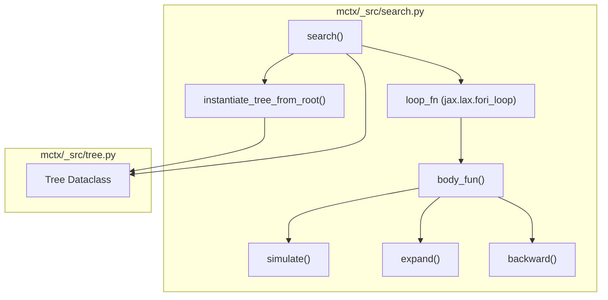
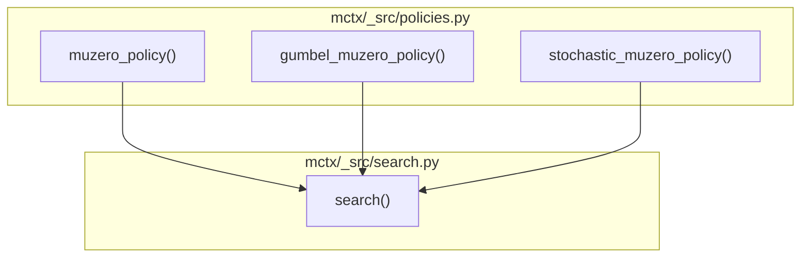
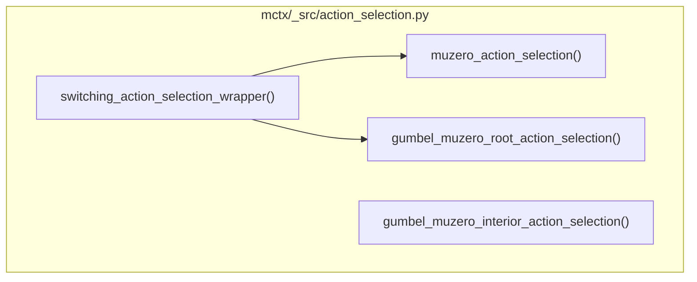
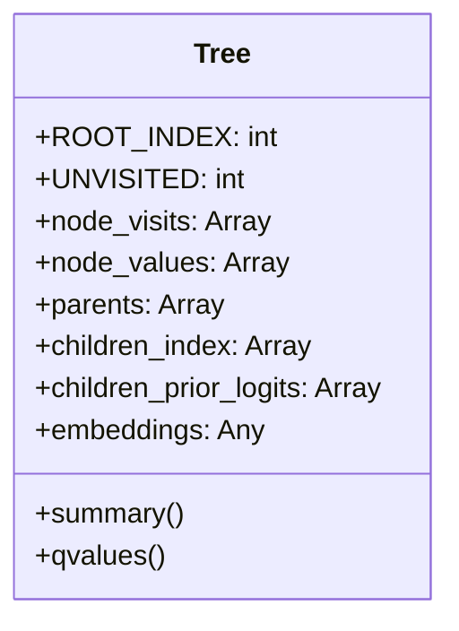
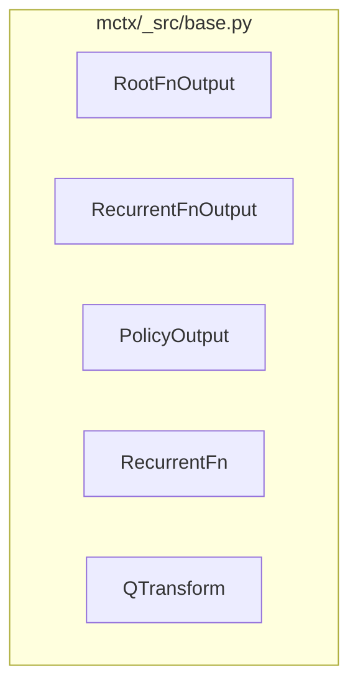

<!-- source: DeepWiki mcp.deepwiki.com · repo google-deepmind/mctx · page 5 Implementation Details · fetched 2026-10-26 -->

# Implementation Details

Relevant source files

The following files were used as context for generating this wiki page:

- [mctx/_src/policies.py](mctx/_src/policies.py)
- [mctx/_src/search.py](mctx/_src/search.py)

This page provides a high-level overview of the internal implementation of the `mctx` library for developers extending the system. For deep technical details, see the child pages linked below. For conceptual explanations of Monte Carlo Tree Search algorithms, see [Core Concepts](#2). For public API documentation, see [API Reference](#3).

## Core Search Implementation

The core search loop coordinates batched MCTS simulations across parallel environments in JAX. For details on the simulation loop, node expansion, and backpropagation phases, see [Search Implementation](#5.1).

Sources: [mctx/_src/search.py:31-114](), [mctx/_src/search.py:128-187](), [mctx/_src/search.py:190-244](), [mctx/_src/search.py:247-292]()

The `search` function ([mctx/_src/search.py:31-114]()) initializes the tree structure from root outputs and iterates over simulations using `jax.lax.fori_loop` [mctx/_src/search.py:112-113](). Each iteration invokes `simulate` [mctx/_src/search.py:93-94]() to traverse the tree, `expand` [mctx/_src/search.py:100-103]() to query the recurrent environment model, and `backward` [mctx/_src/search.py:104-104]() to propagate values back to the root.

Sources: [mctx/_src/search.py:31-114](), [mctx/_src/search.py:88-114]()

## Policy Implementations

The library offers three policy variants built on top of the shared search infrastructure: standard MuZero, Gumbel MuZero, and Stochastic MuZero. For details on how these policies and stochastic tree masking are implemented, see [Policy Implementations](#5.2).

Sources: [mctx/_src/policies.py:30-122](), [mctx/_src/policies.py:125-231](), [mctx/_src/policies.py:234-371]()

Each policy function preprocesses root statistics (such as adding Dirichlet or Gumbel noise), configures specialized action selection rules, invokes `search.search()`, and samples a final action based on visit counts or sequential halving outcomes.

Sources: [mctx/_src/policies.py:30-122](), [mctx/_src/policies.py:125-231](), [mctx/_src/policies.py:234-371]()

## Action Selection Mechanisms

Action selection dictates how the tree is explored during simulation phases. For details on PUCT, Gumbel action selection formulas, and sequential halving schedules, see [Action Selection Mechanisms](#5.3).

Sources: [mctx/_src/action_selection.py:1-50]()

Standard MuZero relies on the PUCT formula inside `muzero_action_selection`, balancing prior probabilities with Q-values and visit counts. Gumbel MuZero utilizes sequential halving at the root to systematically refine action subsets.

Sources: [mctx/_src/action_selection.py:1-100]()

## Tree Data Structure Implementation

The search tree state is encapsulated in a batched `Tree` dataclass. For details on how tree fields are allocated, indexed, and mutated during search, see [Tree Data Structure Implementation](#5.4).

Sources: [mctx/_src/tree.py:25-100]()

All tensor fields in `Tree` incorporate a leading batch dimension `B`, enabling parallel tree searches to execute efficiently under JAX transformations like `vmap` and `jit`.

Sources: [mctx/_src/tree.py:25-100]()

## Type System

The `mctx` library enforces a strict type and interface system across its modules. For details on `RootFnOutput`, `RecurrentFnOutput`, `PolicyOutput`, and other callable signatures, see [Type System](#5.5).

Sources: [mctx/_src/base.py:1-100]()

These definitions standardize data contracts between the user's environment models, policy configurations, and internal search routines.

Sources: [mctx/_src/base.py:1-100]()

---

