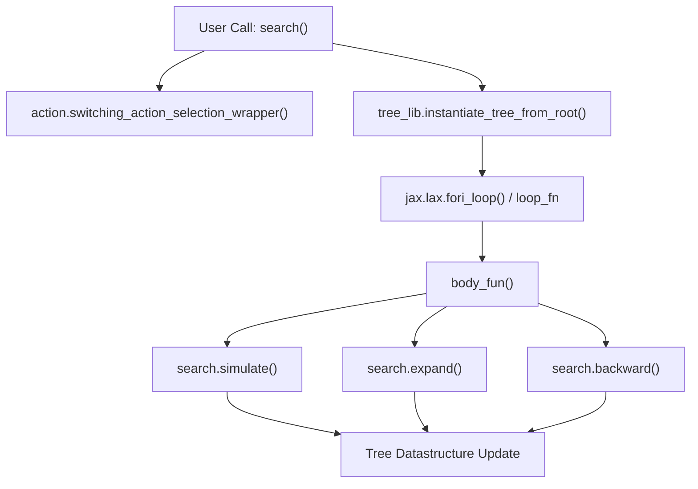
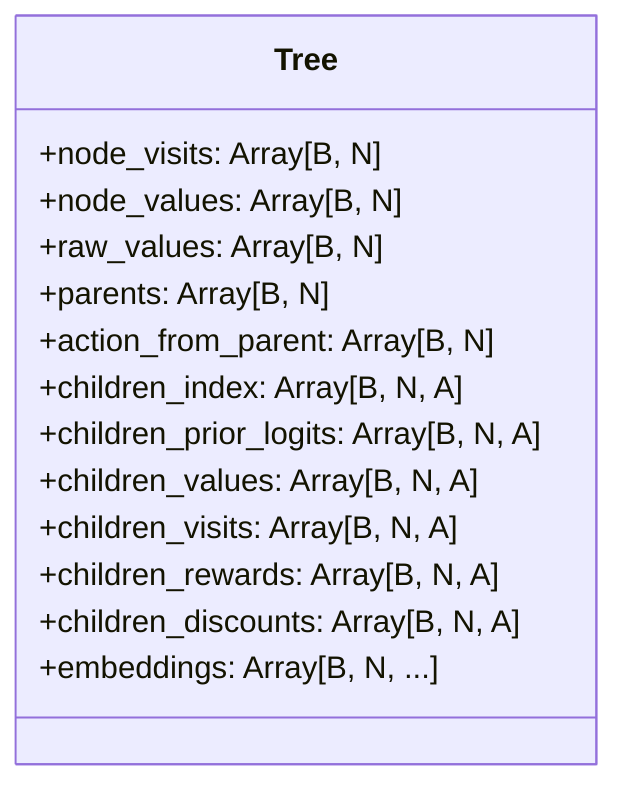
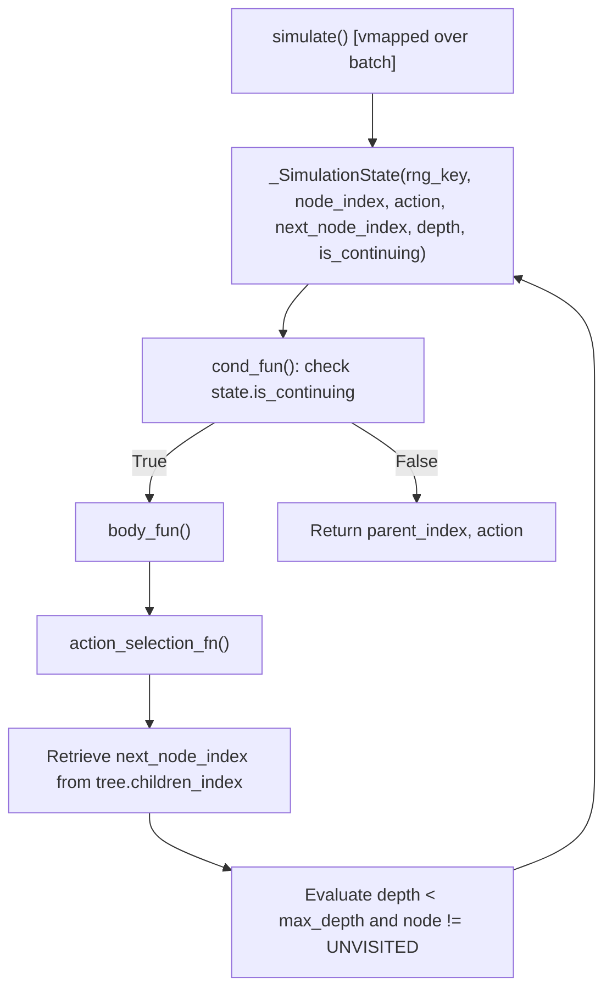

<!-- source: DeepWiki mcp.deepwiki.com · repo google-deepmind/mctx · page 5.1 Search Implementation · fetched 2026-10-26 -->

# Search Implementation

Relevant source files

The following files were used as context for generating this wiki page:

- [mctx/_src/search.py](mctx/_src/search.py)

This document details the internal implementation of the Monte Carlo Tree Search (MCTS) algorithm in the `mctx` library [mctx/_src/search.py:15](). It focuses specifically on how the core search algorithm is structured and executed, covering simulation, expansion, and backpropagation steps within a batched JAX loop. For details on specific policy variants, see [Policy Implementations](#5.2).

## Overview of Search Algorithm

The `mctx` library implements a batched version of MCTS designed for JAX's functional paradigm, enabling hardware acceleration and automatic differentiation across multiple search instances simultaneously. The core routine follows these phases:

1. **Tree Initialization**: Instantiation of search storage via root data (`RootFnOutput`) [mctx/_src/search.py:109-111]().
2. **Simulation Loop**: Executed via a loop construct (`loop_fn`, defaulting to `jax.lax.fori_loop`) [mctx/_src/search.py:43]() over `num_simulations` [mctx/_src/search.py:61](). Each iteration performs:
   - **Selection (`simulate`)**: Traverses the tree from root to an unvisited node or `max_depth` using an action selection wrapper [mctx/_src/search.py:93-94]().
   - **Expansion (`expand`)**: Evaluates leaf node dynamics using `recurrent_fn` and adds a new node [mctx/_src/search.py:100-103]().
   - **Backpropagation (`backward`)**: Updates node values and visit counts up the tree path [mctx/_src/search.py:104]().

Sources: [mctx/_src/search.py:31-115]()

## Search Function and Execution Flow

The main entry point is the `search` function [mctx/_src/search.py:31](), which sets up action selection wrappers, initializes the tree, and runs the simulation loop.

### Search Execution Flow (Code Entity Mapping)

Sources: [mctx/_src/search.py:31-115]()

The `search` function signature accepts `params`, `rng_key`, `root`, `recurrent_fn`, `root_action_selection_fn`, `interior_action_selection_fn`, `num_simulations`, `max_depth`, `invalid_actions`, `extra_data`, and `loop_fn` [mctx/_src/search.py:31-43]().

Sources: [mctx/_src/search.py:31-115]()

## Tree Data Structure

The tree state during search is represented by the `Tree` dataclass (alias `Tree = tree_lib.Tree`) [mctx/_src/search.py:25-27](), storing batched arrays across batch dimension `B` and node dimension `N`.

Sources: [mctx/_src/search.py:25-27]()

## Detailed Search Phases

### 1. Simulation Phase

The simulation step traverses the tree starting from the root until reaching an unvisited action or `max_depth` [mctx/_src/search.py:134-137](). It is implemented via the `simulate` function decorated with `jax.vmap` [mctx/_src/search.py:128-129]().

### Simulation State Machine and Code Entities

Sources: [mctx/_src/search.py:118-170]()

The simulation loop state is encapsulated in `_SimulationState` [mctx/_src/search.py:118-126](), tracking the `rng_key`, current `node_index`, chosen `action`, `next_node_index`, search `depth`, and `is_continuing` boolean flag [mctx/_src/search.py:120-125]().

Sources: [mctx/_src/search.py:118-170]()

### 2. Expansion Phase

The expansion step calls `expand` [mctx/_src/search.py:100]() which invokes the user-provided `recurrent_fn` [mctx/_src/search.py:36]() using the state embedding and selected action, appending a newly discovered node into the `Tree` arrays.

Sources: [mctx/_src/search.py:31-115]()

### 3. Backpropagation Phase

The backpropagation step invokes `backward` [mctx/_src/search.py:104]() to propagate values, visit counts, and reward accumulations from the newly expanded leaf node back up to the root along the traversal path recorded in `parents` and `action_from_parent`.

Sources: [mctx/_src/search.py:31-115]()

## Batched Operations and JAX Integration

The entire search loop operates within JAX transformations. `simulate`, `expand`, and `backward` leverage `jax.vmap` across the batch dimension `B`. The simulation loop itself is driven by `loop_fn` (defaulting to `jax.lax.fori_loop`) [mctx/_src/search.py:43](), which ensures that JAX can compile the entire search process into static XLA graphs when wrapped in `jax.jit`.

Sources: [mctx/_src/search.py:31-115]()

## Summary

The `mctx` search implementation couples a functional loop structure with vmapped tree operations in JAX:
1. `search()` orchestrates initialization and the simulation loop [mctx/_src/search.py:31-115]().
2. `simulate()` traverses unvisted nodes via `_SimulationState` and `action_selection_fn` [mctx/_src/search.py:127-170]().
3. `expand()` and `backward()` manage tree growth and value propagation.

Sources: [mctx/_src/search.py:31-170]()

---

