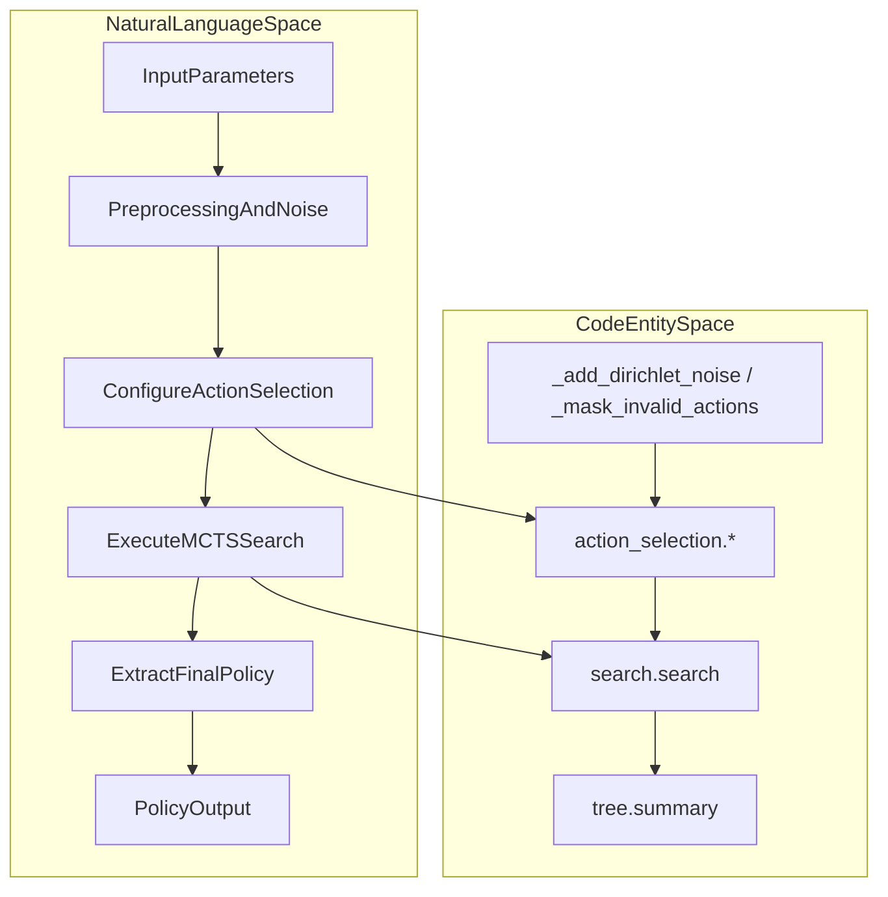
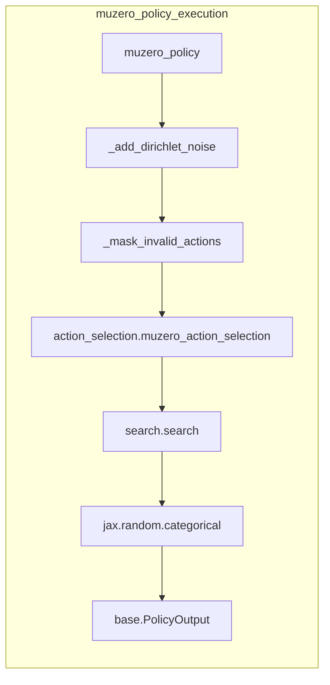
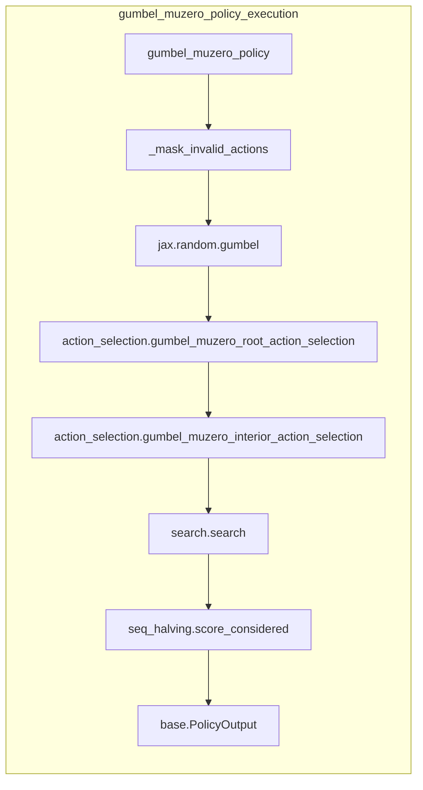
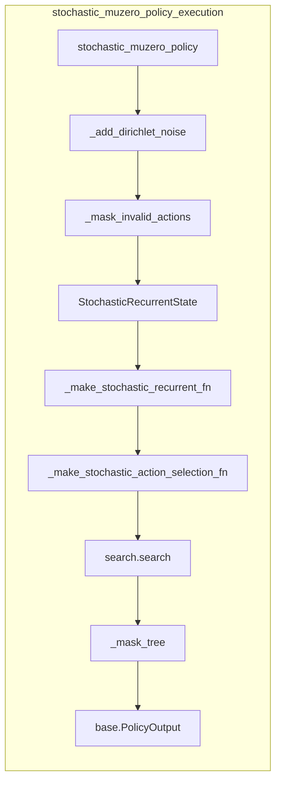
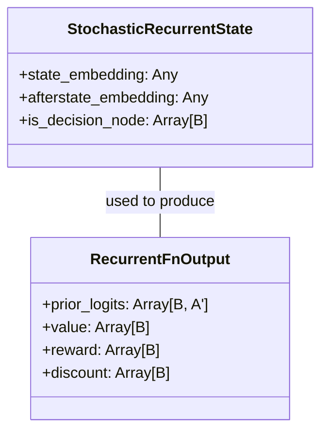

<!-- source: DeepWiki mcp.deepwiki.com · repo google-deepmind/mctx · page 5.2 Policy Implementations · fetched 2026-10-26 -->

# Policy Implementations

<details>
<summary>Relevant source files</summary>

The following files were used as context for generating this wiki page:

- [mctx/_src/policies.py](mctx/_src/policies.py)

</details>


This document provides a technical overview of the policy implementations in the `mctx` library [mctx/_src/policies.py:15](). The policies determine how Monte Carlo Tree Search (MCTS) is executed and how actions are selected based on search results. For information about the underlying search mechanism used by these policies, see [Search Implementation](#5.1).

`mctx` implements three distinct policy variants, each with specific strengths and application domains:
1. **Standard MuZero Policy** (`muzero_policy`) — The classic MuZero algorithm with PUCT action selection [mctx/_src/policies.py:30]()
2. **Gumbel MuZero Policy** (`gumbel_muzero_policy`) — An improved variant with Gumbel noise and Sequential Halving [mctx/_src/policies.py:125]()
3. **Stochastic MuZero Policy** (`stochastic_muzero_policy`) — A variant designed for environments with stochastic transitions [mctx/_src/policies.py:234]()

## Policy Structure Overview



Sources: [mctx/_src/policies.py:30-371]()

## Standard MuZero Policy

The standard MuZero policy (`muzero_policy`) implements the original MuZero algorithm as described in the MuZero paper. It uses PUCT (Predictor + Upper Confidence bound applied to Trees) for action selection and adds Dirichlet noise at the root to encourage exploration [mctx/_src/policies.py:30-45]().



Sources: [mctx/_src/policies.py:30-122]()

### Key Components

The function signature defines the required parameters and optional configurations:

```python
def muzero_policy(
    params: base.Params,
    rng_key: chex.PRNGKey,
    root: base.RootFnOutput,
    recurrent_fn: base.RecurrentFn,
    num_simulations: int,
    invalid_actions: Optional[chex.Array] = None,
    max_depth: Optional[int] = None,
    loop_fn: base.LoopFn = jax.lax.fori_loop,
    *,
    qtransform: base.QTransform = qtransforms.qtransform_by_parent_and_siblings,
    dirichlet_fraction: chex.Numeric = 0.25,
    dirichlet_alpha: chex.Numeric = 0.3,
    pb_c_init: chex.Numeric = 1.25,
    pb_c_base: chex.Numeric = 19652,
    temperature: chex.Numeric = 1.0) -> base.PolicyOutput[None]:
```

Sources: [mctx/_src/policies.py:30-45]()

The execution flow for `muzero_policy`:
1. Add Dirichlet noise to the root prior probabilities [mctx/_src/policies.py:83-88]()
2. Configure action selection functions using the PUCT formula [mctx/_src/policies.py:93-100]()
3. Run the search algorithm via `search.search` [mctx/_src/policies.py:101-111]()
4. Extract action weights from visit counts using `search_tree.summary()` [mctx/_src/policies.py:114-115]()
5. Apply temperature and sample the action [mctx/_src/policies.py:116-118]()

Sources: [mctx/_src/policies.py:30-122]()

## Gumbel MuZero Policy

The Gumbel MuZero policy (`gumbel_muzero_policy`) implements the algorithm from "Policy improvement by planning with Gumbel". It differentiates itself by using Sequential Halving with Gumbel noise at the root and deterministic action selection at interior nodes [mctx/_src/policies.py:125-148]().



Sources: [mctx/_src/policies.py:125-231]()

### Key Features

1. **Different action selection at root and interior nodes:**
   - Root: Sequential Halving with Gumbel noise [mctx/_src/policies.py:194-199]()
   - Interior: Deterministic selection using Q-values [mctx/_src/policies.py:200-203]()

2. **Limited action consideration:**
   - Considers only a subset of actions at the root controlled by `max_num_considered_actions` [mctx/_src/policies.py:136]()

3. **Gumbel noise for exploration:**
   - Adds Gumbel-distributed noise to prior logits for systematic exploration [mctx/_src/policies.py:182-185]()

Sources: [mctx/_src/policies.py:125-231]()

## Stochastic MuZero Policy

The Stochastic MuZero policy (`stochastic_muzero_policy`) extends MuZero to handle environments with stochastic transitions by introducing decision and chance nodes [mctx/_src/policies.py:234-371]().



Sources: [mctx/_src/policies.py:234-371]()

### Stochastic Recurrent State Structure



Sources: [mctx/_src/policies.py:321-324](), [mctx/_src/policies.py:466-469]()

## Common Helper Functions

All policy implementations rely on shared helper utilities:

| Function | Purpose | Source |
|----------|---------|--------|
| `_mask_invalid_actions` | Prevents selection of invalid actions by applying a mask | [mctx/_src/policies.py:374-384]() |
| `_add_dirichlet_noise` | Adds exploration noise to the root prior | [mctx/_src/policies.py:392-404]() |
| `_apply_temperature` | Controls the sharpness of action selection distribution | [mctx/_src/policies.py:407-412]() |
| `_get_logits_from_probs` | Converts probabilities to logits with numerical stability | [mctx/_src/policies.py:387-389]() |
| `_mask_tree` | Filters tree parts based on node type in stochastic search | [mctx/_src/policies.py:488-519]() |

Sources: [mctx/_src/policies.py:374-554]()

## Policy Comparison

| Feature | Standard MuZero | Gumbel MuZero | Stochastic MuZero |
|---------|----------------|---------------|-------------------|
| **Root Action Selection** | PUCT | Sequential Halving with Gumbel | PUCT (Decision Nodes) |
| **Interior Action Selection** | PUCT | Deterministic | PUCT / Probability-based |
| **Default Q-transform** | `qtransform_by_parent_and_siblings` | `qtransform_completed_by_mix_value` | `qtransform_by_parent_and_siblings` |
| **Exploration Noise** | Dirichlet | Gumbel | Dirichlet |
| **Environment Type** | Deterministic | Deterministic | Stochastic |

Sources: [mctx/_src/policies.py:30-371]()

---

