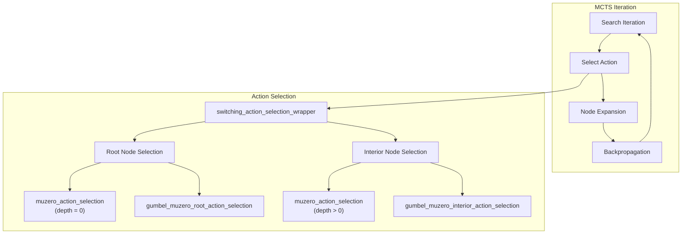
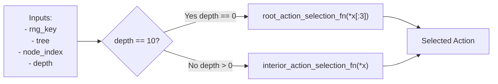
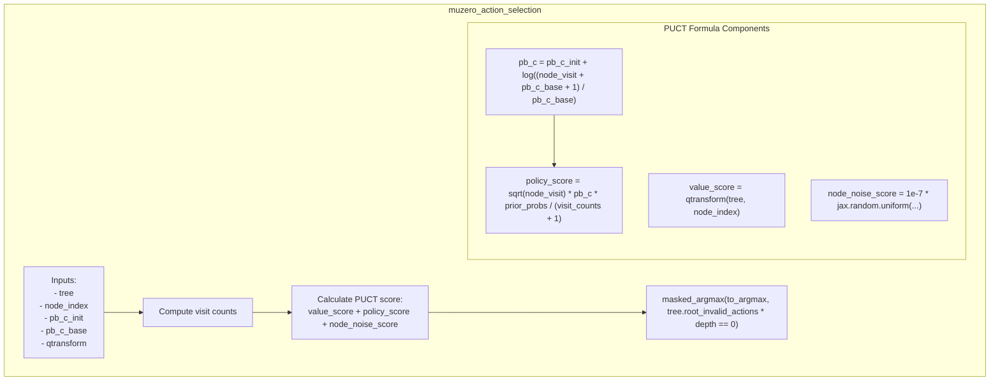
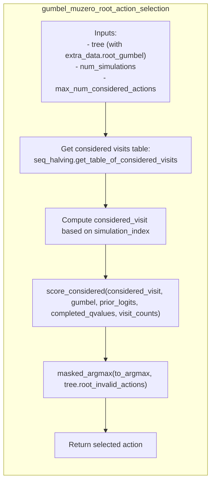
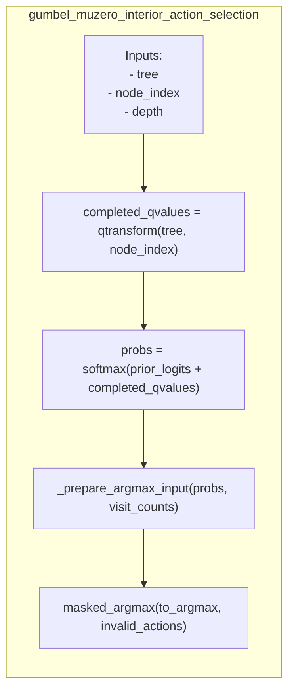

<!-- source: DeepWiki mcp.deepwiki.com · repo google-deepmind/mctx · page 5.3 Action Selection Mechanisms · fetched 2026-10-26 -->

# Action Selection Mechanisms

<details>
<summary>Relevant source files</summary>

The following files were used as context for generating this wiki page:

- [mctx/_src/action_selection.py](mctx/_src/action_selection.py)
- [mctx/_src/seq_halving.py](mctx/_src/seq_halving.py)

</details>


This page documents the action selection mechanisms implemented in the `mctx` library for Monte Carlo Tree Search (MCTS). These mechanisms determine how actions are selected during the search process, balancing exploration and exploitation to effectively build a search tree. For information about the overall search process, see [Search Implementation](#5.1), and for details on policy implementations, see [Policy Implementations](#5.2).

## Overview of Action Selection in MCTS

Action selection is a critical component of the MCTS algorithm, determining which nodes to expand during each simulation. The `mctx` library implements several action selection strategies optimized for different MCTS variants within `mctx/_src/action_selection.py`.



Sources: [mctx/_src/action_selection.py:28-45](), [mctx/_src/action_selection.py:48-93](), [mctx/_src/action_selection.py:105-161](), [mctx/_src/action_selection.py:163-180]().

## Root vs. Interior Action Selection

MCTS typically uses different action selection strategies at the root node versus interior nodes:

1. **Root Node Selection**: Often employs more exploratory methods or sophisticated batch sampling schemes since the root receives many more visits.
2. **Interior Node Selection**: Typically more focused on exploitation of known good paths or recursive tree traversal.

The `switching_action_selection_wrapper` function in `mctx/_src/action_selection.py` provides a conditional wrapper using `jax.lax.cond` to switch between root and interior selection based on node depth:



Sources: [mctx/_src/action_selection.py:28-45]().

## MuZero Action Selection

### PUCT Algorithm

The standard MuZero action selection implemented in `muzero_action_selection` uses the PUCT (Polynomial Upper Confidence Trees) formula, which balances exploration and exploitation:



Where:
- `node_visit` = parent node visit count
- `visit_counts` = child visit counts (`tree.children_visits[node_index]`)
- `prior_probs` = softmax of prior logits (`tree.children_prior_logits[node_index]`)
- `pb_c_init`, `pb_c_base` = exploration constants

Sources: [mctx/_src/action_selection.py:48-93]().

### Implementation Details

The `muzero_action_selection` function combines:

1. Value component: Transformed Q-values via `qtransform` indicating expected returns [mctx/_src/action_selection.py:84]()
2. Policy component: Prior probabilities weighted by visit count-based exploration term [mctx/_src/action_selection.py:79-80]()
3. Noise component: Small random noise (`1e-7 * jax.random.uniform`) for tie-breaking [mctx/_src/action_selection.py:87-89]()

Key parameters:
- `pb_c_init` (default: `1.25`): Controls exploration strength [mctx/_src/action_selection.py:54]()
- `pb_c_base` (default: `19652.0`): Controls how quickly exploration decays with visits [mctx/_src/action_selection.py:55]()
- `qtransform`: Function to normalize Q-values (default: `qtransforms.qtransform_by_parent_and_siblings`) [mctx/_src/action_selection.py:56]()

Sources: [mctx/_src/action_selection.py:48-93]().

## Gumbel MuZero Action Selection

Gumbel MuZero employs different selection strategies for root and interior nodes.

### Root Action Selection with Sequential Halving

For root nodes, Gumbel MuZero uses Sequential Halving with Gumbel noise for efficient exploration, implemented in `gumbel_muzero_root_action_selection`:



The `gumbel_muzero_root_action_selection` function:
1. Extracts pre-sampled Gumbel noise from `tree.extra_data.root_gumbel` [mctx/_src/action_selection.py:95-99](), [mctx/_src/action_selection.py:154]()
2. Computes a table of considered visits using `seq_halving.get_table_of_considered_visits` [mctx/_src/action_selection.py:142-143]()
3. Scores actions using `seq_halving.score_considered` based on prior logits, completed Q-values, Gumbel noise, and visit counts [mctx/_src/action_selection.py:155-157]()
4. Returns the highest-scoring valid action via `masked_argmax` [mctx/_src/action_selection.py:160]()

Sequential Halving efficiently allocates simulation budget by focusing on the most promising actions according to Karnin et al. (2013) [mctx/_src/seq_halving.py:36-42]().

Sources: [mctx/_src/action_selection.py:95-161](), [mctx/_src/seq_halving.py:36-70]().

### Interior Action Selection

For interior nodes, Gumbel MuZero uses a deterministic selection strategy implemented in `gumbel_muzero_interior_action_selection`:



The interior action selection produces visitation frequencies that approximate `softmax(prior_logits + qvalues)` over multiple simulation visits.

Sources: [mctx/_src/action_selection.py:163-180]().

## Selection Mechanism Integration

The action selection mechanisms are integrated into the MCTS search functions and high-level policies.

```mermaid
classDiagram
    class "search()" {
        +action_selection_fn: Function
    }
    
    class "muzero_policy()" {
        +uses muzero_action_selection
    }
    
    class "gumbel_muzero_policy()" {
        +uses switching_action_selection_wrapper
    }
    
    class "muzero_action_selection()" {
        +PUCT formula
    }
    
    class "gumbel_muzero_root_action_selection()" {
        +Sequential Halving
        +Gumbel noise
    }
    
    class "gumbel_muzero_interior_action_selection()" {
        +Deterministic selection
    }
    
    "search()" --> "muzero_action_selection()"
    "search()" --> "gumbel_muzero_root_action_selection()"
    "search()" --> "gumbel_muzero_interior_action_selection()"
    
    "muzero_policy()" --> "muzero_action_selection()"
    "gumbel_muzero_policy()" --> "switching_action_selection_wrapper"
    "switching_action_selection_wrapper" --> "gumbel_muzero_root_action_selection()"
    "switching_action_selection_wrapper" --> "gumbel_muzero_interior_action_selection()"
```

Sources: [mctx/_src/action_selection.py:28-180]().

## Summary Table

| Mechanism | Policy / Context | Key Features & Formulas |
|-----------|------------------|-------------------------|
| `muzero_action_selection` | Standard MuZero (Root & Interior) | PUCT score (`value_score + policy_score`), noise tie-breaking [mctx/_src/action_selection.py:48-93]() |
| `gumbel_muzero_root_action_selection` | Gumbel MuZero (Root) | Sequential Halving schedule, Gumbel noise, `score_considered` [mctx/_src/action_selection.py:105-161]() |
| `gumbel_muzero_interior_action_selection` | Gumbel MuZero (Interior) | Deterministic selection approximating target policy [mctx/_src/action_selection.py:163-180]() |
| `switching_action_selection_wrapper` | Conditional wrapper | Switches between root and interior based on `depth == 0` [mctx/_src/action_selection.py:28-45]() |

Sources: [mctx/_src/action_selection.py:28-180]().

---

