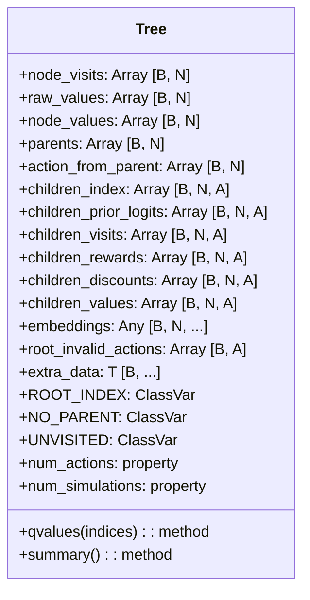
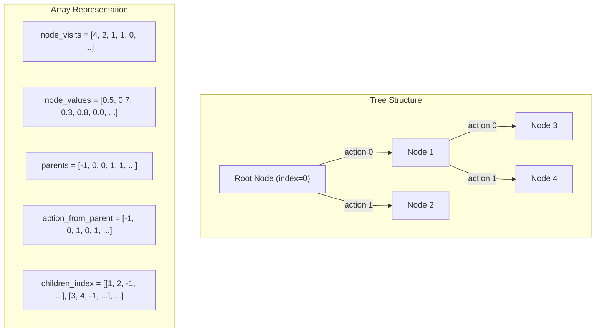
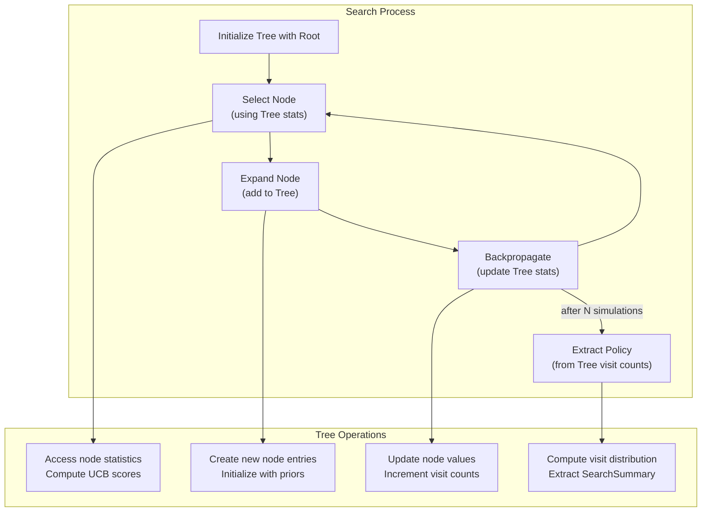

<!-- source: DeepWiki mcp.deepwiki.com · repo google-deepmind/mctx · page 5.4 Tree Data Structure Implementation · fetched 2026-10-26 -->

# Tree Data Structure Implementation

<details>
<summary>Relevant source files</summary>

The following files were used as context for generating this wiki page:

- [mctx/_src/tree.py](mctx/_src/tree.py)

</details>


This document details the internal implementation of the search tree data structure in the MCTX library. It focuses on the technical implementation of the `Tree` class (`mctx/_src/tree.py`), which is the core data structure used to represent and manage Monte Carlo search trees. For information on how to use the Tree API, see [Tree Data Structure](#3.4).

## Overview

The `Tree` class in MCTX is a JAX-compatible data structure that stores the state of a search tree during Monte Carlo Tree Search (MCTS) simulations. It is designed to:

1. Efficiently store tree nodes and their relationships
2. Support batched operations for parallel searches
3. Track search statistics (visits, values, rewards)
4. Provide methods to extract search results
5. Maintain state embeddings for each node

The implementation is optimized for JAX's functional programming model and supports operations like automatic differentiation and just-in-time compilation.

Sources: [mctx/_src/tree.py:15-16](), [mctx/_src/tree.py:29-58]()

## Structure and Representation

The `Tree` class is implemented as an immutable dataclass using `chex.dataclass` with the `frozen=True` parameter. This immutability aligns with JAX's functional programming model where data structures are not modified in place but rather replaced with new instances [mctx/_src/tree.py:28-29].



**Diagram: Tree Class Structure and Fields**

Sources: [mctx/_src/tree.py:29-72](), [mctx/_src/tree.py:76-79]()

### Array Dimensions and Notation

The Tree class uses a consistent dimensional structure across its fields:
- `B`: Batch dimension (supporting multiple parallel searches)
- `N`: Node dimension (total number of nodes in the tree)
- `A`: Action dimension (number of possible actions from each node)

The class maintains several arrays with different dimensions:
- `[B, N]` arrays: Node-level information (visits, values, parent indices)
- `[B, N, A]` arrays: Action-specific information (children indices, rewards, prior probabilities)

Sources: [mctx/_src/tree.py:32-37]()

## Key Fields

The `Tree` dataclass contains the following key fields:

| Field | Shape | Description |
|-------|-------|-------------|
| `node_visits` | `[B, N]` | Visit counts for each node [mctx/_src/tree.py:37] |
| `raw_values` | `[B, N]` | Raw value predictions for each node [mctx/_src/tree.py:38] |
| `node_values` | `[B, N]` | Cumulative search values for each node [mctx/_src/tree.py:39] |
| `parents` | `[B, N]` | Index of the parent for each node [mctx/_src/tree.py:40] |
| `action_from_parent` | `[B, N]` | Action taken from parent to reach this node [mctx/_src/tree.py:41-42] |
| `children_index` | `[B, N, A]` | Node indices for children of each action [mctx/_src/tree.py:43-44] |
| `children_prior_logits` | `[B, N, A]` | Action prior logits for each node [mctx/_src/tree.py:45-46] |
| `children_visits` | `[B, N, A]` | Visit counts for children of each action [mctx/_src/tree.py:47-48] |
| `children_rewards` | `[B, N, A]` | Immediate rewards for each action [mctx/_src/tree.py:49] |
| `children_discounts` | `[B, N, A]` | Discount factors for each action [mctx/_src/tree.py:50-51] |
| `children_values` | `[B, N, A]` | Values of the next node after each action [mctx/_src/tree.py:52-53] |
| `embeddings` | `[B, N, ...]` | State embeddings for each node [mctx/_src/tree.py:54] |
| `root_invalid_actions` | `[B, A]` | Mask for invalid actions at the root (1 = invalid) [mctx/_src/tree.py:55-56] |
| `extra_data` | `[B, ...]` | Additional data passed to the search [mctx/_src/tree.py:57] |

Sources: [mctx/_src/tree.py:37-57](), [mctx/_src/tree.py:59-72]()

## Class Constants

The Tree class defines three important class variables (constants):

| Constant | Value | Description |
|----------|-------|-------------|
| `ROOT_INDEX` | `0` | Index of the root node in the tree [mctx/_src/tree.py:76] |
| `NO_PARENT` | `-1` | Special value indicating a node has no parent [mctx/_src/tree.py:77] |
| `UNVISITED` | `-1` | Special value for unvisited nodes [mctx/_src/tree.py:78] |

Sources: [mctx/_src/tree.py:76-79]()

## Tree Representation in Memory

The Tree data structure uses a compact, array-based representation where nodes are stored in arrays with fixed indices. This approach provides efficient access and manipulation while working with JAX's functional paradigm.



**Diagram: Tree Memory Representation**

In this representation:
- Each node has a fixed index in the arrays (`0` for root, `1` for first child, etc.) [mctx/_src/tree.py:76]
- Parent-child relationships are stored through indices rather than pointers [mctx/_src/tree.py:40,43]
- Unvisited or non-existent nodes/edges are represented with special values (like `-1`) [mctx/_src/tree.py:77-78]

Sources: [mctx/_src/tree.py:29-79]()

## Methods and Properties

The Tree class provides several methods and properties to access and manipulate the tree data:

### Properties

1. `num_actions`: Returns the number of possible actions from each node [mctx/_src/tree.py:81-82].
   ```python
   @property
   def num_actions(self):
     return self.children_index.shape[-1]
   ```

2. `num_simulations`: Returns the number of simulation steps performed (`nodes - 1`) [mctx/_src/tree.py:85-86].
   ```python
   @property
   def num_simulations(self):
     return self.node_visits.shape[-1] - 1
   ```

Sources: [mctx/_src/tree.py:80-86]()

### Methods

1. `qvalues(indices)`: Computes Q-values for specified nodes in the tree [mctx/_src/tree.py:88-93].
   - Handles both scalar and array indices through `jax.vmap` [mctx/_src/tree.py:90-91]
   - Q-values are computed as immediate reward + discounted future value via `_unbatched_qvalues` [mctx/_src/tree.py:136-143]

2. `summary()`: Extracts summary statistics for the root node [mctx/_src/tree.py:95-115].
   - Returns visit counts, visit probabilities, state value, and Q-values [mctx/_src/tree.py:110-114]
   - Returns these in a `SearchSummary` dataclass [mctx/_src/tree.py:110,128-134]

Sources: [mctx/_src/tree.py:88-116](), [mctx/_src/tree.py:128-134](), [mctx/_src/tree.py:137-142]()

## Tree Integration with Search Process

The Tree data structure is central to the MCTS algorithm's operation. Here's how it fits into the overall search process:



**Diagram: Tree's Role in Search Process**

During search:
1. The tree is initialized with a root node [mctx/_src/tree.py:76]
2. Selection uses tree statistics to compute UCB scores [mctx/_src/tree.py:37-39]
3. Expansion adds new nodes to the tree with prior probabilities [mctx/_src/tree.py:43-46]
4. Backpropagation updates node values and visit counts [mctx/_src/tree.py:37,39]
5. After all simulations, policy extraction uses visit counts to determine action probabilities [mctx/_src/tree.py:105-108]

Sources: [mctx/_src/tree.py:29-58](), [mctx/_src/tree.py:97-116]()

## Helper Functions

The file also defines helper functions that work with the Tree:

1. `infer_batch_size(tree)`: Recovers the batch size from a `Tree` instance [mctx/_src/tree.py:117-122].
   - Ensures the tree is batched (`node_values` has dimension 2) [mctx/_src/tree.py:119-120]
   - Verifies consistent batch dimensions across all tree fields [mctx/_src/tree.py:121]

2. `_unbatched_qvalues(tree, index)`: Helper function to compute Q-values for an unbatched tree [mctx/_src/tree.py:136-143].
   - Used internally by the `qvalues` method [mctx/_src/tree.py:91,93]
   - Computes $Q = \text{reward} + \text{discount} \times \text{value}$ [mctx/_src/tree.py:138-143]

Sources: [mctx/_src/tree.py:118-123](), [mctx/_src/tree.py:137-142]()

## SearchSummary Dataclass

The tree module also defines a `SearchSummary` dataclass that contains aggregate statistics extracted from the search [mctx/_src/tree.py:127-134]:

```python
@chex.dataclass(frozen=True)
class SearchSummary:
  """Stats from MCTS search."""
  visit_counts: chex.Array
  visit_probs: chex.Array
  value: chex.Array
  qvalues: chex.Array
```

This dataclass is returned by the `summary()` method of the Tree class and provides a compact representation of the search results at the root node [mctx/_src/tree.py:95-115,128-134].

Sources: [mctx/_src/tree.py:128-134]()

## Design Considerations and Implementation Details

Several design choices in the Tree implementation are worth noting:

1. **Immutable Structure**: The Tree is immutable (frozen dataclass), which aligns with JAX's functional programming model and enables efficient JIT compilation [mctx/_src/tree.py:28-29].

2. **Batched Operations**: The entire structure supports batched operations, allowing multiple searches to be performed in parallel for improved efficiency [mctx/_src/tree.py:32-35].

3. **Fixed-Size Arrays**: The tree uses fixed-size arrays with special values (`-1`) to indicate unvisited or non-existent nodes, which allows for efficient representation in JAX [mctx/_src/tree.py:43,77-78].

4. **Computation Efficiency**: Methods like `qvalues` use `jax.vmap` to vectorize operations across multiple nodes, improving computational efficiency [mctx/_src/tree.py:88-93].

5. **Generic Type Parameter**: The Tree class uses a generic type parameter `T` for the `extra_data` field, allowing users to store custom data with the search tree [mctx/_src/tree.py:25,29,57].

Sources: [mctx/_src/tree.py:17-18](), [mctx/_src/tree.py:29](), [mctx/_src/tree.py:57](), [mctx/_src/tree.py:88-95]()

## Relationship to Other Components

The Tree data structure is used by multiple components in the MCTX library:

1. **Search Algorithm**: Uses the Tree to store the state of the search and make decisions about node expansion.

2. **Action Selection**: Uses node values, visit counts, and prior probabilities from the Tree to select actions.

3. **Policy Implementation**: Extracts final policy outputs from the Tree's visit statistics.

4. **Q-Value Transformations**: Transform raw values stored in the Tree to improve search performance.

The Tree serves as the central data repository that connects these components together.

Sources: [mctx/_src/tree.py:29-58](), [mctx/_src/tree.py:95-115]()

---

