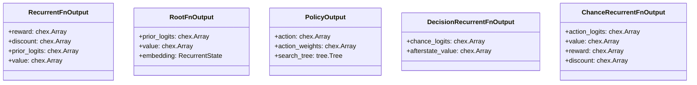
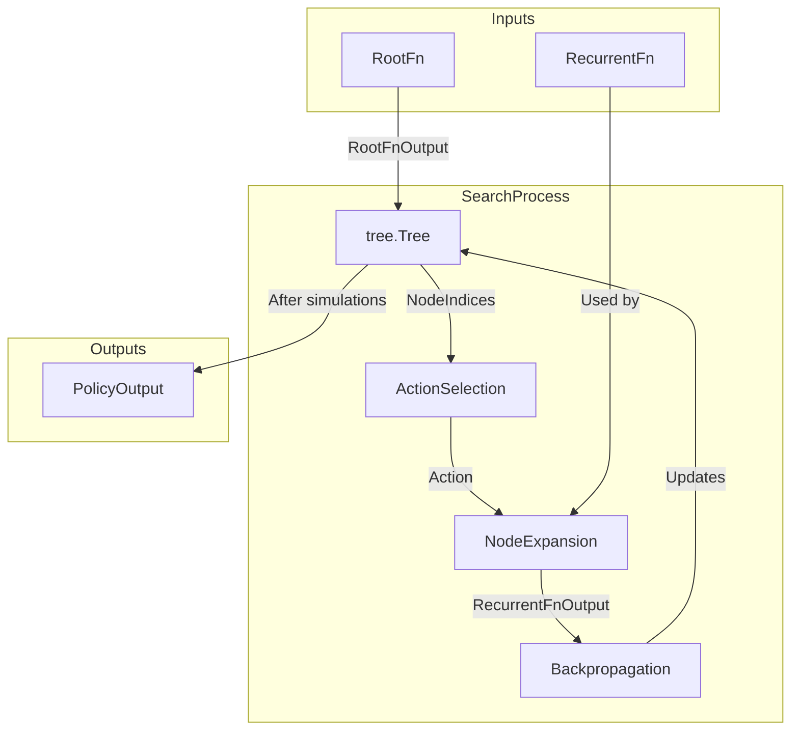
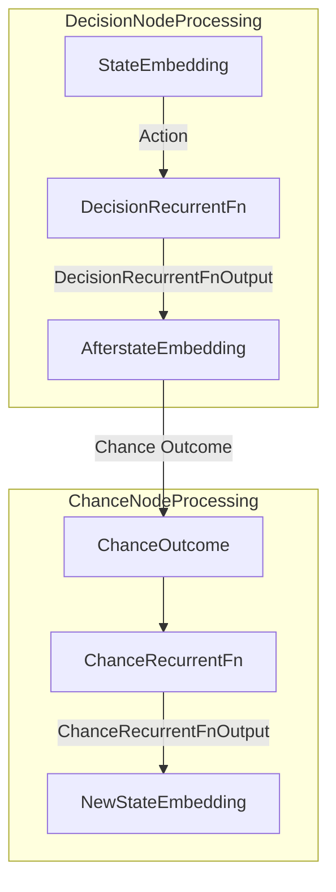

<!-- source: DeepWiki mcp.deepwiki.com · repo google-deepmind/mctx · page 5.5 Type System · fetched 2026-10-26 -->

# Type System

<details>
<summary>Relevant source files</summary>

The following files were used as context for generating this wiki page:

- [mctx/_src/base.py](mctx/_src/base.py)

</details>


## Purpose and Scope

This document details the type system used throughout the mctx library, which provides a structured foundation for implementing Monte Carlo Tree Search (MCTS) algorithms in JAX. The type system defines the core data structures, function signatures, and interfaces that compose the library's architecture. Understanding these types is essential for both using the library effectively and extending it with custom implementations.

For information about the implementation of specific algorithms built on top of this type system, see [Policy Implementations](#5.2) and [Action Selection Mechanisms](#5.3).

Sources: [mctx/_src/base.py:15-15]()

## Core Type Overview

The mctx library uses a carefully designed type system to ensure type safety and provide clear interfaces between components. The core types are defined in the `base.py` file and broadly fall into these categories:

1. **Basic Types**: Simple type aliases for commonly used data structures
2. **Function Types**: Type signatures for key functions in the MCTS process
3. **Output Types**: Dataclasses representing outputs from various functions
4. **State Types**: Types representing the state of the search process

```mermaid
classDiagram
    class "BasicTypes" {
        Params
        Action
        NodeIndices
        Depth
        RecurrentState
    }
    
    class "FunctionTypes" {
        RecurrentFn
        RootActionSelectionFn
        InteriorActionSelectionFn
        QTransform
        LoopFn
        DecisionRecurrentFn
        ChanceRecurrentFn
    }
    
    class "OutputTypes" {
        RecurrentFnOutput
        RootFnOutput
        PolicyOutput
        DecisionRecurrentFnOutput
        ChanceRecurrentFnOutput
    }
    
    class "StateTypes" {
        RecurrentState
        StochasticRecurrentState
    }
    
    "FunctionTypes" --> "OutputTypes" : "produces"
    "FunctionTypes" --> "StateTypes" : "manipulates"
    "BasicTypes" <-- "FunctionTypes" : "uses"
    "OutputTypes" --> "StateTypes" : "contains"
```

Sources: [mctx/_src/base.py:15-170]()

## Basic Types

The mctx library defines several type aliases for fundamental data structures used throughout the codebase:

| Type | Definition | Description |
|------|------------|-------------|
| `Params` | `chex.ArrayTree` | Arbitrary nested structures of arrays representing model parameters [mctx/_src/base.py:27-27]() |
| `Action` | `chex.Array` | Array representation of actions in the search space [mctx/_src/base.py:49-49]() |
| `NodeIndices` | `chex.Array` | Array of indices identifying nodes in the search tree [mctx/_src/base.py:70-70]() |
| `Depth` | `chex.Array` | Array representing depths in the search tree [mctx/_src/base.py:71-71]() |
| `RecurrentState` | `chex.ArrayTree` | Arbitrary tree of arrays representing state embeddings [mctx/_src/base.py:164-164]() |

Sources: [mctx/_src/base.py:25-27](), [mctx/_src/base.py:49-50](), [mctx/_src/base.py:70-71](), [mctx/_src/base.py:164-164]()

## Function Types

The library defines several function type signatures that are central to the MCTS algorithm:

```mermaid
flowchart LR
    subgraph "FunctionTypes"
        direction TB
        RecurrentFn["RecurrentFn"]
        RootActionSelect["RootActionSelectionFn"]
        InteriorActionSelect["InteriorActionSelectionFn"]
        QTransform["QTransform"]
        LoopFn["LoopFn"]
        DecisionRecurrentFn["DecisionRecurrentFn"]
        ChanceRecurrentFn["ChanceRecurrentFn"]
    end
    
    RecurrentFn --> RecurrentFnOutput
    RootActionSelect --> "Action selection at root"
    InteriorActionSelect --> "Action selection in tree"
    QTransform --> "Transform Q-values"
    LoopFn --> "Simulation control"
    DecisionRecurrentFn --> DecisionRecurrentFnOutput
    ChanceRecurrentFn --> ChanceRecurrentFnOutput
```

### RecurrentFn

The `RecurrentFn` is the function that models environment dynamics, taking an action and a state embedding, and producing the next state's information [mctx/_src/base.py:30-53]():

```python
RecurrentFn = Callable[
    [Params, chex.PRNGKey, Action, RecurrentState],
    Tuple[RecurrentFnOutput, RecurrentState]]
```

### Action Selection Functions

The library defines two types of action selection functions [mctx/_src/base.py:72-76]():

```python
RootActionSelectionFn = Callable[
    [chex.PRNGKey, tree.Tree, NodeIndices], chex.Array]

InteriorActionSelectionFn = Callable[
    [chex.PRNGKey, tree.Tree, NodeIndices, Depth],
    chex.Array]
```

### Other Function Types

- `QTransform`: Functions that transform raw Q-values in the search tree [mctx/_src/base.py:77-77]()
- `LoopFn`: Functions with the same interface as `jax.lax.fori_loop` for simulation control [mctx/_src/base.py:78-81]()
- `DecisionRecurrentFn` and `ChanceRecurrentFn`: Specialized recurrent functions for stochastic environments [mctx/_src/base.py:166-170]()

Sources: [mctx/_src/base.py:30-53](), [mctx/_src/base.py:70-81](), [mctx/_src/base.py:166-170]()

## Output Types

The library defines several dataclasses that represent outputs from various functions in the MCTS process:

### RecurrentFnOutput

Output from the recurrent function representing a transition in the environment [mctx/_src/base.py:33-46]():

```python
@chex.dataclass(frozen=True)
class RecurrentFnOutput:
  reward: chex.Array           # [B] reward from transition
  discount: chex.Array         # [B] discount factor
  prior_logits: chex.Array     # [B, num_actions] policy logits
  value: chex.Array            # [B] value estimate
```

### RootFnOutput

Output from the representation network at the root of the search [mctx/_src/base.py:56-66]():

```python
@chex.dataclass(frozen=True)
class RootFnOutput:
  prior_logits: chex.Array     # [B, num_actions] policy logits
  value: chex.Array            # [B] value estimate
  embedding: RecurrentState    # [B, ...] state embedding
```

### PolicyOutput

The final output of the search process [mctx/_src/base.py:86-99]():

```python
@chex.dataclass(frozen=True)
class PolicyOutput(Generic[T]):
  action: chex.Array           # [B] selected action
  action_weights: chex.Array   # [B, num_actions] refined policy
  search_tree: tree.Tree[T]    # [B, ...] final search tree
```

### Stochastic MuZero Types

For stochastic environments, additional output types are defined:
- `DecisionRecurrentFnOutput`: Output from expanding decision nodes [mctx/_src/base.py:102-118]()
- `ChanceRecurrentFnOutput`: Output from expanding chance nodes [mctx/_src/base.py:121-139]()



Sources: [mctx/_src/base.py:33-46](), [mctx/_src/base.py:56-66](), [mctx/_src/base.py:86-99](), [mctx/_src/base.py:102-139]()

## State Types

The library defines types to represent the state of the search process:

### RecurrentState

`RecurrentState` is defined as `chex.ArrayTree`, representing an arbitrary nested structure of arrays that captures the state of the environment [mctx/_src/base.py:50-50](), [mctx/_src/base.py:164-164]().

### StochasticRecurrentState

For stochastic environments, the library defines a specialized state type [mctx/_src/base.py:141-161]():

```python
@chex.dataclass(frozen=True)
class StochasticRecurrentState:
  state_embedding: chex.ArrayTree     # [B, ...] state embedding
  afterstate_embedding: chex.ArrayTree # [B, ...] afterstate embedding
  is_decision_node: chex.Array        # [B] node type indicator
```

This type allows different treatment of decision and chance nodes in stochastic environments.

Sources: [mctx/_src/base.py:50-50](), [mctx/_src/base.py:141-164]()

## Type System Integration with Search Process

To better understand how these types fit into the overall search process, the following diagram illustrates the flow of data through the MCTS algorithm:



Sources: [mctx/_src/base.py:15-170]()

## Type System for Stochastic Environments

The type system includes specialized components for handling stochastic environments in the Stochastic MuZero algorithm:



The `StochasticRecurrentState` dataclass enables this dual-node approach by tracking whether a node is a decision node or a chance node, along with the appropriate embeddings for each type [mctx/_src/base.py:141-161]().

Sources: [mctx/_src/base.py:102-170]()

## JAX Integration

The mctx type system is designed to work seamlessly with JAX's functional programming model:

1. All types use `chex.Array` for tensors, allowing automatic differentiation [mctx/_src/base.py:19-20]()
2. Function types use the `Callable` interface compatible with JAX transformations [mctx/_src/base.py:17-17]()
3. Dataclasses are frozen (immutable) to align with JAX's functional paradigm [mctx/_src/base.py:33-33]()
4. Batch dimensions are explicit in type documentation to facilitate vectorized operations [mctx/_src/base.py:37-41]()

This integration enables mctx to leverage JAX features such as just-in-time compilation, automatic differentiation, and hardware acceleration.

Sources: [mctx/_src/base.py:17-46]()

## Type System Benefits

The type system in mctx provides several key benefits:

1. **Type Safety**: Static type checking helps catch errors early in development
2. **Clear Interfaces**: Well-defined interfaces between components make the code easier to understand
3. **Modularity**: Types facilitate composable, modular design where components can be swapped out
4. **Documentation**: Types serve as self-documenting code, explaining the shape and structure of data
5. **Extensibility**: The type system makes it easier to extend the library with custom implementations

This type-driven approach contributes to the library's flexibility, allowing it to support multiple MCTS variants through a common interface.

Sources: [mctx/_src/base.py:15-170]()

---

