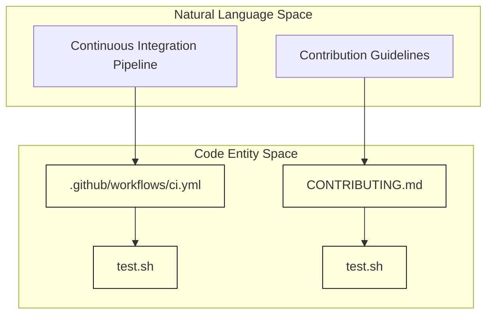
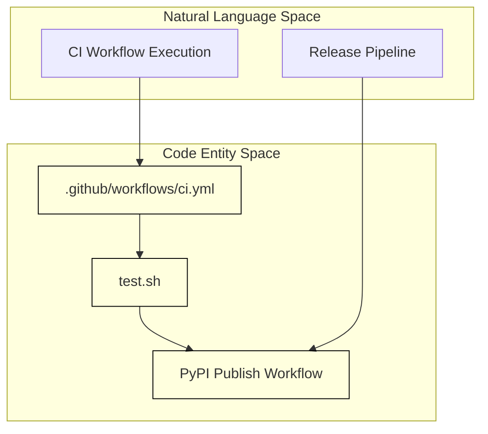

<!-- source: DeepWiki mcp.deepwiki.com · repo google-deepmind/mctx · page 6 Development and Contribution · fetched 2026-10-26 -->

# Development and Contribution

Relevant source files

The following files were used as context for generating this wiki page:

- [.github/workflows/ci.yml](.github/workflows/ci.yml)
- [CONTRIBUTING.md](CONTRIBUTING.md)

This page provides a high-level overview for developers who want to contribute to the `mctx` codebase. The library relies on standardized testing suites, strict linting rules, continuous integration pipelines, and contributor agreements to maintain code quality. 

For deep technical details, refer to the child pages covering testing procedures, contribution guidelines, and the CI/release infrastructure.

Sources: [.github/workflows/ci.yml:1-26](), [CONTRIBUTING.md:1-34]()

Sources: [.github/workflows/ci.yml:1-26](), [CONTRIBUTING.md:1-34]()

---

## Testing

The `mctx` test suite covers core functionalities including policies, tree manipulation, Q-value transformations, and sequential halving logic. Tests make use of golden JSON test data to verify correctness against expected search trajectories and outputs. Developers execute the local verification script to run checks before submitting patches.

For detailed information on test suites, golden JSON data, and local execution commands, see [Testing](#6.1).

Sources: [CONTRIBUTING.md:25-29]()

---

## Contributing Guidelines

Contributing to `mctx` requires adherence to specific community guidelines and code review workflows. All contributors must sign a Contributor License Agreement (CLA) before patches can be merged. Additionally, code submissions must satisfy quality standards enforced by linters like `flake8` and `pylint`.

For detailed information regarding the CLA, pull request procedures, and lint configurations, see [Contributing Guidelines](#6.2).

Sources: [CONTRIBUTING.md:1-34]()

---

## CI and Release Pipeline

Continuous integration for `mctx` is managed via GitHub Actions configurations defined in `.github/workflows/ci.yml`. The test runner executes `test.sh` across a matrix of supported Python versions on Ubuntu runners to catch regressions early. The release pipeline handles package distribution to PyPI following version validation checks.

For detailed information on the GitHub Actions matrix, test execution scripts, and PyPI publishing workflows, see [CI and Release Pipeline](#6.3).

Sources: [.github/workflows/ci.yml:1-26]()

Sources: [.github/workflows/ci.yml:1-26]()

---

