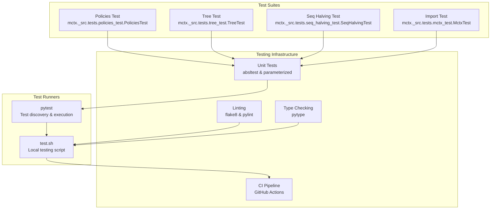
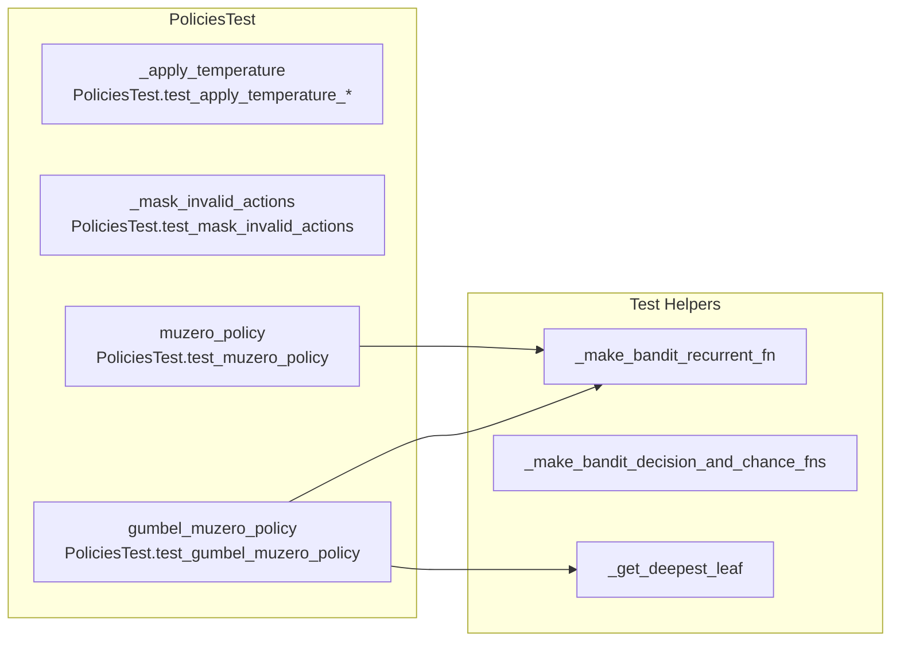
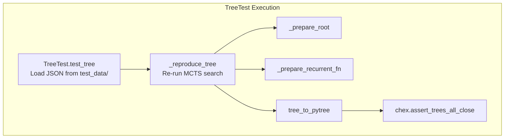
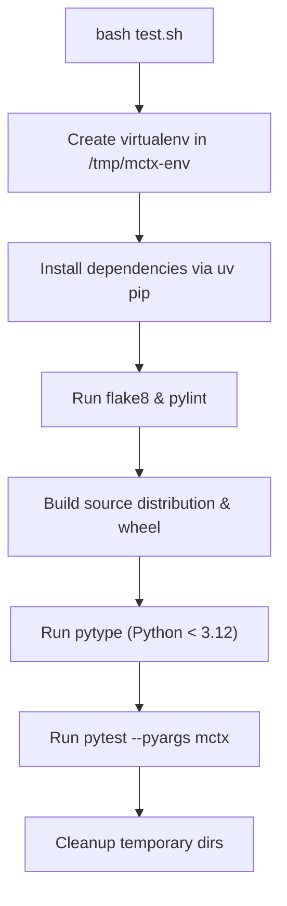

<!-- source: DeepWiki mcp.deepwiki.com · repo google-deepmind/mctx · page 6.1 Testing · fetched 2026-10-26 -->

# Testing

<details>
<summary>Relevant source files</summary>

The following files were used as context for generating this wiki page:

- [mctx/_src/tests/mctx_test.py](mctx/_src/tests/mctx_test.py)
- [mctx/_src/tests/policies_test.py](mctx/_src/tests/policies_test.py)
- [mctx/_src/tests/seq_halving_test.py](mctx/_src/tests/seq_halving_test.py)
- [mctx/_src/tests/test_data/muzero_tree.json](mctx/_src/tests/test_data/muzero_tree.json)
- [mctx/_src/tests/tree_test.py](mctx/_src/tests/tree_test.py)
- [test.sh](test.sh)

</details>


This document describes the testing infrastructure and practices used in the MCTX library. It covers test suites for policies, trees, Q-transforms, and sequential halving, golden JSON test data, and how to run the test suite via local scripts and continuous integration.

## 1. Testing Architecture

MCTX uses a comprehensive testing approach that combines unit tests, linting tools, and type checking to ensure code quality and correctness. The testing infrastructure is designed to work seamlessly with JAX's functional programming model and transformation functions.



Sources: [mctx/_src/tests/policies_test.py:98-362](), [mctx/_src/tests/tree_test.py:152-210](), [mctx/_src/tests/seq_halving_test.py:20-100](), [test.sh:16-67]()

## 2. Test Suites

The MCTX library organizes unit tests by component, with dedicated test modules for policies, search trees, Q-transform integrations, and sequential halving schedules.

### 2.1 Policy Tests

Policy tests verify that the different policy implementations (`muzero_policy`, `gumbel_muzero_policy`, and `stochastic_muzero_policy`) work correctly [mctx/_src/tests/policies_test.py:151-362](). These tests use artificial bandit environments with known rewards (`_make_bandit_recurrent_fn`) and decision/chance functions (`_make_bandit_decision_and_chance_fns`) to validate action selections and action weights [mctx/_src/tests/policies_test.py:28-70]().

Key test cases in `PoliciesTest` include:
- Temperature scaling validation via `_apply_temperature` for `temperature=1.0`, `2.0`, `0.0`, and large logits [mctx/_src/tests/policies_test.py:100-129]().
- Action masking validation via `_mask_invalid_actions` and handling of fully invalid action spaces [mctx/_src/tests/policies_test.py:130-150]().
- Policy simulations like `test_muzero_policy` and `test_gumbel_muzero_policy` [mctx/_src/tests/policies_test.py:151-254]().



Sources: [mctx/_src/tests/policies_test.py:28-95](), [mctx/_src/tests/policies_test.py:100-179]()

### 2.2 Tree Tests

Tree tests validate search tree construction against reference structures stored in golden JSON files [mctx/_src/tests/tree_test.py:15-172](). `TreeTest` loads expected trees, runs search reproduction using `_reproduce_tree()`, and compares the generated tree pytree with the expected structure using `chex.assert_trees_all_close()` [mctx/_src/tests/tree_test.py:152-172]().



Sources: [mctx/_src/tests/tree_test.py:32-88](), [mctx/_src/tests/tree_test.py:99-149](), [mctx/_src/tests/tree_test.py:152-210]()

### 2.3 Sequential Halving Tests

Sequential halving tests in `SeqHalvingTest` verify that `seq_halving.get_sequence_of_considered_visits` computes the correct visit allocations across simulation steps and action subsets [mctx/_src/tests/seq_halving_test.py:20-100](). Test cases cover:
- Minimum required simulations (`test_considered_min_sims`) [mctx/_src/tests/seq_halving_test.py:30-41]()
- Extra simulations (`test_considered_extra_sims`) [mctx/_src/tests/seq_halving_test.py:43-57]()
- Fewer simulations than rounds (`test_considered_less_sims`) [mctx/_src/tests/seq_halving_test.py:58-76]()
- Non-power-of-2 action spaces (`test_considered_not_power_of_2`) [mctx/_src/tests/seq_halving_test.py:77-87]()

Sources: [mctx/_src/tests/seq_halving_test.py:20-100]()

## 3. Golden JSON Test Data and Fixtures

Tree validation relies on golden JSON files located in `mctx/_src/tests/test_data/` [mctx/_src/tests/tree_test.py:157-165](). These files capture complete search tree structures, algorithm configurations, and environment configurations.

| JSON File Path | Algorithm | Q-Transform / Rescaling Config |
|----------------|-----------|--------------------------------|
| `mctx/_src/tests/test_data/muzero_tree.json` | MuZero | `qtransform_by_min_max` (no rescaling) [mctx/_src/tests/tree_test.py:158-159]() |
| `mctx/_src/tests/test_data/muzero_qtransform_tree.json` | MuZero | `qtransform_by_min_max` with bounds [mctx/_src/tests/tree_test.py:160-161]() |
| `mctx/_src/tests/test_data/gumbel_muzero_tree.json` | Gumbel MuZero | Standard Gumbel search tree [mctx/_src/tests/tree_test.py:162-163]() |
| `mctx/_src/tests/test_data/gumbel_muzero_reward_tree.json` | Gumbel MuZero | Gumbel search tree with reward values [mctx/_src/tests/test_data/gumbel_muzero_reward_tree.json](), [mctx/_src/tests/tree_test.py:164-165]() |

Sources: [mctx/_src/tests/tree_test.py:157-165](), [mctx/_src/tests/test_data/muzero_tree.json:1-17]()

## 4. Running Tests

The test suite can be executed locally using the provided shell script `test.sh`, which automates virtual environment setup, dependency installation, linting, package building, type checking, and pytest execution [test.sh:16-67]().

### 4.1 Local Execution via `test.sh`

Run the entire test and validation pipeline from the repository root:

```bash
bash test.sh
```



Sources: [test.sh:16-67]()

### 4.2 Direct Test Execution with Pytest

After installing the package and test dependencies, individual test modules can be executed directly with `pytest`:

```bash
pytest -xvs mctx/_src/tests/policies_test.py
pytest -xvs mctx/_src/tests/tree_test.py
pytest -xvs mctx/_src/tests/seq_halving_test.py
```

Sources: [test.sh:58-63]()

## 5. Continuous Integration

Continuous integration is handled via GitHub Actions workflow definitions (`.github/workflows/ci.yml`), running `test.sh` across multiple Python versions (3.10, 3.11, 3.12) on Linux environments.

Sources: [.github/workflows/ci.yml:1-26](), [test.sh:16-67]()

---

