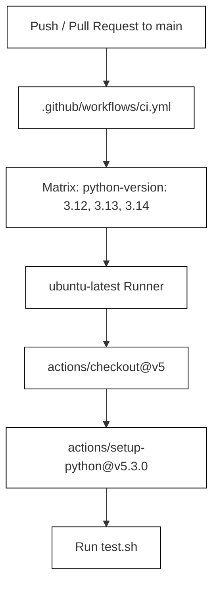
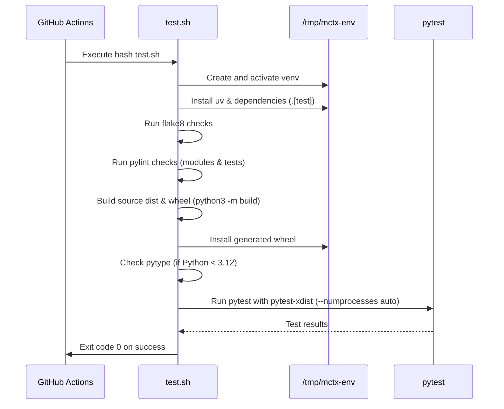
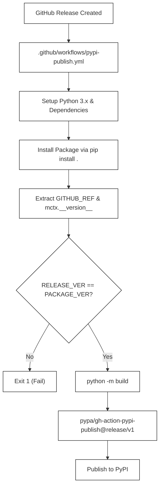

<!-- source: DeepWiki mcp.deepwiki.com · repo google-deepmind/mctx · page 6.3 CI and Release Pipeline · fetched 2026-10-26 -->

# CI and Release Pipeline

Relevant source files

The following files were used as context for generating this wiki page:

- [.github/workflows/ci.yml](.github/workflows/ci.yml)
- [.github/workflows/pypi-publish.yml](.github/workflows/pypi-publish.yml)
- [.gitignore](.gitignore)
- [test.sh](test.sh)

The purpose and scope of this page is to detail the continuous integration (CI) workflows, local test runner scripts, and PyPI release mechanisms used in the `mctx` repository. It covers the GitHub Actions configuration, test execution via `test.sh`, static analysis steps (such as `flake8`, `pylint`, and `pytype`), and automated version validation during deployment.

## GitHub Actions CI Matrix

The main continuous integration workflow is defined in `.github/workflows/ci.yml`. It triggers automatically on push and pull request events targeting the `main` branch. 

The workflow uses a matrix strategy to test across multiple Python versions (`3.12`, `3.13`, and `3.14`) on an `ubuntu-latest` runner environment. Each job sets up the requested Python version using `actions/setup-python@v5.3.0` and delegates the actual test execution to the local test script `test.sh`.

Sources: [.github/workflows/ci.yml:1-26]()

---

## Local and CI Test Script (`test.sh`)

The script `test.sh` orchestrates the full suite of dependency installation, static code analysis, packaging, type checking, and test execution within a temporary virtual environment (`/tmp/mctx-env`).

### Execution Flow in `test.sh`

1. **Virtual Environment Setup**: Cleans up and creates a virtual environment at `/tmp/mctx-env`, activating it for subsequent commands [test.sh:19-24]().
2. **Dependency Management**: Upgrades pip, installs `uv`, and uses `uv pip` to install development, testing, and editing dependencies (`.[test]`, `flake8`, `pytest-xdist`, `pylint`, `pylint-exit`) [test.sh:26-30]().
3. **Linting & Code Quality**:
   - Runs `flake8` targeting specific error codes (`E9`, `F63`, `F7`, `F82`, `E225`, `E251`) on all package files [test.sh:32-33]().
   - Runs `pylint` with `.pylintrc` separately on core modules (failing on errors, warnings, and conventions) and tests (disabling `protected-access` warnings via `-d W0212,R0917`) [test.sh:35-41]().
4. **Build Validation**: Builds source distributions and wheel packages using `python3 -m build` and installs them locally to verify packaging integrity [test.sh:43-47]().
5. **Type Checking**: Conditionally runs `pytype` on Python versions below 3.12 (as `pytype` has compatibility limits on Python 3.12+) [test.sh:49-56]().
6. **Test Suite Execution**: Changes directory into a temporary `_testing` folder to prevent importing directly from the repository root, and runs `pytest` across CPU cores using `pytest-xdist` (`--numprocesses auto`) [test.sh:58-64]().
7. **Cleanup**: Removes temporary build artifacts and test directories [test.sh:66-67]().

Sources: [test.sh:1-71]()

---

## PyPI Release Pipeline

The publishing workflow is specified in `.github/workflows/pypi-publish.yml`. It runs whenever a GitHub release is created (`types: [created]`).

### Key Steps and Version Consistency Check

1. **Environment Setup**: Checks out the repository and configures Python (`3.x`) [.github/workflows/pypi-publish.yml:13-17]().
2. **Build Dependencies**: Installs `setuptools`, `wheel`, `twine`, and `build` [.github/workflows/pypi-publish.yml:18-21]().
3. **Version Consistency Check**: Installs the current package locally, extracts the git tag reference (`GITHUB_REF`), compares it against `mctx.__version__`, and fails the pipeline if a mismatch is detected [.github/workflows/pypi-publish.yml:22-30]().
4. **Build and Publish**: Builds the distribution files and pushes them to PyPI using `pypa/gh-action-pypi-publish` with Trusted Publishing (`id-token: write`) [.github/workflows/pypi-publish.yml:31-35]().

Sources: [.github/workflows/pypi-publish.yml:1-35]()

---

