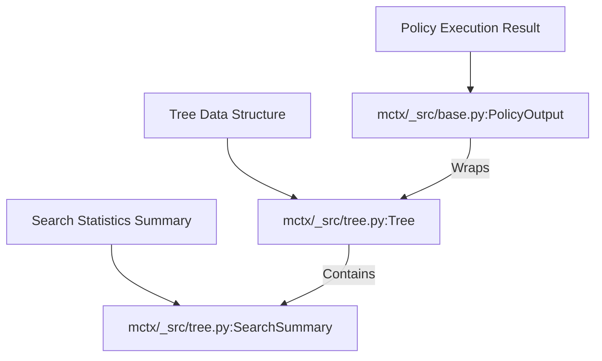
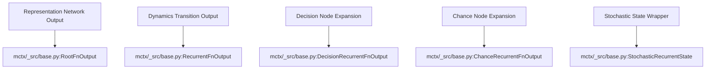
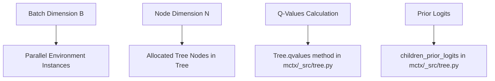

<!-- source: DeepWiki mcp.deepwiki.com · repo google-deepmind/mctx · page 7 Glossary · fetched 2026-10-26 -->

# Glossary

Relevant source files

The following files were used as context for generating this wiki page:

- [README.md](README.md)
- [mctx/__init__.py](mctx/__init__.py)
- [mctx/_src/base.py](mctx/_src/base.py)
- [mctx/_src/tree.py](mctx/_src/tree.py)

## Purpose and Scope

This page defines the core codebase-specific terms, domain concepts, and data structures used throughout the `mctx` library. It bridges high-level reinforcement learning and Monte Carlo Tree Search (MCTS) concepts with their concrete implementations and type definitions in the JAX-native codebase. 

---

## Core Data Structures & Types

### Tree
The central data structure holding search data for a batched set of inputs [mctx/_src/tree.py:29-35](). It maintains arrays representing node statistics, parent-child relationships, rewards, values, and environment embeddings across a batch dimension `B` and a node dimension `N`. Key fields include `node_visits`, `raw_values`, `node_values`, `parents`, `action_from_parent`, `children_index`, `children_prior_logits`, `children_visits`, `children_rewards`, `children_discounts`, `children_values`, `embeddings`, `root_invalid_actions`, and `extra_data` [mctx/_src/tree.py:59-72]().

### SearchSummary
A dataclass containing aggregate statistics and predictions extracted from the root of a finished search tree [mctx/_src/tree.py:125-134](). It includes `visit_counts`, `visit_probs`, `value`, and `qvalues` [mctx/_src/tree.py:128-134]().

### PolicyOutput
The primary return type of high-level policy functions (such as `muzero_policy`, `gumbel_muzero_policy`, and `stochastic_muzero_policy`) [mctx/_src/base.py:86-100](). It wraps the selected `action` `[B]`, the normalized `action_weights` `[B, num_actions]` used as targets for policy network training, and the final `search_tree` [mctx/_src/base.py:87-99]().

*Sources:* `mctx/_src/tree.py:29-73`, `mctx/_src/tree.py:125-134`, `mctx/_src/base.py:86-100`

---

## Model & Recurrent Function Interfaces

### RootFnOutput
The output structure produced by a representation or root network [mctx/_src/base.py:57-63](). It defines `prior_logits` `[B, num_actions]`, an estimated state `value` `[B]`, and state `embedding` `[B, ...]` [mctx/_src/base.py:64-66]().

### RecurrentFnOutput
The output of a standard MuZero dynamics transition function (`RecurrentFn`) [mctx/_src/base.py:33-47](). It contains the approximate `reward` `[B]`, transition `discount` `[B]`, policy `prior_logits` `[B, num_actions]`, and state `value` `[B]` after taking an action [mctx/_src/base.py:37-46]().

### DecisionRecurrentFnOutput & ChanceRecurrentFnOutput
Specialized outputs used in Stochastic MuZero [mctx/_src/base.py:102-139](). `DecisionRecurrentFnOutput` captures afterstate transitions with `chance_logits` `[B, C]` and `afterstate_value` `[B]` [mctx/_src/base.py:103-117](). `ChanceRecurrentFnOutput` captures chance outcome transitions producing `action_logits` `[B, A]`, `value` `[B]`, `reward` `[B]`, and `discount` `[B]` [mctx/_src/base.py:121-139]().

### StochasticRecurrentState
A wrapper container used in Stochastic MuZero to distinguish and hold embeddings for either decision nodes or chance nodes (`state_embedding`, `afterstate_embedding`, and `is_decision_node`) [mctx/_src/base.py:141-162]().

*Sources:* `mctx/_src/base.py:33-66`, `mctx/_src/base.py:102-162`

---

## Algorithmic & Search Terminology

### Batch Dimension (`B`)
The leading tensor dimension representing independent parallel environments and searches processed simultaneously via JAX vectorization and JIT compilation [mctx/_src/tree.py:33]().

### Node Dimension (`N`)
The secondary dimension in tree tensors representing allocated tree nodes, spanning from the root index (`0`) up to the maximum number of simulations [mctx/_src/tree.py:33]().

### Q-Values
The estimated return following a state-action pair, computed by combining immediate `children_rewards`, `children_discounts`, and successor node `children_values` [mctx/_src/tree.py:88-93]().

### Prior Logits
Unnormalized log-probabilities generated by a policy network over discrete actions, guiding the exploration policy during tree search expansion [mctx/_src/tree.py:45]().

*Sources:* `mctx/_src/tree.py:33-93`, `mctx/_src/tree.py:45`